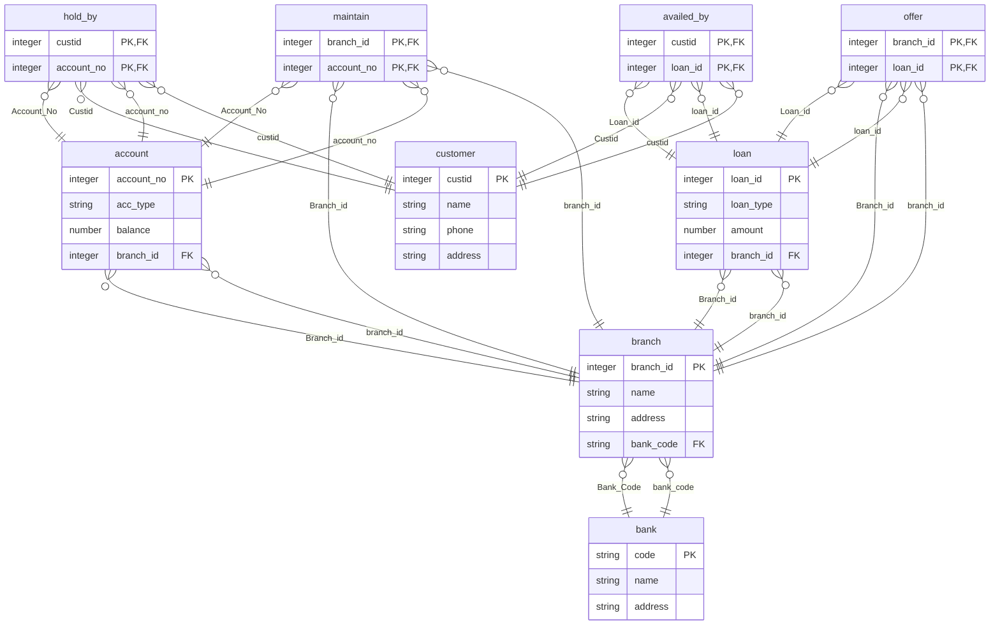
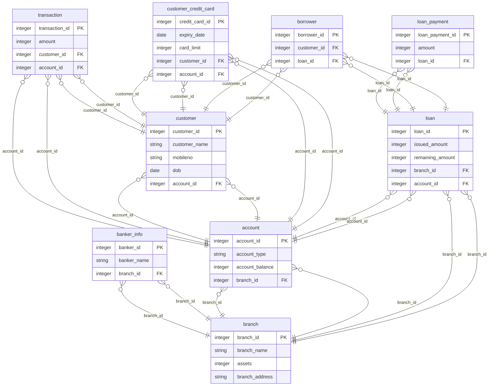
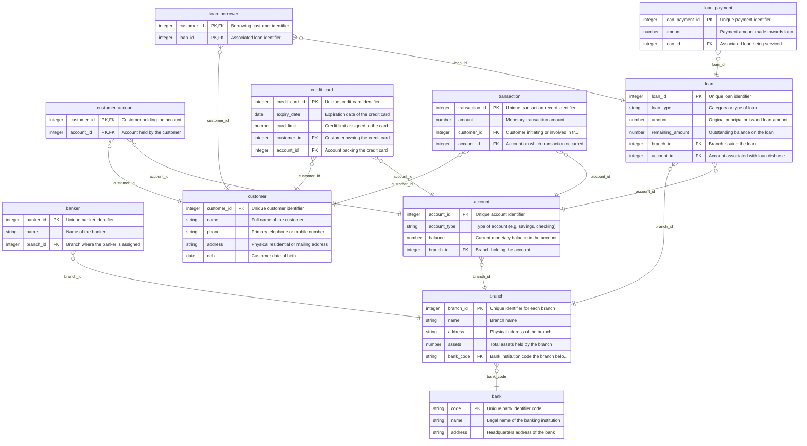
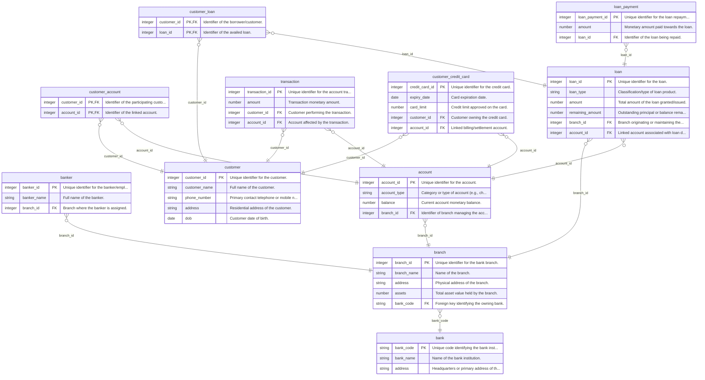
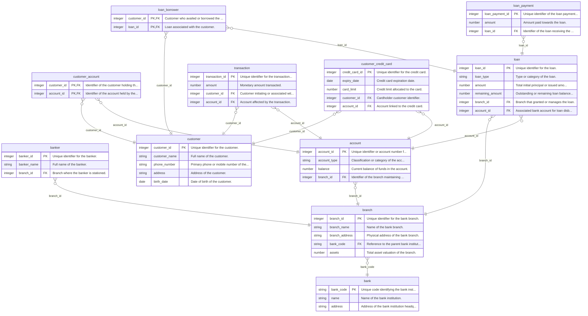

# Schema Alignment Diagnostic Report — bank1-bank2

## Summary Results

## Detailed Analysis

# Schema Alignment Diagnostic Report — bank1-bank2

- **Model**: `gemini-3.8-flash`
- **Domain**: Financial & Banking
- **Status**: `SUCCESS (3/3)`
- **Iterations**: `3`
- **Source A**: `bank1` (9 tables, 27 cols)
- **Source B**: `bank2` (9 tables, 36 cols)

## Schema Architectures (ER Diagrams)

### Source A Schema (`bank1`)

### Source B Schema (`bank2`)

### Generated Unified Target Schemas per Iteration

> [!NOTE]
> Use the toggles below to view the target schema ER diagram generated in each iteration. The representative run is expanded by default.

<b>Iteration 1 Target Schema (11 tables, S_rel: 0.8261)</b>

<b>Iteration 2 Target Schema (11 tables, S_rel: 0.8261)</b>

<b>Iteration 3 Target Schema (11 tables, S_rel: 0.8261) [Representative / Final Run]</b>

## Performance & Efficiency Summary

| Completeness (Cov_attr) | Structural Integrity (S_rel) | Intra-Table Uniqueness (M_unique) | Latency (s) | Total Tokens |
| --- | --- | --- | --- | --- |
| 0.9206 | 0.8261 | 0.9919 | 22.36s | 35,349 |

## Target Schema Detailed Specifications

### Target Table: `bank`

| Column Name | Type | Key | Source Provenance | Description |
| --- | --- | --- | --- | --- |
| `bank_code` | string | PK | `bank1.bank.code` | Unique code identifying the bank institution. |
| `name` | string | - | `bank1.bank.name` | Name of the bank institution. |
| `address` | string | - | `bank1.bank.address` | Address of the bank institution headquarters. |

### Target Table: `branch`

| Column Name | Type | Key | Source Provenance | Description |
| --- | --- | --- | --- | --- |
| `branch_id` | integer | PK | `bank1.branch.branch_id`, `bank2.branch.branch_id` | Unique identifier for the bank branch. |
| `branch_name` | string | - | `bank1.branch.name`, `bank2.branch.branch_name` | Name of the bank branch. |
| `branch_address` | string | - | `bank1.branch.address`, `bank2.branch.branch_address` | Physical address of the bank branch. |
| `bank_code` | string | FK -> `bank.bank_code` | `bank1.branch.bank_code` | Reference to the parent bank institution. |
| `assets` | number | - | `bank2.branch.assets` | Total asset valuation of the branch. |

### Target Table: `banker`

| Column Name | Type | Key | Source Provenance | Description |
| --- | --- | --- | --- | --- |
| `banker_id` | integer | PK | `bank2.banker_info.banker_id` | Unique identifier for the banker. |
| `banker_name` | string | - | `bank2.banker_info.banker_name` | Full name of the banker. |
| `branch_id` | integer | FK -> `branch.branch_id` | `bank2.banker_info.branch_id` | Branch where the banker is stationed. |

### Target Table: `customer`

| Column Name | Type | Key | Source Provenance | Description |
| --- | --- | --- | --- | --- |
| `customer_id` | integer | PK | `bank1.customer.custid`, `bank2.customer.customer_id` | Unique identifier for the customer. |
| `customer_name` | string | - | `bank1.customer.name`, `bank2.customer.customer_name` | Full name of the customer. |
| `phone_number` | string | - | `bank1.customer.phone`, `bank2.customer.mobileno` | Primary phone or mobile number of the customer. |
| `address` | string | - | `bank1.customer.address` | Address of the customer. |
| `birth_date` | date | - | `bank2.customer.dob` | Date of birth of the customer. |

### Target Table: `account`

| Column Name | Type | Key | Source Provenance | Description |
| --- | --- | --- | --- | --- |
| `account_id` | integer | PK | `bank1.account.account_no`, `bank2.account.account_id` | Unique identifier or account number for the bank account. |
| `account_type` | string | - | `bank1.account.acc_type`, `bank2.account.account_type` | Classification or category of the account (e.g. savings, checking). |
| `balance` | number | - | `bank1.account.balance`, `bank2.account.account_balance` | Current balance of funds in the account. |
| `branch_id` | integer | FK -> `branch.branch_id` | `bank1.account.branch_id`, `bank2.account.branch_id` | Identifier of the branch maintaining this account. |

### Target Table: `customer_account`

| Column Name | Type | Key | Source Provenance | Description |
| --- | --- | --- | --- | --- |
| `customer_id` | integer | PK, FK | `bank1.hold_by.custid`, `bank2.customer.customer_id` | Identifier of the customer holding the account. |
| `account_id` | integer | PK, FK | `bank1.hold_by.account_no`, `bank2.customer.account_id` | Identifier of the account held by the customer. |

### Target Table: `loan`

| Column Name | Type | Key | Source Provenance | Description |
| --- | --- | --- | --- | --- |
| `loan_id` | integer | PK | `bank1.loan.loan_id`, `bank2.loan.loan_id` | Unique identifier for the loan. |
| `loan_type` | string | - | `bank1.loan.loan_type` | Type or category of the loan. |
| `amount` | number | - | `bank1.loan.amount`, `bank2.loan.issued_amount` | Total initial principal or issued amount of the loan. |
| `remaining_amount` | number | - | `bank2.loan.remaining_amount` | Outstanding or remaining loan balance amount. |
| `branch_id` | integer | FK -> `branch.branch_id` | `bank1.loan.branch_id`, `bank2.loan.branch_id` | Branch that granted or manages the loan. |
| `account_id` | integer | FK -> `account.account_id` | `bank2.loan.account_id` | Associated bank account for loan disbursement or payments. |

### Target Table: `loan_borrower`

| Column Name | Type | Key | Source Provenance | Description |
| --- | --- | --- | --- | --- |
| `customer_id` | integer | PK, FK | `bank1.availed_by.custid`, `bank2.borrower.customer_id` | Customer who availed or borrowed the loan. |
| `loan_id` | integer | PK, FK | `bank1.availed_by.loan_id`, `bank2.borrower.loan_id` | Loan associated with the customer. |

### Target Table: `loan_payment`

| Column Name | Type | Key | Source Provenance | Description |
| --- | --- | --- | --- | --- |
| `loan_payment_id` | integer | PK | `bank2.loan_payment.loan_payment_id` | Unique identifier of the loan payment record. |
| `amount` | number | - | `bank2.loan_payment.amount` | Amount paid towards the loan. |
| `loan_id` | integer | FK -> `loan.loan_id` | `bank2.loan_payment.loan_id` | Identifier of the loan receiving the payment. |

### Target Table: `transaction`

| Column Name | Type | Key | Source Provenance | Description |
| --- | --- | --- | --- | --- |
| `transaction_id` | integer | PK | `bank2.transaction.transaction_id` | Unique identifier for the transaction record. |
| `amount` | number | - | `bank2.transaction.amount` | Monetary amount transacted. |
| `customer_id` | integer | FK -> `customer.customer_id` | `bank2.transaction.customer_id` | Customer initiating or associated with the transaction. |
| `account_id` | integer | FK -> `account.account_id` | `bank2.transaction.account_id` | Account affected by the transaction. |

### Target Table: `customer_credit_card`

| Column Name | Type | Key | Source Provenance | Description |
| --- | --- | --- | --- | --- |
| `credit_card_id` | integer | PK | `bank2.customer_credit_card.credit_card_id` | Unique identifier for the credit card. |
| `expiry_date` | date | - | `bank2.customer_credit_card.expiry_date` | Credit card expiration date. |
| `card_limit` | number | - | `bank2.customer_credit_card.card_limit` | Credit limit allocated to the card. |
| `customer_id` | integer | FK -> `customer.customer_id` | `bank2.customer_credit_card.customer_id` | Cardholder customer identifier. |
| `account_id` | integer | FK -> `account.account_id` | `bank2.customer_credit_card.account_id` | Account linked to the credit card. |

## 3-Pillar Reference-Free Diagnostic Inspection

### Pillar 1: Information Preservation (Completeness)

- **Attribute Completeness ($Cov_{\text{attr}}$)**: `92.06%`

#### Dropped / Unmapped Source Attributes
- :x: `a:maintain.account_no`
- :x: `a:maintain.branch_id`
- :x: `a:offer.branch_id`
- :x: `a:offer.loan_id`
- :x: `b:borrower.borrower_id`

### Pillar 2: Structural & Referential Constraints

- **Primary Key Validity**: `100.00%`
- **Foreign Key Validity**: `100.00%` (14 declared FKs)
- **Source FK Preservation**: `82.61%` (38/46 source relationships preserved)
- **Combined Structural Score ($S_{\text{rel}}$)**: `0.8261`
- **Total Target Tables**: `11`

#### Unpreserved Source Foreign Keys
- :warning: Source bank1 FK 'offer' -> 'branch' has unmapped columns in target
- :warning: Source bank1 FK 'offer' -> 'loan' has unmapped columns in target
- :warning: Source bank1 FK 'offer' -> 'branch' has unmapped columns in target
- :warning: Source bank1 FK 'offer' -> 'loan' has unmapped columns in target
- :warning: Source bank1 FK 'maintain' -> 'branch' has unmapped columns in target
- :warning: Source bank1 FK 'maintain' -> 'account' has unmapped columns in target
- :warning: Source bank1 FK 'maintain' -> 'branch' has unmapped columns in target
- :warning: Source bank1 FK 'maintain' -> 'account' has unmapped columns in target

### Pillar 3: Intrinsic Minimality & Non-Redundancy

- **Intra-Table Uniqueness ($M_{\text{unique}}$)**: `0.9835`

#### Flagged Intra-Table Candidate Clones
| Target Table | Column A | Column B | Data Type | Cosine Sim | Source Prov A | Source Prov B |
| --- | --- | --- | --- | --- | --- | --- |
| `customer_account` | `customer_id` | `account_id` | integer | 0.9546 | bank1.hold_by.custid, bank2.customer.customer_id | bank1.hold_by.account_no, bank2.customer.account_id |
| `loan_borrower` | `customer_id` | `loan_id` | integer | 0.9264 | bank1.availed_by.custid, bank2.borrower.customer_id | bank1.availed_by.loan_id, bank2.borrower.loan_id |

## Multi-Iteration Stability Analysis

| Iteration | Completeness | Integrity | Uniqueness | Clones Flagged | Latency (s) | Prompt Tokens | Completion Tokens | Total Tokens |
| --- | --- | --- | --- | --- | --- | --- | --- | --- |
| 1 | 0.9206 | 0.8261 | 0.9923 | 1 | 22.61s | 7,559 | 4,193 | 11,752 |
| 2 | 0.9206 | 0.8261 | 1.0000 | 0 | 22.38s | 7,559 | 4,303 | 11,862 |
| 3 | 0.9206 | 0.8261 | 0.9835 | 2 | 22.08s | 7,559 | 4,176 | 11,735 |

### Cross-Iteration Attribute Mapping Consensus

- **Total Co-Aligned Attribute Pairs**: `17`
- **Invariant / Stable Alignments (100% Agreement)**: `17`
- **Volatile / Flaky Alignments (<100% Agreement)**: `0`
- **Overall Consensus Ratio**: `100.00%`

### Topological & Relational Drift

- **Mean Table Count**: `11.00 ± 0.00` (Range: 11 – 11)
- **Relational Graph Edge Stability (Mean Pairwise Jaccard)**: `0.6236`

:white_check_mark: Zero volatile attribute alignments; 100% agreement across all runs.

#### Confirmed Invariant Alignments (17 pairs)

| Source A Attribute | Source B Attribute | Unified Target Field |
| --- | --- | --- |
| `account.acc_type` | `account.account_type` | `account.account_type` |
| `account.account_no` | `account.account_id` | `account.account_id` |
| `account.balance` | `account.account_balance` | `account.balance` |
| `account.branch_id` | `account.branch_id` | `account.branch_id` |
| `availed_by.custid` | `borrower.customer_id` | `customer_loan.customer_id`, `loan_borrower.customer_id` |
| `availed_by.loan_id` | `borrower.loan_id` | `customer_loan.loan_id`, `loan_borrower.loan_id` |
| `branch.address` | `branch.branch_address` | `branch.address`, `branch.branch_address` |
| `branch.branch_id` | `branch.branch_id` | `branch.branch_id` |
| `branch.name` | `branch.branch_name` | `branch.branch_name`, `branch.name` |
| `customer.custid` | `customer.customer_id` | `customer.customer_id` |
| `customer.name` | `customer.customer_name` | `customer.customer_name`, `customer.name` |
| `customer.phone` | `customer.mobileno` | `customer.phone`, `customer.phone_number` |
| `hold_by.account_no` | `customer.account_id` | `customer_account.account_id` |
| `hold_by.custid` | `customer.customer_id` | `customer_account.customer_id` |
| `loan.amount` | `loan.issued_amount` | `loan.amount` |
| `loan.branch_id` | `loan.branch_id` | `loan.branch_id` |
| `loan.loan_id` | `loan.loan_id` | `loan.loan_id` |

### Intra-Table Clone Stability

- **Candidate Clones Stability Ratio**: `0.00%` (0/2 stable)

## Diagnostic & Observability Telemetry

- **Candidate Clones CSV**: [`detected_clones.csv`](./detected_clones.csv)
- **Mapping Consensus CSV**: [`mapping_consensus.csv`](./mapping_consensus.csv)
- **LLM Execution Trace**: [`execution_trace.jsonl`](./execution_trace.jsonl)
- **Per-Iteration Artifacts**: [`iterations/`](./iterations/)

