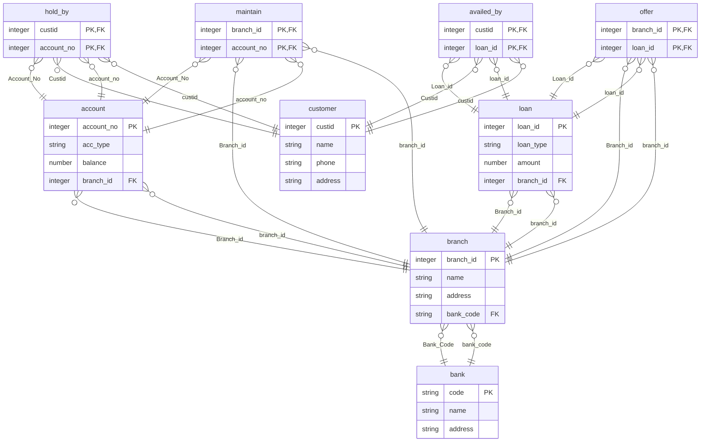
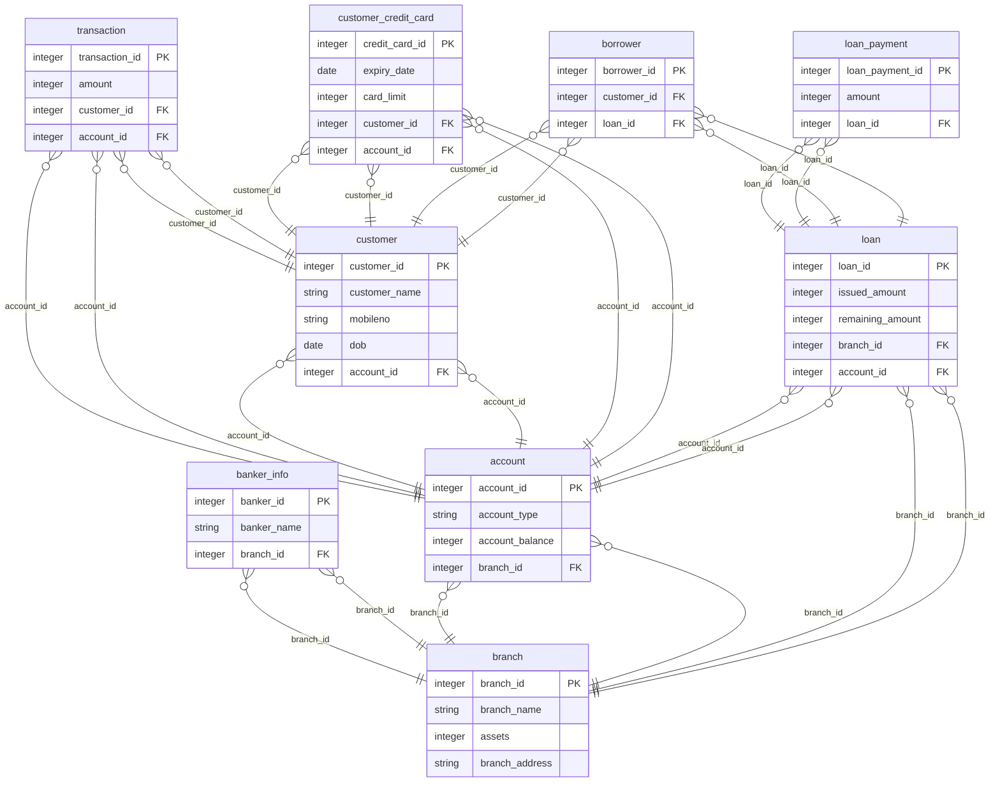

```mermaid
erDiagram
    bank {
        string bank_code PK "Business code identifying a bank."
        string bank_name "Bank name."
        string bank_address "Bank postal address as supplied by th..."
    }
    branch {
        integer branch_id PK "Identifier of a bank branch."
        string branch_name "Branch name."
        string branch_address "Branch postal address as supplied by ..."
        number assets_amount "Reported monetary value of branch ass..."
        string bank_code FK "Code of the bank to which the branch ..."
    }
    banker {
        integer banker_id PK "Identifier of a banker or bank employee."
        string banker_name "Banker name."
        integer branch_id FK "Branch at which the banker works."
    }
    customer {
        integer customer_id PK "Identifier of a customer."
        string customer_name "Customer name."
        string phone_number "Customer telephone or mobile number."
        string customer_address "Customer postal address as supplied b..."
        date date_of_birth "Customer date of birth."
    }
    account {
        integer account_id PK "Identifier or account number of a ban..."
        string account_type "Account product type."
        number account_balance_amount "Reported account balance; currency is..."
    }
    customer_account {
        integer customer_id PK,FK "Customer participating in the account..."
        integer account_id PK,FK "Account participating in the account-..."
    }
    account_branch {
        integer account_id PK,FK "Account maintained by the branch."
        integer branch_id PK,FK "Branch maintaining the account."
    }
    transaction {
        integer transaction_id PK "Identifier of an account transaction."
        number transaction_amount "Transaction monetary amount; currency..."
        integer customer_id FK "Customer associated with the transact..."
        integer account_id FK "Account associated with the transaction."
    }
    credit_card {
        integer credit_card_id PK "Identifier of a customer credit card."
        date expiry_date "Credit card expiration date."
        number credit_limit_amount "Credit limit assigned to the card; cu..."
        integer customer_id FK "Customer who owns the credit card."
        integer account_id FK "Account linked to the credit card."
    }
    loan {
        integer loan_id PK "Identifier of a loan."
        string loan_type "Loan product type, when supplied."
        number issued_amount "Original or issued loan principal; cu..."
        number remaining_amount "Outstanding loan amount; currency is ..."
        integer account_id FK "Account associated with the loan, whe..."
    }
    loan_branch {
        integer loan_id PK,FK "Loan offered or issued through the br..."
        integer branch_id PK,FK "Branch offering or issuing the loan."
    }
    loan_borrower {
        integer customer_id PK,FK "Customer borrowing the loan."
        integer loan_id PK,FK "Loan borrowed by the customer."
        integer source_borrower_id "Source-specific identifier for the bo..."
    }
    loan_payment {
        integer loan_payment_id PK "Identifier of a loan payment."
        number payment_amount "Loan payment amount; currency is not ..."
        integer loan_id FK "Loan to which the payment applies."
    }
    branch }o--|| bank : "bank_code"
    banker }o--|| branch : "branch_id"
    customer_account }o--|| customer : "customer_id"
    customer_account }o--|| account : "account_id"
    account_branch }o--|| account : "account_id"
    account_branch }o--|| branch : "branch_id"
    transaction }o--|| customer : "customer_id"
    transaction }o--|| account : "account_id"
    credit_card }o--|| customer : "customer_id"
    credit_card }o--|| account : "account_id"
    loan }o--|| account : "account_id"
    loan_branch }o--|| loan : "loan_id"
    loan_branch }o--|| branch : "branch_id"
    loan_borrower }o--|| customer : "customer_id"
    loan_borrower }o--|| loan : "loan_id"
    loan_payment }o--|| loan : "loan_id"
```

# Schema Alignment Diagnostic Report — bank1-bank2

## Summary Results

## Detailed Analysis

# Schema Alignment Diagnostic Report — bank1-bank2

- **Model**: `gpt-5.6-sol`
- **Domain**: Financial & Banking
- **Status**: `SUCCESS (3/3)`
- **Iterations**: `3`
- **Source A**: `bank1` (9 tables, 27 cols)
- **Source B**: `bank2` (9 tables, 36 cols)

## Schema Architectures (ER Diagrams)

### Source A Schema (`bank1`)

### Source B Schema (`bank2`)

### Generated Unified Target Schemas per Iteration

> [!NOTE]
> Use the toggles below to view the target schema ER diagram generated in each iteration. The representative run is expanded by default.

```mermaid
erDiagram
    bank {
        string bank_code PK "Stable code identifying a bank."
        string bank_name "Name of the bank."
        string address_text "Unparsed bank address text retained b..."
    }
    branch {
        integer branch_id PK "Identifier of a bank branch."
        string branch_name "Name of the branch."
        string address_text "Unparsed branch address text retained..."
        number assets_amount "Reported monetary value of branch ass..."
        string bank_code FK "Bank to which the branch belongs, whe..."
    }
    banker {
        integer banker_id PK "Identifier of a banker."
        string banker_name "Name of the banker."
        integer branch_id FK "Branch employing or associated with t..."
    }
    customer {
        integer customer_id PK "Identifier of a customer."
        string customer_name "Name of the customer."
        string phone_number "Customer telephone number represented..."
        string address_text "Unparsed customer address text retain..."
        date date_of_birth "Customer date of birth."
    }
    account {
        integer account_id PK "Identifier or account number of a ban..."
        string account_type "Classification of the account."
        number balance_amount "Account balance; currency is not spec..."
        integer home_branch_id FK "Primary or home branch recorded direc..."
    }
    customer_account {
        integer customer_id PK,FK "Customer participating in the account..."
        integer account_id PK,FK "Account held by the customer."
    }
    account_maintenance {
        integer branch_id PK,FK "Branch that maintains the account."
        integer account_id PK,FK "Account maintained by the branch."
    }
    loan {
        integer loan_id PK "Identifier of a loan."
        string loan_type "Classification of the loan."
        number issued_amount "Original or issued loan amount; curre..."
        number remaining_amount "Outstanding loan amount; currency is ..."
        integer originating_branch_id FK "Branch directly associated with or or..."
        integer linked_account_id FK "Account directly linked to the loan, ..."
    }
    branch_loan_offer {
        integer branch_id PK,FK "Branch participating in the loan-offe..."
        integer loan_id PK,FK "Loan offered by the branch."
    }
    borrower {
        integer customer_id PK,FK "Customer borrowing or availing the loan."
        integer loan_id PK,FK "Loan associated with the borrower."
        integer source_borrower_id "Source-specific identifier of the bor..."
    }
    account_transaction {
        integer transaction_id PK "Identifier of an account transaction."
        number amount "Transaction amount; currency and debi..."
        integer customer_id FK "Customer associated with the transact..."
        integer account_id FK "Account affected by the transaction."
    }
    credit_card {
        integer credit_card_id PK "Identifier of a customer credit card."
        date expiry_date "Credit card expiration date."
        number credit_limit_amount "Credit limit amount; currency is not ..."
        integer customer_id FK "Customer owning the credit card."
        integer account_id FK "Account linked to the credit card."
    }
    loan_payment {
        integer loan_payment_id PK "Identifier of a loan payment."
        number payment_amount "Loan payment amount; currency is not ..."
        integer loan_id FK "Loan to which the payment applies."
    }
    branch }o--|| bank : "bank_code"
    banker }o--|| branch : "branch_id"
    account }o--|| branch : "home_branch_id"
    customer_account }o--|| customer : "customer_id"
    customer_account }o--|| account : "account_id"
    account_maintenance }o--|| branch : "branch_id"
    account_maintenance }o--|| account : "account_id"
    loan }o--|| branch : "originating_branch_id"
    loan }o--|| account : "linked_account_id"
    branch_loan_offer }o--|| branch : "branch_id"
    branch_loan_offer }o--|| loan : "loan_id"
    borrower }o--|| customer : "customer_id"
    borrower }o--|| loan : "loan_id"
    account_transaction }o--|| customer : "customer_id"
    account_transaction }o--|| account : "account_id"
    credit_card }o--|| customer : "customer_id"
    credit_card }o--|| account : "account_id"
    loan_payment }o--|| loan : "loan_id"
```

<b>Iteration 1 Target Schema (13 tables, S_rel: 1.0000)</b>

<b>Iteration 2 Target Schema (13 tables, S_rel: 1.0000)</b>

<b>Iteration 3 Target Schema (13 tables, S_rel: 1.0000) [Representative / Final Run]</b>

```mermaid
erDiagram
    bank {
        string bank_code PK "Business identifier for a bank."
        string bank_name "Bank name."
        string postal_address "Bank postal address retained as an op..."
    }
    branch {
        integer branch_id PK "Branch identifier."
        string branch_name "Branch name."
        string postal_address "Branch postal address retained as an ..."
        number assets_amount "Total branch assets in the source mon..."
        string bank_code FK "Identifier of the bank to which the b..."
    }
    banker {
        integer banker_id PK "Banker identifier."
        string banker_name "Banker name."
        integer branch_id FK "Branch employing or associated with t..."
    }
    account {
        integer account_id PK "Account identifier."
        string account_type "Account classification."
        number balance_amount "Current account balance in the source..."
        integer branch_id FK "Branch directly assigned to the account."
    }
    customer {
        integer customer_id PK "Customer identifier."
        string customer_name "Customer name."
        string phone_number "Customer telephone number represented..."
        string postal_address "Customer postal address retained as a..."
        date date_of_birth "Customer date of birth."
    }
    customer_account {
        integer customer_id PK,FK "Customer participating in the account..."
        integer account_id PK,FK "Account participating in the customer..."
    }
    account_transaction {
        integer transaction_id PK "Account transaction identifier."
        number amount "Transaction amount in the source mone..."
        integer customer_id FK "Customer associated with the transact..."
        integer account_id FK "Account associated with the transaction."
    }
    credit_card {
        integer credit_card_id PK "Credit card identifier."
        date expiry_date "Credit card expiry date."
        number credit_limit_amount "Credit limit in the source monetary u..."
        integer customer_id FK "Customer to whom the card is issued."
        integer account_id FK "Account linked to the card."
    }
    loan {
        integer loan_id PK "Loan identifier."
        string loan_type "Loan classification."
        number issued_amount "Original or issued loan principal in ..."
        number remaining_amount "Outstanding loan amount in the source..."
        integer branch_id FK "Branch directly assigned to or issuin..."
        integer account_id FK "Account directly linked to the loan."
    }
    loan_payment {
        integer loan_payment_id PK "Loan payment identifier."
        number payment_amount "Loan payment amount in the source mon..."
        integer loan_id FK "Loan receiving the payment."
    }
    customer_loan {
        integer customer_loan_id PK "Identifier for a customer-loan associ..."
        integer customer_id FK "Customer participating in the borrowi..."
        integer loan_id FK "Loan participating in the borrowing r..."
    }
    branch_loan_offer {
        integer branch_id PK,FK "Branch participating in a loan-offeri..."
        integer loan_id PK,FK "Loan participating in a branch-offeri..."
    }
    branch_account_maintenance {
        integer branch_id PK,FK "Branch participating in an account-ma..."
        integer account_id PK,FK "Account maintained by the branch."
    }
    branch }o--|| bank : "bank_code"
    banker }o--|| branch : "branch_id"
    account }o--|| branch : "branch_id"
    customer_account }o--|| customer : "customer_id"
    customer_account }o--|| account : "account_id"
    account_transaction }o--|| customer : "customer_id"
    account_transaction }o--|| account : "account_id"
    credit_card }o--|| customer : "customer_id"
    credit_card }o--|| account : "account_id"
    loan }o--|| branch : "branch_id"
    loan }o--|| account : "account_id"
    loan_payment }o--|| loan : "loan_id"
    customer_loan }o--|| customer : "customer_id"
    customer_loan }o--|| loan : "loan_id"
    branch_loan_offer }o--|| branch : "branch_id"
    branch_loan_offer }o--|| loan : "loan_id"
    branch_account_maintenance }o--|| branch : "branch_id"
    branch_account_maintenance }o--|| account : "account_id"
```

## Performance & Efficiency Summary

| Completeness (Cov_attr) | Structural Integrity (S_rel) | Intra-Table Uniqueness (M_unique) | Latency (s) | Total Tokens |
| --- | --- | --- | --- | --- |
| 1.0000 | 1.0000 | 0.9902 | 60.09s | 37,526 |

## Target Schema Detailed Specifications

### Target Table: `bank`

| Column Name | Type | Key | Source Provenance | Description |
| --- | --- | --- | --- | --- |
| `bank_code` | string | PK | `bank1.bank.code` | Business identifier for a bank. |
| `bank_name` | string | - | `bank1.bank.name` | Bank name. |
| `postal_address` | string | - | `bank1.bank.address` | Bank postal address retained as an opaque text value because no source address components are supplied. |

### Target Table: `branch`

| Column Name | Type | Key | Source Provenance | Description |
| --- | --- | --- | --- | --- |
| `branch_id` | integer | PK | `bank1.branch.branch_id`, `bank2.branch.branch_id` | Branch identifier. |
| `branch_name` | string | - | `bank1.branch.name`, `bank2.branch.branch_name` | Branch name. |
| `postal_address` | string | - | `bank1.branch.address`, `bank2.branch.branch_address` | Branch postal address retained as an opaque text value because no source address components are supplied. |
| `assets_amount` | number | - | `bank2.branch.assets` | Total branch assets in the source monetary unit. |
| `bank_code` | string | FK -> `bank.bank_code` | `bank1.branch.bank_code` | Identifier of the bank to which the branch belongs, when known. |

### Target Table: `banker`

| Column Name | Type | Key | Source Provenance | Description |
| --- | --- | --- | --- | --- |
| `banker_id` | integer | PK | `bank2.banker_info.banker_id` | Banker identifier. |
| `banker_name` | string | - | `bank2.banker_info.banker_name` | Banker name. |
| `branch_id` | integer | FK -> `branch.branch_id` | `bank2.banker_info.branch_id` | Branch employing or associated with the banker. |

### Target Table: `account`

| Column Name | Type | Key | Source Provenance | Description |
| --- | --- | --- | --- | --- |
| `account_id` | integer | PK | `bank1.account.account_no`, `bank2.account.account_id` | Account identifier. |
| `account_type` | string | - | `bank1.account.acc_type`, `bank2.account.account_type` | Account classification. |
| `balance_amount` | number | - | `bank1.account.balance`, `bank2.account.account_balance` | Current account balance in the source monetary unit. |
| `branch_id` | integer | FK -> `branch.branch_id` | `bank1.account.branch_id`, `bank2.account.branch_id` | Branch directly assigned to the account. |

### Target Table: `customer`

| Column Name | Type | Key | Source Provenance | Description |
| --- | --- | --- | --- | --- |
| `customer_id` | integer | PK | `bank1.customer.custid`, `bank2.customer.customer_id` | Customer identifier. |
| `customer_name` | string | - | `bank1.customer.name`, `bank2.customer.customer_name` | Customer name. |
| `phone_number` | string | - | `bank1.customer.phone`, `bank2.customer.mobileno` | Customer telephone number represented as text. |
| `postal_address` | string | - | `bank1.customer.address` | Customer postal address retained as an opaque text value because no source address components are supplied. |
| `date_of_birth` | date | - | `bank2.customer.dob` | Customer date of birth. |

### Target Table: `customer_account`

| Column Name | Type | Key | Source Provenance | Description |
| --- | --- | --- | --- | --- |
| `customer_id` | integer | PK, FK | `bank1.hold_by.custid`, `bank2.customer.customer_id` | Customer participating in the account relationship. |
| `account_id` | integer | PK, FK | `bank1.hold_by.account_no`, `bank2.customer.account_id` | Account participating in the customer relationship. |

### Target Table: `account_transaction`

| Column Name | Type | Key | Source Provenance | Description |
| --- | --- | --- | --- | --- |
| `transaction_id` | integer | PK | `bank2.transaction.transaction_id` | Account transaction identifier. |
| `amount` | number | - | `bank2.transaction.amount` | Transaction amount in the source monetary unit. |
| `customer_id` | integer | FK -> `customer.customer_id` | `bank2.transaction.customer_id` | Customer associated with the transaction. |
| `account_id` | integer | FK -> `account.account_id` | `bank2.transaction.account_id` | Account associated with the transaction. |

### Target Table: `credit_card`

| Column Name | Type | Key | Source Provenance | Description |
| --- | --- | --- | --- | --- |
| `credit_card_id` | integer | PK | `bank2.customer_credit_card.credit_card_id` | Credit card identifier. |
| `expiry_date` | date | - | `bank2.customer_credit_card.expiry_date` | Credit card expiry date. |
| `credit_limit_amount` | number | - | `bank2.customer_credit_card.card_limit` | Credit limit in the source monetary unit. |
| `customer_id` | integer | FK -> `customer.customer_id` | `bank2.customer_credit_card.customer_id` | Customer to whom the card is issued. |
| `account_id` | integer | FK -> `account.account_id` | `bank2.customer_credit_card.account_id` | Account linked to the card. |

### Target Table: `loan`

| Column Name | Type | Key | Source Provenance | Description |
| --- | --- | --- | --- | --- |
| `loan_id` | integer | PK | `bank1.loan.loan_id`, `bank2.loan.loan_id` | Loan identifier. |
| `loan_type` | string | - | `bank1.loan.loan_type` | Loan classification. |
| `issued_amount` | number | - | `bank1.loan.amount`, `bank2.loan.issued_amount` | Original or issued loan principal in the source monetary unit. |
| `remaining_amount` | number | - | `bank2.loan.remaining_amount` | Outstanding loan amount in the source monetary unit. |
| `branch_id` | integer | FK -> `branch.branch_id` | `bank1.loan.branch_id`, `bank2.loan.branch_id` | Branch directly assigned to or issuing the loan. |
| `account_id` | integer | FK -> `account.account_id` | `bank2.loan.account_id` | Account directly linked to the loan. |

### Target Table: `loan_payment`

| Column Name | Type | Key | Source Provenance | Description |
| --- | --- | --- | --- | --- |
| `loan_payment_id` | integer | PK | `bank2.loan_payment.loan_payment_id` | Loan payment identifier. |
| `payment_amount` | number | - | `bank2.loan_payment.amount` | Loan payment amount in the source monetary unit. |
| `loan_id` | integer | FK -> `loan.loan_id` | `bank2.loan_payment.loan_id` | Loan receiving the payment. |

### Target Table: `customer_loan`

| Column Name | Type | Key | Source Provenance | Description |
| --- | --- | --- | --- | --- |
| `customer_loan_id` | integer | PK | `bank2.borrower.borrower_id` | Identifier for a customer-loan association; bank1 associations require generated values because their source key is composite. |
| `customer_id` | integer | FK -> `customer.customer_id` | `bank1.availed_by.custid`, `bank2.borrower.customer_id` | Customer participating in the borrowing relationship. |
| `loan_id` | integer | FK -> `loan.loan_id` | `bank1.availed_by.loan_id`, `bank2.borrower.loan_id` | Loan participating in the borrowing relationship. |

### Target Table: `branch_loan_offer`

| Column Name | Type | Key | Source Provenance | Description |
| --- | --- | --- | --- | --- |
| `branch_id` | integer | PK, FK | `bank1.offer.branch_id` | Branch participating in a loan-offering relationship. |
| `loan_id` | integer | PK, FK | `bank1.offer.loan_id` | Loan participating in a branch-offering relationship. |

### Target Table: `branch_account_maintenance`

| Column Name | Type | Key | Source Provenance | Description |
| --- | --- | --- | --- | --- |
| `branch_id` | integer | PK, FK | `bank1.maintain.branch_id` | Branch participating in an account-maintenance relationship. |
| `account_id` | integer | PK, FK | `bank1.maintain.account_no` | Account maintained by the branch. |

## 3-Pillar Reference-Free Diagnostic Inspection

### Pillar 1: Information Preservation (Completeness)

- **Attribute Completeness ($Cov_{\text{attr}}$)**: `100.00%`

:white_check_mark: 100% of source schema attributes were preserved in target schema provenance.

### Pillar 2: Structural & Referential Constraints

- **Primary Key Validity**: `100.00%`
- **Foreign Key Validity**: `100.00%` (18 declared FKs)
- **Source FK Preservation**: `100.00%` (46/46 source relationships preserved)
- **Combined Structural Score ($S_{\text{rel}}$)**: `1.0000`
- **Total Target Tables**: `13`

:white_check_mark: All target foreign keys are valid and all source relational links are preserved.

### Pillar 3: Intrinsic Minimality & Non-Redundancy

- **Intra-Table Uniqueness ($M_{\text{unique}}$)**: `0.9918`

#### Flagged Intra-Table Candidate Clones
| Target Table | Column A | Column B | Data Type | Cosine Sim | Source Prov A | Source Prov B |
| --- | --- | --- | --- | --- | --- | --- |
| `customer_account` | `customer_id` | `account_id` | integer | 0.9562 | bank1.hold_by.custid, bank2.customer.customer_id | bank1.hold_by.account_no, bank2.customer.account_id |

## Multi-Iteration Stability Analysis

| Iteration | Completeness | Integrity | Uniqueness | Clones Flagged | Latency (s) | Prompt Tokens | Completion Tokens | Total Tokens |
| --- | --- | --- | --- | --- | --- | --- | --- | --- |
| 1 | 1.0000 | 1.0000 | 0.9987 | 1 | 64.75s | 6,406 | 6,277 | 12,683 |
| 2 | 1.0000 | 1.0000 | 0.9801 | 3 | 53.78s | 6,406 | 5,711 | 12,117 |
| 3 | 1.0000 | 1.0000 | 0.9918 | 1 | 61.73s | 6,406 | 6,320 | 12,726 |

### Cross-Iteration Attribute Mapping Consensus

- **Total Co-Aligned Attribute Pairs**: `21`
- **Invariant / Stable Alignments (100% Agreement)**: `17`
- **Volatile / Flaky Alignments (<100% Agreement)**: `4`
- **Overall Consensus Ratio**: `80.95%`

### Topological & Relational Drift

- **Mean Table Count**: `13.00 ± 0.00` (Range: 13 – 13)
- **Relational Graph Edge Stability (Mean Pairwise Jaccard)**: `0.3357`

#### Volatile Cross-Source Alignments (Flakiness Breakdown)

| Source A Attribute | Source B Attribute | Agreement Rate | Runs | Assigned Target Field(s) |
| --- | --- | --- | --- | --- |
| `maintain.account_no` | `account.account_id` | 33.3% | 1/3 | `account_branch.account_id` |
| `maintain.branch_id` | `account.branch_id` | 33.3% | 1/3 | `account_branch.branch_id` |
| `offer.branch_id` | `loan.branch_id` | 33.3% | 1/3 | `loan_branch.branch_id` |
| `offer.loan_id` | `loan.loan_id` | 33.3% | 1/3 | `loan_branch.loan_id` |

#### Confirmed Invariant Alignments (17 pairs)

| Source A Attribute | Source B Attribute | Unified Target Field |
| --- | --- | --- |
| `account.acc_type` | `account.account_type` | `account.account_type` |
| `account.account_no` | `account.account_id` | `account.account_id`, `account_branch.account_id` |
| `account.balance` | `account.account_balance` | `account.account_balance_amount`, `account.balance_amount` |
| `account.branch_id` | `account.branch_id` | `account.branch_id`, `account.home_branch_id`, `account_branch.branch_id` |
| `availed_by.custid` | `borrower.customer_id` | `borrower.customer_id`, `customer_loan.customer_id`, `loan_borrower.customer_id` |
| `availed_by.loan_id` | `borrower.loan_id` | `borrower.loan_id`, `customer_loan.loan_id`, `loan_borrower.loan_id` |
| `branch.address` | `branch.branch_address` | `branch.address_text`, `branch.branch_address`, `branch.postal_address` |
| `branch.branch_id` | `branch.branch_id` | `branch.branch_id` |
| `branch.name` | `branch.branch_name` | `branch.branch_name` |
| `customer.custid` | `customer.customer_id` | `customer.customer_id` |
| `customer.name` | `customer.customer_name` | `customer.customer_name` |
| `customer.phone` | `customer.mobileno` | `customer.phone_number` |
| `hold_by.account_no` | `customer.account_id` | `customer_account.account_id` |
| `hold_by.custid` | `customer.customer_id` | `customer_account.customer_id` |
| `loan.amount` | `loan.issued_amount` | `loan.issued_amount` |
| `loan.branch_id` | `loan.branch_id` | `loan.branch_id`, `loan.originating_branch_id`, `loan_branch.branch_id` |
| `loan.loan_id` | `loan.loan_id` | `loan.loan_id`, `loan_branch.loan_id` |

### Intra-Table Clone Stability

- **Candidate Clones Stability Ratio**: `0.00%` (0/4 stable)

## Diagnostic & Observability Telemetry

- **Candidate Clones CSV**: [`detected_clones.csv`](./detected_clones.csv)
- **Mapping Consensus CSV**: [`mapping_consensus.csv`](./mapping_consensus.csv)
- **LLM Execution Trace**: [`execution_trace.jsonl`](./execution_trace.jsonl)
- **Per-Iteration Artifacts**: [`iterations/`](./iterations/)

