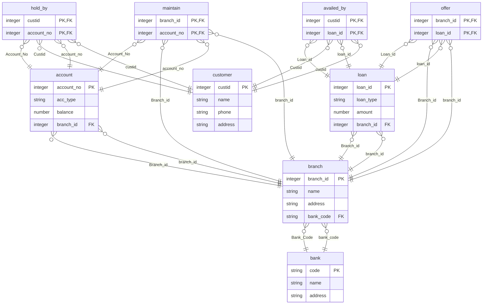
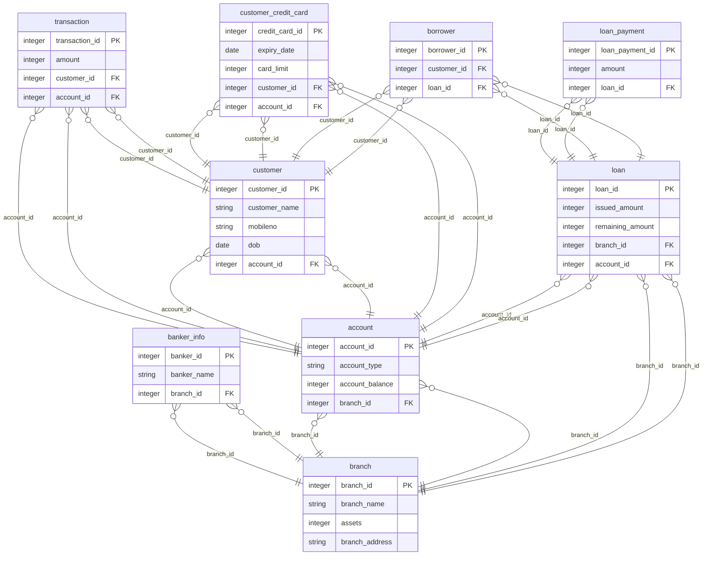
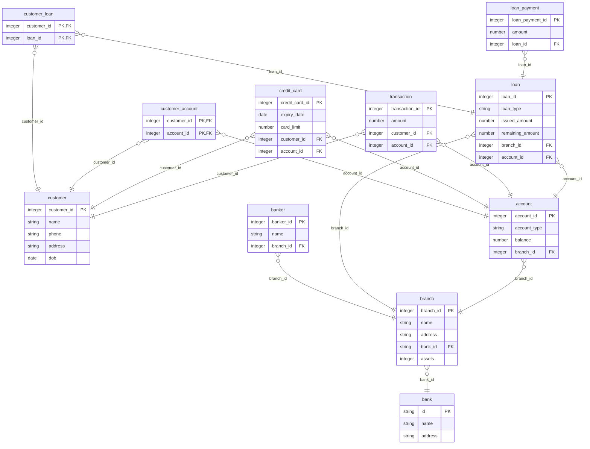
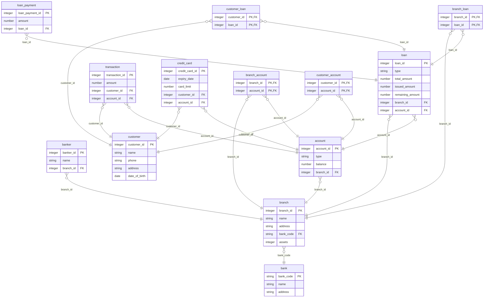
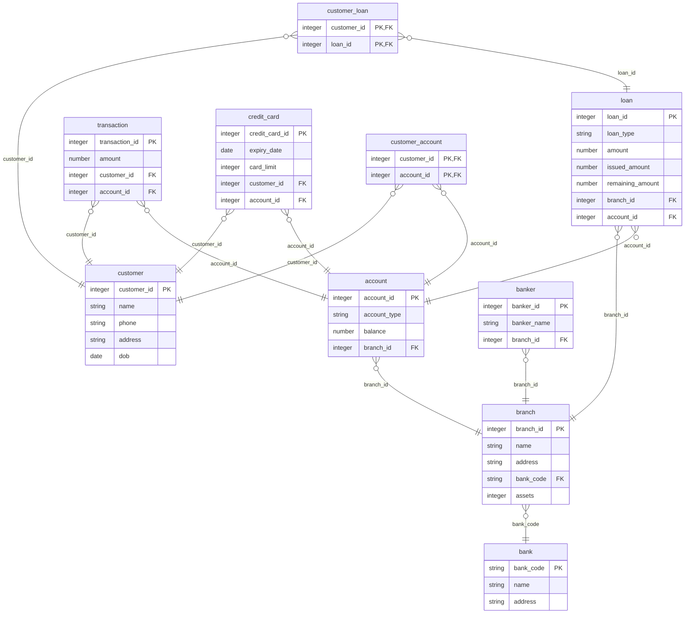

# Schema Alignment Diagnostic Report — bank1-bank2

## Summary Results

## Detailed Analysis

# Schema Alignment Diagnostic Report — bank1-bank2

- **Model**: `mistral-medium-latest`
- **Domain**: Financial & Banking
- **Status**: `SUCCESS (3/3)`
- **Iterations**: `3`
- **Source A**: `bank1` (9 tables, 27 cols)
- **Source B**: `bank2` (9 tables, 36 cols)

## Schema Architectures (ER Diagrams)

### Source A Schema (`bank1`)

### Source B Schema (`bank2`)

### Generated Unified Target Schemas per Iteration

> [!NOTE]
> Use the toggles below to view the target schema ER diagram generated in each iteration. The representative run is expanded by default.

<b>Iteration 1 Target Schema (11 tables, S_rel: 0.8261)</b>

<b>Iteration 2 Target Schema (13 tables, S_rel: 0.9565)</b>

<b>Iteration 3 Target Schema (10 tables, S_rel: 0.7391) [Representative / Final Run]</b>

## Performance & Efficiency Summary

| Completeness (Cov_attr) | Structural Integrity (S_rel) | Intra-Table Uniqueness (M_unique) | Latency (s) | Total Tokens |
| --- | --- | --- | --- | --- |
| 0.9153 | 0.8406 | 1.0000 | 471.57s | 155,693 |

## Target Schema Detailed Specifications

### Target Table: `bank`

| Column Name | Type | Key | Source Provenance | Description |
| --- | --- | --- | --- | --- |
| `bank_code` | string | PK | `bank1.bank.code` | - |
| `name` | string | - | `bank1.bank.name` | - |
| `address` | string | - | `bank1.bank.address` | - |

### Target Table: `branch`

| Column Name | Type | Key | Source Provenance | Description |
| --- | --- | --- | --- | --- |
| `branch_id` | integer | PK | `bank1.branch.branch_id`, `bank2.branch.branch_id` | - |
| `name` | string | - | `bank1.branch.name`, `bank2.branch.branch_name` | - |
| `address` | string | - | `bank1.branch.address`, `bank2.branch.branch_address` | - |
| `bank_code` | string | FK -> `bank.bank_code` | `bank1.branch.bank_code` | - |
| `assets` | integer | - | `bank2.branch.assets` | - |

### Target Table: `customer`

| Column Name | Type | Key | Source Provenance | Description |
| --- | --- | --- | --- | --- |
| `customer_id` | integer | PK | `bank1.customer.custid`, `bank2.customer.customer_id` | - |
| `name` | string | - | `bank1.customer.name`, `bank2.customer.customer_name` | - |
| `phone` | string | - | `bank1.customer.phone`, `bank2.customer.mobileno` | - |
| `address` | string | - | `bank1.customer.address` | - |
| `dob` | date | - | `bank2.customer.dob` | - |

### Target Table: `account`

| Column Name | Type | Key | Source Provenance | Description |
| --- | --- | --- | --- | --- |
| `account_id` | integer | PK | `bank1.account.account_no`, `bank2.account.account_id` | - |
| `account_type` | string | - | `bank1.account.acc_type`, `bank2.account.account_type` | - |
| `balance` | number | - | `bank1.account.balance`, `bank2.account.account_balance` | - |
| `branch_id` | integer | FK -> `branch.branch_id` | `bank1.account.branch_id`, `bank2.account.branch_id` | - |

### Target Table: `loan`

| Column Name | Type | Key | Source Provenance | Description |
| --- | --- | --- | --- | --- |
| `loan_id` | integer | PK | `bank1.loan.loan_id`, `bank2.loan.loan_id` | - |
| `loan_type` | string | - | `bank1.loan.loan_type` | - |
| `amount` | number | - | `bank1.loan.amount` | - |
| `issued_amount` | number | - | `bank2.loan.issued_amount` | - |
| `remaining_amount` | number | - | `bank2.loan.remaining_amount` | - |
| `branch_id` | integer | FK -> `branch.branch_id` | `bank1.loan.branch_id`, `bank2.loan.branch_id` | - |
| `account_id` | integer | FK -> `account.account_id` | `bank2.loan.account_id` | - |

### Target Table: `transaction`

| Column Name | Type | Key | Source Provenance | Description |
| --- | --- | --- | --- | --- |
| `transaction_id` | integer | PK | `bank2.transaction.transaction_id` | - |
| `amount` | number | - | `bank2.transaction.amount` | - |
| `customer_id` | integer | FK -> `customer.customer_id` | `bank2.transaction.customer_id` | - |
| `account_id` | integer | FK -> `account.account_id` | `bank2.transaction.account_id` | - |

### Target Table: `banker`

| Column Name | Type | Key | Source Provenance | Description |
| --- | --- | --- | --- | --- |
| `banker_id` | integer | PK | `bank2.banker_info.banker_id` | - |
| `banker_name` | string | - | `bank2.banker_info.banker_name` | - |
| `branch_id` | integer | FK -> `branch.branch_id` | `bank2.banker_info.branch_id` | - |

### Target Table: `credit_card`

| Column Name | Type | Key | Source Provenance | Description |
| --- | --- | --- | --- | --- |
| `credit_card_id` | integer | PK | `bank2.customer_credit_card.credit_card_id` | - |
| `expiry_date` | date | - | `bank2.customer_credit_card.expiry_date` | - |
| `card_limit` | integer | - | `bank2.customer_credit_card.card_limit` | - |
| `customer_id` | integer | FK -> `customer.customer_id` | `bank2.customer_credit_card.customer_id` | - |
| `account_id` | integer | FK -> `account.account_id` | `bank2.customer_credit_card.account_id` | - |

### Target Table: `customer_account`

| Column Name | Type | Key | Source Provenance | Description |
| --- | --- | --- | --- | --- |
| `customer_id` | integer | PK, FK | `bank1.hold_by.custid` | - |
| `account_id` | integer | PK, FK | `bank1.hold_by.account_no` | - |

### Target Table: `customer_loan`

| Column Name | Type | Key | Source Provenance | Description |
| --- | --- | --- | --- | --- |
| `customer_id` | integer | PK, FK | `bank1.availed_by.custid`, `bank2.borrower.customer_id` | - |
| `loan_id` | integer | PK, FK | `bank1.availed_by.loan_id`, `bank2.borrower.loan_id` | - |

## 3-Pillar Reference-Free Diagnostic Inspection

### Pillar 1: Information Preservation (Completeness)

- **Attribute Completeness ($Cov_{\text{attr}}$)**: `85.71%`

#### Dropped / Unmapped Source Attributes
- :x: `a:maintain.account_no`
- :x: `a:maintain.branch_id`
- :x: `a:offer.branch_id`
- :x: `a:offer.loan_id`
- :x: `b:borrower.borrower_id`
- :x: `b:customer.account_id`
- :x: `b:loan_payment.amount`
- :x: `b:loan_payment.loan_id`
- :x: `b:loan_payment.loan_payment_id`

### Pillar 2: Structural & Referential Constraints

- **Primary Key Validity**: `100.00%`
- **Foreign Key Validity**: `100.00%` (13 declared FKs)
- **Source FK Preservation**: `73.91%` (34/46 source relationships preserved)
- **Combined Structural Score ($S_{\text{rel}}$)**: `0.7391`
- **Total Target Tables**: `10`

#### Unpreserved Source Foreign Keys
- :warning: Source bank1 FK 'offer' -> 'branch' has unmapped columns in target
- :warning: Source bank1 FK 'offer' -> 'loan' has unmapped columns in target
- :warning: Source bank1 FK 'offer' -> 'branch' has unmapped columns in target
- :warning: Source bank1 FK 'offer' -> 'loan' has unmapped columns in target
- :warning: Source bank1 FK 'maintain' -> 'branch' has unmapped columns in target
- :warning: Source bank1 FK 'maintain' -> 'account' has unmapped columns in target
- :warning: Source bank1 FK 'maintain' -> 'branch' has unmapped columns in target
- :warning: Source bank1 FK 'maintain' -> 'account' has unmapped columns in target
- :warning: Source bank2 FK 'customer' -> 'account' has unmapped columns in target
- :warning: Source bank2 FK 'customer' -> 'account' has unmapped columns in target
- :warning: Source bank2 FK 'loan_payment' -> 'loan' has unmapped columns in target
- :warning: Source bank2 FK 'loan_payment' -> 'loan' has unmapped columns in target

### Pillar 3: Intrinsic Minimality & Non-Redundancy

- **Intra-Table Uniqueness ($M_{\text{unique}}$)**: `1.0000`

:white_check_mark: Zero semantic duplicate columns detected across target relations.

## Multi-Iteration Stability Analysis

| Iteration | Completeness | Integrity | Uniqueness | Clones Flagged | Latency (s) | Prompt Tokens | Completion Tokens | Total Tokens |
| --- | --- | --- | --- | --- | --- | --- | --- | --- |
| 1 | 0.9206 | 0.8261 | 1.0000 | 0 | 738.14s | 30,651 | 16,639 | 47,290 |
| 2 | 0.9683 | 0.9565 | 1.0000 | 0 | 256.90s | 43,697 | 34,199 | 77,896 |
| 3 | 0.8571 | 0.7391 | 1.0000 | 0 | 419.68s | 7,215 | 23,292 | 30,507 |

### Cross-Iteration Attribute Mapping Consensus

- **Total Co-Aligned Attribute Pairs**: `17`
- **Invariant / Stable Alignments (100% Agreement)**: `14`
- **Volatile / Flaky Alignments (<100% Agreement)**: `3`
- **Overall Consensus Ratio**: `82.35%`

### Topological & Relational Drift

- **Mean Table Count**: `11.33 ± 1.25` (Range: 10 – 13)
- **Relational Graph Edge Stability (Mean Pairwise Jaccard)**: `0.7355`

#### Volatile Cross-Source Alignments (Flakiness Breakdown)

| Source A Attribute | Source B Attribute | Agreement Rate | Runs | Assigned Target Field(s) |
| --- | --- | --- | --- | --- |
| `hold_by.account_no` | `customer.account_id` | 33.3% | 1/3 | `customer_account.account_id` |
| `hold_by.custid` | `customer.customer_id` | 33.3% | 1/3 | `customer_account.customer_id` |
| `loan.amount` | `loan.issued_amount` | 33.3% | 1/3 | `loan.issued_amount` |

#### Confirmed Invariant Alignments (14 pairs)

| Source A Attribute | Source B Attribute | Unified Target Field |
| --- | --- | --- |
| `account.acc_type` | `account.account_type` | `account.account_type`, `account.type` |
| `account.account_no` | `account.account_id` | `account.account_id` |
| `account.balance` | `account.account_balance` | `account.balance` |
| `account.branch_id` | `account.branch_id` | `account.branch_id` |
| `availed_by.custid` | `borrower.customer_id` | `customer_loan.customer_id` |
| `availed_by.loan_id` | `borrower.loan_id` | `customer_loan.loan_id` |
| `branch.address` | `branch.branch_address` | `branch.address` |
| `branch.branch_id` | `branch.branch_id` | `branch.branch_id` |
| `branch.name` | `branch.branch_name` | `branch.name` |
| `customer.custid` | `customer.customer_id` | `customer.customer_id` |
| `customer.name` | `customer.customer_name` | `customer.name` |
| `customer.phone` | `customer.mobileno` | `customer.phone` |
| `loan.branch_id` | `loan.branch_id` | `loan.branch_id` |
| `loan.loan_id` | `loan.loan_id` | `loan.loan_id` |

### Intra-Table Clone Stability

- **Candidate Clones Stability Ratio**: `100.00%` (0/0 stable)

## Diagnostic & Observability Telemetry

- **Candidate Clones CSV**: [`detected_clones.csv`](./detected_clones.csv)
- **Mapping Consensus CSV**: [`mapping_consensus.csv`](./mapping_consensus.csv)
- **LLM Execution Trace**: [`execution_trace.jsonl`](./execution_trace.jsonl)
- **Per-Iteration Artifacts**: [`iterations/`](./iterations/)

