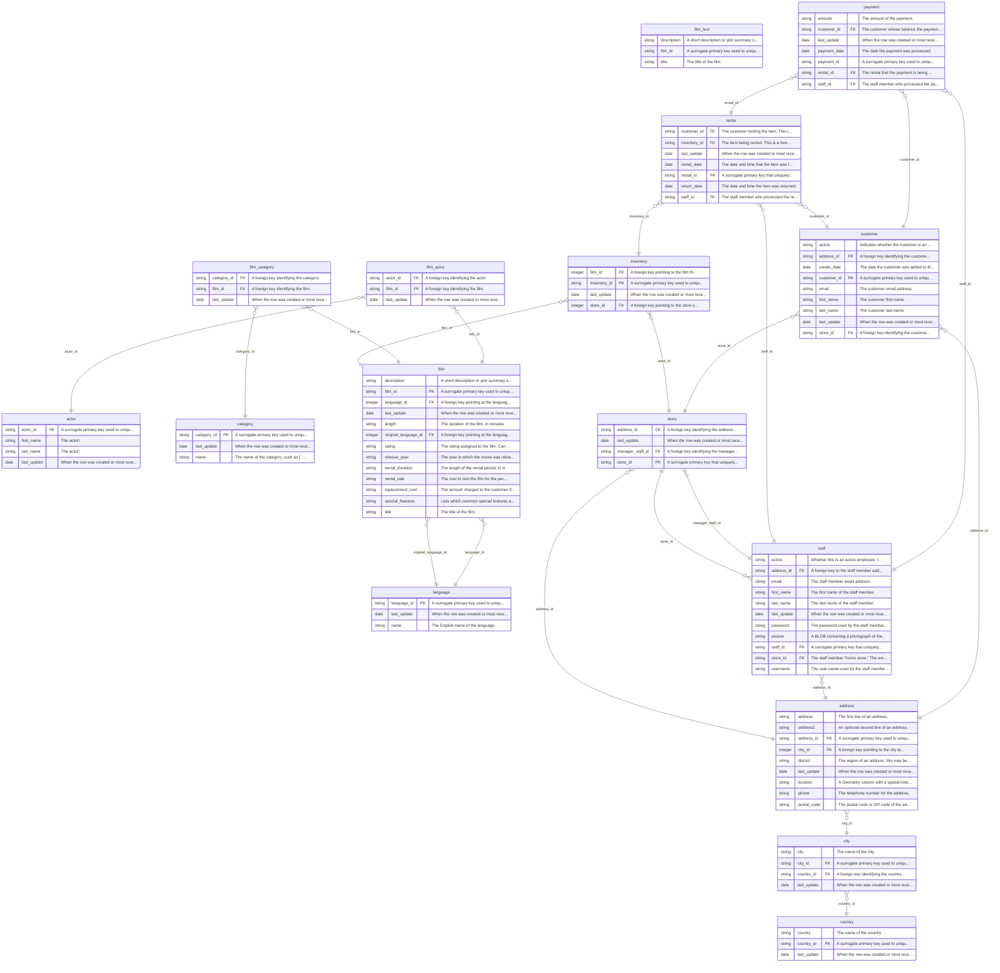

```mermaid
erDiagram
    person {
        string person_id PK "Unified person identifier."
        string primary_name "Full credited name of the person."
        string first_name "Given name of the person."
        string last_name "Family name of the person."
        integer birth_year "Year of birth."
        integer death_year "Year of death if applicable."
        string primary_profession "Top professions of the person."
        date last_update "Row creation / last update timestamp."
    }
    person_known_for {
        string person_id PK,FK "Person the title is known-for credit ..."
        string title_id PK,FK "Title the person is known for."
    }
    title {
        string title_id PK "Unified title/film identifier."
        string primary_title "The main display title of the work."
        string original_title "Title in original language."
        string title_type "Format/type of the title."
        integer start_year "Release year (or series start year)."
        integer end_year "Series end year if applicable."
        integer runtime_minutes "Primary runtime of the title in minutes."
        boolean is_adult "Whether the title is adult content."
        string description "Short plot summary / description."
        string content_rating "Motion-picture content rating (MPAA s..."
        integer rental_duration "Rental period in days."
        number rental_rate "Cost to rent the title for the rental..."
        number replacement_cost "Amount charged if the item is lost/da..."
        string special_features "Special features included on the medium."
        string language_id FK "Primary language of the title."
        string original_language_id FK "Original language when dubbed."
        date last_update "Row creation / last update timestamp."
    }
    title_alias {
        string title_id PK,FK "Title the alias belongs to."
        integer ordering PK "Sequence to uniquely identify aliases..."
        string title "Localized alternative title."
        string region "Region for this title version."
        string language "Language of the alias title."
        string types "Enumerated set of alias attributes."
        string attributes "Additional terms describing the alias."
        boolean is_original_title "Whether this alias is the original ti..."
    }
    title_genre {
        string title_id PK,FK "Title the genre applies to."
        string genre PK "Genre associated with the title."
    }
    title_credit {
        string title_id PK,FK "Title of the credit."
        string person_id PK,FK "Person credited in the title."
        integer ordering "Sequence to uniquely identify credits..."
        string category "Category of the job the person perfor..."
        string job "Specific job title if applicable."
        string characters "Characters played if applicable."
        date last_update "Row creation / last update timestamp."
    }
    title_director {
        string title_id PK,FK "Title that was directed."
        string person_id PK,FK "Person who directed the title."
    }
    title_writer {
        string title_id PK,FK "Title that was written."
        string person_id PK,FK "Person who wrote the title."
    }
    title_episode {
        string title_id PK,FK "Episode title identifier."
        string parent_title_id FK "Parent TV series title identifier."
        integer season_number "Season the episode belongs to."
        integer episode_number "Episode number within the series."
    }
    title_rating {
        string title_id PK,FK "Rated title identifier."
        number average_rating "Weighted average of user ratings."
        integer num_votes "Number of votes received."
    }
    language {
        string language_id PK "Language identifier."
        string name "English name of the language."
        date last_update "Row creation / last update timestamp."
    }
    category {
        string category_id PK "Category identifier."
        string name "Name of the category."
        date last_update "Row creation / last update timestamp."
    }
    title_category {
        string title_id PK,FK "Categorized title identifier."
        string category_id PK,FK "Category identifier."
        date last_update "Row creation / last update timestamp."
    }
    country {
        string country_id PK "Country identifier."
        string country "Name of the country."
        date last_update "Row creation / last update timestamp."
    }
    city {
        string city_id PK "City identifier."
        string city "Name of the city."
        string country_id FK "Country the city belongs to."
        date last_update "Row creation / last update timestamp."
    }
    address {
        string address_id PK "Address identifier."
        string address "First line of the address."
        string address2 "Second line of the address."
        string district "Region/state/province of the address."
        string city_id FK "City of the address."
        string postal_code "Postal / ZIP code."
        string phone "Telephone number for the address."
        string location "Geospatial geometry of the address."
        date last_update "Row creation / last update timestamp."
    }
    store {
        string store_id PK "Store identifier."
        string manager_staff_id FK "Manager of the store."
        string address_id FK "Address of the store."
        date last_update "Row creation / last update timestamp."
    }
    staff {
        string staff_id PK "Staff member identifier."
        string first_name "First name of the staff member."
        string last_name "Last name of the staff member."
        string email "Staff member email address."
        string address_id FK "Address of the staff member."
        string store_id FK "Home store of the staff member."
        boolean active "Whether the staff member is active."
        string username "Login user name."
        string password "Hashed access password."
        string picture "Photograph of the staff member."
        date last_update "Row creation / last update timestamp."
    }
    customer {
        string customer_id PK "Customer identifier."
        string first_name "Customer first name."
        string last_name "Customer last name."
        string email "Customer email address."
        string address_id FK "Customer address."
        string store_id FK "Customer home store."
        boolean active "Whether the customer is active."
        date create_date "Date the customer was added."
        date last_update "Row creation / last update timestamp."
    }
    inventory {
        string inventory_id PK "Inventory item identifier."
        string title_id FK "Title the item represents."
        string store_id FK "Store stocking the item."
        date last_update "Row creation / last update timestamp."
    }
    rental {
        string rental_id PK "Rental identifier."
        string customer_id FK "Customer who rented the item."
        string inventory_id FK "Inventory item rented."
        string staff_id FK "Staff member who processed the rental."
        datetime rental_date "Date and time the item was rented."
        datetime return_date "Date and time the item was returned."
        date last_update "Row creation / last update timestamp."
    }
    payment {
        string payment_id PK "Payment identifier."
        string customer_id FK "Customer the payment is applied to."
        string rental_id FK "Rental the payment is applied to."
        string staff_id FK "Staff member who processed the payment."
        number amount "Amount of the payment."
        datetime payment_date "Date and time the payment was processed."
        date last_update "Row creation / last update timestamp."
    }
    person_known_for }o--|| person : "person_id"
    person_known_for }o--|| title : "title_id"
    title }o--|| language : "language_id"
    title }o--|| language : "original_language_id"
    title_alias }o--|| title : "title_id"
    title_genre }o--|| title : "title_id"
    title_credit }o--|| title : "title_id"
    title_credit }o--|| person : "person_id"
    title_director }o--|| title : "title_id"
    title_director }o--|| person : "person_id"
    title_writer }o--|| title : "title_id"
    title_writer }o--|| person : "person_id"
    title_episode }o--|| title : "title_id"
    title_episode }o--|| title : "parent_title_id"
    title_rating }o--|| title : "title_id"
    title_category }o--|| title : "title_id"
    title_category }o--|| category : "category_id"
    city }o--|| country : "country_id"
    address }o--|| city : "city_id"
    store }o--|| staff : "manager_staff_id"
    store }o--|| address : "address_id"
    staff }o--|| address : "address_id"
    staff }o--|| store : "store_id"
    customer }o--|| address : "address_id"
    customer }o--|| store : "store_id"
    inventory }o--|| title : "title_id"
    inventory }o--|| store : "store_id"
    rental }o--|| customer : "customer_id"
    rental }o--|| inventory : "inventory_id"
    rental }o--|| staff : "staff_id"
    payment }o--|| customer : "customer_id"
    payment }o--|| rental : "rental_id"
    payment }o--|| staff : "staff_id"
```

# Schema Alignment Diagnostic Report — imdb-sakila

## Summary Results

## Detailed Analysis

# Schema Alignment Diagnostic Report — imdb-sakila

- **Model**: `deepseek-v4.1-flash`
- **Domain**: Media & Entertainment
- **Status**: `SUCCESS (3/3)`
- **Iterations**: `3`
- **Source A**: `imdb` (7 tables, 39 cols)
- **Source B**: `sakila` (16 tables, 90 cols)

## Schema Architectures (ER Diagrams)

### Source A Schema (`imdb`)

```mermaid
erDiagram
    name_basics {
        string birthyear "birth year (YYYY)"
        string deathyear "death year if applicable, else"
        string knownfortitles "titles the person is known for (array..."
        number nconst PK "alphanumeric unique identifier of the..."
        string primaryname "name by which the person is most ofte..."
        string primaryprofession "the top-3 professions of the person (..."
    }
    title_akas {
        string attributes "Additional terms to describe this alt..."
        boolean isoriginaltitle "0: not original title. 1: original ti..."
        string language "the language of the title (string)"
        integer ordering "a number to uniquely identify rows fo..."
        string region "the region for this version of the ti..."
        string title "the localized title (string)"
        number titleid FK "a tconst (string, an alphanumeric uni..."
        string types "Enumerated set of attributes for this..."
    }
    title_basics {
        string endyear "TV Series end year (YYYY). ‘\N’ for a..."
        string genres "includes up to three genres associate..."
        boolean isadult "0: non-adult title. 1: adult title (b..."
        string originaltitle "original title (string) (in the origi..."
        integer primarytitle "the more popular title (string) (the ..."
        integer runtimeminutes "primary runtime of the title (integer..."
        string startyear "represents the release year of a titl..."
        number tconst PK "alphanumeric unique identifier of the..."
        string titletype "the type/format of the title (string)..."
    }
    title_crew {
        string directors "director(s) of the given title (array..."
        number tconst FK "alphanumeric unique identifier of the..."
        string writers "writer(s) of the given title (array o..."
    }
    title_episode {
        integer episodenumber "episode number of the tconst in the T..."
        number parenttconst FK "alphanumeric identifier of the parent..."
        integer seasonnumber "season number the episode belongs to ..."
        number tconst FK "alphanumeric identifier of episode (s..."
    }
    title_principals {
        string category "the category of job that person was i..."
        string characters "the name of the character played if a..."
        string job "the specific job title if applicable,..."
        number nconst FK "alphanumeric unique identifier of the..."
        integer ordering "a number to uniquely identify rows fo..."
        number tconst FK "alphanumeric unique identifier of the..."
    }
    title_ratings {
        number averagerating "weighted average of all the individua..."
        integer numvotes "number of votes the title has receive..."
        number tconst FK "alphanumeric unique identifier of the..."
    }
    title_akas }o--|| title_basics : "titleid"
    title_crew }o--|| title_basics : "tconst"
    title_episode }o--|| title_basics : "parenttconst"
    title_episode }o--|| title_basics : "tconst"
    title_principals }o--|| name_basics : "nconst"
    title_principals }o--|| title_basics : "tconst"
    title_ratings }o--|| title_basics : "tconst"
```

### Source B Schema (`sakila`)

### Generated Unified Target Schemas per Iteration

> [!NOTE]
> Use the toggles below to view the target schema ER diagram generated in each iteration. The representative run is expanded by default.

```mermaid
erDiagram
    title {
        string title_id PK "Unified identifier of a title/film (a..."
        string primary_title "The primary/popular title used for re..."
        string original_title "Original-language title."
        string title_type "Format/type of the title (movie, shor..."
        string description "Short plot summary / description."
        integer release_year "Year the title was released (series s..."
        integer end_year "TV series end year, where applicable."
        integer runtime_minutes "Primary runtime in minutes."
        boolean is_adult "True if the title is adult content."
        string content_rating "Content/age rating (G, PG, PG-13, R, ..."
        integer rental_duration "Rental period length in days."
        number rental_rate "Cost to rent the title for the rental..."
        number replacement_cost "Charge if the title is not returned o..."
        string special_features "Special features included on the media."
        string language_id FK "Foreign key to the primary language."
        string original_language_id FK "Foreign key to the original (pre-dub)..."
        date last_update "When the row was created or last upda..."
    }
    title_aka {
        string title_id PK,FK "Foreign key to the title."
        integer ordering PK "Number uniquely identifying rows for ..."
        string title "The localized alternative title."
        string region "Region for this version of the title."
        string language_code "Language code of the alternative titl..."
        string types "Enumerated set of attributes for this..."
        string attributes "Additional terms describing this alte..."
        boolean is_original_title "True if this is the original title."
    }
    title_episode {
        string title_id PK,FK "Foreign key to the episode title."
        string parent_title_id FK "Foreign key to the parent TV series t..."
        integer season_number "Season the episode belongs to."
        integer episode_number "Episode number within the series."
    }
    title_rating {
        string title_id PK,FK "Foreign key to the title."
        number average_rating "Weighted average of user ratings."
        integer num_votes "Number of votes received."
    }
    title_credit {
        string credit_id PK "Surrogate key for a person's credit o..."
        string title_id FK "Foreign key to the title."
        string person_id FK "Foreign key to the credited person."
        string role "Category of the credit (actor, direct..."
        string job "Specific job title, where applicable."
        string characters "Name(s) of the character played, wher..."
        date last_update "When the row was created or last upda..."
    }
    person {
        string person_id PK "Unified identifier of a person (alpha..."
        string primary_name "Name by which the person is most ofte..."
        string first_name "Person first name (split form)."
        string last_name "Person last name (split form)."
        integer birth_year "Year of birth."
        integer death_year "Year of death, where applicable."
        date last_update "When the row was created or last upda..."
    }
    person_profession {
        string person_id PK,FK "Foreign key to the person."
        string profession PK "A profession of the person (normalize..."
    }
    person_known_for_title {
        string person_id PK,FK "Foreign key to the person."
        string title_id PK,FK "Foreign key to a title the person is ..."
    }
    genre {
        string genre_id PK "Identifier of the genre/category."
        string name "Genre/category name."
        date last_update "When the row was created or last upda..."
    }
    title_genre {
        string title_id PK,FK "Foreign key to the title."
        string genre_id PK,FK "Foreign key to the genre."
        date last_update "When the row was created or last upda..."
    }
    language {
        string language_id PK "Identifier of the language."
        string name "English name of the language."
        date last_update "When the row was created or last upda..."
    }
    country {
        string country_id PK "Identifier of the country."
        string country "Name of the country."
        date last_update "When the row was created or last upda..."
    }
    city {
        string city_id PK "Identifier of the city."
        string city "Name of the city."
        string country_id FK "Foreign key to the country."
        date last_update "When the row was created or last upda..."
    }
    address {
        string address_id PK "Identifier of the address."
        string address "First line of the address."
        string address2 "Optional second line of the address."
        string district "Region of the address (state, provinc..."
        string city_id FK "Foreign key to the city."
        string postal_code "Postal / ZIP code."
        string phone "Telephone number for the address."
        string location "Geometry point of the address (serial..."
        date last_update "When the row was created or last upda..."
    }
    store {
        string store_id PK "Identifier of the store."
        string manager_staff_id FK "Foreign key to the managing staff mem..."
        string address_id FK "Foreign key to the store address."
        date last_update "When the row was created or last upda..."
    }
    staff {
        string staff_id PK "Identifier of the staff member."
        string first_name "First name of the staff member."
        string last_name "Last name of the staff member."
        string email "Staff member email address."
        string username "Username for the rental system."
        string password "Hashed password for the rental system."
        string picture "Photograph of the employee (binary)."
        boolean active "Whether this is an active employee."
        string address_id FK "Foreign key to the staff address."
        string store_id FK "Foreign key to the staff home store."
        date last_update "When the row was created or last upda..."
    }
    customer {
        string customer_id PK "Identifier of the customer."
        string first_name "Customer first name."
        string last_name "Customer last name."
        string email "Customer email address."
        boolean active "Whether the customer is active."
        date create_date "Date the customer was added to the sy..."
        string address_id FK "Foreign key to the customer address."
        string store_id FK "Foreign key to the customer home store."
        date last_update "When the row was created or last upda..."
    }
    inventory {
        string inventory_id PK "Identifier of the inventory item."
        string film_id FK "Foreign key to the title stocked."
        string store_id FK "Foreign key to the store stocking the..."
        date last_update "When the row was created or last upda..."
    }
    rental {
        string rental_id PK "Identifier of the rental."
        string inventory_id FK "Foreign key to the rented inventory i..."
        string customer_id FK "Foreign key to the renting customer."
        string staff_id FK "Foreign key to the staff member proce..."
        datetime rental_date "Date and time the item was rented."
        datetime return_date "Date and time the item was returned."
        date last_update "When the row was created or last upda..."
    }
    payment {
        string payment_id PK "Identifier of the payment."
        string customer_id FK "Foreign key to the paying customer."
        string rental_id FK "Foreign key to the related rental (op..."
        string staff_id FK "Foreign key to the staff member proce..."
        number amount "Amount of the payment."
        datetime payment_date "Date and time the payment was processed."
        date last_update "When the row was created or last upda..."
    }
    title }o--|| language : "language_id"
    title }o--|| language : "original_language_id"
    title_aka }o--|| title : "title_id"
    title_episode }o--|| title : "title_id"
    title_episode }o--|| title : "parent_title_id"
    title_rating }o--|| title : "title_id"
    title_credit }o--|| title : "title_id"
    title_credit }o--|| person : "person_id"
    person_profession }o--|| person : "person_id"
    person_known_for_title }o--|| person : "person_id"
    person_known_for_title }o--|| title : "title_id"
    title_genre }o--|| title : "title_id"
    title_genre }o--|| genre : "genre_id"
    city }o--|| country : "country_id"
    address }o--|| city : "city_id"
    store }o--|| staff : "manager_staff_id"
    store }o--|| address : "address_id"
    staff }o--|| address : "address_id"
    staff }o--|| store : "store_id"
    customer }o--|| address : "address_id"
    customer }o--|| store : "store_id"
    inventory }o--|| title : "film_id"
    inventory }o--|| store : "store_id"
    rental }o--|| inventory : "inventory_id"
    rental }o--|| customer : "customer_id"
    rental }o--|| staff : "staff_id"
    payment }o--|| customer : "customer_id"
    payment }o--|| rental : "rental_id"
    payment }o--|| staff : "staff_id"
```

<b>Iteration 1 Target Schema (20 tables, S_rel: 1.0000)</b>

<b>Iteration 2 Target Schema (22 tables, S_rel: 1.0000)</b>

<b>Iteration 3 Target Schema (20 tables, S_rel: 1.0000) [Representative / Final Run]</b>

```mermaid
erDiagram
    person {
        string person_id PK "Unified identifier for a person (IMDb..."
        string primary_name "Full credited name of the person."
        string first_name "Given name."
        string last_name "Family name."
        integer birth_year "Year of birth."
        integer death_year "Year of death, if applicable."
        date last_update "Row creation/update timestamp."
    }
    person_profession {
        string person_id PK,FK "Reference to the person."
        string profession PK "One profession of the person."
    }
    person_known_for {
        string person_id PK,FK "Reference to the person."
        string title_id PK,FK "Reference to a title the person is kn..."
    }
    title {
        string title_id PK "Unified identifier for a title/film (..."
        string primary_title "Primary display title."
        string original_title "Title in its original language."
        string title_type "Type/format of the title (movie, tvse..."
        string description "Short plot summary."
        boolean is_adult "Whether the title is adult content."
        integer release_year "Year the title was released or the se..."
        integer end_year "Year a TV series ended."
        integer runtime_minutes "Primary runtime in minutes."
        string content_rating "Categorical content rating (G, PG, PG..."
        integer rental_duration_days "Rental period in days."
        number rental_rate "Cost to rent the title."
        number replacement_cost "Replacement cost if lost or damaged."
        string special_features "Special features included (delimited ..."
        string language_id FK "Reference to the title language."
        string original_language_id FK "Reference to the original language of..."
        date last_update "Row creation/update timestamp."
    }
    genre {
        string genre_id PK "Genre/category identifier."
        string genre_name "Genre/category name."
        date last_update "Row creation/update timestamp."
    }
    title_genre {
        string title_id PK,FK "Reference to the title."
        string genre_id PK,FK "Reference to the genre."
        date last_update "Row creation/update timestamp."
    }
    language {
        string language_id PK "Language identifier."
        string language_name "English name of the language."
        date last_update "Row creation/update timestamp."
    }
    title_alternative {
        string title_id PK,FK "Reference to the parent title."
        integer ordering PK "Sequence number distinguishing altern..."
        string alternative_title "Localized alternative title."
        string region "Region for this version of the title."
        string language_id FK "Reference to the language of the alte..."
        boolean is_original_title "Whether this is the original title."
        string attributes "Free-text descriptive attributes (del..."
        string types "Enumerated types for this alternative..."
    }
    title_credit {
        string title_credit_id PK "Synthetic surrogate key for the credit."
        string title_id FK "Reference to the title."
        string person_id FK "Reference to the credited person."
        string category "Credit category/role (actor, actress,..."
        string job "Specific job title, if applicable."
        string characters "Character(s) portrayed, if applicable."
        integer ordering "Sequence number distinguishing credit..."
        date last_update "Row creation/update timestamp."
    }
    title_episode {
        string title_id PK,FK "Reference to the episode title."
        string parent_title_id FK "Reference to the parent TV series."
        integer season_number "Season the episode belongs to."
        integer episode_number "Episode number within the series."
    }
    title_rating {
        string title_id PK,FK "Reference to the rated title."
        number average_rating "Weighted average user rating (0-10 sc..."
        integer num_votes "Number of votes received."
    }
    country {
        string country_id PK "Country identifier."
        string country_name "Name of the country."
        date last_update "Row creation/update timestamp."
    }
    city {
        string city_id PK "City identifier."
        string city_name "Name of the city."
        string country_id FK "Reference to the country."
        date last_update "Row creation/update timestamp."
    }
    address {
        string address_id PK "Address identifier."
        string address_line1 "First line of the address."
        string address_line2 "Second line of the address."
        string district "Region/state/province of the address."
        string city_id FK "Reference to the city."
        string postal_code "Postal/ZIP code."
        string phone "Telephone number."
        string location "Geospatial location value."
        date last_update "Row creation/update timestamp."
    }
    customer {
        string customer_id PK "Customer identifier."
        string first_name "Customer first name."
        string last_name "Customer last name."
        string email "Customer email address."
        boolean active "Whether the customer is active."
        date create_date "Date the customer was added."
        string address_id FK "Reference to the customer address."
        string store_id FK "Reference to the customer home store."
        date last_update "Row creation/update timestamp."
    }
    staff {
        string staff_id PK "Staff identifier."
        string first_name "Staff first name."
        string last_name "Staff last name."
        string email "Staff email address."
        boolean active "Whether the staff member is active."
        string username "Login user name."
        string password "Hashed password."
        string picture "Photograph (binary content)."
        string address_id FK "Reference to the staff address."
        string store_id FK "Reference to the staff home store."
        date last_update "Row creation/update timestamp."
    }
    store {
        string store_id PK "Store identifier."
        string manager_staff_id FK "Reference to the store manager."
        string address_id FK "Reference to the store address."
        date last_update "Row creation/update timestamp."
    }
    inventory {
        string inventory_id PK "Inventory item identifier."
        string title_id FK "Reference to the stocked title."
        string store_id FK "Reference to the stocking store."
        date last_update "Row creation/update timestamp."
    }
    rental {
        string rental_id PK "Rental identifier."
        datetime rental_date "Date and time the item was rented."
        datetime return_date "Date and time the item was returned."
        string inventory_id FK "Reference to the rented inventory item."
        string customer_id FK "Reference to the renting customer."
        string staff_id FK "Reference to the staff member who pro..."
        date last_update "Row creation/update timestamp."
    }
    payment {
        string payment_id PK "Payment identifier."
        number amount "Payment amount."
        datetime payment_date "Date and time the payment was processed."
        string rental_id FK "Reference to the related rental."
        string customer_id FK "Reference to the paying customer."
        string staff_id FK "Reference to the staff member who pro..."
        date last_update "Row creation/update timestamp."
    }
    person_profession }o--|| person : "person_id"
    person_known_for }o--|| person : "person_id"
    person_known_for }o--|| title : "title_id"
    title }o--|| language : "language_id"
    title }o--|| language : "original_language_id"
    title_genre }o--|| title : "title_id"
    title_genre }o--|| genre : "genre_id"
    title_alternative }o--|| title : "title_id"
    title_alternative }o--|| language : "language_id"
    title_credit }o--|| title : "title_id"
    title_credit }o--|| person : "person_id"
    title_episode }o--|| title : "title_id"
    title_episode }o--|| title : "parent_title_id"
    title_rating }o--|| title : "title_id"
    city }o--|| country : "country_id"
    address }o--|| city : "city_id"
    customer }o--|| address : "address_id"
    customer }o--|| store : "store_id"
    staff }o--|| address : "address_id"
    staff }o--|| store : "store_id"
    store }o--|| staff : "manager_staff_id"
    store }o--|| address : "address_id"
    inventory }o--|| title : "title_id"
    inventory }o--|| store : "store_id"
    rental }o--|| inventory : "inventory_id"
    rental }o--|| customer : "customer_id"
    rental }o--|| staff : "staff_id"
    payment }o--|| rental : "rental_id"
    payment }o--|| customer : "customer_id"
    payment }o--|| staff : "staff_id"
```

## Performance & Efficiency Summary

| Completeness (Cov_attr) | Structural Integrity (S_rel) | Intra-Table Uniqueness (M_unique) | Latency (s) | Total Tokens |
| --- | --- | --- | --- | --- |
| 0.9922 | 1.0000 | 0.9996 | 106.39s | 180,929 |

## Target Schema Detailed Specifications

### Target Table: `person`

| Column Name | Type | Key | Source Provenance | Description |
| --- | --- | --- | --- | --- |
| `person_id` | string | PK | `imdb.name_basics.nconst`, `sakila.actor.actor_id` | Unified identifier for a person (IMDb name or Sakila actor). |
| `primary_name` | string | - | `imdb.name_basics.primaryname` | Full credited name of the person. |
| `first_name` | string | - | `sakila.actor.first_name` | Given name. |
| `last_name` | string | - | `sakila.actor.last_name` | Family name. |
| `birth_year` | integer | - | `imdb.name_basics.birthyear` | Year of birth. |
| `death_year` | integer | - | `imdb.name_basics.deathyear` | Year of death, if applicable. |
| `last_update` | date | - | `sakila.actor.last_update` | Row creation/update timestamp. |

### Target Table: `person_profession`

| Column Name | Type | Key | Source Provenance | Description |
| --- | --- | --- | --- | --- |
| `person_id` | string | PK, FK | `imdb.name_basics.nconst` | Reference to the person. |
| `profession` | string | PK | `imdb.name_basics.primaryprofession` | One profession of the person. |

### Target Table: `person_known_for`

| Column Name | Type | Key | Source Provenance | Description |
| --- | --- | --- | --- | --- |
| `person_id` | string | PK, FK | `imdb.name_basics.nconst` | Reference to the person. |
| `title_id` | string | PK, FK | `imdb.name_basics.knownfortitles` | Reference to a title the person is known for. |

### Target Table: `title`

| Column Name | Type | Key | Source Provenance | Description |
| --- | --- | --- | --- | --- |
| `title_id` | string | PK | `imdb.title_basics.tconst`, `sakila.film.film_id` | Unified identifier for a title/film (IMDb tconst or Sakila film). |
| `primary_title` | string | - | `imdb.title_basics.primarytitle`, `sakila.film.title` | Primary display title. |
| `original_title` | string | - | `imdb.title_basics.originaltitle` | Title in its original language. |
| `title_type` | string | - | `imdb.title_basics.titletype` | Type/format of the title (movie, tvseries, ...). |
| `description` | string | - | `sakila.film.description`, `sakila.film_text.description` | Short plot summary. |
| `is_adult` | boolean | - | `imdb.title_basics.isadult` | Whether the title is adult content. |
| `release_year` | integer | - | `imdb.title_basics.startyear`, `sakila.film.release_year` | Year the title was released or the series started. |
| `end_year` | integer | - | `imdb.title_basics.endyear` | Year a TV series ended. |
| `runtime_minutes` | integer | - | `imdb.title_basics.runtimeminutes`, `sakila.film.length` | Primary runtime in minutes. |
| `content_rating` | string | - | `sakila.film.rating` | Categorical content rating (G, PG, PG-13, R, NC-17). |
| `rental_duration_days` | integer | - | `sakila.film.rental_duration` | Rental period in days. |
| `rental_rate` | number | - | `sakila.film.rental_rate` | Cost to rent the title. |
| `replacement_cost` | number | - | `sakila.film.replacement_cost` | Replacement cost if lost or damaged. |
| `special_features` | string | - | `sakila.film.special_features` | Special features included (delimited list). |
| `language_id` | string | FK -> `language.language_id` | `sakila.film.language_id` | Reference to the title language. |
| `original_language_id` | string | FK -> `language.language_id` | `sakila.film.original_language_id` | Reference to the original language of the title. |
| `last_update` | date | - | `sakila.film.last_update` | Row creation/update timestamp. |

### Target Table: `genre`

| Column Name | Type | Key | Source Provenance | Description |
| --- | --- | --- | --- | --- |
| `genre_id` | string | PK | `sakila.category.category_id` | Genre/category identifier. |
| `genre_name` | string | - | `sakila.category.name`, `imdb.title_basics.genres` | Genre/category name. |
| `last_update` | date | - | `sakila.category.last_update` | Row creation/update timestamp. |

### Target Table: `title_genre`

| Column Name | Type | Key | Source Provenance | Description |
| --- | --- | --- | --- | --- |
| `title_id` | string | PK, FK | `imdb.title_basics.tconst`, `sakila.film_category.film_id` | Reference to the title. |
| `genre_id` | string | PK, FK | `imdb.title_basics.genres`, `sakila.film_category.category_id` | Reference to the genre. |
| `last_update` | date | - | `sakila.film_category.last_update` | Row creation/update timestamp. |

### Target Table: `language`

| Column Name | Type | Key | Source Provenance | Description |
| --- | --- | --- | --- | --- |
| `language_id` | string | PK | `sakila.language.language_id` | Language identifier. |
| `language_name` | string | - | `sakila.language.name` | English name of the language. |
| `last_update` | date | - | `sakila.language.last_update` | Row creation/update timestamp. |

### Target Table: `title_alternative`

| Column Name | Type | Key | Source Provenance | Description |
| --- | --- | --- | --- | --- |
| `title_id` | string | PK, FK | `imdb.title_akas.titleid` | Reference to the parent title. |
| `ordering` | integer | PK | `imdb.title_akas.ordering` | Sequence number distinguishing alternative titles of a title. |
| `alternative_title` | string | - | `imdb.title_akas.title` | Localized alternative title. |
| `region` | string | - | `imdb.title_akas.region` | Region for this version of the title. |
| `language_id` | string | FK -> `language.language_id` | `imdb.title_akas.language` | Reference to the language of the alternative title. |
| `is_original_title` | boolean | - | `imdb.title_akas.isoriginaltitle` | Whether this is the original title. |
| `attributes` | string | - | `imdb.title_akas.attributes` | Free-text descriptive attributes (delimited list). |
| `types` | string | - | `imdb.title_akas.types` | Enumerated types for this alternative title (delimited list). |

### Target Table: `title_credit`

| Column Name | Type | Key | Source Provenance | Description |
| --- | --- | --- | --- | --- |
| `title_credit_id` | string | PK | - | Synthetic surrogate key for the credit. |
| `title_id` | string | FK -> `title.title_id` | `imdb.title_principals.tconst`, `imdb.title_crew.tconst`, `sakila.film_actor.film_id` | Reference to the title. |
| `person_id` | string | FK -> `person.person_id` | `imdb.title_principals.nconst`, `imdb.title_crew.directors`, `imdb.title_crew.writers`, `sakila.film_actor.actor_id` | Reference to the credited person. |
| `category` | string | - | `imdb.title_principals.category` | Credit category/role (actor, actress, director, writer, ...). |
| `job` | string | - | `imdb.title_principals.job` | Specific job title, if applicable. |
| `characters` | string | - | `imdb.title_principals.characters` | Character(s) portrayed, if applicable. |
| `ordering` | integer | - | `imdb.title_principals.ordering` | Sequence number distinguishing credits within a title. |
| `last_update` | date | - | `sakila.film_actor.last_update` | Row creation/update timestamp. |

### Target Table: `title_episode`

| Column Name | Type | Key | Source Provenance | Description |
| --- | --- | --- | --- | --- |
| `title_id` | string | PK, FK | `imdb.title_episode.tconst` | Reference to the episode title. |
| `parent_title_id` | string | FK -> `title.title_id` | `imdb.title_episode.parenttconst` | Reference to the parent TV series. |
| `season_number` | integer | - | `imdb.title_episode.seasonnumber` | Season the episode belongs to. |
| `episode_number` | integer | - | `imdb.title_episode.episodenumber` | Episode number within the series. |

### Target Table: `title_rating`

| Column Name | Type | Key | Source Provenance | Description |
| --- | --- | --- | --- | --- |
| `title_id` | string | PK, FK | `imdb.title_ratings.tconst` | Reference to the rated title. |
| `average_rating` | number | - | `imdb.title_ratings.averagerating` | Weighted average user rating (0-10 scale). |
| `num_votes` | integer | - | `imdb.title_ratings.numvotes` | Number of votes received. |

### Target Table: `country`

| Column Name | Type | Key | Source Provenance | Description |
| --- | --- | --- | --- | --- |
| `country_id` | string | PK | `sakila.country.country_id` | Country identifier. |
| `country_name` | string | - | `sakila.country.country` | Name of the country. |
| `last_update` | date | - | `sakila.country.last_update` | Row creation/update timestamp. |

### Target Table: `city`

| Column Name | Type | Key | Source Provenance | Description |
| --- | --- | --- | --- | --- |
| `city_id` | string | PK | `sakila.city.city_id` | City identifier. |
| `city_name` | string | - | `sakila.city.city` | Name of the city. |
| `country_id` | string | FK -> `country.country_id` | `sakila.city.country_id` | Reference to the country. |
| `last_update` | date | - | `sakila.city.last_update` | Row creation/update timestamp. |

### Target Table: `address`

| Column Name | Type | Key | Source Provenance | Description |
| --- | --- | --- | --- | --- |
| `address_id` | string | PK | `sakila.address.address_id` | Address identifier. |
| `address_line1` | string | - | `sakila.address.address` | First line of the address. |
| `address_line2` | string | - | `sakila.address.address2` | Second line of the address. |
| `district` | string | - | `sakila.address.district` | Region/state/province of the address. |
| `city_id` | string | FK -> `city.city_id` | `sakila.address.city_id` | Reference to the city. |
| `postal_code` | string | - | `sakila.address.postal_code` | Postal/ZIP code. |
| `phone` | string | - | `sakila.address.phone` | Telephone number. |
| `location` | string | - | `sakila.address.location` | Geospatial location value. |
| `last_update` | date | - | `sakila.address.last_update` | Row creation/update timestamp. |

### Target Table: `customer`

| Column Name | Type | Key | Source Provenance | Description |
| --- | --- | --- | --- | --- |
| `customer_id` | string | PK | `sakila.customer.customer_id` | Customer identifier. |
| `first_name` | string | - | `sakila.customer.first_name` | Customer first name. |
| `last_name` | string | - | `sakila.customer.last_name` | Customer last name. |
| `email` | string | - | `sakila.customer.email` | Customer email address. |
| `active` | boolean | - | `sakila.customer.active` | Whether the customer is active. |
| `create_date` | date | - | `sakila.customer.create_date` | Date the customer was added. |
| `address_id` | string | FK -> `address.address_id` | `sakila.customer.address_id` | Reference to the customer address. |
| `store_id` | string | FK -> `store.store_id` | `sakila.customer.store_id` | Reference to the customer home store. |
| `last_update` | date | - | `sakila.customer.last_update` | Row creation/update timestamp. |

### Target Table: `staff`

| Column Name | Type | Key | Source Provenance | Description |
| --- | --- | --- | --- | --- |
| `staff_id` | string | PK | `sakila.staff.staff_id` | Staff identifier. |
| `first_name` | string | - | `sakila.staff.first_name` | Staff first name. |
| `last_name` | string | - | `sakila.staff.last_name` | Staff last name. |
| `email` | string | - | `sakila.staff.email` | Staff email address. |
| `active` | boolean | - | `sakila.staff.active` | Whether the staff member is active. |
| `username` | string | - | `sakila.staff.username` | Login user name. |
| `password` | string | - | `sakila.staff.password` | Hashed password. |
| `picture` | string | - | `sakila.staff.picture` | Photograph (binary content). |
| `address_id` | string | FK -> `address.address_id` | `sakila.staff.address_id` | Reference to the staff address. |
| `store_id` | string | FK -> `store.store_id` | `sakila.staff.store_id` | Reference to the staff home store. |
| `last_update` | date | - | `sakila.staff.last_update` | Row creation/update timestamp. |

### Target Table: `store`

| Column Name | Type | Key | Source Provenance | Description |
| --- | --- | --- | --- | --- |
| `store_id` | string | PK | `sakila.store.store_id` | Store identifier. |
| `manager_staff_id` | string | FK -> `staff.staff_id` | `sakila.store.manager_staff_id` | Reference to the store manager. |
| `address_id` | string | FK -> `address.address_id` | `sakila.store.address_id` | Reference to the store address. |
| `last_update` | date | - | `sakila.store.last_update` | Row creation/update timestamp. |

### Target Table: `inventory`

| Column Name | Type | Key | Source Provenance | Description |
| --- | --- | --- | --- | --- |
| `inventory_id` | string | PK | `sakila.inventory.inventory_id` | Inventory item identifier. |
| `title_id` | string | FK -> `title.title_id` | `sakila.inventory.film_id` | Reference to the stocked title. |
| `store_id` | string | FK -> `store.store_id` | `sakila.inventory.store_id` | Reference to the stocking store. |
| `last_update` | date | - | `sakila.inventory.last_update` | Row creation/update timestamp. |

### Target Table: `rental`

| Column Name | Type | Key | Source Provenance | Description |
| --- | --- | --- | --- | --- |
| `rental_id` | string | PK | `sakila.rental.rental_id` | Rental identifier. |
| `rental_date` | datetime | - | `sakila.rental.rental_date` | Date and time the item was rented. |
| `return_date` | datetime | - | `sakila.rental.return_date` | Date and time the item was returned. |
| `inventory_id` | string | FK -> `inventory.inventory_id` | `sakila.rental.inventory_id` | Reference to the rented inventory item. |
| `customer_id` | string | FK -> `customer.customer_id` | `sakila.rental.customer_id` | Reference to the renting customer. |
| `staff_id` | string | FK -> `staff.staff_id` | `sakila.rental.staff_id` | Reference to the staff member who processed the rental. |
| `last_update` | date | - | `sakila.rental.last_update` | Row creation/update timestamp. |

### Target Table: `payment`

| Column Name | Type | Key | Source Provenance | Description |
| --- | --- | --- | --- | --- |
| `payment_id` | string | PK | `sakila.payment.payment_id` | Payment identifier. |
| `amount` | number | - | `sakila.payment.amount` | Payment amount. |
| `payment_date` | datetime | - | `sakila.payment.payment_date` | Date and time the payment was processed. |
| `rental_id` | string | FK -> `rental.rental_id` | `sakila.payment.rental_id` | Reference to the related rental. |
| `customer_id` | string | FK -> `customer.customer_id` | `sakila.payment.customer_id` | Reference to the paying customer. |
| `staff_id` | string | FK -> `staff.staff_id` | `sakila.payment.staff_id` | Reference to the staff member who processed the payment. |
| `last_update` | date | - | `sakila.payment.last_update` | Row creation/update timestamp. |

## 3-Pillar Reference-Free Diagnostic Inspection

### Pillar 1: Information Preservation (Completeness)

- **Attribute Completeness ($Cov_{\text{attr}}$)**: `98.45%`

#### Dropped / Unmapped Source Attributes
- :x: `b:film_text.film_id`
- :x: `b:film_text.title`

### Pillar 2: Structural & Referential Constraints

- **Primary Key Validity**: `100.00%`
- **Foreign Key Validity**: `100.00%` (30 declared FKs)
- **Source FK Preservation**: `100.00%` (29/29 source relationships preserved)
- **Combined Structural Score ($S_{\text{rel}}$)**: `1.0000`
- **Total Target Tables**: `20`

:white_check_mark: All target foreign keys are valid and all source relational links are preserved.

### Pillar 3: Intrinsic Minimality & Non-Redundancy

- **Intra-Table Uniqueness ($M_{\text{unique}}$)**: `0.9988`

#### Flagged Intra-Table Candidate Clones
| Target Table | Column A | Column B | Data Type | Cosine Sim | Source Prov A | Source Prov B |
| --- | --- | --- | --- | --- | --- | --- |
| `genre` | `genre_id` | `genre_name` | string | 0.8732 | sakila.category.category_id | sakila.category.name, imdb.title_basics.genres |

## Multi-Iteration Stability Analysis

| Iteration | Completeness | Integrity | Uniqueness | Clones Flagged | Latency (s) | Prompt Tokens | Completion Tokens | Total Tokens |
| --- | --- | --- | --- | --- | --- | --- | --- | --- |
| 1 | 0.9922 | 1.0000 | 1.0000 | 0 | 111.38s | 59,253 | 35,958 | 95,211 |
| 2 | 1.0000 | 1.0000 | 1.0000 | 0 | 83.13s | 11,835 | 24,539 | 36,374 |
| 3 | 0.9845 | 1.0000 | 0.9988 | 1 | 124.65s | 11,835 | 37,509 | 49,344 |

### Cross-Iteration Attribute Mapping Consensus

- **Total Co-Aligned Attribute Pairs**: `15`
- **Invariant / Stable Alignments (100% Agreement)**: `7`
- **Volatile / Flaky Alignments (<100% Agreement)**: `8`
- **Overall Consensus Ratio**: `46.67%`

### Topological & Relational Drift

- **Mean Table Count**: `20.67 ± 0.94` (Range: 20 – 22)
- **Relational Graph Edge Stability (Mean Pairwise Jaccard)**: `0.6759`

#### Volatile Cross-Source Alignments (Flakiness Breakdown)

| Source A Attribute | Source B Attribute | Agreement Rate | Runs | Assigned Target Field(s) |
| --- | --- | --- | --- | --- |
| `title_basics.genres` | `category.name` | 66.7% | 2/3 | `genre.genre_name`, `genre.name` |
| `title_basics.genres` | `film_category.category_id` | 66.7% | 2/3 | `title_genre.genre_id` |
| `title_basics.primarytitle` | `film_text.title` | 66.7% | 2/3 | `title.primary_title` |
| `title_basics.tconst` | `film_category.film_id` | 66.7% | 2/3 | `title_genre.title_id` |
| `title_basics.tconst` | `film_text.film_id` | 66.7% | 2/3 | `title.title_id` |
| `title_crew.directors` | `film_actor.actor_id` | 66.7% | 2/3 | `title_credit.person_id` |
| `title_crew.tconst` | `film_actor.film_id` | 66.7% | 2/3 | `title_credit.title_id` |
| `title_crew.writers` | `film_actor.actor_id` | 66.7% | 2/3 | `title_credit.person_id` |

#### Confirmed Invariant Alignments (7 pairs)

| Source A Attribute | Source B Attribute | Unified Target Field |
| --- | --- | --- |
| `name_basics.nconst` | `actor.actor_id` | `person.person_id` |
| `title_basics.primarytitle` | `film.title` | `title.primary_title` |
| `title_basics.runtimeminutes` | `film.length` | `title.runtime_minutes` |
| `title_basics.startyear` | `film.release_year` | `title.release_year`, `title.start_year` |
| `title_basics.tconst` | `film.film_id` | `title.title_id` |
| `title_principals.nconst` | `film_actor.actor_id` | `title_credit.person_id` |
| `title_principals.tconst` | `film_actor.film_id` | `title_credit.title_id` |

### Intra-Table Clone Stability

- **Candidate Clones Stability Ratio**: `0.00%` (0/1 stable)

## Diagnostic & Observability Telemetry

- **Candidate Clones CSV**: [`detected_clones.csv`](./detected_clones.csv)
- **Mapping Consensus CSV**: [`mapping_consensus.csv`](./mapping_consensus.csv)
- **LLM Execution Trace**: [`execution_trace.jsonl`](./execution_trace.jsonl)
- **Per-Iteration Artifacts**: [`iterations/`](./iterations/)

