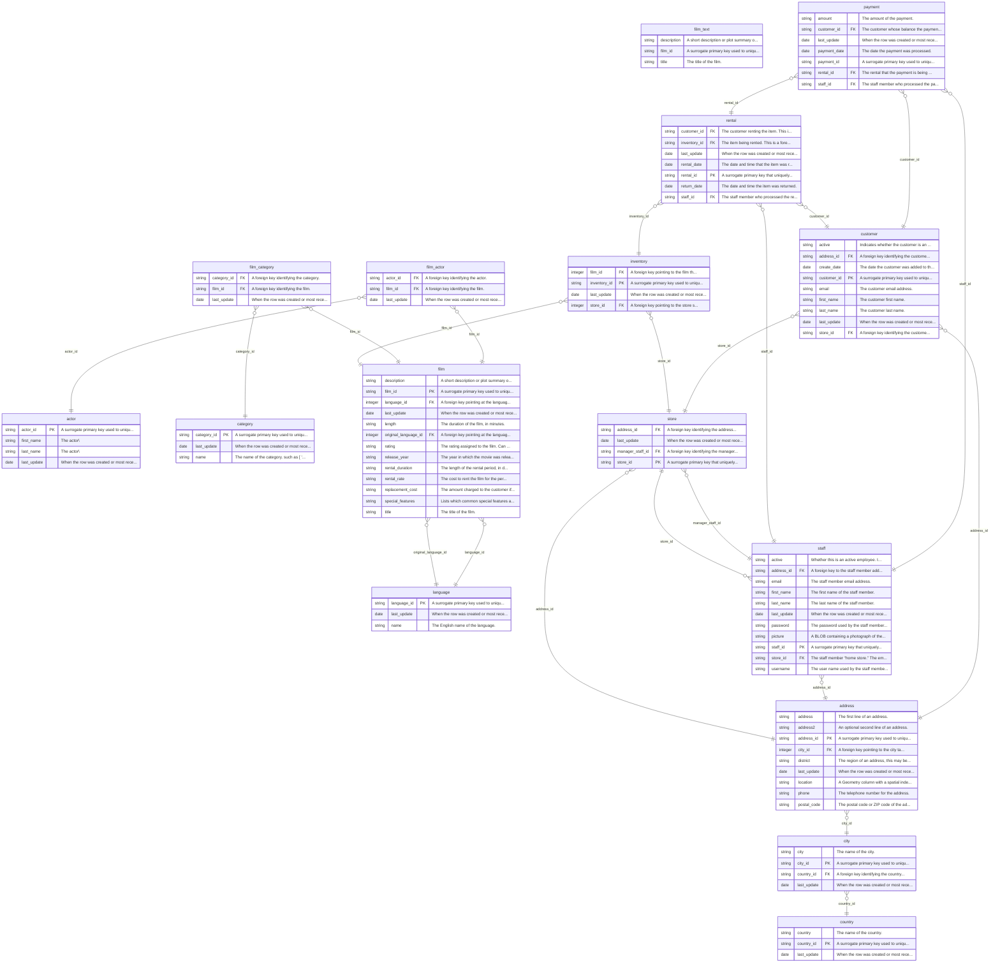

```mermaid
erDiagram
    person {
        string person_id PK "Unique identifier for the person."
        string primary_name "Full credited name of the person."
        string first_name "First name of the person."
        string last_name "Last name of the person."
        string birth_year "Birth year in YYYY format."
        string death_year "Death year in YYYY format, if applica..."
        string primary_profession "Top professions of the person."
        datetime last_update "Timestamp when the record was last up..."
    }
    title {
        string title_id PK "Unique identifier for the title or film."
        string title_type "Format or type of the title (e.g., mo..."
        string primary_title "Primary promotional title."
        string original_title "Original title in original language."
        string description "Plot summary or description."
        boolean is_adult "Whether the title is classified as ad..."
        string release_year "Release year or series premiere year ..."
        string end_year "TV series end year (YYYY)."
        integer runtime_minutes "Runtime of the title in minutes."
        string language_id FK "Primary spoken language identifier."
        string original_language_id FK "Original audio language identifier."
        integer rental_duration "Rental period in days."
        number rental_rate "Rental fee rate."
        number replacement_cost "Replacement cost if damaged or lost."
        string content_rating "Content advisory rating (e.g. PG-13, R)."
        string special_features "Special DVD/media features."
        datetime last_update "Timestamp when the record was last up..."
    }
    title_alias {
        string title_alias_id PK "Surrogate key for the title alias rec..."
        string title_id FK "Foreign key referencing the title."
        integer ordering "Sequential ordering identifier for ti..."
        string title "Alternative or localized title text."
        string region "Geographical release region."
        string language "Language code or name of the localize..."
        string types "Type classifications of the alternati..."
        string attributes "Additional descriptive attributes."
        boolean is_original_title "Whether this is the original title."
    }
    title_episode {
        string episode_title_id PK,FK "Foreign key referencing the episode t..."
        string parent_title_id FK "Foreign key referencing the parent se..."
        integer season_number "Season number of the episode."
        integer episode_number "Episode number in the season."
    }
    title_principal {
        string title_principal_id PK "Surrogate identifier for the title pr..."
        string title_id FK "Foreign key pointing to the title."
        string person_id FK "Foreign key pointing to the person."
        integer ordering "Display ordering index."
        string category "Category of job or involvement (e.g. ..."
        string job "Specific job title if applicable."
        string characters "Character name played if applicable."
        datetime last_update "Timestamp when the record was last up..."
    }
    title_rating {
        string title_id PK,FK "Foreign key identifying the title."
        number average_rating "Weighted average user rating."
        integer num_votes "Total number of votes received."
    }
    category {
        string category_id PK "Unique identifier for the genre or ca..."
        string name "Name of the category or genre."
        datetime last_update "Timestamp of last update."
    }
    title_category {
        string title_id PK,FK "Foreign key pointing to the title."
        string category_id PK,FK "Foreign key pointing to the category."
        datetime last_update "Timestamp of last update."
    }
    language {
        string language_id PK "Unique identifier for the language."
        string name "Language name."
        datetime last_update "Timestamp of last update."
    }
    country {
        string country_id PK "Unique identifier for the country."
        string country "Name of the country."
        datetime last_update "Timestamp of last update."
    }
    city {
        string city_id PK "Unique identifier for the city."
        string city "Name of the city."
        string country_id FK "Foreign key identifying the country."
        datetime last_update "Timestamp of last update."
    }
    address {
        string address_id PK "Unique identifier for the address."
        string address "First address line."
        string address2 "Second address line."
        string district "District, province, or state."
        string city_id FK "Foreign key pointing to the city."
        string postal_code "Postal code."
        string phone "Contact telephone number."
        string location "Spatial geometry representation."
        datetime last_update "Timestamp of last update."
    }
    store {
        string store_id PK "Unique identifier for the store."
        string manager_staff_id FK "Foreign key identifying the manager s..."
        string address_id FK "Foreign key identifying the store add..."
        datetime last_update "Timestamp of last update."
    }
    staff {
        string staff_id PK "Unique identifier for the staff member."
        string first_name "First name of the staff member."
        string last_name "Last name of the staff member."
        string address_id FK "Foreign key pointing to staff address."
        string picture "Photograph of the staff member."
        string email "Staff member email address."
        string store_id FK "Foreign key referencing the home store."
        boolean active "Whether the staff member is active."
        string username "System username."
        string password "System password hash."
        datetime last_update "Timestamp of last update."
    }
    customer {
        string customer_id PK "Unique identifier for the customer."
        string store_id FK "Foreign key identifying customer home..."
        string first_name "First name of the customer."
        string last_name "Last name of the customer."
        string email "Email address of the customer."
        string address_id FK "Foreign key referencing customer addr..."
        boolean active "Whether the customer account is active."
        date create_date "Date the customer account was created."
        datetime last_update "Timestamp of last update."
    }
    inventory {
        string inventory_id PK "Unique identifier for the physical in..."
        string title_id FK "Foreign key referencing the title."
        string store_id FK "Foreign key pointing to the stocking ..."
        datetime last_update "Timestamp of last update."
    }
    rental {
        string rental_id PK "Unique identifier for the rental tran..."
        datetime rental_date "Date and time the item was rented out."
        string inventory_id FK "Foreign key pointing to the inventory..."
        string customer_id FK "Foreign key pointing to the customer."
        datetime return_date "Date and time the item was returned."
        string staff_id FK "Foreign key pointing to the processin..."
        datetime last_update "Timestamp of last update."
    }
    payment {
        string payment_id PK "Unique identifier for the payment."
        string customer_id FK "Foreign key referencing the paying cu..."
        string staff_id FK "Foreign key referencing the staff mem..."
        string rental_id FK "Foreign key referencing the rental tr..."
        number amount "Payment monetary amount."
        datetime payment_date "Timestamp when payment was processed."
        datetime last_update "Timestamp of last update."
    }
    title }o--|| language : "language_id"
    title }o--|| language : "original_language_id"
    title_alias }o--|| title : "title_id"
    title_episode }o--|| title : "episode_title_id"
    title_episode }o--|| title : "parent_title_id"
    title_principal }o--|| title : "title_id"
    title_principal }o--|| person : "person_id"
    title_rating }o--|| title : "title_id"
    title_category }o--|| title : "title_id"
    title_category }o--|| category : "category_id"
    city }o--|| country : "country_id"
    address }o--|| city : "city_id"
    store }o--|| address : "address_id"
    store }o--|| staff : "manager_staff_id"
    staff }o--|| address : "address_id"
    staff }o--|| store : "store_id"
    customer }o--|| address : "address_id"
    customer }o--|| store : "store_id"
    inventory }o--|| title : "title_id"
    inventory }o--|| store : "store_id"
    rental }o--|| customer : "customer_id"
    rental }o--|| inventory : "inventory_id"
    rental }o--|| staff : "staff_id"
    payment }o--|| customer : "customer_id"
    payment }o--|| rental : "rental_id"
    payment }o--|| staff : "staff_id"
```

# Schema Alignment Diagnostic Report — imdb-sakila

## Summary Results

## Detailed Analysis

# Schema Alignment Diagnostic Report — imdb-sakila

- **Model**: `gemini-3.8-flash`
- **Domain**: Media & Entertainment
- **Status**: `SUCCESS (3/3)`
- **Iterations**: `3`
- **Source A**: `imdb` (7 tables, 39 cols)
- **Source B**: `sakila` (16 tables, 90 cols)

## Schema Architectures (ER Diagrams)

### Source A Schema (`imdb`)

```mermaid
erDiagram
    name_basics {
        string birthyear "birth year (YYYY)"
        string deathyear "death year if applicable, else"
        string knownfortitles "titles the person is known for (array..."
        number nconst PK "alphanumeric unique identifier of the..."
        string primaryname "name by which the person is most ofte..."
        string primaryprofession "the top-3 professions of the person (..."
    }
    title_akas {
        string attributes "Additional terms to describe this alt..."
        boolean isoriginaltitle "0: not original title. 1: original ti..."
        string language "the language of the title (string)"
        integer ordering "a number to uniquely identify rows fo..."
        string region "the region for this version of the ti..."
        string title "the localized title (string)"
        number titleid FK "a tconst (string, an alphanumeric uni..."
        string types "Enumerated set of attributes for this..."
    }
    title_basics {
        string endyear "TV Series end year (YYYY). ‘\N’ for a..."
        string genres "includes up to three genres associate..."
        boolean isadult "0: non-adult title. 1: adult title (b..."
        string originaltitle "original title (string) (in the origi..."
        integer primarytitle "the more popular title (string) (the ..."
        integer runtimeminutes "primary runtime of the title (integer..."
        string startyear "represents the release year of a titl..."
        number tconst PK "alphanumeric unique identifier of the..."
        string titletype "the type/format of the title (string)..."
    }
    title_crew {
        string directors "director(s) of the given title (array..."
        number tconst FK "alphanumeric unique identifier of the..."
        string writers "writer(s) of the given title (array o..."
    }
    title_episode {
        integer episodenumber "episode number of the tconst in the T..."
        number parenttconst FK "alphanumeric identifier of the parent..."
        integer seasonnumber "season number the episode belongs to ..."
        number tconst FK "alphanumeric identifier of episode (s..."
    }
    title_principals {
        string category "the category of job that person was i..."
        string characters "the name of the character played if a..."
        string job "the specific job title if applicable,..."
        number nconst FK "alphanumeric unique identifier of the..."
        integer ordering "a number to uniquely identify rows fo..."
        number tconst FK "alphanumeric unique identifier of the..."
    }
    title_ratings {
        number averagerating "weighted average of all the individua..."
        integer numvotes "number of votes the title has receive..."
        number tconst FK "alphanumeric unique identifier of the..."
    }
    title_akas }o--|| title_basics : "titleid"
    title_crew }o--|| title_basics : "tconst"
    title_episode }o--|| title_basics : "parenttconst"
    title_episode }o--|| title_basics : "tconst"
    title_principals }o--|| name_basics : "nconst"
    title_principals }o--|| title_basics : "tconst"
    title_ratings }o--|| title_basics : "tconst"
```

### Source B Schema (`sakila`)

### Generated Unified Target Schemas per Iteration

> [!NOTE]
> Use the toggles below to view the target schema ER diagram generated in each iteration. The representative run is expanded by default.

```mermaid
erDiagram
    title {
        string title_id PK "Unique identifier for the title/film."
        string primary_title "Primary popular display title."
        string original_title "Original title in original language."
        string title_type "Type or format of title (movie, short..."
        boolean is_adult "Flag indicating whether title is inte..."
        string release_year "Release or start year of the title."
        string end_year "TV series end year if applicable."
        integer runtime_minutes "Runtime duration in minutes."
        string description "Short synopsis or description."
        string mpaa_rating "Parental rating / MPAA guidance rating."
        string language_id FK "Foreign key referencing original/prim..."
        string original_language_id FK "Foreign key referencing original lang..."
        integer rental_duration_days "Rental period duration in days."
        number rental_rate "Cost to rent the film."
        number replacement_cost "Charge if film is damaged or unreturned."
        string special_features "Included DVD special features."
        date last_update "Timestamp of last record update."
    }
    title_aka {
        string title_aka_id PK "Synthetic surrogate key for alternati..."
        string title_id FK "Foreign key referencing parent title."
        integer ordering "Ordering identifier for title AKAs."
        string title "Localized or alternative title name."
        string region "Geographic region for this title vers..."
        string language "Language of this title version."
        string types "Enumerated types for this alternative..."
        string attributes "Additional descriptive terms."
        boolean is_original_title "Flag indicating if this is the origin..."
    }
    title_rating {
        string title_id PK,FK "Foreign key referencing title."
        number average_rating "Weighted average user rating."
        integer num_votes "Total number of user votes."
    }
    title_episode {
        string episode_title_id PK,FK "Identifier of the episode title."
        string parent_series_title_id FK "Identifier of the parent series title."
        integer season_number "Season number."
        integer episode_number "Episode number within the season."
    }
    category {
        string category_id PK "Unique identifier for category/genre."
        string name "Name of the category or genre."
        date last_update "Timestamp of last record update."
    }
    title_category {
        string title_id PK,FK "Foreign key referencing title."
        string category_id PK,FK "Foreign key referencing category."
        date last_update "Timestamp of last record update."
    }
    person {
        string person_id PK "Unique identifier of the person or ac..."
        string primary_name "Full display/credited name."
        string first_name "First name of person."
        string last_name "Last name of person."
        string birth_year "Birth year (YYYY)."
        string death_year "Death year (YYYY) if applicable."
        date last_update "Timestamp of last record update."
    }
    title_principal {
        string title_principal_id PK "Synthetic surrogate key for title pri..."
        string title_id FK "Foreign key referencing title."
        string person_id FK "Foreign key referencing person."
        integer ordering "Ordering number for title cast/crew b..."
        string category "Broad category of job (e.g., actor, d..."
        string job "Specific job role or title."
        string characters "Name of character played."
        date last_update "Timestamp of last record update."
    }
    person_known_for_title {
        string person_id PK,FK "Foreign key referencing person."
        string title_id PK,FK "Foreign key referencing title known for."
    }
    person_profession {
        string person_id PK,FK "Foreign key referencing person."
        string profession PK "Profession name."
    }
    language {
        string language_id PK "Surrogate primary key identifying the..."
        string name "English name of language."
        date last_update "Timestamp of last record update."
    }
    country {
        string country_id PK "Primary key identifying the country."
        string country "Name of the country."
        date last_update "Timestamp of last record update."
    }
    city {
        string city_id PK "Primary key identifying the city."
        string city "Name of the city."
        string country_id FK "Foreign key referencing country."
        date last_update "Timestamp of last record update."
    }
    address {
        string address_id PK "Primary key identifying the address."
        string address "First address line."
        string address2 "Second address line."
        string district "District, state, or province."
        integer city_id FK "Foreign key referencing city."
        string postal_code "Postal or ZIP code."
        string phone "Telephone number."
        string location "Spatial geometry location."
        date last_update "Timestamp of last record update."
    }
    store {
        string store_id PK "Primary key identifying the store."
        string manager_staff_id FK "Foreign key referencing store manager..."
        string address_id FK "Foreign key referencing store address."
        date last_update "Timestamp of last record update."
    }
    staff {
        string staff_id PK "Primary key identifying the staff mem..."
        string first_name "First name of staff member."
        string last_name "Last name of staff member."
        string address_id FK "Address foreign key."
        string email "Email address."
        string store_id FK "Home store foreign key."
        boolean active "Active employment status."
        string username "System username."
        string password "Password hash."
        string picture "Binary/BLOB image photograph represen..."
        date last_update "Timestamp of last record update."
    }
    customer {
        string customer_id PK "Primary key identifying the customer."
        string store_id FK "Customer home store foreign key."
        string first_name "Customer first name."
        string last_name "Customer last name."
        string email "Customer email address."
        string address_id FK "Customer address foreign key."
        boolean active "Active customer flag."
        date create_date "Date customer record was created."
        date last_update "Timestamp of last record update."
    }
    inventory {
        string inventory_id PK "Primary key identifying the inventory..."
        string title_id FK "Foreign key referencing film/title."
        integer store_id FK "Foreign key referencing store stockin..."
        date last_update "Timestamp of last record update."
    }
    rental {
        string rental_id PK "Primary key identifying the rental tr..."
        datetime rental_date "Date and time item was rented."
        string inventory_id FK "Foreign key referencing inventory ite..."
        string customer_id FK "Foreign key referencing customer rent..."
        datetime return_date "Date and time item was returned."
        string staff_id FK "Foreign key referencing staff member ..."
        date last_update "Timestamp of last record update."
    }
    payment {
        string payment_id PK "Primary key identifying the payment."
        string customer_id FK "Foreign key referencing customer."
        string staff_id FK "Foreign key referencing staff member ..."
        string rental_id FK "Foreign key referencing associated re..."
        number amount "Amount of the payment."
        datetime payment_date "Date payment was processed."
        date last_update "Timestamp of last record update."
    }
    title }o--|| language : "language_id"
    title }o--|| language : "original_language_id"
    title_aka }o--|| title : "title_id"
    title_rating }o--|| title : "title_id"
    title_episode }o--|| title : "episode_title_id"
    title_episode }o--|| title : "parent_series_title_id"
    title_category }o--|| category : "category_id"
    title_category }o--|| title : "title_id"
    title_principal }o--|| person : "person_id"
    title_principal }o--|| title : "title_id"
    person_known_for_title }o--|| person : "person_id"
    person_known_for_title }o--|| title : "title_id"
    person_profession }o--|| person : "person_id"
    city }o--|| country : "country_id"
    address }o--|| city : "city_id"
    store }o--|| address : "address_id"
    store }o--|| staff : "manager_staff_id"
    staff }o--|| address : "address_id"
    staff }o--|| store : "store_id"
    customer }o--|| address : "address_id"
    customer }o--|| store : "store_id"
    inventory }o--|| store : "store_id"
    inventory }o--|| title : "title_id"
    rental }o--|| customer : "customer_id"
    rental }o--|| inventory : "inventory_id"
    rental }o--|| staff : "staff_id"
    payment }o--|| customer : "customer_id"
    payment }o--|| rental : "rental_id"
    payment }o--|| staff : "staff_id"
```

<b>Iteration 1 Target Schema (20 tables, S_rel: 1.0000)</b>

<b>Iteration 2 Target Schema (18 tables, S_rel: 0.9655)</b>

<b>Iteration 3 Target Schema (18 tables, S_rel: 1.0000) [Representative / Final Run]</b>

```mermaid
erDiagram
    film_work {
        string film_work_id PK "Unique identifier for the film or med..."
        string title "Primary or display title of the film ..."
        string original_title "Original language title of the film w..."
        string work_type "Type or format of the media work (e.g..."
        boolean is_adult "Flag indicating whether the title is ..."
        integer release_year "Release year or start year of the fil..."
        integer end_year "TV series end year if applicable."
        integer runtime_minutes "Duration of the film work in minutes."
        string description "Short plot summary or description of ..."
        string mpaa_rating "Content advisory rating (e.g., PG, R,..."
        integer rental_duration "Rental duration limit in days."
        number rental_rate "Rental fee for the film."
        number replacement_cost "Cost to replace damaged or lost physi..."
        string special_features "Special features available on the rel..."
        string language_id FK "Foreign key referencing the audio lan..."
        string original_language_id FK "Foreign key referencing the original ..."
        datetime last_update "Timestamp when the record was last mo..."
    }
    language {
        string language_id PK "Unique identifier for the language."
        string name "English name of the language."
        datetime last_update "Timestamp when the record was last mo..."
    }
    person {
        string person_id PK "Unique identifier for the person."
        string full_name "Full display name of the person."
        string first_name "First name of the person."
        string last_name "Last name or surname of the person."
        integer birth_year "Birth year of the person (YYYY)."
        integer death_year "Death year of the person (YYYY) if de..."
        string primary_profession "Primary professions of the individual."
        datetime last_update "Timestamp when the record was last mo..."
    }
    film_work_participant {
        string participation_id PK "Synthetic surrogate key for the parti..."
        string film_work_id FK "Reference to the film work."
        string person_id FK "Reference to the person."
        string category "Category or job of the participant (e..."
        string job "Specific job title or duty."
        string characters "Name of the character played if appli..."
        integer ordering "Display order / billing index in the ..."
        datetime last_update "Timestamp when the record was last mo..."
    }
    genre {
        string genre_id PK "Unique identifier for the genre/categ..."
        string name "Name of the category or genre."
        datetime last_update "Timestamp when the record was last mo..."
    }
    film_work_genre {
        string film_work_id PK,FK "Foreign key referencing the film work."
        string genre_id PK,FK "Foreign key referencing the genre."
        datetime last_update "Timestamp when the record was last mo..."
    }
    film_work_alias {
        string alias_id PK "Synthetic surrogate key for title ali..."
        string film_work_id FK "Foreign key referencing the film work."
        integer ordering "Number uniquely identifying rows for ..."
        string title "The localized or alternative title text."
        string region "Geographic region for this title vers..."
        string language "Language of the title variant."
        string types "Enumerated set of attributes or relea..."
        string attributes "Additional descriptive terms for the ..."
        boolean is_original_title "Flag indicating if this is the origin..."
    }
    film_work_episode {
        string episode_film_work_id PK,FK "Foreign key referencing the episode f..."
        string parent_film_work_id FK "Foreign key referencing the parent se..."
        integer season_number "Season number the episode belongs to."
        integer episode_number "Episode number within the season."
    }
    film_work_rating {
        string film_work_id PK,FK "Foreign key referencing the film work."
        number average_rating "Weighted average user rating."
        integer num_votes "Number of user votes received."
    }
    country {
        string country_id PK "Surrogate primary key identifying eac..."
        string country "Name of the country."
        datetime last_update "Timestamp when the record was last mo..."
    }
    city {
        string city_id PK "Surrogate primary key identifying eac..."
        string city "Name of the city."
        string country_id FK "Foreign key identifying the country."
        datetime last_update "Timestamp when the record was last mo..."
    }
    address {
        string address_id PK "Surrogate primary key identifying eac..."
        string address "Primary street address line."
        string address2 "Secondary street address line."
        string district "District, state, or province."
        string city_id FK "Foreign key pointing to the city."
        string postal_code "Postal or ZIP code."
        string phone "Telephone number."
        string location "Spatial location geometry representat..."
        datetime last_update "Timestamp when the record was last mo..."
    }
    store {
        string store_id PK "Surrogate primary key uniquely identi..."
        string manager_staff_id FK "Foreign key referencing the store man..."
        string address_id FK "Foreign key identifying the address o..."
        datetime last_update "Timestamp when the record was last mo..."
    }
    staff {
        string staff_id PK "Surrogate primary key identifying the..."
        string first_name "Staff member first name."
        string last_name "Staff member last name."
        string address_id FK "Foreign key pointing to staff address."
        string email "Staff email address."
        string store_id FK "Home store assignment for staff member."
        boolean active "Flag indicating if the staff member i..."
        string username "Username for system authentication."
        string password "Hashed password for authentication."
        string picture "Staff photograph data/link."
        datetime last_update "Timestamp when the record was last mo..."
    }
    customer {
        string customer_id PK "Surrogate primary key identifying the..."
        string store_id FK "Home store of the customer."
        string first_name "Customer first name."
        string last_name "Customer last name."
        string email "Customer email address."
        string address_id FK "Foreign key pointing to customer addr..."
        boolean active "Flag indicating active status of the ..."
        date create_date "Date customer was added to system."
        datetime last_update "Timestamp when the record was last mo..."
    }
    inventory {
        string inventory_id PK "Surrogate primary key identifying inv..."
        string film_work_id FK "Foreign key referencing the stocked f..."
        string store_id FK "Foreign key pointing to the stocking ..."
        datetime last_update "Timestamp when the record was last mo..."
    }
    rental {
        string rental_id PK "Surrogate primary key identifying eac..."
        datetime rental_date "Date and time the item was rented."
        string inventory_id FK "Foreign key referencing rented invent..."
        string customer_id FK "Foreign key referencing customer rent..."
        datetime return_date "Date and time the item was returned."
        string staff_id FK "Foreign key referencing staff member ..."
        datetime last_update "Timestamp when the record was last mo..."
    }
    payment {
        string payment_id PK "Surrogate primary key identifying the..."
        string customer_id FK "Foreign key referencing the customer ..."
        string staff_id FK "Foreign key referencing staff member ..."
        string rental_id FK "Foreign key referencing associated re..."
        number amount "Amount paid in transaction."
        datetime payment_date "Timestamp when payment was processed."
        datetime last_update "Timestamp when the record was last mo..."
    }
    film_work }o--|| language : "language_id"
    film_work }o--|| language : "original_language_id"
    film_work_participant }o--|| film_work : "film_work_id"
    film_work_participant }o--|| person : "person_id"
    film_work_genre }o--|| film_work : "film_work_id"
    film_work_genre }o--|| genre : "genre_id"
    film_work_alias }o--|| film_work : "film_work_id"
    film_work_episode }o--|| film_work : "episode_film_work_id"
    film_work_episode }o--|| film_work : "parent_film_work_id"
    film_work_rating }o--|| film_work : "film_work_id"
    city }o--|| country : "country_id"
    address }o--|| city : "city_id"
    store }o--|| address : "address_id"
    store }o--|| staff : "manager_staff_id"
    staff }o--|| address : "address_id"
    staff }o--|| store : "store_id"
    customer }o--|| address : "address_id"
    customer }o--|| store : "store_id"
    inventory }o--|| film_work : "film_work_id"
    inventory }o--|| store : "store_id"
    rental }o--|| customer : "customer_id"
    rental }o--|| inventory : "inventory_id"
    rental }o--|| staff : "staff_id"
    payment }o--|| customer : "customer_id"
    payment }o--|| rental : "rental_id"
    payment }o--|| staff : "staff_id"
```

## Performance & Efficiency Summary

| Completeness (Cov_attr) | Structural Integrity (S_rel) | Intra-Table Uniqueness (M_unique) | Latency (s) | Total Tokens |
| --- | --- | --- | --- | --- |
| 0.9741 | 0.9885 | 1.0000 | 42.36s | 61,938 |

## Target Schema Detailed Specifications

### Target Table: `film_work`

| Column Name | Type | Key | Source Provenance | Description |
| --- | --- | --- | --- | --- |
| `film_work_id` | string | PK | `imdb.title_basics.tconst`, `sakila.film.film_id`, `sakila.film_text.film_id` | Unique identifier for the film or media work. |
| `title` | string | - | `imdb.title_basics.primarytitle`, `sakila.film.title`, `sakila.film_text.title` | Primary or display title of the film work. |
| `original_title` | string | - | `imdb.title_basics.originaltitle` | Original language title of the film work. |
| `work_type` | string | - | `imdb.title_basics.titletype` | Type or format of the media work (e.g. movie, tvseries, short). |
| `is_adult` | boolean | - | `imdb.title_basics.isadult` | Flag indicating whether the title is for adult audiences. |
| `release_year` | integer | - | `imdb.title_basics.startyear`, `sakila.film.release_year` | Release year or start year of the film work. |
| `end_year` | integer | - | `imdb.title_basics.endyear` | TV series end year if applicable. |
| `runtime_minutes` | integer | - | `imdb.title_basics.runtimeminutes`, `sakila.film.length` | Duration of the film work in minutes. |
| `description` | string | - | `sakila.film.description`, `sakila.film_text.description` | Short plot summary or description of the film work. |
| `mpaa_rating` | string | - | `sakila.film.rating` | Content advisory rating (e.g., PG, R, NC-17). |
| `rental_duration` | integer | - | `sakila.film.rental_duration` | Rental duration limit in days. |
| `rental_rate` | number | - | `sakila.film.rental_rate` | Rental fee for the film. |
| `replacement_cost` | number | - | `sakila.film.replacement_cost` | Cost to replace damaged or lost physical copy. |
| `special_features` | string | - | `sakila.film.special_features` | Special features available on the release. |
| `language_id` | string | FK -> `language.language_id` | `sakila.film.language_id` | Foreign key referencing the audio language of the film. |
| `original_language_id` | string | FK -> `language.language_id` | `sakila.film.original_language_id` | Foreign key referencing the original audio language of the film. |
| `last_update` | datetime | - | `sakila.film.last_update` | Timestamp when the record was last modified. |

### Target Table: `language`

| Column Name | Type | Key | Source Provenance | Description |
| --- | --- | --- | --- | --- |
| `language_id` | string | PK | `sakila.language.language_id` | Unique identifier for the language. |
| `name` | string | - | `sakila.language.name` | English name of the language. |
| `last_update` | datetime | - | `sakila.language.last_update` | Timestamp when the record was last modified. |

### Target Table: `person`

| Column Name | Type | Key | Source Provenance | Description |
| --- | --- | --- | --- | --- |
| `person_id` | string | PK | `imdb.name_basics.nconst`, `sakila.actor.actor_id` | Unique identifier for the person. |
| `full_name` | string | - | `imdb.name_basics.primaryname` | Full display name of the person. |
| `first_name` | string | - | `sakila.actor.first_name` | First name of the person. |
| `last_name` | string | - | `sakila.actor.last_name` | Last name or surname of the person. |
| `birth_year` | integer | - | `imdb.name_basics.birthyear` | Birth year of the person (YYYY). |
| `death_year` | integer | - | `imdb.name_basics.deathyear` | Death year of the person (YYYY) if deceased. |
| `primary_profession` | string | - | `imdb.name_basics.primaryprofession` | Primary professions of the individual. |
| `last_update` | datetime | - | `sakila.actor.last_update` | Timestamp when the record was last modified. |

### Target Table: `film_work_participant`

| Column Name | Type | Key | Source Provenance | Description |
| --- | --- | --- | --- | --- |
| `participation_id` | string | PK | - | Synthetic surrogate key for the participation record. |
| `film_work_id` | string | FK -> `film_work.film_work_id` | `imdb.title_principals.tconst`, `imdb.title_crew.tconst`, `sakila.film_actor.film_id` | Reference to the film work. |
| `person_id` | string | FK -> `person.person_id` | `imdb.title_principals.nconst`, `sakila.film_actor.actor_id` | Reference to the person. |
| `category` | string | - | `imdb.title_principals.category` | Category or job of the participant (e.g. actor, director, writer). |
| `job` | string | - | `imdb.title_principals.job` | Specific job title or duty. |
| `characters` | string | - | `imdb.title_principals.characters` | Name of the character played if applicable. |
| `ordering` | integer | - | `imdb.title_principals.ordering` | Display order / billing index in the credits. |
| `last_update` | datetime | - | `sakila.film_actor.last_update` | Timestamp when the record was last modified. |

### Target Table: `genre`

| Column Name | Type | Key | Source Provenance | Description |
| --- | --- | --- | --- | --- |
| `genre_id` | string | PK | `sakila.category.category_id` | Unique identifier for the genre/category. |
| `name` | string | - | `sakila.category.name` | Name of the category or genre. |
| `last_update` | datetime | - | `sakila.category.last_update` | Timestamp when the record was last modified. |

### Target Table: `film_work_genre`

| Column Name | Type | Key | Source Provenance | Description |
| --- | --- | --- | --- | --- |
| `film_work_id` | string | PK, FK | `sakila.film_category.film_id` | Foreign key referencing the film work. |
| `genre_id` | string | PK, FK | `sakila.film_category.category_id` | Foreign key referencing the genre. |
| `last_update` | datetime | - | `sakila.film_category.last_update` | Timestamp when the record was last modified. |

### Target Table: `film_work_alias`

| Column Name | Type | Key | Source Provenance | Description |
| --- | --- | --- | --- | --- |
| `alias_id` | string | PK | - | Synthetic surrogate key for title alias entry. |
| `film_work_id` | string | FK -> `film_work.film_work_id` | `imdb.title_akas.titleid` | Foreign key referencing the film work. |
| `ordering` | integer | - | `imdb.title_akas.ordering` | Number uniquely identifying rows for a given title. |
| `title` | string | - | `imdb.title_akas.title` | The localized or alternative title text. |
| `region` | string | - | `imdb.title_akas.region` | Geographic region for this title version. |
| `language` | string | - | `imdb.title_akas.language` | Language of the title variant. |
| `types` | string | - | `imdb.title_akas.types` | Enumerated set of attributes or release types for the alias. |
| `attributes` | string | - | `imdb.title_akas.attributes` | Additional descriptive terms for the alternative title. |
| `is_original_title` | boolean | - | `imdb.title_akas.isoriginaltitle` | Flag indicating if this is the original title. |

### Target Table: `film_work_episode`

| Column Name | Type | Key | Source Provenance | Description |
| --- | --- | --- | --- | --- |
| `episode_film_work_id` | string | PK, FK | `imdb.title_episode.tconst` | Foreign key referencing the episode film work. |
| `parent_film_work_id` | string | FK -> `film_work.film_work_id` | `imdb.title_episode.parenttconst` | Foreign key referencing the parent series film work. |
| `season_number` | integer | - | `imdb.title_episode.seasonnumber` | Season number the episode belongs to. |
| `episode_number` | integer | - | `imdb.title_episode.episodenumber` | Episode number within the season. |

### Target Table: `film_work_rating`

| Column Name | Type | Key | Source Provenance | Description |
| --- | --- | --- | --- | --- |
| `film_work_id` | string | PK, FK | `imdb.title_ratings.tconst` | Foreign key referencing the film work. |
| `average_rating` | number | - | `imdb.title_ratings.averagerating` | Weighted average user rating. |
| `num_votes` | integer | - | `imdb.title_ratings.numvotes` | Number of user votes received. |

### Target Table: `country`

| Column Name | Type | Key | Source Provenance | Description |
| --- | --- | --- | --- | --- |
| `country_id` | string | PK | `sakila.country.country_id` | Surrogate primary key identifying each country. |
| `country` | string | - | `sakila.country.country` | Name of the country. |
| `last_update` | datetime | - | `sakila.country.last_update` | Timestamp when the record was last modified. |

### Target Table: `city`

| Column Name | Type | Key | Source Provenance | Description |
| --- | --- | --- | --- | --- |
| `city_id` | string | PK | `sakila.city.city_id` | Surrogate primary key identifying each city. |
| `city` | string | - | `sakila.city.city` | Name of the city. |
| `country_id` | string | FK -> `country.country_id` | `sakila.city.country_id` | Foreign key identifying the country. |
| `last_update` | datetime | - | `sakila.city.last_update` | Timestamp when the record was last modified. |

### Target Table: `address`

| Column Name | Type | Key | Source Provenance | Description |
| --- | --- | --- | --- | --- |
| `address_id` | string | PK | `sakila.address.address_id` | Surrogate primary key identifying each address. |
| `address` | string | - | `sakila.address.address` | Primary street address line. |
| `address2` | string | - | `sakila.address.address2` | Secondary street address line. |
| `district` | string | - | `sakila.address.district` | District, state, or province. |
| `city_id` | string | FK -> `city.city_id` | `sakila.address.city_id` | Foreign key pointing to the city. |
| `postal_code` | string | - | `sakila.address.postal_code` | Postal or ZIP code. |
| `phone` | string | - | `sakila.address.phone` | Telephone number. |
| `location` | string | - | `sakila.address.location` | Spatial location geometry representation. |
| `last_update` | datetime | - | `sakila.address.last_update` | Timestamp when the record was last modified. |

### Target Table: `store`

| Column Name | Type | Key | Source Provenance | Description |
| --- | --- | --- | --- | --- |
| `store_id` | string | PK | `sakila.store.store_id` | Surrogate primary key uniquely identifying the store. |
| `manager_staff_id` | string | FK -> `staff.staff_id` | `sakila.store.manager_staff_id` | Foreign key referencing the store manager staff member. |
| `address_id` | string | FK -> `address.address_id` | `sakila.store.address_id` | Foreign key identifying the address of the store. |
| `last_update` | datetime | - | `sakila.store.last_update` | Timestamp when the record was last modified. |

### Target Table: `staff`

| Column Name | Type | Key | Source Provenance | Description |
| --- | --- | --- | --- | --- |
| `staff_id` | string | PK | `sakila.staff.staff_id` | Surrogate primary key identifying the staff member. |
| `first_name` | string | - | `sakila.staff.first_name` | Staff member first name. |
| `last_name` | string | - | `sakila.staff.last_name` | Staff member last name. |
| `address_id` | string | FK -> `address.address_id` | `sakila.staff.address_id` | Foreign key pointing to staff address. |
| `email` | string | - | `sakila.staff.email` | Staff email address. |
| `store_id` | string | FK -> `store.store_id` | `sakila.staff.store_id` | Home store assignment for staff member. |
| `active` | boolean | - | `sakila.staff.active` | Flag indicating if the staff member is active. |
| `username` | string | - | `sakila.staff.username` | Username for system authentication. |
| `password` | string | - | `sakila.staff.password` | Hashed password for authentication. |
| `picture` | string | - | `sakila.staff.picture` | Staff photograph data/link. |
| `last_update` | datetime | - | `sakila.staff.last_update` | Timestamp when the record was last modified. |

### Target Table: `customer`

| Column Name | Type | Key | Source Provenance | Description |
| --- | --- | --- | --- | --- |
| `customer_id` | string | PK | `sakila.customer.customer_id` | Surrogate primary key identifying the customer. |
| `store_id` | string | FK -> `store.store_id` | `sakila.customer.store_id` | Home store of the customer. |
| `first_name` | string | - | `sakila.customer.first_name` | Customer first name. |
| `last_name` | string | - | `sakila.customer.last_name` | Customer last name. |
| `email` | string | - | `sakila.customer.email` | Customer email address. |
| `address_id` | string | FK -> `address.address_id` | `sakila.customer.address_id` | Foreign key pointing to customer address. |
| `active` | boolean | - | `sakila.customer.active` | Flag indicating active status of the customer. |
| `create_date` | date | - | `sakila.customer.create_date` | Date customer was added to system. |
| `last_update` | datetime | - | `sakila.customer.last_update` | Timestamp when the record was last modified. |

### Target Table: `inventory`

| Column Name | Type | Key | Source Provenance | Description |
| --- | --- | --- | --- | --- |
| `inventory_id` | string | PK | `sakila.inventory.inventory_id` | Surrogate primary key identifying inventory item. |
| `film_work_id` | string | FK -> `film_work.film_work_id` | `sakila.inventory.film_id` | Foreign key referencing the stocked film work. |
| `store_id` | string | FK -> `store.store_id` | `sakila.inventory.store_id` | Foreign key pointing to the stocking store. |
| `last_update` | datetime | - | `sakila.inventory.last_update` | Timestamp when the record was last modified. |

### Target Table: `rental`

| Column Name | Type | Key | Source Provenance | Description |
| --- | --- | --- | --- | --- |
| `rental_id` | string | PK | `sakila.rental.rental_id` | Surrogate primary key identifying each rental transaction. |
| `rental_date` | datetime | - | `sakila.rental.rental_date` | Date and time the item was rented. |
| `inventory_id` | string | FK -> `inventory.inventory_id` | `sakila.rental.inventory_id` | Foreign key referencing rented inventory item. |
| `customer_id` | string | FK -> `customer.customer_id` | `sakila.rental.customer_id` | Foreign key referencing customer renting item. |
| `return_date` | datetime | - | `sakila.rental.return_date` | Date and time the item was returned. |
| `staff_id` | string | FK -> `staff.staff_id` | `sakila.rental.staff_id` | Foreign key referencing staff member processing rental. |
| `last_update` | datetime | - | `sakila.rental.last_update` | Timestamp when the record was last modified. |

### Target Table: `payment`

| Column Name | Type | Key | Source Provenance | Description |
| --- | --- | --- | --- | --- |
| `payment_id` | string | PK | `sakila.payment.payment_id` | Surrogate primary key identifying the payment. |
| `customer_id` | string | FK -> `customer.customer_id` | `sakila.payment.customer_id` | Foreign key referencing the customer making payment. |
| `staff_id` | string | FK -> `staff.staff_id` | `sakila.payment.staff_id` | Foreign key referencing staff member receiving payment. |
| `rental_id` | string | FK -> `rental.rental_id` | `sakila.payment.rental_id` | Foreign key referencing associated rental if applicable. |
| `amount` | number | - | `sakila.payment.amount` | Amount paid in transaction. |
| `payment_date` | datetime | - | `sakila.payment.payment_date` | Timestamp when payment was processed. |
| `last_update` | datetime | - | `sakila.payment.last_update` | Timestamp when the record was last modified. |

## 3-Pillar Reference-Free Diagnostic Inspection

### Pillar 1: Information Preservation (Completeness)

- **Attribute Completeness ($Cov_{\text{attr}}$)**: `96.90%`

#### Dropped / Unmapped Source Attributes
- :x: `a:name_basics.knownfortitles`
- :x: `a:title_basics.genres`
- :x: `a:title_crew.directors`
- :x: `a:title_crew.writers`

### Pillar 2: Structural & Referential Constraints

- **Primary Key Validity**: `100.00%`
- **Foreign Key Validity**: `100.00%` (26 declared FKs)
- **Source FK Preservation**: `100.00%` (29/29 source relationships preserved)
- **Combined Structural Score ($S_{\text{rel}}$)**: `1.0000`
- **Total Target Tables**: `18`

:white_check_mark: All target foreign keys are valid and all source relational links are preserved.

### Pillar 3: Intrinsic Minimality & Non-Redundancy

- **Intra-Table Uniqueness ($M_{\text{unique}}$)**: `1.0000`

:white_check_mark: Zero semantic duplicate columns detected across target relations.

## Multi-Iteration Stability Analysis

| Iteration | Completeness | Integrity | Uniqueness | Clones Flagged | Latency (s) | Prompt Tokens | Completion Tokens | Total Tokens |
| --- | --- | --- | --- | --- | --- | --- | --- | --- |
| 1 | 0.9922 | 1.0000 | 1.0000 | 0 | 44.17s | 12,223 | 8,509 | 20,732 |
| 2 | 0.9612 | 0.9655 | 1.0000 | 0 | 41.87s | 12,223 | 8,378 | 20,601 |
| 3 | 0.9690 | 1.0000 | 1.0000 | 0 | 41.03s | 12,223 | 8,382 | 20,605 |

### Cross-Iteration Attribute Mapping Consensus

- **Total Co-Aligned Attribute Pairs**: `13`
- **Invariant / Stable Alignments (100% Agreement)**: `8`
- **Volatile / Flaky Alignments (<100% Agreement)**: `5`
- **Overall Consensus Ratio**: `61.54%`

### Topological & Relational Drift

- **Mean Table Count**: `18.67 ± 0.94` (Range: 18 – 20)
- **Relational Graph Edge Stability (Mean Pairwise Jaccard)**: `0.5182`

#### Volatile Cross-Source Alignments (Flakiness Breakdown)

| Source A Attribute | Source B Attribute | Agreement Rate | Runs | Assigned Target Field(s) |
| --- | --- | --- | --- | --- |
| `title_basics.genres` | `category.name` | 33.3% | 1/3 | `category.name` |
| `title_basics.tconst` | `film_text.film_id` | 66.7% | 2/3 | `film_work.film_work_id`, `title.title_id` |
| `title_crew.directors` | `film_actor.actor_id` | 33.3% | 1/3 | `title_principal.person_id` |
| `title_crew.tconst` | `film_actor.film_id` | 66.7% | 2/3 | `film_work_participant.film_work_id`, `title_principal.title_id` |
| `title_crew.writers` | `film_actor.actor_id` | 33.3% | 1/3 | `title_principal.person_id` |

#### Confirmed Invariant Alignments (8 pairs)

| Source A Attribute | Source B Attribute | Unified Target Field |
| --- | --- | --- |
| `name_basics.nconst` | `actor.actor_id` | `person.person_id` |
| `title_basics.primarytitle` | `film.title` | `film_work.title`, `title.primary_title` |
| `title_basics.primarytitle` | `film_text.title` | `film_work.title`, `title.primary_title` |
| `title_basics.runtimeminutes` | `film.length` | `film_work.runtime_minutes`, `title.runtime_minutes` |
| `title_basics.startyear` | `film.release_year` | `film_work.release_year`, `title.release_year` |
| `title_basics.tconst` | `film.film_id` | `film_work.film_work_id`, `title.title_id` |
| `title_principals.nconst` | `film_actor.actor_id` | `film_work_participant.person_id`, `title_principal.person_id` |
| `title_principals.tconst` | `film_actor.film_id` | `film_work_participant.film_work_id`, `title_principal.title_id` |

### Intra-Table Clone Stability

- **Candidate Clones Stability Ratio**: `100.00%` (0/0 stable)

## Diagnostic & Observability Telemetry

- **Candidate Clones CSV**: [`detected_clones.csv`](./detected_clones.csv)
- **Mapping Consensus CSV**: [`mapping_consensus.csv`](./mapping_consensus.csv)
- **LLM Execution Trace**: [`execution_trace.jsonl`](./execution_trace.jsonl)
- **Per-Iteration Artifacts**: [`iterations/`](./iterations/)

