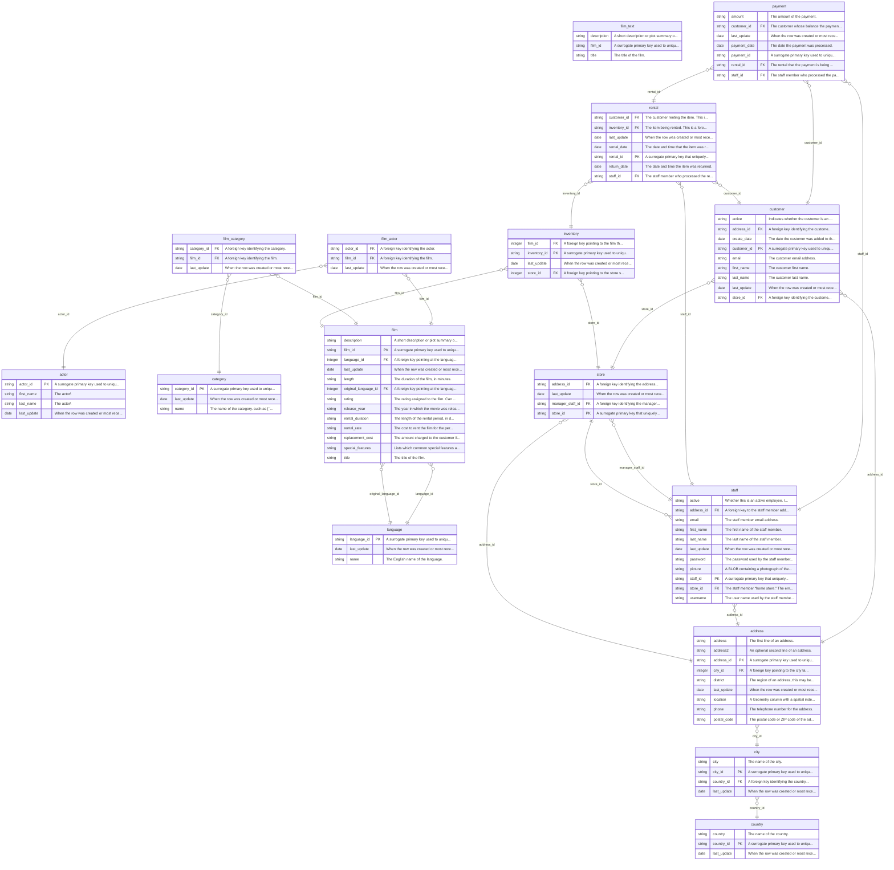

```mermaid
erDiagram
    person {
        string person_id PK "Source-system identifier for a person..."
        string display_name "Name by which the person is primarily..."
        string first_name "Actor's given name."
        string last_name "Actor's family name."
        integer birth_year "Calendar year of birth."
        integer death_year "Calendar year of death, when applicable."
        date last_update "Date the actor record was last update..."
    }
    person_profession {
        string person_id PK,FK "Person having the profession."
        string profession_name PK "One atomic profession associated with..."
    }
    person_known_work {
        string person_id PK,FK "Person known for the work."
        string work_id PK,FK "Work for which the person is known."
    }
    language {
        string language_id PK "Source-system language identifier."
        string language_name "English name of the language."
        date last_update "Date the language row was last updated."
    }
    work {
        string work_id PK "Source-system identifier for a title ..."
        string work_type "Format or type of work, such as movie..."
        string primary_title "Primary or commonly displayed title o..."
        string original_title "Title in the work's original language."
        string description "Plot summary or short description of ..."
        integer release_start_year "Release year, or series start year wh..."
        integer end_year "Series end year, where applicable."
        boolean is_adult "Whether the work is designated adult ..."
        integer runtime_seconds "Primary running time in SI seconds."
        string content_rating "Audience content classification assig..."
        string language_id FK "Language identifier for the distribut..."
        string original_language_id FK "Original language identifier when the..."
        integer rental_duration_seconds "Standard rental period in SI seconds."
        number rental_rate "Charge for the standard rental period..."
        number replacement_cost "Replacement charge; currency is not s..."
        date last_update "Date the film row was last updated."
    }
    work_special_feature {
        string work_id PK,FK "Work containing the special feature."
        string feature_name PK "One atomic special feature available ..."
    }
    classification {
        string classification_id PK "Identifier for a genre or film catego..."
        string classification_name "Genre or category name."
        date last_update "Date the category row was last updated."
    }
    work_classification {
        string work_id PK,FK "Classified work."
        string classification_id PK,FK "Genre or category assigned to the work."
        date last_update "Date the film-category association wa..."
    }
    work_alias {
        string work_id PK,FK "Work having the localized or alternat..."
        integer alias_order PK "Source row sequence unique within the..."
        string alias_title "Localized or alternative title."
        string region_code "Region associated with the title vers..."
        string language_code "Language code or label supplied for t..."
        boolean is_original_title "Whether this alias is marked as the o..."
    }
    work_alias_type {
        string work_id PK,FK "Work owning the alias."
        integer alias_order PK,FK "Sequence identifying the alias within..."
        string alias_type PK "One atomic enumerated alias type."
    }
    work_alias_attribute {
        string work_id PK,FK "Work owning the alias."
        integer alias_order PK,FK "Sequence identifying the alias within..."
        string attribute_name PK "One atomic additional descriptor of t..."
    }
    work_credit {
        string credit_id PK "Synthetic identifier needed because t..."
        string work_id FK "Work associated with the credit."
        string person_id FK "Person receiving the credit."
        string role_category "Broad role category, including actor,..."
        string specific_job "Specific job title when supplied."
        integer credit_order "Display or significance order of the ..."
        string character_name "One atomic character name represented..."
        date last_update "Date the film-actor association was l..."
    }
    episode {
        string episode_work_id PK,FK "Work identifier of the episode."
        string parent_work_id FK "Work identifier of the parent series."
        integer season_number "Season sequence number."
        integer episode_number "Episode sequence number within the se..."
    }
    work_rating {
        string work_id PK,FK "Rated work."
        number average_user_rating "Weighted average of individual IMDb u..."
        integer vote_count "Number of votes contributing to the r..."
    }
    country {
        string country_id PK "Source-system country identifier."
        string country_name "Country name."
        date last_update "Date the country row was last updated."
    }
    city {
        string city_id PK "Source-system city identifier."
        string city_name "City name."
        string country_id FK "Country containing the city."
        date last_update "Date the city row was last updated."
    }
    address {
        string address_id PK "Source-system address identifier."
        string address_line_1 "First address line."
        string address_line_2 "Optional second address line."
        string district "State, province, prefecture, or other..."
        string city_id FK "City containing the address."
        string postal_code "Postal or ZIP code."
        string phone "Telephone number associated with the ..."
        number latitude "Atomic latitude coordinate extracted ..."
        number longitude "Atomic longitude coordinate extracted..."
        date last_update "Date the address row was last updated."
    }
    store {
        string store_id PK "Source-system store identifier."
        string address_id FK "Store address."
        string manager_staff_id FK "Staff member managing the store."
        date last_update "Date the store row was last updated."
    }
    customer {
        string customer_id PK "Source-system customer identifier."
        string store_id FK "Customer's home store."
        string first_name "Customer given name."
        string last_name "Customer family name."
        string email "Customer email address."
        string address_id FK "Customer address."
        boolean is_active "Whether the customer account is active."
        date created_date "Date the customer was added."
        date last_update "Date the customer row was last updated."
    }
    staff {
        string staff_id PK "Source-system staff identifier."
        string first_name "Staff member given name."
        string last_name "Staff member family name."
        string address_id FK "Staff member address."
        string email "Staff member email address."
        string store_id FK "Staff member's home store."
        boolean is_active "Whether the staff member remains active."
        string username "Account username."
        string password_hash "Stored password hash."
        string picture_base64 "Employee photograph represented as a ..."
        date last_update "Date the staff row was last updated."
    }
    inventory {
        string inventory_id PK "Source-system inventory item identifier."
        string work_id FK "Work represented by the physical inve..."
        string store_id FK "Store stocking the inventory item."
        date last_update "Date the inventory row was last updated."
    }
    rental {
        string rental_id PK "Source-system rental identifier."
        datetime rented_at "Date and time the inventory item was ..."
        string inventory_id FK "Rented inventory item."
        string customer_id FK "Customer renting the item."
        datetime returned_at "Date and time the item was returned."
        string staff_id FK "Staff member processing the rental."
        date last_update "Date the rental row was last updated."
    }
    payment {
        string payment_id PK "Source-system payment identifier."
        string customer_id FK "Customer whose balance receives the p..."
        string staff_id FK "Staff member processing the payment."
        string rental_id FK "Rental to which the payment applies, ..."
        number amount "Payment amount; currency is not speci..."
        datetime paid_at "Date and time the payment was processed."
        date last_update "Date the payment row was last updated."
    }
    person_profession }o--|| person : "person_id"
    person_known_work }o--|| person : "person_id"
    person_known_work }o--|| work : "work_id"
    work }o--|| language : "language_id"
    work }o--|| language : "original_language_id"
    work_special_feature }o--|| work : "work_id"
    work_classification }o--|| work : "work_id"
    work_classification }o--|| classification : "classification_id"
    work_alias }o--|| work : "work_id"
    work_alias_type }o--|| work_alias : "work_id, alias_order"
    work_alias_attribute }o--|| work_alias : "work_id, alias_order"
    work_credit }o--|| work : "work_id"
    work_credit }o--|| person : "person_id"
    episode }o--|| work : "episode_work_id"
    episode }o--|| work : "parent_work_id"
    work_rating }o--|| work : "work_id"
    city }o--|| country : "country_id"
    address }o--|| city : "city_id"
    store }o--|| address : "address_id"
    store }o--|| staff : "manager_staff_id"
    customer }o--|| store : "store_id"
    customer }o--|| address : "address_id"
    staff }o--|| address : "address_id"
    staff }o--|| store : "store_id"
    inventory }o--|| work : "work_id"
    inventory }o--|| store : "store_id"
    rental }o--|| inventory : "inventory_id"
    rental }o--|| customer : "customer_id"
    rental }o--|| staff : "staff_id"
    payment }o--|| customer : "customer_id"
    payment }o--|| staff : "staff_id"
    payment }o--|| rental : "rental_id"
```

# Schema Alignment Diagnostic Report — imdb-sakila

## Summary Results

## Detailed Analysis

# Schema Alignment Diagnostic Report — imdb-sakila

- **Model**: `gpt-5.6-sol`
- **Domain**: Media & Entertainment
- **Status**: `SUCCESS (3/3)`
- **Iterations**: `3`
- **Source A**: `imdb` (7 tables, 39 cols)
- **Source B**: `sakila` (16 tables, 90 cols)

## Schema Architectures (ER Diagrams)

### Source A Schema (`imdb`)

```mermaid
erDiagram
    name_basics {
        string birthyear "birth year (YYYY)"
        string deathyear "death year if applicable, else"
        string knownfortitles "titles the person is known for (array..."
        number nconst PK "alphanumeric unique identifier of the..."
        string primaryname "name by which the person is most ofte..."
        string primaryprofession "the top-3 professions of the person (..."
    }
    title_akas {
        string attributes "Additional terms to describe this alt..."
        boolean isoriginaltitle "0: not original title. 1: original ti..."
        string language "the language of the title (string)"
        integer ordering "a number to uniquely identify rows fo..."
        string region "the region for this version of the ti..."
        string title "the localized title (string)"
        number titleid FK "a tconst (string, an alphanumeric uni..."
        string types "Enumerated set of attributes for this..."
    }
    title_basics {
        string endyear "TV Series end year (YYYY). ‘\N’ for a..."
        string genres "includes up to three genres associate..."
        boolean isadult "0: non-adult title. 1: adult title (b..."
        string originaltitle "original title (string) (in the origi..."
        integer primarytitle "the more popular title (string) (the ..."
        integer runtimeminutes "primary runtime of the title (integer..."
        string startyear "represents the release year of a titl..."
        number tconst PK "alphanumeric unique identifier of the..."
        string titletype "the type/format of the title (string)..."
    }
    title_crew {
        string directors "director(s) of the given title (array..."
        number tconst FK "alphanumeric unique identifier of the..."
        string writers "writer(s) of the given title (array o..."
    }
    title_episode {
        integer episodenumber "episode number of the tconst in the T..."
        number parenttconst FK "alphanumeric identifier of the parent..."
        integer seasonnumber "season number the episode belongs to ..."
        number tconst FK "alphanumeric identifier of episode (s..."
    }
    title_principals {
        string category "the category of job that person was i..."
        string characters "the name of the character played if a..."
        string job "the specific job title if applicable,..."
        number nconst FK "alphanumeric unique identifier of the..."
        integer ordering "a number to uniquely identify rows fo..."
        number tconst FK "alphanumeric unique identifier of the..."
    }
    title_ratings {
        number averagerating "weighted average of all the individua..."
        integer numvotes "number of votes the title has receive..."
        number tconst FK "alphanumeric unique identifier of the..."
    }
    title_akas }o--|| title_basics : "titleid"
    title_crew }o--|| title_basics : "tconst"
    title_episode }o--|| title_basics : "parenttconst"
    title_episode }o--|| title_basics : "tconst"
    title_principals }o--|| name_basics : "nconst"
    title_principals }o--|| title_basics : "tconst"
    title_ratings }o--|| title_basics : "tconst"
```

### Source B Schema (`sakila`)

### Generated Unified Target Schemas per Iteration

> [!NOTE]
> Use the toggles below to view the target schema ER diagram generated in each iteration. The representative run is expanded by default.

```mermaid
erDiagram
    person {
        string person_id PK "Source-scoped identifier for a credit..."
        string display_name "Name by which the person is primarily..."
        string given_name "Given name when represented separately."
        string family_name "Family name when represented separately."
        integer birth_year "Calendar year of birth."
        integer death_year "Calendar year of death, if applicable."
        datetime updated_at "Timestamp when the source actor recor..."
    }
    person_profession {
        string person_id PK,FK "Person having the profession."
        string profession_name PK "One profession associated with the pe..."
    }
    work {
        string work_id PK "Source-scoped identifier for an audio..."
        string primary_title "Primary or commonly displayed title o..."
        string original_title "Title in the work's original language."
        string description "Short description or plot summary."
        string work_type "Format or type of audiovisual work."
        boolean is_adult "Whether the work is classified as adu..."
        integer release_year "Release year, or series start year."
        integer end_year "Series end year, if applicable."
        integer runtime_seconds "Primary runtime in SI seconds."
        string content_rating "Audience/content classification assig..."
        string language_id FK "Language of the distributed work vers..."
        string original_language_id FK "Original language of the work."
        integer rental_period_seconds "Standard rental period in SI seconds."
        number rental_rate "Cost to rent the work for its standar..."
        number replacement_cost "Charge for loss or damage of a rental..."
        datetime updated_at "Timestamp when the film record was la..."
    }
    person_known_work {
        string person_id PK,FK "Person known for the work."
        string work_id PK,FK "Work for which the person is known."
    }
    language {
        string language_id PK "Source-scoped or code-derived identif..."
        string language_name "English name of the language."
        string language_code "Language code used for a localized ti..."
        datetime updated_at "Timestamp when the language record wa..."
    }
    alternate_title {
        string alternate_title_id PK "Synthetic identifier for an alternate..."
        string work_id FK "Work to which the alternate title bel..."
        integer sequence_number "Source ordering number within a work'..."
        string localized_title "Localized or alternate title text."
        string region_code "Region associated with the title vers..."
        string language_id FK "Language associated with the title ve..."
        boolean is_original_title "Whether this row represents the origi..."
    }
    alternate_title_type {
        string alternate_title_id PK,FK "Alternate title having this type."
        string title_type PK "One enumerated type assigned to the a..."
    }
    alternate_title_attribute {
        string alternate_title_id PK,FK "Alternate title having this attribute."
        string attribute_name PK "One descriptive attribute assigned to..."
    }
    genre {
        string genre_id PK "Source-scoped or name-derived identif..."
        string genre_name "Genre or film-category name."
        datetime updated_at "Timestamp when the source category re..."
    }
    work_genre {
        string work_id PK,FK "Work classified in the genre."
        string genre_id PK,FK "Genre assigned to the work."
        datetime updated_at "Timestamp when the film-category asso..."
    }
    work_credit {
        string credit_id PK "Synthetic identifier for a principal ..."
        string work_id FK "Credited work."
        string person_id FK "Credited person."
        integer sequence_number "Ordering of the principal credit with..."
        string credit_category "General category of the credited cont..."
        string job_title "Specific job title associated with th..."
        datetime updated_at "Timestamp when the film-actor associa..."
    }
    credit_character {
        string credit_id PK,FK "Credit under which the character was ..."
        string character_name PK "One character name associated with th..."
    }
    work_director {
        string work_id PK,FK "Directed work."
        string person_id PK,FK "Director of the work."
    }
    work_writer {
        string work_id PK,FK "Written work."
        string person_id PK,FK "Writer of the work."
    }
    episode {
        string episode_work_id PK,FK "Work identifier of the episode."
        string series_work_id FK "Parent series work identifier."
        integer season_number "Season number containing the episode."
        integer episode_number "Episode number within the series or s..."
    }
    work_rating {
        string work_id PK,FK "Rated work."
        number average_rating "Weighted average user rating on the I..."
        integer vote_count "Number of user votes contributing to ..."
    }
    work_special_feature {
        string work_id PK,FK "Work whose release includes the feature."
        string feature_name PK "One special feature included with the..."
    }
    country {
        string country_id PK "Country identifier."
        string country_name "Country name."
        datetime updated_at "Timestamp when the country record was..."
    }
    city {
        string city_id PK "City identifier."
        string country_id FK "Country containing the city."
        string city_name "City name."
        datetime updated_at "Timestamp when the city record was la..."
    }
    address {
        string address_id PK "Address identifier."
        string address_line_1 "First address line."
        string address_line_2 "Optional second address line."
        string district "State, province, prefecture, or analo..."
        string city_id FK "City containing the address."
        string postal_code "Postal or ZIP code."
        string phone_number "Telephone number associated with the ..."
        string location_geometry "Serialized source geometry; geometry ..."
        datetime updated_at "Timestamp when the address record was..."
    }
    store {
        string store_id PK "Store identifier."
        string address_id FK "Store address."
        string manager_staff_id FK "Staff member managing the store."
        datetime updated_at "Timestamp when the store record was l..."
    }
    customer {
        string customer_id PK "Customer identifier."
        string store_id FK "Customer's home store."
        string address_id FK "Customer address."
        string given_name "Customer given name."
        string family_name "Customer family name."
        string email_address "Customer email address."
        boolean is_active "Whether the customer is active."
        date created_on "Date the customer was created."
        datetime updated_at "Timestamp when the customer record wa..."
    }
    staff {
        string staff_id PK "Staff identifier."
        string store_id FK "Staff member's home store."
        string address_id FK "Staff member's address."
        string given_name "Staff member's given name."
        string family_name "Staff member's family name."
        string email_address "Staff member's email address."
        string username "Login username."
        string password_hash "Stored password hash."
        string picture_data "String-encoded staff picture data."
        boolean is_active "Whether the staff member is active."
        datetime updated_at "Timestamp when the staff record was l..."
    }
    inventory_item {
        string inventory_item_id PK "Physical inventory-copy identifier."
        string work_id FK "Work represented by the inventory copy."
        string store_id FK "Store stocking the inventory copy."
        datetime updated_at "Timestamp when the inventory record w..."
    }
    rental {
        string rental_id PK "Rental transaction identifier."
        string inventory_item_id FK "Inventory copy rented."
        string customer_id FK "Customer renting the copy."
        string staff_id FK "Staff member processing the rental."
        datetime rented_at "Date and time the item was rented."
        datetime returned_at "Date and time the item was returned."
        datetime updated_at "Timestamp when the rental record was ..."
    }
    payment {
        string payment_id PK "Payment identifier."
        string customer_id FK "Customer making the payment."
        string staff_id FK "Staff member processing the payment."
        string rental_id FK "Optional rental to which the payment ..."
        number amount "Payment amount in the source system's..."
        datetime paid_at "Date and time the payment was processed."
        datetime updated_at "Timestamp when the payment record was..."
    }
    person_profession }o--|| person : "person_id"
    work }o--|| language : "language_id"
    work }o--|| language : "original_language_id"
    person_known_work }o--|| person : "person_id"
    person_known_work }o--|| work : "work_id"
    alternate_title }o--|| work : "work_id"
    alternate_title }o--|| language : "language_id"
    alternate_title_type }o--|| alternate_title : "alternate_title_id"
    alternate_title_attribute }o--|| alternate_title : "alternate_title_id"
    work_genre }o--|| work : "work_id"
    work_genre }o--|| genre : "genre_id"
    work_credit }o--|| work : "work_id"
    work_credit }o--|| person : "person_id"
    credit_character }o--|| work_credit : "credit_id"
    work_director }o--|| work : "work_id"
    work_director }o--|| person : "person_id"
    work_writer }o--|| work : "work_id"
    work_writer }o--|| person : "person_id"
    episode }o--|| work : "episode_work_id"
    episode }o--|| work : "series_work_id"
    work_rating }o--|| work : "work_id"
    work_special_feature }o--|| work : "work_id"
    city }o--|| country : "country_id"
    address }o--|| city : "city_id"
    store }o--|| address : "address_id"
    store }o--|| staff : "manager_staff_id"
    customer }o--|| store : "store_id"
    customer }o--|| address : "address_id"
    staff }o--|| store : "store_id"
    staff }o--|| address : "address_id"
    inventory_item }o--|| work : "work_id"
    inventory_item }o--|| store : "store_id"
    rental }o--|| inventory_item : "inventory_item_id"
    rental }o--|| customer : "customer_id"
    rental }o--|| staff : "staff_id"
    payment }o--|| customer : "customer_id"
    payment }o--|| staff : "staff_id"
    payment }o--|| rental : "rental_id"
```

<b>Iteration 1 Target Schema (26 tables, S_rel: 1.0000)</b>

<b>Iteration 2 Target Schema (23 tables, S_rel: 1.0000)</b>

<b>Iteration 3 Target Schema (24 tables, S_rel: 1.0000) [Representative / Final Run]</b>

```mermaid
erDiagram
    person {
        string person_id PK "Canonical source-qualified identifier..."
        string display_name "Name by which the person is primarily..."
        string first_name "Person's given name where separately ..."
        string last_name "Person's family name where separately..."
        integer birth_year "Four-digit year of birth."
        integer death_year "Four-digit year of death, when applic..."
        datetime last_updated_at "Time the source actor row was last up..."
    }
    person_profession {
        string person_id PK,FK
        string profession_name PK "One profession extracted from the sou..."
    }
    person_known_title {
        string person_id PK,FK
        string media_title_id PK,FK
    }
    language {
        string language_id PK "Canonical source-qualified language i..."
        string language_name
        datetime last_updated_at
    }
    media_title {
        string media_title_id PK "Canonical source-qualified identifier..."
        string title_type "Format or kind of title."
        string primary_title "Primary display or promotional title."
        string original_title "Title in its original language."
        string description "Plot summary or short description."
        boolean is_adult
        integer release_start_year "Release year or series start year."
        integer release_end_year "Series end year, when applicable."
        number runtime_seconds "Runtime in SI seconds."
        string language_id FK "Language of the film version represen..."
        string original_language_id FK "Original language before dubbing, whe..."
        string content_rating_code "Audience classification code such as ..."
        number rental_duration_seconds "Standard rental period in SI seconds."
        number rental_rate "Rental price amount; source currency ..."
        number replacement_cost "Replacement charge amount; source cur..."
        datetime last_updated_at
    }
    media_title_special_feature {
        string media_title_id PK,FK
        string feature_name PK "One special feature extracted from th..."
    }
    category {
        string category_id PK "Canonical category identity, using a ..."
        string category_name "Genre or category label."
        datetime last_updated_at
    }
    title_category {
        string media_title_id PK,FK
        string category_id PK,FK
        datetime last_updated_at
    }
    alternative_title {
        string alternative_title_id PK "Synthetic identifier for a normalized..."
        string media_title_id FK
        integer source_order "Ordering number unique within the sou..."
        string localized_title
        string region_code
        string language_code
        boolean is_original_title
    }
    alternative_title_type {
        string alternative_title_id PK,FK
        string alternative_title_type PK "One alternative-title type extracted ..."
    }
    alternative_title_attribute {
        string alternative_title_id PK,FK
        string attribute_name PK "One descriptive attribute extracted f..."
    }
    title_credit {
        string title_credit_id PK "Synthetic identifier for a normalized..."
        string media_title_id FK
        string person_id FK
        integer source_order "Ordering of a principal credit within..."
        string credit_category "General category of the principal cre..."
        string job_title "Specific credited job title."
        boolean is_director "Indicates membership in the IMDb dire..."
        boolean is_writer "Indicates membership in the IMDb writ..."
        datetime last_updated_at
    }
    title_credit_character {
        string title_credit_id PK,FK
        string character_name PK "One character name extracted from the..."
    }
    episode {
        string episode_title_id PK,FK
        string parent_series_title_id FK
        integer season_number
        integer episode_number
    }
    title_rating {
        string media_title_id PK,FK
        number average_user_rating
        integer vote_count
    }
    country {
        string country_id PK
        string country_name
        datetime last_updated_at
    }
    city {
        string city_id PK
        string country_id FK
        string city_name
        datetime last_updated_at
    }
    address {
        string address_id PK
        string address_line_1
        string address_line_2
        string district
        string city_id FK
        string postal_code
        string phone_number
        number latitude_degrees "Latitude parsed from the source geome..."
        number longitude_degrees "Longitude parsed from the source geom..."
        datetime last_updated_at
    }
    customer {
        string customer_id PK
        string store_id FK
        string first_name
        string last_name
        string email
        string address_id FK
        boolean is_active
        date created_on
        datetime last_updated_at
    }
    staff {
        string staff_id PK
        string first_name
        string last_name
        string address_id FK
        string email
        string store_id FK
        boolean is_active
        string username
        string password_hash
        string picture_data "Source picture encoded as a string re..."
        datetime last_updated_at
    }
    store {
        string store_id PK
        string manager_staff_id FK
        string address_id FK
        datetime last_updated_at
    }
    inventory_item {
        string inventory_item_id PK
        string media_title_id FK
        string store_id FK
        datetime last_updated_at
    }
    rental {
        string rental_id PK
        datetime rented_at
        string inventory_item_id FK
        string customer_id FK
        datetime returned_at
        string staff_id FK
        datetime last_updated_at
    }
    payment {
        string payment_id PK
        string customer_id FK
        string staff_id FK
        string rental_id FK
        number amount "Payment amount; source currency is un..."
        datetime paid_at
        datetime last_updated_at
    }
    person_profession }o--|| person : "person_id"
    person_known_title }o--|| person : "person_id"
    person_known_title }o--|| media_title : "media_title_id"
    media_title }o--|| language : "language_id"
    media_title }o--|| language : "original_language_id"
    media_title_special_feature }o--|| media_title : "media_title_id"
    title_category }o--|| media_title : "media_title_id"
    title_category }o--|| category : "category_id"
    alternative_title }o--|| media_title : "media_title_id"
    alternative_title_type }o--|| alternative_title : "alternative_title_id"
    alternative_title_attribute }o--|| alternative_title : "alternative_title_id"
    title_credit }o--|| media_title : "media_title_id"
    title_credit }o--|| person : "person_id"
    title_credit_character }o--|| title_credit : "title_credit_id"
    episode }o--|| media_title : "episode_title_id"
    episode }o--|| media_title : "parent_series_title_id"
    title_rating }o--|| media_title : "media_title_id"
    city }o--|| country : "country_id"
    address }o--|| city : "city_id"
    customer }o--|| address : "address_id"
    customer }o--|| store : "store_id"
    staff }o--|| address : "address_id"
    staff }o--|| store : "store_id"
    store }o--|| staff : "manager_staff_id"
    store }o--|| address : "address_id"
    inventory_item }o--|| media_title : "media_title_id"
    inventory_item }o--|| store : "store_id"
    rental }o--|| inventory_item : "inventory_item_id"
    rental }o--|| customer : "customer_id"
    rental }o--|| staff : "staff_id"
    payment }o--|| customer : "customer_id"
    payment }o--|| staff : "staff_id"
    payment }o--|| rental : "rental_id"
```

## Performance & Efficiency Summary

| Completeness (Cov_attr) | Structural Integrity (S_rel) | Intra-Table Uniqueness (M_unique) | Latency (s) | Total Tokens |
| --- | --- | --- | --- | --- |
| 1.0000 | 1.0000 | 0.9997 | 83.11s | 60,262 |

## Target Schema Detailed Specifications

### Target Table: `person`

| Column Name | Type | Key | Source Provenance | Description |
| --- | --- | --- | --- | --- |
| `person_id` | string | PK | `imdb.name_basics.nconst`, `sakila.actor.actor_id` | Canonical source-qualified identifier for a person or actor. |
| `display_name` | string | - | `imdb.name_basics.primaryname` | Name by which the person is primarily known or credited. |
| `first_name` | string | - | `sakila.actor.first_name` | Person's given name where separately available. |
| `last_name` | string | - | `sakila.actor.last_name` | Person's family name where separately available. |
| `birth_year` | integer | - | `imdb.name_basics.birthyear` | Four-digit year of birth. |
| `death_year` | integer | - | `imdb.name_basics.deathyear` | Four-digit year of death, when applicable. |
| `last_updated_at` | datetime | - | `sakila.actor.last_update` | Time the source actor row was last updated. |

### Target Table: `person_profession`

| Column Name | Type | Key | Source Provenance | Description |
| --- | --- | --- | --- | --- |
| `person_id` | string | PK, FK | `imdb.name_basics.nconst` | - |
| `profession_name` | string | PK | `imdb.name_basics.primaryprofession` | One profession extracted from the source profession list. |

### Target Table: `person_known_title`

| Column Name | Type | Key | Source Provenance | Description |
| --- | --- | --- | --- | --- |
| `person_id` | string | PK, FK | `imdb.name_basics.nconst` | - |
| `media_title_id` | string | PK, FK | `imdb.name_basics.knownfortitles` | - |

### Target Table: `language`

| Column Name | Type | Key | Source Provenance | Description |
| --- | --- | --- | --- | --- |
| `language_id` | string | PK | `sakila.language.language_id` | Canonical source-qualified language identifier. |
| `language_name` | string | - | `sakila.language.name` | - |
| `last_updated_at` | datetime | - | `sakila.language.last_update` | - |

### Target Table: `media_title`

| Column Name | Type | Key | Source Provenance | Description |
| --- | --- | --- | --- | --- |
| `media_title_id` | string | PK | `imdb.title_basics.tconst`, `sakila.film.film_id`, `sakila.film_text.film_id` | Canonical source-qualified identifier for a title or film. |
| `title_type` | string | - | `imdb.title_basics.titletype` | Format or kind of title. |
| `primary_title` | string | - | `imdb.title_basics.primarytitle`, `sakila.film.title`, `sakila.film_text.title` | Primary display or promotional title. |
| `original_title` | string | - | `imdb.title_basics.originaltitle` | Title in its original language. |
| `description` | string | - | `sakila.film.description`, `sakila.film_text.description` | Plot summary or short description. |
| `is_adult` | boolean | - | `imdb.title_basics.isadult` | - |
| `release_start_year` | integer | - | `imdb.title_basics.startyear`, `sakila.film.release_year` | Release year or series start year. |
| `release_end_year` | integer | - | `imdb.title_basics.endyear` | Series end year, when applicable. |
| `runtime_seconds` | number | - | `imdb.title_basics.runtimeminutes`, `sakila.film.length` | Runtime in SI seconds. |
| `language_id` | string | FK -> `language.language_id` | `sakila.film.language_id` | Language of the film version represented by the Sakila record. |
| `original_language_id` | string | FK -> `language.language_id` | `sakila.film.original_language_id` | Original language before dubbing, where known. |
| `content_rating_code` | string | - | `sakila.film.rating` | Audience classification code such as PG or R. |
| `rental_duration_seconds` | number | - | `sakila.film.rental_duration` | Standard rental period in SI seconds. |
| `rental_rate` | number | - | `sakila.film.rental_rate` | Rental price amount; source currency is unspecified. |
| `replacement_cost` | number | - | `sakila.film.replacement_cost` | Replacement charge amount; source currency is unspecified. |
| `last_updated_at` | datetime | - | `sakila.film.last_update` | - |

### Target Table: `media_title_special_feature`

| Column Name | Type | Key | Source Provenance | Description |
| --- | --- | --- | --- | --- |
| `media_title_id` | string | PK, FK | `sakila.film.film_id` | - |
| `feature_name` | string | PK | `sakila.film.special_features` | One special feature extracted from the source list. |

### Target Table: `category`

| Column Name | Type | Key | Source Provenance | Description |
| --- | --- | --- | --- | --- |
| `category_id` | string | PK | `imdb.title_basics.genres`, `sakila.category.category_id` | Canonical category identity, using a source-qualified identifier or normalized genre value. |
| `category_name` | string | - | `imdb.title_basics.genres`, `sakila.category.name` | Genre or category label. |
| `last_updated_at` | datetime | - | `sakila.category.last_update` | - |

### Target Table: `title_category`

| Column Name | Type | Key | Source Provenance | Description |
| --- | --- | --- | --- | --- |
| `media_title_id` | string | PK, FK | `imdb.title_basics.tconst`, `sakila.film_category.film_id` | - |
| `category_id` | string | PK, FK | `imdb.title_basics.genres`, `sakila.film_category.category_id` | - |
| `last_updated_at` | datetime | - | `sakila.film_category.last_update` | - |

### Target Table: `alternative_title`

| Column Name | Type | Key | Source Provenance | Description |
| --- | --- | --- | --- | --- |
| `alternative_title_id` | string | PK | - | Synthetic identifier for a normalized alternative-title row. |
| `media_title_id` | string | FK -> `media_title.media_title_id` | `imdb.title_akas.titleid` | - |
| `source_order` | integer | - | `imdb.title_akas.ordering` | Ordering number unique within the source title. |
| `localized_title` | string | - | `imdb.title_akas.title` | - |
| `region_code` | string | - | `imdb.title_akas.region` | - |
| `language_code` | string | - | `imdb.title_akas.language` | - |
| `is_original_title` | boolean | - | `imdb.title_akas.isoriginaltitle` | - |

### Target Table: `alternative_title_type`

| Column Name | Type | Key | Source Provenance | Description |
| --- | --- | --- | --- | --- |
| `alternative_title_id` | string | PK, FK | - | - |
| `alternative_title_type` | string | PK | `imdb.title_akas.types` | One alternative-title type extracted from the source list. |

### Target Table: `alternative_title_attribute`

| Column Name | Type | Key | Source Provenance | Description |
| --- | --- | --- | --- | --- |
| `alternative_title_id` | string | PK, FK | - | - |
| `attribute_name` | string | PK | `imdb.title_akas.attributes` | One descriptive attribute extracted from the source list. |

### Target Table: `title_credit`

| Column Name | Type | Key | Source Provenance | Description |
| --- | --- | --- | --- | --- |
| `title_credit_id` | string | PK | - | Synthetic identifier for a normalized title-person credit. |
| `media_title_id` | string | FK -> `media_title.media_title_id` | `imdb.title_principals.tconst`, `imdb.title_crew.tconst`, `sakila.film_actor.film_id` | - |
| `person_id` | string | FK -> `person.person_id` | `imdb.title_principals.nconst`, `imdb.title_crew.directors`, `imdb.title_crew.writers`, `sakila.film_actor.actor_id` | - |
| `source_order` | integer | - | `imdb.title_principals.ordering` | Ordering of a principal credit within a title. |
| `credit_category` | string | - | `imdb.title_principals.category` | General category of the principal credit. |
| `job_title` | string | - | `imdb.title_principals.job` | Specific credited job title. |
| `is_director` | boolean | - | `imdb.title_crew.directors` | Indicates membership in the IMDb director list. |
| `is_writer` | boolean | - | `imdb.title_crew.writers` | Indicates membership in the IMDb writer list. |
| `last_updated_at` | datetime | - | `sakila.film_actor.last_update` | - |

### Target Table: `title_credit_character`

| Column Name | Type | Key | Source Provenance | Description |
| --- | --- | --- | --- | --- |
| `title_credit_id` | string | PK, FK | - | - |
| `character_name` | string | PK | `imdb.title_principals.characters` | One character name extracted from the source character list. |

### Target Table: `episode`

| Column Name | Type | Key | Source Provenance | Description |
| --- | --- | --- | --- | --- |
| `episode_title_id` | string | PK, FK | `imdb.title_episode.tconst` | - |
| `parent_series_title_id` | string | FK -> `media_title.media_title_id` | `imdb.title_episode.parenttconst` | - |
| `season_number` | integer | - | `imdb.title_episode.seasonnumber` | - |
| `episode_number` | integer | - | `imdb.title_episode.episodenumber` | - |

### Target Table: `title_rating`

| Column Name | Type | Key | Source Provenance | Description |
| --- | --- | --- | --- | --- |
| `media_title_id` | string | PK, FK | `imdb.title_ratings.tconst` | - |
| `average_user_rating` | number | - | `imdb.title_ratings.averagerating` | - |
| `vote_count` | integer | - | `imdb.title_ratings.numvotes` | - |

### Target Table: `country`

| Column Name | Type | Key | Source Provenance | Description |
| --- | --- | --- | --- | --- |
| `country_id` | string | PK | `sakila.country.country_id` | - |
| `country_name` | string | - | `sakila.country.country` | - |
| `last_updated_at` | datetime | - | `sakila.country.last_update` | - |

### Target Table: `city`

| Column Name | Type | Key | Source Provenance | Description |
| --- | --- | --- | --- | --- |
| `city_id` | string | PK | `sakila.city.city_id` | - |
| `country_id` | string | FK -> `country.country_id` | `sakila.city.country_id` | - |
| `city_name` | string | - | `sakila.city.city` | - |
| `last_updated_at` | datetime | - | `sakila.city.last_update` | - |

### Target Table: `address`

| Column Name | Type | Key | Source Provenance | Description |
| --- | --- | --- | --- | --- |
| `address_id` | string | PK | `sakila.address.address_id` | - |
| `address_line_1` | string | - | `sakila.address.address` | - |
| `address_line_2` | string | - | `sakila.address.address2` | - |
| `district` | string | - | `sakila.address.district` | - |
| `city_id` | string | FK -> `city.city_id` | `sakila.address.city_id` | - |
| `postal_code` | string | - | `sakila.address.postal_code` | - |
| `phone_number` | string | - | `sakila.address.phone` | - |
| `latitude_degrees` | number | - | `sakila.address.location` | Latitude parsed from the source geometry value. |
| `longitude_degrees` | number | - | `sakila.address.location` | Longitude parsed from the source geometry value. |
| `last_updated_at` | datetime | - | `sakila.address.last_update` | - |

### Target Table: `customer`

| Column Name | Type | Key | Source Provenance | Description |
| --- | --- | --- | --- | --- |
| `customer_id` | string | PK | `sakila.customer.customer_id` | - |
| `store_id` | string | FK -> `store.store_id` | `sakila.customer.store_id` | - |
| `first_name` | string | - | `sakila.customer.first_name` | - |
| `last_name` | string | - | `sakila.customer.last_name` | - |
| `email` | string | - | `sakila.customer.email` | - |
| `address_id` | string | FK -> `address.address_id` | `sakila.customer.address_id` | - |
| `is_active` | boolean | - | `sakila.customer.active` | - |
| `created_on` | date | - | `sakila.customer.create_date` | - |
| `last_updated_at` | datetime | - | `sakila.customer.last_update` | - |

### Target Table: `staff`

| Column Name | Type | Key | Source Provenance | Description |
| --- | --- | --- | --- | --- |
| `staff_id` | string | PK | `sakila.staff.staff_id` | - |
| `first_name` | string | - | `sakila.staff.first_name` | - |
| `last_name` | string | - | `sakila.staff.last_name` | - |
| `address_id` | string | FK -> `address.address_id` | `sakila.staff.address_id` | - |
| `email` | string | - | `sakila.staff.email` | - |
| `store_id` | string | FK -> `store.store_id` | `sakila.staff.store_id` | - |
| `is_active` | boolean | - | `sakila.staff.active` | - |
| `username` | string | - | `sakila.staff.username` | - |
| `password_hash` | string | - | `sakila.staff.password` | - |
| `picture_data` | string | - | `sakila.staff.picture` | Source picture encoded as a string representation such as base64. |
| `last_updated_at` | datetime | - | `sakila.staff.last_update` | - |

### Target Table: `store`

| Column Name | Type | Key | Source Provenance | Description |
| --- | --- | --- | --- | --- |
| `store_id` | string | PK | `sakila.store.store_id` | - |
| `manager_staff_id` | string | FK -> `staff.staff_id` | `sakila.store.manager_staff_id` | - |
| `address_id` | string | FK -> `address.address_id` | `sakila.store.address_id` | - |
| `last_updated_at` | datetime | - | `sakila.store.last_update` | - |

### Target Table: `inventory_item`

| Column Name | Type | Key | Source Provenance | Description |
| --- | --- | --- | --- | --- |
| `inventory_item_id` | string | PK | `sakila.inventory.inventory_id` | - |
| `media_title_id` | string | FK -> `media_title.media_title_id` | `sakila.inventory.film_id` | - |
| `store_id` | string | FK -> `store.store_id` | `sakila.inventory.store_id` | - |
| `last_updated_at` | datetime | - | `sakila.inventory.last_update` | - |

### Target Table: `rental`

| Column Name | Type | Key | Source Provenance | Description |
| --- | --- | --- | --- | --- |
| `rental_id` | string | PK | `sakila.rental.rental_id` | - |
| `rented_at` | datetime | - | `sakila.rental.rental_date` | - |
| `inventory_item_id` | string | FK -> `inventory_item.inventory_item_id` | `sakila.rental.inventory_id` | - |
| `customer_id` | string | FK -> `customer.customer_id` | `sakila.rental.customer_id` | - |
| `returned_at` | datetime | - | `sakila.rental.return_date` | - |
| `staff_id` | string | FK -> `staff.staff_id` | `sakila.rental.staff_id` | - |
| `last_updated_at` | datetime | - | `sakila.rental.last_update` | - |

### Target Table: `payment`

| Column Name | Type | Key | Source Provenance | Description |
| --- | --- | --- | --- | --- |
| `payment_id` | string | PK | `sakila.payment.payment_id` | - |
| `customer_id` | string | FK -> `customer.customer_id` | `sakila.payment.customer_id` | - |
| `staff_id` | string | FK -> `staff.staff_id` | `sakila.payment.staff_id` | - |
| `rental_id` | string | FK -> `rental.rental_id` | `sakila.payment.rental_id` | - |
| `amount` | number | - | `sakila.payment.amount` | Payment amount; source currency is unspecified. |
| `paid_at` | datetime | - | `sakila.payment.payment_date` | - |
| `last_updated_at` | datetime | - | `sakila.payment.last_update` | - |

## 3-Pillar Reference-Free Diagnostic Inspection

### Pillar 1: Information Preservation (Completeness)

- **Attribute Completeness ($Cov_{\text{attr}}$)**: `100.00%`

:white_check_mark: 100% of source schema attributes were preserved in target schema provenance.

### Pillar 2: Structural & Referential Constraints

- **Primary Key Validity**: `100.00%`
- **Foreign Key Validity**: `100.00%` (33 declared FKs)
- **Source FK Preservation**: `100.00%` (29/29 source relationships preserved)
- **Combined Structural Score ($S_{\text{rel}}$)**: `1.0000`
- **Total Target Tables**: `24`

:white_check_mark: All target foreign keys are valid and all source relational links are preserved.

### Pillar 3: Intrinsic Minimality & Non-Redundancy

- **Intra-Table Uniqueness ($M_{\text{unique}}$)**: `0.9991`

#### Flagged Intra-Table Candidate Clones
| Target Table | Column A | Column B | Data Type | Cosine Sim | Source Prov A | Source Prov B |
| --- | --- | --- | --- | --- | --- | --- |
| `media_title` | `release_start_year` | `release_end_year` | integer | 0.8722 | imdb.title_basics.startyear, sakila.film.release_year | imdb.title_basics.endyear |

## Multi-Iteration Stability Analysis

| Iteration | Completeness | Integrity | Uniqueness | Clones Flagged | Latency (s) | Prompt Tokens | Completion Tokens | Total Tokens |
| --- | --- | --- | --- | --- | --- | --- | --- | --- |
| 1 | 1.0000 | 1.0000 | 1.0000 | 0 | 80.07s | 10,709 | 9,541 | 20,250 |
| 2 | 1.0000 | 1.0000 | 1.0000 | 0 | 89.71s | 10,709 | 9,935 | 20,644 |
| 3 | 1.0000 | 1.0000 | 0.9991 | 1 | 79.53s | 10,709 | 8,659 | 19,368 |

### Cross-Iteration Attribute Mapping Consensus

- **Total Co-Aligned Attribute Pairs**: `18`
- **Invariant / Stable Alignments (100% Agreement)**: `13`
- **Volatile / Flaky Alignments (<100% Agreement)**: `5`
- **Overall Consensus Ratio**: `72.22%`

### Topological & Relational Drift

- **Mean Table Count**: `24.33 ± 1.25` (Range: 23 – 26)
- **Relational Graph Edge Stability (Mean Pairwise Jaccard)**: `0.3415`

#### Volatile Cross-Source Alignments (Flakiness Breakdown)

| Source A Attribute | Source B Attribute | Agreement Rate | Runs | Assigned Target Field(s) |
| --- | --- | --- | --- | --- |
| `title_akas.language` | `language.language_id` | 33.3% | 1/3 | `language.language_id` |
| `title_crew.directors` | `film_actor.actor_id` | 66.7% | 2/3 | `title_credit.person_id`, `work_credit.role_category` |
| `title_crew.tconst` | `film_actor.film_id` | 66.7% | 2/3 | `title_credit.media_title_id`, `work_credit.work_id` |
| `title_crew.writers` | `film_actor.actor_id` | 66.7% | 2/3 | `title_credit.person_id`, `work_credit.role_category` |
| `title_principals.category` | `film_actor.actor_id` | 33.3% | 1/3 | `work_credit.role_category` |

#### Confirmed Invariant Alignments (13 pairs)

| Source A Attribute | Source B Attribute | Unified Target Field |
| --- | --- | --- |
| `name_basics.nconst` | `actor.actor_id` | `person.person_id` |
| `title_basics.genres` | `category.category_id` | `category.category_id`, `classification.classification_id`, `genre.genre_id` |
| `title_basics.genres` | `category.name` | `category.category_name`, `classification.classification_name`, `genre.genre_name` |
| `title_basics.genres` | `film_category.category_id` | `title_category.category_id`, `work_classification.classification_id`, `work_genre.genre_id` |
| `title_basics.primarytitle` | `film.title` | `media_title.primary_title`, `work.primary_title` |
| `title_basics.primarytitle` | `film_text.title` | `media_title.primary_title`, `work.primary_title` |
| `title_basics.runtimeminutes` | `film.length` | `media_title.runtime_seconds`, `work.runtime_seconds` |
| `title_basics.startyear` | `film.release_year` | `media_title.release_start_year`, `work.release_start_year`, `work.release_year` |
| `title_basics.tconst` | `film.film_id` | `media_title.media_title_id`, `work.work_id` |
| `title_basics.tconst` | `film_category.film_id` | `title_category.media_title_id`, `work_classification.work_id`, `work_genre.work_id` |
| `title_basics.tconst` | `film_text.film_id` | `media_title.media_title_id`, `work.work_id` |
| `title_principals.nconst` | `film_actor.actor_id` | `title_credit.person_id`, `work_credit.person_id` |
| `title_principals.tconst` | `film_actor.film_id` | `title_credit.media_title_id`, `work_credit.work_id` |

### Intra-Table Clone Stability

- **Candidate Clones Stability Ratio**: `0.00%` (0/1 stable)

## Diagnostic & Observability Telemetry

- **Candidate Clones CSV**: [`detected_clones.csv`](./detected_clones.csv)
- **Mapping Consensus CSV**: [`mapping_consensus.csv`](./mapping_consensus.csv)
- **LLM Execution Trace**: [`execution_trace.jsonl`](./execution_trace.jsonl)
- **Per-Iteration Artifacts**: [`iterations/`](./iterations/)

