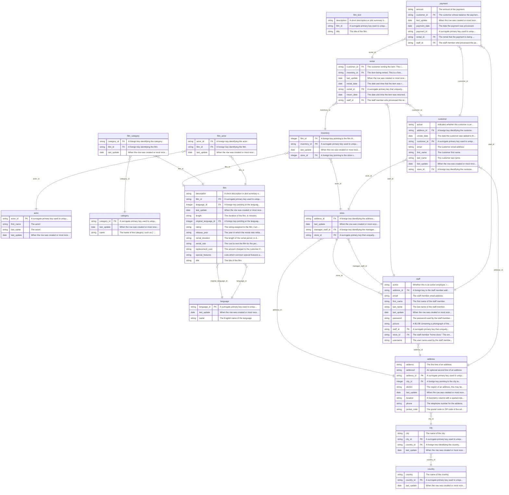

```mermaid
erDiagram
    person {
        string person_id PK "Global unique identifier for a person..."
        string full_name "Primary name by which the person is m..."
        string first_name "Person's first name"
        string last_name "Person's last name"
        integer birth_year "Year of birth (YYYY)"
        integer death_year "Year of death (YYYY) if applicable"
        string email "Email address of the person"
        boolean is_active "Indicates if the person is active (e...."
        string person_type "Type of person (e.g., 'person', 'acto..."
        date last_updated "Timestamp when the record was last up..."
    }
    person_profession {
        string person_id PK "Foreign key to person table"
        string profession PK "Profession of the person (e.g., 'Acto..."
    }
    person_known_for_work {
        string person_id PK "Foreign key to person table"
        string work_id PK "Foreign key to work table"
    }
    work {
        string work_id PK "Global unique identifier for a work (..."
        string title "Primary title of the work"
        string original_title "Original title in the original language"
        string work_type "Type of work (e.g., 'movie', 'short',..."
        boolean is_adult "Indicates if the work is adult-rated"
        integer release_year "Year the work was released or series ..."
        integer end_year "Year a TV series ended"
        integer runtime_minutes "Primary runtime in minutes"
    }
    work_episode {
        string work_id PK "Foreign key to work table (the episode)"
        string parent_work_id "Foreign key to work table (parent TV ..."
        integer season_number "Season number"
        integer episode_number "Episode number"
    }
    work_rating {
        string work_id PK "Foreign key to work table"
        number average_rating "Weighted average user rating"
        integer num_votes "Number of user votes"
    }
    genre {
        string genre_id PK "Surrogate primary key"
        string name "Genre name"
    }
    work_genre {
        string work_id PK "Foreign key to work"
        string genre_id PK "Foreign key to genre"
    }
    language {
        string language_id PK "Surrogate primary key"
        string name "Language name"
    }
    work_language {
        string work_id PK "Foreign key to work"
        string language_id PK "Foreign key to language"
        boolean is_original "True if original language"
    }
    alternative_title {
        string alternative_title_id PK "Surrogate primary key"
        string work_id "Foreign key to work"
        string title "Alternative title text"
        string region "Region for this title"
        boolean is_original_title "True if original title"
        integer ordering "Ordering index"
    }
    alternative_title_type {
        string alternative_title_id PK "Foreign key to alternative_title"
        string type PK "Type descriptor"
    }
    alternative_title_attribute {
        string alternative_title_id PK "Foreign key to alternative_title"
        string attribute PK "Attribute descriptor"
    }
    person_work_role {
        string person_work_role_id PK "Surrogate primary key"
        string person_id "Foreign key to person"
        string work_id "Foreign key to work"
        string role_type "Role category"
        string job_title "Specific job title"
        string character_name "Character name (for actors)"
        integer ordering "Ordering index"
    }
```

# Schema Alignment Diagnostic Report — imdb-sakila

## Summary Results

## Detailed Analysis

# Schema Alignment Diagnostic Report — imdb-sakila

- **Model**: `mistral-medium-latest`
- **Domain**: Media & Entertainment
- **Status**: `SUCCESS (3/3)`
- **Iterations**: `3`
- **Source A**: `imdb` (7 tables, 39 cols)
- **Source B**: `sakila` (16 tables, 90 cols)

## Schema Architectures (ER Diagrams)

### Source A Schema (`imdb`)

```mermaid
erDiagram
    name_basics {
        string birthyear "birth year (YYYY)"
        string deathyear "death year if applicable, else"
        string knownfortitles "titles the person is known for (array..."
        number nconst PK "alphanumeric unique identifier of the..."
        string primaryname "name by which the person is most ofte..."
        string primaryprofession "the top-3 professions of the person (..."
    }
    title_akas {
        string attributes "Additional terms to describe this alt..."
        boolean isoriginaltitle "0: not original title. 1: original ti..."
        string language "the language of the title (string)"
        integer ordering "a number to uniquely identify rows fo..."
        string region "the region for this version of the ti..."
        string title "the localized title (string)"
        number titleid FK "a tconst (string, an alphanumeric uni..."
        string types "Enumerated set of attributes for this..."
    }
    title_basics {
        string endyear "TV Series end year (YYYY). ‘\N’ for a..."
        string genres "includes up to three genres associate..."
        boolean isadult "0: non-adult title. 1: adult title (b..."
        string originaltitle "original title (string) (in the origi..."
        integer primarytitle "the more popular title (string) (the ..."
        integer runtimeminutes "primary runtime of the title (integer..."
        string startyear "represents the release year of a titl..."
        number tconst PK "alphanumeric unique identifier of the..."
        string titletype "the type/format of the title (string)..."
    }
    title_crew {
        string directors "director(s) of the given title (array..."
        number tconst FK "alphanumeric unique identifier of the..."
        string writers "writer(s) of the given title (array o..."
    }
    title_episode {
        integer episodenumber "episode number of the tconst in the T..."
        number parenttconst FK "alphanumeric identifier of the parent..."
        integer seasonnumber "season number the episode belongs to ..."
        number tconst FK "alphanumeric identifier of episode (s..."
    }
    title_principals {
        string category "the category of job that person was i..."
        string characters "the name of the character played if a..."
        string job "the specific job title if applicable,..."
        number nconst FK "alphanumeric unique identifier of the..."
        integer ordering "a number to uniquely identify rows fo..."
        number tconst FK "alphanumeric unique identifier of the..."
    }
    title_ratings {
        number averagerating "weighted average of all the individua..."
        integer numvotes "number of votes the title has receive..."
        number tconst FK "alphanumeric unique identifier of the..."
    }
    title_akas }o--|| title_basics : "titleid"
    title_crew }o--|| title_basics : "tconst"
    title_episode }o--|| title_basics : "parenttconst"
    title_episode }o--|| title_basics : "tconst"
    title_principals }o--|| name_basics : "nconst"
    title_principals }o--|| title_basics : "tconst"
    title_ratings }o--|| title_basics : "tconst"
```

### Source B Schema (`sakila`)

### Generated Unified Target Schemas per Iteration

> [!NOTE]
> Use the toggles below to view the target schema ER diagram generated in each iteration. The representative run is expanded by default.

```mermaid
erDiagram
    person {
        string person_id PK "Global unique identifier for a person..."
        string first_name "First name of the person (where avail..."
        string last_name "Last name of the person (where availa..."
        string display_name "Full display name (used when first/la..."
        integer birth_year "Year of birth (YYYY format)"
        integer death_year "Year of death (YYYY format, if applic..."
        datetime last_updated "Timestamp of last update to the record"
    }
    person_profession {
        string person_id PK "Reference to person"
        string profession PK "Professional role or occupation"
    }
    person_known_for {
        string person_id PK "Reference to person"
        string media_id PK "Reference to media title the person i..."
    }
    media_title {
        string media_id PK "Global unique identifier for a media ..."
        string original_title "Title in the original language"
        string primary_title "Primary/popular title used for display"
        integer release_year "Year of release (YYYY format)"
        integer end_year "End year for TV series (YYYY format)"
        integer runtime_minutes "Primary runtime in minutes"
        boolean is_adult "Flag indicating adult content"
        string media_type "Type/format of the title (e.g., movie..."
        string description "Plot summary or description"
        string language_id "Primary language identifier"
        string original_language_id "Original language identifier"
        integer rental_duration_days "Rental period duration in days"
        number rental_rate "Cost to rent the media"
        number replacement_cost "Cost to replace if damaged/lost"
        string mpaa_rating "MPAA rating classification"
        datetime last_updated "Timestamp of last update"
    }
    genre {
        string genre_id PK "Surrogate key for genre"
        string name "Name of the genre/category"
    }
    media_genre {
        string media_id PK,FK "Reference to media title"
        string genre_id PK,FK "Reference to genre"
    }
    media_alternative_title {
        string alternative_title_id PK "Surrogate key for alternative title"
        string media_id FK "Reference to primary media title"
        string title "Localized alternative title text"
        string language "Language of the alternative title"
        string region "Region for this title version"
        boolean is_original "Flag indicating if this is the origin..."
        integer ordering "Ordering index for this title version"
    }
    media_alternative_title_type {
        string alternative_title_id PK,FK "Reference to alternative title"
        string type PK "Type classification for the alternati..."
    }
    media_alternative_title_attribute {
        string alternative_title_id PK,FK "Reference to alternative title"
        string attribute PK "Additional attribute describing the t..."
    }
    media_person {
        string media_person_id PK "Surrogate key for media-person relati..."
        string media_id FK "Reference to media title"
        string person_id FK "Reference to person"
        string role_category "High-level role category"
        string role_job "Specific job title if applicable"
        string character_name "Name of character played"
        integer ordering "Ordering index for the role"
    }
    media_rating {
        string media_id PK,FK "Reference to media title"
        string rating_system PK "Identifies the rating system"
        string rating_value "The rating value"
        integer num_votes "Number of votes for user ratings"
    }
    media_episode {
        string parent_media_id PK,FK "Reference to parent TV series"
        string media_id FK "Reference to the episode"
        integer season_number PK "Season number"
        integer episode_number PK "Episode number within the season"
    }
    address {
        string address_id PK "Unique identifier for an address"
        string address_line1 "First line of the address"
        string address_line2 "Second line of the address"
        string district "District/region of the address"
        string city_id FK "Reference to city"
        string postal_code "Postal or ZIP code"
        string phone "Contact phone number"
        string location "Geometric location data"
        datetime last_updated "Timestamp of last update"
    }
    city {
        string city_id PK "Unique identifier for a city"
        string city "Name of the city"
        string country_id FK "Reference to country"
        datetime last_updated "Timestamp of last update"
    }
    country {
        string country_id PK "Unique identifier for a country"
        string country "Name of the country"
        datetime last_updated "Timestamp of last update"
    }
    store {
        string store_id PK "Unique identifier for a store"
        string address_id FK "Reference to store address"
        string manager_staff_id FK "Reference to staff member who manages..."
        datetime last_updated "Timestamp of last update"
    }
    language {
        string language_id PK "Unique identifier for a language"
        string name "Name of the language"
        datetime last_updated "Timestamp of last update"
    }
    inventory {
        string inventory_id PK "Unique identifier for inventory item"
        string media_id FK "Reference to media title"
        string store_id FK "Reference to store"
        datetime last_updated "Timestamp of last update"
    }
    rental {
        string rental_id PK "Unique identifier for a rental transa..."
        string renter_person_id FK "Reference to person who rented the item"
        string inventory_id FK "Reference to rented inventory item"
        string staff_person_id FK "Reference to staff who processed the ..."
        datetime rental_date "Date and time when item was rented"
        datetime return_date "Date and time when item was returned"
        datetime last_updated "Timestamp of last update"
    }
    payment {
        string payment_id PK "Unique identifier for a payment"
        string customer_person_id FK "Reference to person who made the payment"
        string staff_person_id FK "Reference to staff who processed the ..."
        string rental_id FK "Reference to related rental"
        number amount "Payment amount"
        datetime payment_date "Date and time when payment was processed"
        datetime last_updated "Timestamp of last update"
    }
    media_genre }o--|| media_title : "media_id"
    media_genre }o--|| genre : "genre_id"
    media_alternative_title }o--|| media_title : "media_id"
    media_alternative_title_type }o--|| media_alternative_title : "alternative_title_id"
    media_alternative_title_attribute }o--|| media_alternative_title : "alternative_title_id"
    media_person }o--|| media_title : "media_id"
    media_person }o--|| person : "person_id"
    media_rating }o--|| media_title : "media_id"
    media_episode }o--|| media_title : "parent_media_id"
    media_episode }o--|| media_title : "media_id"
    address }o--|| city : "city_id"
    city }o--|| country : "country_id"
    store }o--|| address : "address_id"
    store }o--|| person : "manager_staff_id"
    inventory }o--|| media_title : "media_id"
    inventory }o--|| store : "store_id"
    rental }o--|| person : "renter_person_id"
    rental }o--|| inventory : "inventory_id"
    rental }o--|| person : "staff_person_id"
    payment }o--|| person : "customer_person_id"
    payment }o--|| person : "staff_person_id"
    payment }o--|| rental : "rental_id"
```

<b>Iteration 1 Target Schema (20 tables, S_rel: 0.7241)</b>

<b>Iteration 2 Target Schema (14 tables, S_rel: 0.0690)</b>

<b>Iteration 3 Target Schema (19 tables, S_rel: 0.5590) [Representative / Final Run]</b>

```mermaid
erDiagram
    person {
        string person_id PK "Surrogate primary key for unified per..."
        string imdb_nconst "IMDb unique identifier for the person"
        string sakila_actor_id "Sakila actor identifier"
        string sakila_staff_id "Sakila staff identifier"
        string first_name "Person's first name"
        string last_name "Person's last name"
        string full_name "Full name as single string"
        integer birth_year "Year of birth (YYYY)"
        integer death_year "Year of death (YYYY)"
        datetime last_update "Timestamp of last update"
    }
    work {
        string work_id PK "Surrogate primary key for unified wor..."
        string imdb_tconst "IMDb unique identifier for the title"
        string sakila_film_id "Sakila film identifier"
        string title "Primary title of the work"
        string original_title "Original title in source language"
        string work_type "Type of work (e.g., movie, tvseries, ..."
        integer start_year "Year of release or series start (YYYY)"
        integer end_year "Year of series end (YYYY)"
        integer runtime_minutes "Runtime in minutes"
        boolean is_adult "Flag for adult content"
        string description "Plot summary or description"
        number imdb_average_rating "IMDb weighted average rating"
        integer imdb_num_votes "IMDb number of votes"
        string sakila_rating "Sakila categorical rating"
        string parent_work_id FK "Parent work ID for episodes"
        integer season_number "Season number for TV episodes"
        integer episode_number "Episode number within season"
        datetime last_update "Timestamp of last update"
    }
    genre {
        string genre_id PK "Surrogate primary key for genre"
        string name "Genre name"
    }
    work_genre {
        string work_id FK "Foreign key to work"
        string genre_id FK "Foreign key to genre"
    }
    language {
        string language_id PK "Surrogate primary key for language"
        string name "Language name"
    }
    work_aka {
        string work_aka_id PK "Surrogate primary key for alternative..."
        string work_id FK "Foreign key to work"
        string title "Localized/alternative title"
        string language_id FK "Foreign key to language"
        string region "Region for this title version"
        boolean is_original_title "Flag if this is the original title"
        integer ordering "Ordering index for titles of the same..."
    }
    work_aka_attribute {
        string work_aka_id FK "Foreign key to work_aka"
        string attribute "Additional attribute for the alternat..."
    }
    work_aka_type {
        string work_aka_id FK "Foreign key to work_aka"
        string type "Type of alternative title"
    }
    work_person {
        string work_person_id PK "Surrogate primary key for work-person..."
        string work_id FK "Foreign key to work"
        string person_id FK "Foreign key to person"
        string role_category "High-level role category"
        string role_job "Specific job title"
        string character_name "Name of character played"
        integer ordering "Ordering index for principals of the ..."
    }
    person_known_for {
        string person_id FK "Foreign key to person"
        string work_id FK "Foreign key to work"
    }
    person_profession {
        string person_id FK "Foreign key to person"
        string profession "Profession name"
    }
    address {
        string address_id PK "Primary key for address"
        string address_line1 "First line of address"
        string address_line2 "Second line of address"
        string district "District/region of address"
        string city_id FK "Foreign key to city"
        string postal_code "Postal or ZIP code"
        string phone "Telephone number"
        string location "Geometric location (stored as string)"
        datetime last_update "Timestamp of last update"
    }
    city {
        string city_id PK "Primary key for city"
        string name "City name"
        string country_id FK "Foreign key to country"
        datetime last_update "Timestamp of last update"
    }
    country {
        string country_id PK "Primary key for country"
        string name "Country name"
        datetime last_update "Timestamp of last update"
    }
    customer {
        string customer_id PK "Primary key for customer"
        string store_id FK "Foreign key to store (home store)"
        string first_name "Customer first name"
        string last_name "Customer last name"
        string email "Customer email address"
        string address_id FK "Foreign key to address"
        boolean active "Flag for active customer status"
        date create_date "Date customer was added to system"
        datetime last_update "Timestamp of last update"
    }
    inventory {
        string inventory_id PK "Primary key for inventory item"
        string work_id FK "Foreign key to work (film)"
        string store_id FK "Foreign key to store"
        datetime last_update "Timestamp of last update"
    }
    payment {
        string payment_id PK "Primary key for payment"
        string customer_id FK "Foreign key to customer"
        string staff_id FK "Foreign key to person (staff member)"
        string rental_id FK "Foreign key to rental (optional)"
        number amount "Payment amount in monetary units"
        datetime payment_date "Date and time payment was processed"
        datetime last_update "Timestamp of last update"
    }
    rental {
        string rental_id PK "Primary key for rental"
        string customer_id FK "Foreign key to customer"
        string inventory_id FK "Foreign key to inventory"
        string staff_id FK "Foreign key to person (staff member)"
        datetime rental_date "Date and time item was rented"
        datetime return_date "Date and time item was returned"
        datetime last_update "Timestamp of last update"
    }
    store {
        string store_id PK "Primary key for store"
        string address_id FK "Foreign key to address"
        string manager_staff_id FK "Foreign key to person (store manager)"
        datetime last_update "Timestamp of last update"
    }
    work }o--|| work : "parent_work_id"
    work_genre }o--|| work : "work_id"
    work_genre }o--|| genre : "genre_id"
    work_aka }o--|| work : "work_id"
    work_aka }o--|| language : "language_id"
    work_aka_attribute }o--|| work_aka : "work_aka_id"
    work_aka_type }o--|| work_aka : "work_aka_id"
    work_person }o--|| work : "work_id"
    work_person }o--|| person : "person_id"
    person_known_for }o--|| person : "person_id"
    person_known_for }o--|| work : "work_id"
    person_profession }o--|| person : "person_id"
    address }o--|| city : "city_id"
    city }o--|| country : "country_id"
    customer }o--|| store : "store_id"
    customer }o--|| address : "address_id"
    inventory }o--|| work : "work_id"
    inventory }o--|| store : "store_id"
    payment }o--|| customer : "customer_id"
    payment }o--|| person : "staff_id"
    payment }o--|| rental : "rental_id"
    rental }o--|| customer : "customer_id"
    rental }o--|| inventory : "inventory_id"
    rental }o--|| person : "staff_id"
    store }o--|| address : "address_id"
    store }o--|| person : "manager_staff_id"
```

## Performance & Efficiency Summary

| Completeness (Cov_attr) | Structural Integrity (S_rel) | Intra-Table Uniqueness (M_unique) | Latency (s) | Total Tokens |
| --- | --- | --- | --- | --- |
| 0.7158 | 0.4507 | 1.0000 | 279.68s | 260,488 |

## Target Schema Detailed Specifications

### Target Table: `person`

| Column Name | Type | Key | Source Provenance | Description |
| --- | --- | --- | --- | --- |
| `person_id` | string | PK | - | Surrogate primary key for unified person entity |
| `imdb_nconst` | string | - | `imdb.name_basics.nconst` | IMDb unique identifier for the person |
| `sakila_actor_id` | string | - | `sakila.actor.actor_id` | Sakila actor identifier |
| `sakila_staff_id` | string | - | `sakila.staff.staff_id` | Sakila staff identifier |
| `first_name` | string | - | `sakila.actor.first_name`, `sakila.staff.first_name` | Person's first name |
| `last_name` | string | - | `sakila.actor.last_name`, `sakila.staff.last_name` | Person's last name |
| `full_name` | string | - | `imdb.name_basics.primaryname` | Full name as single string |
| `birth_year` | integer | - | `imdb.name_basics.birthyear` | Year of birth (YYYY) |
| `death_year` | integer | - | `imdb.name_basics.deathyear` | Year of death (YYYY) |
| `last_update` | datetime | - | `sakila.actor.last_update`, `sakila.staff.last_update` | Timestamp of last update |

### Target Table: `work`

| Column Name | Type | Key | Source Provenance | Description |
| --- | --- | --- | --- | --- |
| `work_id` | string | PK | - | Surrogate primary key for unified work entity |
| `imdb_tconst` | string | - | `imdb.title_basics.tconst` | IMDb unique identifier for the title |
| `sakila_film_id` | string | - | `sakila.film.film_id` | Sakila film identifier |
| `title` | string | - | `imdb.title_basics.primarytitle`, `sakila.film.title` | Primary title of the work |
| `original_title` | string | - | `imdb.title_basics.originaltitle` | Original title in source language |
| `work_type` | string | - | `imdb.title_basics.titletype` | Type of work (e.g., movie, tvseries, tvepisode) |
| `start_year` | integer | - | `imdb.title_basics.startyear`, `sakila.film.release_year` | Year of release or series start (YYYY) |
| `end_year` | integer | - | `imdb.title_basics.endyear` | Year of series end (YYYY) |
| `runtime_minutes` | integer | - | `imdb.title_basics.runtimeminutes`, `sakila.film.length` | Runtime in minutes |
| `is_adult` | boolean | - | `imdb.title_basics.isadult` | Flag for adult content |
| `description` | string | - | `sakila.film.description` | Plot summary or description |
| `imdb_average_rating` | number | - | `imdb.title_ratings.averagerating` | IMDb weighted average rating |
| `imdb_num_votes` | integer | - | `imdb.title_ratings.numvotes` | IMDb number of votes |
| `sakila_rating` | string | - | `sakila.film.rating` | Sakila categorical rating |
| `parent_work_id` | string | FK -> `work.work_id` | `imdb.title_episode.parenttconst` | Parent work ID for episodes |
| `season_number` | integer | - | `imdb.title_episode.seasonnumber` | Season number for TV episodes |
| `episode_number` | integer | - | `imdb.title_episode.episodenumber` | Episode number within season |
| `last_update` | datetime | - | `sakila.film.last_update` | Timestamp of last update |

### Target Table: `genre`

| Column Name | Type | Key | Source Provenance | Description |
| --- | --- | --- | --- | --- |
| `genre_id` | string | PK | - | Surrogate primary key for genre |
| `name` | string | - | `sakila.category.name`, `imdb.title_basics.genres` | Genre name |

### Target Table: `work_genre`

| Column Name | Type | Key | Source Provenance | Description |
| --- | --- | --- | --- | --- |
| `work_id` | string | FK -> `work.work_id` | `imdb.title_basics.tconst`, `sakila.film_category.film_id` | Foreign key to work |
| `genre_id` | string | FK -> `genre.genre_id` | `sakila.film_category.category_id`, `imdb.title_basics.genres` | Foreign key to genre |

### Target Table: `language`

| Column Name | Type | Key | Source Provenance | Description |
| --- | --- | --- | --- | --- |
| `language_id` | string | PK | - | Surrogate primary key for language |
| `name` | string | - | `sakila.language.name`, `imdb.title_akas.language` | Language name |

### Target Table: `work_aka`

| Column Name | Type | Key | Source Provenance | Description |
| --- | --- | --- | --- | --- |
| `work_aka_id` | string | PK | - | Surrogate primary key for alternative title |
| `work_id` | string | FK -> `work.work_id` | `imdb.title_akas.titleid` | Foreign key to work |
| `title` | string | - | `imdb.title_akas.title` | Localized/alternative title |
| `language_id` | string | FK -> `language.language_id` | `imdb.title_akas.language` | Foreign key to language |
| `region` | string | - | `imdb.title_akas.region` | Region for this title version |
| `is_original_title` | boolean | - | `imdb.title_akas.isoriginaltitle` | Flag if this is the original title |
| `ordering` | integer | - | `imdb.title_akas.ordering` | Ordering index for titles of the same work |

### Target Table: `work_aka_attribute`

| Column Name | Type | Key | Source Provenance | Description |
| --- | --- | --- | --- | --- |
| `work_aka_id` | string | FK -> `work_aka.work_aka_id` | `imdb.title_akas.attributes` | Foreign key to work_aka |
| `attribute` | string | - | `imdb.title_akas.attributes` | Additional attribute for the alternative title |

### Target Table: `work_aka_type`

| Column Name | Type | Key | Source Provenance | Description |
| --- | --- | --- | --- | --- |
| `work_aka_id` | string | FK -> `work_aka.work_aka_id` | `imdb.title_akas.types` | Foreign key to work_aka |
| `type` | string | - | `imdb.title_akas.types` | Type of alternative title |

### Target Table: `work_person`

| Column Name | Type | Key | Source Provenance | Description |
| --- | --- | --- | --- | --- |
| `work_person_id` | string | PK | - | Surrogate primary key for work-person association |
| `work_id` | string | FK -> `work.work_id` | `imdb.title_crew.tconst`, `imdb.title_principals.tconst`, `sakila.film_actor.film_id` | Foreign key to work |
| `person_id` | string | FK -> `person.person_id` | `imdb.title_crew.directors`, `imdb.title_crew.writers`, `imdb.title_principals.nconst`, `sakila.film_actor.actor_id` | Foreign key to person |
| `role_category` | string | - | `imdb.title_principals.category` | High-level role category |
| `role_job` | string | - | `imdb.title_principals.job` | Specific job title |
| `character_name` | string | - | `imdb.title_principals.characters` | Name of character played |
| `ordering` | integer | - | `imdb.title_principals.ordering` | Ordering index for principals of the same work |

### Target Table: `person_known_for`

| Column Name | Type | Key | Source Provenance | Description |
| --- | --- | --- | --- | --- |
| `person_id` | string | FK -> `person.person_id` | `imdb.name_basics.knownfortitles` | Foreign key to person |
| `work_id` | string | FK -> `work.work_id` | `imdb.name_basics.knownfortitles` | Foreign key to work |

### Target Table: `person_profession`

| Column Name | Type | Key | Source Provenance | Description |
| --- | --- | --- | --- | --- |
| `person_id` | string | FK -> `person.person_id` | `imdb.name_basics.primaryprofession` | Foreign key to person |
| `profession` | string | - | `imdb.name_basics.primaryprofession` | Profession name |

### Target Table: `address`

| Column Name | Type | Key | Source Provenance | Description |
| --- | --- | --- | --- | --- |
| `address_id` | string | PK | `sakila.address.address_id` | Primary key for address |
| `address_line1` | string | - | `sakila.address.address` | First line of address |
| `address_line2` | string | - | `sakila.address.address2` | Second line of address |
| `district` | string | - | `sakila.address.district` | District/region of address |
| `city_id` | string | FK -> `city.city_id` | `sakila.address.city_id` | Foreign key to city |
| `postal_code` | string | - | `sakila.address.postal_code` | Postal or ZIP code |
| `phone` | string | - | `sakila.address.phone` | Telephone number |
| `location` | string | - | `sakila.address.location` | Geometric location (stored as string) |
| `last_update` | datetime | - | `sakila.address.last_update` | Timestamp of last update |

### Target Table: `city`

| Column Name | Type | Key | Source Provenance | Description |
| --- | --- | --- | --- | --- |
| `city_id` | string | PK | `sakila.city.city_id` | Primary key for city |
| `name` | string | - | `sakila.city.city` | City name |
| `country_id` | string | FK -> `country.country_id` | `sakila.city.country_id` | Foreign key to country |
| `last_update` | datetime | - | `sakila.city.last_update` | Timestamp of last update |

### Target Table: `country`

| Column Name | Type | Key | Source Provenance | Description |
| --- | --- | --- | --- | --- |
| `country_id` | string | PK | `sakila.country.country_id` | Primary key for country |
| `name` | string | - | `sakila.country.country` | Country name |
| `last_update` | datetime | - | `sakila.country.last_update` | Timestamp of last update |

### Target Table: `customer`

| Column Name | Type | Key | Source Provenance | Description |
| --- | --- | --- | --- | --- |
| `customer_id` | string | PK | `sakila.customer.customer_id` | Primary key for customer |
| `store_id` | string | FK -> `store.store_id` | `sakila.customer.store_id` | Foreign key to store (home store) |
| `first_name` | string | - | `sakila.customer.first_name` | Customer first name |
| `last_name` | string | - | `sakila.customer.last_name` | Customer last name |
| `email` | string | - | `sakila.customer.email` | Customer email address |
| `address_id` | string | FK -> `address.address_id` | `sakila.customer.address_id` | Foreign key to address |
| `active` | boolean | - | `sakila.customer.active` | Flag for active customer status |
| `create_date` | date | - | `sakila.customer.create_date` | Date customer was added to system |
| `last_update` | datetime | - | `sakila.customer.last_update` | Timestamp of last update |

### Target Table: `inventory`

| Column Name | Type | Key | Source Provenance | Description |
| --- | --- | --- | --- | --- |
| `inventory_id` | string | PK | `sakila.inventory.inventory_id` | Primary key for inventory item |
| `work_id` | string | FK -> `work.work_id` | `sakila.inventory.film_id` | Foreign key to work (film) |
| `store_id` | string | FK -> `store.store_id` | `sakila.inventory.store_id` | Foreign key to store |
| `last_update` | datetime | - | `sakila.inventory.last_update` | Timestamp of last update |

### Target Table: `payment`

| Column Name | Type | Key | Source Provenance | Description |
| --- | --- | --- | --- | --- |
| `payment_id` | string | PK | `sakila.payment.payment_id` | Primary key for payment |
| `customer_id` | string | FK -> `customer.customer_id` | `sakila.payment.customer_id` | Foreign key to customer |
| `staff_id` | string | FK -> `person.person_id` | `sakila.payment.staff_id` | Foreign key to person (staff member) |
| `rental_id` | string | FK -> `rental.rental_id` | `sakila.payment.rental_id` | Foreign key to rental (optional) |
| `amount` | number | - | `sakila.payment.amount` | Payment amount in monetary units |
| `payment_date` | datetime | - | `sakila.payment.payment_date` | Date and time payment was processed |
| `last_update` | datetime | - | `sakila.payment.last_update` | Timestamp of last update |

### Target Table: `rental`

| Column Name | Type | Key | Source Provenance | Description |
| --- | --- | --- | --- | --- |
| `rental_id` | string | PK | `sakila.rental.rental_id` | Primary key for rental |
| `customer_id` | string | FK -> `customer.customer_id` | `sakila.rental.customer_id` | Foreign key to customer |
| `inventory_id` | string | FK -> `inventory.inventory_id` | `sakila.rental.inventory_id` | Foreign key to inventory |
| `staff_id` | string | FK -> `person.person_id` | `sakila.rental.staff_id` | Foreign key to person (staff member) |
| `rental_date` | datetime | - | `sakila.rental.rental_date` | Date and time item was rented |
| `return_date` | datetime | - | `sakila.rental.return_date` | Date and time item was returned |
| `last_update` | datetime | - | `sakila.rental.last_update` | Timestamp of last update |

### Target Table: `store`

| Column Name | Type | Key | Source Provenance | Description |
| --- | --- | --- | --- | --- |
| `store_id` | string | PK | `sakila.store.store_id` | Primary key for store |
| `address_id` | string | FK -> `address.address_id` | `sakila.store.address_id` | Foreign key to address |
| `manager_staff_id` | string | FK -> `person.person_id` | `sakila.store.manager_staff_id` | Foreign key to person (store manager) |
| `last_update` | datetime | - | `sakila.store.last_update` | Timestamp of last update |

## 3-Pillar Reference-Free Diagnostic Inspection

### Pillar 1: Information Preservation (Completeness)

- **Attribute Completeness ($Cov_{\text{attr}}$)**: `81.40%`

#### Dropped / Unmapped Source Attributes
- :x: `a:title_episode.tconst`
- :x: `a:title_ratings.tconst`
- :x: `b:category.category_id`
- :x: `b:category.last_update`
- :x: `b:film.language_id`
- :x: `b:film.original_language_id`
- :x: `b:film.rental_duration`
- :x: `b:film.rental_rate`
- :x: `b:film.replacement_cost`
- :x: `b:film.special_features`
- :x: `b:film_actor.last_update`
- :x: `b:film_category.last_update`
- :x: `b:film_text.description`
- :x: `b:film_text.film_id`
- :x: `b:film_text.title`
- :x: `b:language.language_id`
- :x: `b:language.last_update`
- :x: `b:staff.active`
- :x: `b:staff.address_id`
- :x: `b:staff.email`
- :x: `b:staff.password`
- :x: `b:staff.picture`
- :x: `b:staff.store_id`
- :x: `b:staff.username`

### Pillar 2: Structural & Referential Constraints

- **Primary Key Validity**: `73.68%`
- **Foreign Key Validity**: `100.00%` (26 declared FKs)
- **Source FK Preservation**: `75.86%` (22/29 source relationships preserved)
- **Combined Structural Score ($S_{\text{rel}}$)**: `0.5590`
- **Total Target Tables**: `19`

#### Unpreserved Source Foreign Keys
- :warning: Source imdb FK 'title_episode' -> 'title_basics' has unmapped columns in target
- :warning: Source imdb FK 'title_ratings' -> 'title_basics' has unmapped columns in target
- :warning: Source sakila FK 'film' -> 'language' has unmapped columns in target
- :warning: Source sakila FK 'film' -> 'language' has unmapped columns in target
- :warning: Source sakila FK 'film_category' -> 'category' has unmapped columns in target
- :warning: Source sakila FK 'staff' -> 'address' has unmapped columns in target
- :warning: Source sakila FK 'staff' -> 'store' has unmapped columns in target

### Pillar 3: Intrinsic Minimality & Non-Redundancy

- **Intra-Table Uniqueness ($M_{\text{unique}}$)**: `1.0000`

:white_check_mark: Zero semantic duplicate columns detected across target relations.

## Multi-Iteration Stability Analysis

| Iteration | Completeness | Integrity | Uniqueness | Clones Flagged | Latency (s) | Prompt Tokens | Completion Tokens | Total Tokens |
| --- | --- | --- | --- | --- | --- | --- | --- | --- |
| 1 | 0.8295 | 0.7241 | 1.0000 | 0 | 309.91s | 55,606 | 49,473 | 105,079 |
| 2 | 0.5039 | 0.0690 | 1.0000 | 0 | 218.99s | 11,621 | 40,663 | 52,284 |
| 3 | 0.8140 | 0.5590 | 1.0000 | 0 | 310.13s | 47,324 | 55,801 | 103,125 |

### Cross-Iteration Attribute Mapping Consensus

- **Total Co-Aligned Attribute Pairs**: `22`
- **Invariant / Stable Alignments (100% Agreement)**: `9`
- **Volatile / Flaky Alignments (<100% Agreement)**: `13`
- **Overall Consensus Ratio**: `40.91%`

### Topological & Relational Drift

- **Mean Table Count**: `17.67 ± 2.62` (Range: 14 – 20)
- **Relational Graph Edge Stability (Mean Pairwise Jaccard)**: `0.0569`

#### Volatile Cross-Source Alignments (Flakiness Breakdown)

| Source A Attribute | Source B Attribute | Agreement Rate | Runs | Assigned Target Field(s) |
| --- | --- | --- | --- | --- |
| `name_basics.nconst` | `actor.actor_id` | 66.7% | 2/3 | `person.person_id`, `person_work_role.person_id` |
| `name_basics.nconst` | `customer.customer_id` | 66.7% | 2/3 | `person.person_id` |
| `name_basics.nconst` | `film_actor.actor_id` | 33.3% | 1/3 | `person_work_role.person_id` |
| `name_basics.nconst` | `staff.staff_id` | 66.7% | 2/3 | `person.person_id` |
| `title_akas.language` | `language.name` | 66.7% | 2/3 | `language.name` |
| `title_basics.genres` | `film_category.category_id` | 33.3% | 1/3 | `work_genre.genre_id` |
| `title_basics.tconst` | `film.film_id` | 66.7% | 2/3 | `media_genre.media_id`, `work_genre.work_id` |
| `title_basics.tconst` | `film_category.film_id` | 33.3% | 1/3 | `work_genre.work_id` |
| `title_crew.directors` | `actor.actor_id` | 33.3% | 1/3 | `person_work_role.person_id` |
| `title_crew.writers` | `actor.actor_id` | 33.3% | 1/3 | `person_work_role.person_id` |
| `title_principals.nconst` | `actor.actor_id` | 33.3% | 1/3 | `person_work_role.person_id` |
| `title_ratings.averagerating` | `film.rating` | 33.3% | 1/3 | `media_rating.rating_value` |
| `title_ratings.tconst` | `film.film_id` | 33.3% | 1/3 | `media_rating.media_id` |

#### Confirmed Invariant Alignments (9 pairs)

| Source A Attribute | Source B Attribute | Unified Target Field |
| --- | --- | --- |
| `title_basics.genres` | `category.name` | `genre.name` |
| `title_basics.primarytitle` | `film.title` | `media_title.primary_title`, `work.title` |
| `title_basics.runtimeminutes` | `film.length` | `media_title.runtime_minutes`, `work.runtime_minutes` |
| `title_basics.startyear` | `film.release_year` | `media_title.release_year`, `work.release_year`, `work.start_year` |
| `title_crew.directors` | `film_actor.actor_id` | `media_person.person_id`, `person_work_role.person_id`, `work_person.person_id` |
| `title_crew.tconst` | `film_actor.film_id` | `media_person.media_id`, `person_work_role.work_id`, `work_person.work_id` |
| `title_crew.writers` | `film_actor.actor_id` | `media_person.person_id`, `person_work_role.person_id`, `work_person.person_id` |
| `title_principals.nconst` | `film_actor.actor_id` | `media_person.person_id`, `person_work_role.person_id`, `work_person.person_id` |
| `title_principals.tconst` | `film_actor.film_id` | `media_person.media_id`, `person_work_role.work_id`, `work_person.work_id` |

### Intra-Table Clone Stability

- **Candidate Clones Stability Ratio**: `100.00%` (0/0 stable)

## Diagnostic & Observability Telemetry

- **Candidate Clones CSV**: [`detected_clones.csv`](./detected_clones.csv)
- **Mapping Consensus CSV**: [`mapping_consensus.csv`](./mapping_consensus.csv)
- **LLM Execution Trace**: [`execution_trace.jsonl`](./execution_trace.jsonl)
- **Per-Iteration Artifacts**: [`iterations/`](./iterations/)

