```mermaid
erDiagram
    patient {
        string patient_id PK "Unique identifier of the patient/person."
        string first_name
        string last_name
        string maiden_name
        string name_prefix
        string name_suffix
        date birth_date
        integer birth_year
        integer birth_month
        integer birth_day
        date death_date
        string gender_source_value
        string gender_concept_id
        string gender_source_concept_id
        string race_source_value
        string race_concept_id
        string race_source_concept_id
        string ethnicity_source_value
        string ethnicity_concept_id
        string ethnicity_source_concept_id
        string marital_status
        string ssn
        string drivers_license
        string passport
        string birthplace
        string address
        string city
        string state
        string zip
        string location_id FK
        string primary_care_provider_id FK
        string care_site_id FK
        string person_source_value
    }
    provider {
        string provider_id PK
        string name
        string gender_source_value
        string gender_concept_id
        string gender_source_concept_id
        string specialty_source_value
        string specialty_concept_id
        string specialty_source_concept_id
        string npi
        string dea
        integer year_of_birth
        string address
        string city
        string state
        string zip
        string care_site_id FK
        integer utilization
        string provider_source_value
    }
    organization {
        string organization_id PK
        string name
        string phone
        string address
        string city
        string state
        string zip
        integer utilization
        string place_of_service_concept_id
        string place_of_service_source_value
        string location_id FK
        string care_site_source_value
    }
    location {
        string location_id PK
        string address_1
        string address_2
        string city
        string state
        string zip
        string county
        string country_concept_id
        string country_source_value
        number latitude
        number longitude
        string location_source_value
    }
    encounter {
        string encounter_id PK
        string patient_id FK
        string encounter_concept_id FK
        string encounter_class
        string code
        string description
        date start_date
        datetime start_datetime
        date end_date
        datetime end_datetime
        string encounter_type_concept_id
        string provider_id FK
        string care_site_id FK
        string reason_code
        string reason_description
        number base_cost
        string visit_source_value
        string visit_source_concept_id
        string admitted_from_concept_id
        string admitted_from_source_value
        string discharged_to_concept_id
        string discharged_to_source_value
        string preceding_encounter_id FK
    }
    condition_occurrence {
        string condition_occurrence_id PK
        string patient_id FK
        string encounter_id FK
        string condition_concept_id FK
        string condition_source_concept_id
        string condition_source_value
        string description
        date start_date
        datetime start_datetime
        date end_date
        datetime end_datetime
        string condition_status_concept_id
        string condition_status_source_value
        string condition_type_concept_id
        string provider_id FK
        string visit_detail_id
        string stop_reason
    }
    drug_exposure {
        string drug_exposure_id PK
        string patient_id FK
        string encounter_id FK
        string drug_concept_id FK
        string drug_source_concept_id
        string drug_source_value
        string description
        date start_date
        datetime start_datetime
        date end_date
        datetime end_datetime
        date verbatim_end_date
        string drug_type_concept_id
        string reason_code
        string reason_description
        number cost
        integer refills
        number quantity
        integer days_supply
        string sig
        string route_concept_id
        string route_source_value
        string dose_unit_source_value
        string lot_number
        string stop_reason
        string provider_id FK
        string visit_detail_id
    }
    procedure_occurrence {
        string procedure_occurrence_id PK
        string patient_id FK
        string encounter_id FK
        string procedure_concept_id FK
        string procedure_source_concept_id
        string procedure_source_value
        string description
        date procedure_date
        datetime procedure_datetime
        date procedure_end_date
        datetime procedure_end_datetime
        string procedure_type_concept_id
        string modifier_concept_id
        string modifier_source_value
        integer quantity
        string reason_code
        string reason_description
        number cost
        string provider_id FK
        string visit_detail_id
    }
    observation {
        string observation_id PK
        string patient_id FK
        string encounter_id FK
        string observation_concept_id FK
        string observation_source_concept_id
        string observation_source_value
        string description
        string value_type "Datatype of the recorded value (text ..."
        date observation_date
        datetime observation_datetime
        number value_as_number
        string value_as_string
        string value_as_concept_id
        string value_source_value
        string unit_source_value
        string unit_concept_id
        string qualifier_concept_id
        string qualifier_source_value
        string observation_type_concept_id
        string provider_id FK
        string visit_detail_id
        string observation_event_id
        string obs_event_field_concept_id
    }
    measurement {
        string measurement_id PK
        string patient_id FK
        string encounter_id FK
        string measurement_concept_id FK
        string measurement_source_concept_id
        string measurement_source_value
        date measurement_date
        datetime measurement_datetime
        string measurement_time
        string measurement_type_concept_id
        string operator_concept_id
        number value_as_number
        string value_as_concept_id
        string value_source_value
        string unit_concept_id
        string unit_source_concept_id
        string unit_source_value
        number range_low
        number range_high
        string provider_id FK
        string visit_detail_id
        string measurement_event_id
        string meas_event_field_concept_id
    }
    immunization {
        string immunization_id PK "Surrogate key introduced for target t..."
        string patient_id FK
        string encounter_id FK
        string code
        string description
        date immunization_date
        number cost
    }
    allergy {
        string allergy_id PK "Surrogate key introduced for target t..."
        string patient_id FK
        string encounter_id FK
        string code
        string description
        date start_date
        date end_date
    }
    imaging_study {
        string imaging_study_id PK
        string patient_id FK
        string encounter_id FK
        string body_site_code
        string body_site_description
        string modality_code
        string modality_description
        string sop_code
        string sop_description
        date study_date
    }
    care_plan {
        string care_plan_id PK
        string patient_id FK
        string encounter_id FK
        string code
        string description
        string reason_code
        string reason_description
        date start_date
        date end_date
    }
    death {
        string patient_id PK,FK
        date death_date
        datetime death_datetime
        string death_type_concept_id
        string cause_concept_id
        string cause_source_concept_id
        string cause_source_value
    }
    concept {
        string concept_id PK
        string concept_name
        string domain_id
        string vocabulary_id
        string concept_class_id
        string standard_concept
        string concept_code
        date valid_start_date
        date valid_end_date
        string invalid_reason
    }
    patient }o--|| location : "location_id"
    patient }o--|| provider : "primary_care_provider_id"
    patient }o--|| organization : "care_site_id"
    provider }o--|| organization : "care_site_id"
    organization }o--|| location : "location_id"
    encounter }o--|| patient : "patient_id"
    encounter }o--|| provider : "provider_id"
    encounter }o--|| organization : "care_site_id"
    encounter }o--|| encounter : "preceding_encounter_id"
    encounter }o--|| concept : "encounter_concept_id"
    condition_occurrence }o--|| patient : "patient_id"
    condition_occurrence }o--|| encounter : "encounter_id"
    condition_occurrence }o--|| provider : "provider_id"
    condition_occurrence }o--|| concept : "condition_concept_id"
    drug_exposure }o--|| patient : "patient_id"
    drug_exposure }o--|| encounter : "encounter_id"
    drug_exposure }o--|| provider : "provider_id"
    drug_exposure }o--|| concept : "drug_concept_id"
    procedure_occurrence }o--|| patient : "patient_id"
    procedure_occurrence }o--|| encounter : "encounter_id"
    procedure_occurrence }o--|| provider : "provider_id"
    procedure_occurrence }o--|| concept : "procedure_concept_id"
    observation }o--|| patient : "patient_id"
    observation }o--|| encounter : "encounter_id"
    observation }o--|| provider : "provider_id"
    observation }o--|| concept : "observation_concept_id"
    measurement }o--|| patient : "patient_id"
    measurement }o--|| encounter : "encounter_id"
    measurement }o--|| provider : "provider_id"
    measurement }o--|| concept : "measurement_concept_id"
    immunization }o--|| patient : "patient_id"
    immunization }o--|| encounter : "encounter_id"
    allergy }o--|| patient : "patient_id"
    allergy }o--|| encounter : "encounter_id"
    imaging_study }o--|| patient : "patient_id"
    imaging_study }o--|| encounter : "encounter_id"
    care_plan }o--|| patient : "patient_id"
    care_plan }o--|| encounter : "encounter_id"
    death }o--|| patient : "patient_id"
```

# Schema Alignment Diagnostic Report — synthea-omop

## Summary Results


## Detailed Analysis

# Schema Alignment Diagnostic Report — synthea-omop

- **Model**: `deepseek-v4.1-flash`
- **Domain**: Clinical & Healthcare
- **Status**: `SUCCESS (3/3)`
- **Iterations**: `3`
- **Source A**: `synthea` (12 tables, 111 cols)
- **Source B**: `omop` (39 tables, 432 cols)

## Schema Architectures (ER Diagrams)

### Source A Schema (`synthea`)

```mermaid
erDiagram
    allergies {
        string code "allergy code from snomed-ct"
        string description "description of the allergy"
        string encounter "foreign key to the encounter when the..."
        string patient "foreign key to the patient."
        date start "the date the allergy was diagnosed."
        date stop "the date the allergy ended, if applic..."
    }
    careplans {
        string code "code from snomed-ct"
        string description "description of the care plan."
        string encounter "foreign key to the encounter when the..."
        string id "primary key. unique identifier of the..."
        string patient "foreign key to the patient."
        string reasoncode "diagnosis code from snomed-ct that th..."
        string reasondescription "description of the reason code."
        date start "the date the care plan was initiated."
        date stop "the date the care plan ended, if appl..."
    }
    conditions {
        string code "diagnosis code from snomed-ct"
        string description "description of the condition."
        string encounter "foreign key to the encounter when the..."
        string patient "foreign key to the patient."
        date start "the date the condition was diagnosed."
        date stop "the date the condition resolved, if a..."
    }
    encounters {
        string code "encounter code from snomed-ct"
        string cost "the base cost of the encounter, not i..."
        string description "description of the type of encounter."
        string encounterclass "the class of the encounter, such as a..."
        string id "primary key. unique identifier of the..."
        string patient "foreign key to the patient."
        string provider "foreign key to the organization."
        string reasoncode "diagnosis code from snomed-ct, only i..."
        string reasondescription "description of the reason code."
        date start "the date and time the encounter started."
        date stop "the date and time the encounter concl..."
    }
    imaging_studies {
        string body_site_code "a snomed body structures code describ..."
        string body_site_description "description of the body site."
        date date "the date the imaging study was conduc..."
        string encounter "foreign key to the encounter where th..."
        string id "primary key. unique identifier of the..."
        string modality_code "a dicom-dcm code describing the metho..."
        string modality_description "description of the modality."
        string patient "foreign key to the patient."
        string sop_code "a dicom-sop code describing the subje..."
        string sop_description "description of the sop code."
    }
    immunizations {
        string code "immunization code from cvx."
        string cost "the line item cost of the immunization."
        date date "the date the immunization was adminis..."
        string description "description of the immunization."
        string encounter "foreign key to the encounter where th..."
        string patient "foreign key to the patient."
    }
    medications {
        string code "medication code from rxnorm."
        string cost "the line item cost of the medication."
        string description "description of the medication."
        string encounter "foreign key to the encounter where th..."
        string patient "foreign key to the patient."
        string reasoncode "diagnosis code from snomed-ct specify..."
        string reasondescription "description of the reason code."
        date start "the date the medication was prescribed."
        date stop "the date the prescription ended, if a..."
    }
    observations {
        string code "observation or lab code from loinc"
        date date "the date the observation was performed."
        string description "description of the observation or lab."
        string encounter "foreign key to the encounter where th..."
        string patient "foreign key to the patient."
        number type "the datatype of value text or numeric."
        string units "the units of measure for the value."
        string value "the recorded value of the observation."
    }
    organizations {
        string address "organization's street address without..."
        string city "street address city."
        string id "primary key of the organization."
        string name "name of the organization."
        string phone "organization's phone number."
        string state "street address state abbreviation."
        string utilization "the number of encounter's performed b..."
        string zip "street address zip or postal code."
    }
    patients {
        string address "patient's street address without comm..."
        date birthdate "the date the patient was born."
        string birthplace "name of the town where the patient wa..."
        string city "patient's address city."
        date deathdate "the date the patient died."
        string drivers "patient drivers license identifier."
        string ethnicity "description of the patient's primary ..."
        string first "first name of the patient."
        string gender "gender. m is male, f is female."
        string id "primary key. unique identifier of the..."
        string last "last or surname of the patient."
        string maiden "maiden name of the patient."
        string marital "marital status. m is married, s is si..."
        string passport "patient passport identifier."
        string prefix "name prefix, such as mr., mrs., dr., ..."
        string race "description of the patient's primary ..."
        string ssn "patient social security identifier."
        string state "patient's address state."
        string suffix "name suffix, such as phd, md, jd, etc."
        string zip "patient's zip code."
    }
    procedures {
        string code "procedure code from snomed-ct"
        string cost "the line item cost of the procedure."
        date date "the date the procedure was performed."
        string description "description of the procedure."
        string encounter "foreign key to the encounter where th..."
        string patient "foreign key to the patient."
        string reasoncode "diagnosis code from snomed-ct specify..."
        string reasondescription "description of the reason code."
    }
    providers {
        string address "provider's street address without com..."
        string city "street address city."
        string gender "gender. m is male, f is female."
        string id "primary key of the provider/clinician."
        string name "first and last name of the provider."
        string organization "foreign key to the organization that ..."
        string speciality "provider speciality."
        string state "street address state abbreviation."
        string utilization "the number of encounter's performed b..."
        string zip "street address zip or postal code."
    }
```



### Source B Schema (`omop`)

```mermaid
erDiagram
    care_site {
        string care_site_id PK "A unique identifier for each Care Site."
        string care_site_name "The verbatim description or name of t..."
        string care_site_source_value "The identifier for the Care Site in t..."
        string location_id FK "A foreign key to the geographic Locat..."
        string place_of_service_concept_id FK "A foreign key that refers to a Place ..."
        string place_of_service_source_value "The source code for the Place of Serv..."
    }
    cdm_source {
        string cdm_etl_reference "Version of the ETL script used. e.g. ..."
        string cdm_holder "The holder of the CDM instance."
        date cdm_release_date "The date the ETL script was completed..."
        string cdm_source_abbreviation "The abbreviation of the CDM instance."
        string cdm_source_name "The name of the CDM instance."
        string cdm_version "Version of the OMOP CDM used as strin..."
        string cdm_version_concept_id FK "The Concept Id representing the versi..."
        string source_description "The description of the CDM instance."
        string source_documentation_reference "The reference documentation for the s..."
        date source_release_date "The date the data was extracted from ..."
        string vocabulary_version "Version of the OMOP standardised voca..."
    }
    cohort {
        string cohort_definition_id "A foreign key to a record in the COHO..."
        date cohort_end_date "The date when the Cohort Definition c..."
        date cohort_start_date "The date when the Cohort Definition c..."
        string subject_id "A foreign key to the subject in the c..."
    }
    cohort_definition {
        string cohort_definition_description "A complete description of the Cohort ..."
        string cohort_definition_id "A unique identifier for each Cohort."
        string cohort_definition_name "A short description of the Cohort."
        string cohort_definition_syntax "Syntax or code to operationalize the ..."
        date cohort_initiation_date "A date to indicate when the Cohort wa..."
        string definition_type_concept_id FK "Type defining what kind of Cohort Def..."
        string subject_concept_id FK "A foreign key to the Concept to which..."
    }
    concept {
        string concept_class_id FK "The attribute or concept class of the..."
        string concept_code "The concept code represents the ident..."
        string concept_id PK "A unique identifier for each Concept ..."
        string concept_name "An unambiguous, meaningful and descri..."
        string domain_id FK "A foreign key to the [DOMAIN](https:/..."
        date invalid_reason "Reason the Concept was invalidated. P..."
        string standard_concept "This flag determines where a Concept ..."
        date valid_end_date "The date when the Concept became inva..."
        date valid_start_date "The date when the Concept was first r..."
        string vocabulary_id FK "A foreign key to the [VOCABULARY](htt..."
    }
    concept_ancestor {
        string ancestor_concept_id FK "A foreign key to the concept in the c..."
        string descendant_concept_id FK "A foreign key to the concept in the c..."
        string max_levels_of_separation "The maximum separation in number of l..."
        string min_levels_of_separation "The minimum separation in number of l..."
    }
    concept_class {
        string concept_class_concept_id FK "A foreign key that refers to an ident..."
        string concept_class_id PK "A unique key for each class."
        string concept_class_name "The name describing the Concept Class..."
    }
    concept_relationship {
        string concept_id_1 FK "A foreign key to a Concept in the [CO..."
        string concept_id_2 FK "A foreign key to a Concept in the [CO..."
        date invalid_reason "Reason the relationship was invalidat..."
        string relationship_id FK "A unique identifier to the type or na..."
        date valid_end_date "The date when the Concept Relationshi..."
        date valid_start_date "The date when the instance of the Con..."
    }
    concept_synonym {
        string concept_id FK "A foreign key to the Concept in the C..."
        string concept_synonym_name "The alternative name for the Concept."
        string language_concept_id FK "A foreign key to a Concept representi..."
    }
    condition_era {
        string condition_concept_id FK "A foreign key that refers to a standa..."
        date condition_era_end_date "The end date for the Condition Era co..."
        string condition_era_id "A unique identifier for each Conditio..."
        date condition_era_start_date "The start date for the Condition Era ..."
        string condition_occurrence_count "The number of individual Condition Oc..."
        string person_id FK "A foreign key identifier to the Perso..."
    }
    condition_occurrence {
        string condition_concept_id FK "A foreign key that refers to a Standa..."
        date condition_end_date "The date when the instance of the Con..."
        date condition_end_datetime "The date when the instance of the Con..."
        string condition_occurrence_id "A unique identifier for each Conditio..."
        string condition_source_concept_id FK "A foreign key to a Condition Concept ..."
        string condition_source_value "The source code for the condition as ..."
        date condition_start_date "The date when the instance of the Con..."
        date condition_start_datetime "The date and time when the instance o..."
        string condition_status_concept_id FK "A foreign key to the predefined conce..."
        string condition_status_source_value "The source code for the condition sta..."
        string condition_type_concept_id FK "A foreign key to the predefined Conce..."
        string person_id FK "A foreign key identifier to the Perso..."
        string provider_id FK "A foreign key to the Provider in the ..."
        string stop_reason "The reason that the condition was no ..."
        string visit_detail_id FK "A foreign key to the visit in the VIS..."
        string visit_occurrence_id FK "A foreign key to the visit in the VIS..."
    }
    cost {
        string amount_allowed "The contracted amount agreed between ..."
        string cost_domain_id FK "The concept representing the domain o..."
        string cost_event_id "A foreign key identifier to the event..."
        string cost_id "A unique identifier for each COST rec..."
        string cost_type_concept_id FK "A foreign key identifier to a concept..."
        integer currency_concept_id FK "A foreign key identifier to the conce..."
        string drg_concept_id FK "A foreign key to the predefined conce..."
        string drg_source_value "The 3-digit DRG source code as it app..."
        string paid_by_patient "The total amount paid by the Person a..."
        string paid_by_payer "The amount paid by the Payer for the ..."
        string paid_by_primary "The amount paid by a primary Payer th..."
        string paid_dispensing_fee "The amount paid by the Payer to a pha..."
        string paid_ingredient_cost "The amount paid by the Payer to a pha..."
        integer paid_patient_coinsurance "The amount paid by the Person as a jo..."
        string paid_patient_copay "The amount paid by the Person as a fi..."
        string paid_patient_deductible "The amount paid by the Person that is..."
        string payer_plan_period_id "A foreign key to the PAYER_PLAN_PERIO..."
        string revenue_code_concept_id FK "A foreign key referring to a Standard..."
        string revenue_code_source_value "The source code for the Revenue code ..."
        string total_charge "The total amount charged by some prov..."
        string total_cost "The cost incurred by the provider of ..."
        string total_paid "The total amount actually paid from a..."
    }
    death {
        string cause_concept_id FK "A foreign key referring to a standard..."
        string cause_source_concept_id FK "A foreign key to the concept that ref..."
        string cause_source_value "The source code for the cause of deat..."
        date death_date "The date the person was deceased. If ..."
        date death_datetime "The date and time the person was dece..."
        string death_type_concept_id FK "A foreign key referring to the predef..."
        string person_id FK "A foreign key identifier to the decea..."
    }
    device_exposure {
        string device_concept_id FK "A foreign key that refers to a Standa..."
        date device_exposure_end_date "The date the Device or supply was rem..."
        date device_exposure_end_datetime "The date and time the Device or suppl..."
        string device_exposure_id "A system-generated unique identifier ..."
        date device_exposure_start_date "The date the Device or supply was app..."
        date device_exposure_start_datetime "The date and time the Device or suppl..."
        string device_source_concept_id FK "A foreign key to a Device Concept tha..."
        string device_source_value "The source code for the Device as it ..."
        string device_type_concept_id FK "A foreign key to the predefined Conce..."
        string person_id FK "A foreign key identifier to the Perso..."
        string production_id "This is the Production Identifier (UD..."
        string provider_id FK "A foreign key to the provider in the ..."
        string quantity "The number of individual Devices used..."
        string unique_device_id "A UDI or equivalent identifying the i..."
        string unit_concept_id FK "UNIT_SOURCE_VALUES should be mapped t..."
        string unit_source_concept_id FK "This is the concept representing the ..."
        string unit_source_value "This field houses the verbatim value ..."
        string visit_detail_id FK "A foreign key to the visit in the vis..."
        string visit_occurrence_id FK "A foreign key to the visit in the VIS..."
    }
    domain {
        string domain_concept_id FK "A foreign key that refers to an ident..."
        string domain_id PK "A unique key for each domain."
        string domain_name "The name describing the Domain, e.g. ..."
    }
    dose_era {
        date dose_era_end_date "The end date for the drug era constru..."
        string dose_era_id "A unique identifier for each Dose Era."
        date dose_era_start_date "The start date for the drug era const..."
        number dose_value "The numeric value of the dose."
        string drug_concept_id FK "A foreign key that refers to a Standa..."
        string person_id FK "A foreign key identifier to the Perso..."
        string unit_concept_id FK "A foreign key that refers to a Standa..."
    }
    drug_era {
        string drug_concept_id FK "A foreign key that refers to a Standa..."
        date drug_era_end_date "The end date for the drug era constru..."
        string drug_era_id "A unique identifier for each Drug Era."
        date drug_era_start_date "The start date for the Drug Era const..."
        string drug_exposure_count "The number of individual Drug Exposur..."
        string gap_days "The number of days that are not cover..."
        string person_id FK "A foreign key identifier to the Perso..."
    }
    drug_exposure {
        string days_supply "The number of days of supply of the m..."
        string dose_unit_source_value "The information about the dose unit a..."
        string drug_concept_id FK "A foreign key that refers to a Standa..."
        date drug_exposure_end_date "The end date for the current instance..."
        date drug_exposure_end_datetime "The end date and time for the current..."
        string drug_exposure_id "A system-generated unique identifier ..."
        date drug_exposure_start_date "The start date for the current instan..."
        date drug_exposure_start_datetime "The start date and time for the curre..."
        string drug_source_concept_id FK "A foreign key to a Drug Concept that ..."
        string drug_source_value "The source code for the Drug as it ap..."
        string drug_type_concept_id FK "A foreign key to the predefined Conce..."
        string lot_number "An identifier assigned to a particula..."
        string person_id FK "A foreign key identifier to the perso..."
        string provider_id FK "A foreign key to the provider in the ..."
        string quantity "The quantity of drug as recorded in t..."
        string refills "The number of refills after the initi..."
        string route_concept_id FK "A foreign key to a predefined concept..."
        string route_source_value "The information about the route of ad..."
        integer sig "The directions ('signetur') on the Dr..."
        string stop_reason "The reason the Drug was stopped. Reas..."
        date verbatim_end_date "The known end date of a drug_exposure..."
        string visit_detail_id FK "A foreign key to the visit in the VIS..."
        string visit_occurrence_id FK "A foreign key to the visit in the vis..."
    }
    drug_strength {
        string amount_unit_concept_id FK "A foreign key to the Concept in the C..."
        number amount_value "The numeric value associated with the..."
        string box_size "The number of units of Clinical of Br..."
        string denominator_unit_concept_id FK "A foreign key to the Concept in the C..."
        integer denominator_value "The amount of total liquid (or other ..."
        string drug_concept_id FK "A foreign key to the Concept in the C..."
        string ingredient_concept_id FK "A foreign key to the Concept in the C..."
        date invalid_reason "Reason the concept was invalidated. P..."
        string numerator_unit_concept_id FK "A foreign key to the Concept in the C..."
        number numerator_value "The numeric value associated with the..."
        date valid_end_date "The date when the concept became inva..."
        date valid_start_date "The date when the Concept was first r..."
    }
    episode {
        string episode_concept_id FK "The EPISODE_CONCEPT_ID represents the..."
        date episode_end_date "The date when the instance of the Epi..."
        date episode_end_datetime "The date and time when the instance o..."
        string episode_id PK "A unique identifier for each Episode."
        string episode_number "For sequences of episodes, this is us..."
        string episode_object_concept_id FK "A Standard Concept representing the d..."
        integer episode_parent_id "Use this field to find the Episode th..."
        string episode_source_concept_id FK "A foreign key to an Episode Concept t..."
        string episode_source_value "The source code for the Episode as it..."
        date episode_start_date "The date when the Episode begins. Ple..."
        date episode_start_datetime "The date and time when the Episode be..."
        string episode_type_concept_id FK "This field can be used to determine t..."
        string person_id FK "The PERSON_ID of the PERSON for whom ..."
    }
    episode_event {
        string episode_event_field_concept_id FK "This field is the CONCEPT_ID that ide..."
        string episode_id FK "Use this field to link the EPISODE_EV..."
        string event_id "This field is the primary key of the ..."
    }
    fact_relationship {
        string domain_concept_id_1 FK "The concept representing the domain o..."
        string domain_concept_id_2 FK "The concept representing the domain o..."
        string fact_id_1 "The unique identifier in the table co..."
        string fact_id_2 "The unique identifier in the table co..."
        string relationship_concept_id FK "A foreign key to a Standard Concept I..."
    }
    location {
        string address_1 "The address field 1, typically used f..."
        string address_2 "The address field 2, typically used f..."
        string city "The city field as it appears in the s..."
        string country_concept_id FK "The Concept Id representing the count..."
        string country_source_value "The name of the country."
        string county "The county."
        string latitude "Must be between -90 and 90."
        string location_id PK "A unique identifier for each geograph..."
        string location_source_value "The verbatim information that is used..."
        string longitude "Must be between -180 and 180."
        string state "The state field as it appears in the ..."
        string zip "The zip or postal code."
    }
    measurement {
        string meas_event_field_concept_id FK "If the Measurement record is related ..."
        string measurement_concept_id FK "A foreign key to the standard measure..."
        date measurement_date "The date of the Measurement."
        date measurement_datetime "The date and time of the Measurement...."
        string measurement_event_id "If the Measurement record is related ..."
        string measurement_id "A unique identifier for each Measurem..."
        string measurement_source_concept_id FK "A foreign key to a Concept in the Sta..."
        string measurement_source_value "The Measurement name as it appears in..."
        string measurement_time "This is present for backwards compati..."
        string measurement_type_concept_id FK "A foreign key to the predefined Conce..."
        string operator_concept_id FK "A foreign key identifier to the prede..."
        string person_id FK "A foreign key identifier to the Perso..."
        string provider_id FK "A foreign key to the provider in the ..."
        string range_high "The upper limit of the normal range o..."
        string range_low "The lower limit of the normal range o..."
        string unit_concept_id FK "A foreign key to a Standard Concept I..."
        string unit_source_concept_id FK "This is the concept representing the ..."
        string unit_source_value "The source code for the unit as it ap..."
        string value_as_concept_id FK "A foreign key to a Measurement result..."
        number value_as_number "A Measurement result where the result..."
        string value_source_value "The source value associated with the ..."
        string visit_detail_id FK "A foreign key to the Visit in the VIS..."
        string visit_occurrence_id FK "A foreign key to the Visit in the VIS..."
    }
    metadata {
        string metadata_concept_id FK "The CONCEPT_ID that provides the meta..."
        date metadata_date "The date of the metadata attribute."
        datetime metadata_datetime "The datetime of the metadata attribute."
        string metadata_id "The unique key given to a Metadata re..."
        string metadata_type_concept_id FK "The CONCEPT_ID that provides the type..."
        string name "The name of the metadata attribute."
        string value_as_concept_id FK "The CONCEPT_ID that represents the va..."
        number value_as_number "This is the numerical value of the re..."
        string value_as_string "The string value of the metadata attr..."
    }
    note {
        string encoding_concept_id FK "A foreign key to the predefined Conce..."
        string language_concept_id FK "A foreign key to the predefined Conce..."
        string note_class_concept_id FK "A foreign key to the predefined Conce..."
        date note_date "The date the note was recorded."
        date note_datetime "The date and time the note was recorded."
        string note_event_field_concept_id FK "If the Note record is related to anot..."
        string note_event_id "If the Note record is related to anot..."
        string note_id "A unique identifier for each note."
        string note_source_value "The source value associated with the ..."
        string note_text "The content of the Note."
        string note_title "The title of the Note as it appears i..."
        string note_type_concept_id FK "A foreign key to the predefined Conce..."
        string person_id FK "A foreign key identifier to the Perso..."
        string provider_id FK "A foreign key to the Provider in the ..."
        string visit_detail_id FK "Foreign key to the Visit in the VISIT..."
        string visit_occurrence_id FK "Foreign key to the Visit in the VISIT..."
    }
    note_nlp {
        string lexical_variant "Raw text extracted from the NLP tool."
        date nlp_date "The date of the note processing.Usefu..."
        date nlp_datetime "The date and time of the note process..."
        string nlp_system "Name and version of the NLP system th..."
        string note_id "A foreign key to the Note table note ..."
        string note_nlp_concept_id FK "A foreign key to the predefined Conce..."
        string note_nlp_id "A unique identifier for each term ext..."
        string note_nlp_source_concept_id FK "A foreign key to a Concept that refer..."
        string offset "Character offset of the extracted ter..."
        string section_concept_id FK "A foreign key to the predefined Conce..."
        string snippet "A small window of text surrounding th..."
        string term_exists "A summary modifier that signifies pre..."
        integer term_modifiers "For the modifiers that are there, the..."
        date term_temporal "Term_temporal is to indicate if a con..."
    }
    observation {
        string obs_event_field_concept_id FK "If the Observation record is related ..."
        string observation_concept_id FK "A foreign key to the standard observa..."
        date observation_date "The date of the observation."
        date observation_datetime "The date and time of the observation."
        string observation_event_id "If the Observation record is related ..."
        string observation_id "A unique identifier for each observat..."
        string observation_source_concept_id FK "A foreign key to a Concept that refer..."
        string observation_source_value "The observation code as it appears in..."
        string observation_type_concept_id FK "A foreign key to the predefined conce..."
        string person_id FK "A foreign key identifier to the Perso..."
        string provider_id FK "A foreign key to the provider in the ..."
        integer qualifier_concept_id FK "A foreign key to a Standard Concept I..."
        string qualifier_source_value "The source value associated with a qu..."
        string unit_concept_id FK "A foreign key to a Standard Concept I..."
        string unit_source_value "The source code for the unit as it ap..."
        string value_as_concept_id FK "A foreign key to an observation resul..."
        number value_as_number "The observation result stored as a nu..."
        string value_as_string "The observation result stored as a st..."
        string value_source_value "This field houses the verbatim result..."
        string visit_detail_id FK "A foreign key to the visit in the VIS..."
        string visit_occurrence_id FK "A foreign key to the visit in the VIS..."
    }
    observation_period {
        date observation_period_end_date "The end date of the observation perio..."
        string observation_period_id "A unique identifier for each observat..."
        date observation_period_start_date "The start date of the observation per..."
        string period_type_concept_id FK "A foreign key identifier to the prede..."
        string person_id FK "A foreign key identifier to the perso..."
    }
    payer_plan_period {
        string family_source_value "The common identifier for all people ..."
        string payer_concept_id FK "This field represents the organizatio..."
        date payer_plan_period_end_date "End date of Plan coverage."
        date payer_plan_period_id "A unique identifier for each unique c..."
        date payer_plan_period_start_date "Start date of Plan coverage."
        string payer_source_concept_id FK "If the source data codes the Payer in..."
        string payer_source_value "This is the Payer as it appears in th..."
        string person_id FK "The Person covered by the Plan. A sin..."
        string plan_concept_id FK "This field represents the specific he..."
        string plan_source_concept_id FK "If the source data codes the Plan in ..."
        string plan_source_value "This is the health benefit Plan of th..."
        string sponsor_concept_id FK "This field represents the sponsor of ..."
        string sponsor_source_concept_id FK "If the source data codes the sponsor ..."
        string sponsor_source_value "The Plan sponsor as it appears in the..."
        string stop_reason_concept_id FK "This field represents the reason the ..."
        string stop_reason_source_concept_id FK "If the source data codes the stop rea..."
        string stop_reason_source_value "The Plan stop reason as it appears in..."
    }
    person {
        date birth_datetime "The date and time of birth of the per..."
        string care_site_id FK "A foreign key to the site of primary ..."
        date day_of_birth "The day of the month of birth of the ..."
        string ethnicity_concept_id FK "A foreign key that refers to the stan..."
        string ethnicity_source_concept_id FK "A foreign key to the ethnicity concep..."
        string ethnicity_source_value "The source code for the ethnicity of ..."
        string gender_concept_id FK "A foreign key that refers to an ident..."
        string gender_source_concept_id FK "A foreign key to the gender concept t..."
        string gender_source_value "The source code for the gender of the..."
        string location_id FK "A foreign key to the place of residen..."
        date month_of_birth "The month of birth of the person. For..."
        string person_id PK "A unique identifier for each person."
        string person_source_value "An (encrypted) key derived from the p..."
        string provider_id FK "A foreign key to the primary care pro..."
        string race_concept_id FK "A foreign key that refers to an ident..."
        string race_source_concept_id FK "A foreign key to the race concept tha..."
        string race_source_value "The source code for the race of the p..."
        date year_of_birth "The year of birth of the person. For ..."
    }
    procedure_occurrence {
        string modifier_concept_id FK "A foreign key to a Standard Concept i..."
        string modifier_source_value "The source code for the qualifier as ..."
        string person_id FK "A foreign key identifier to the Perso..."
        string procedure_concept_id FK "A foreign key that refers to a standa..."
        date procedure_date "The date on which the Procedure was p..."
        date procedure_datetime "The date and time on which the Proced..."
        date procedure_end_date "The date on which the Procedure finis..."
        date procedure_end_datetime "The date and time on which the Proced..."
        string procedure_occurrence_id "A system-generated unique identifier ..."
        string procedure_source_concept_id FK "A foreign key to a Procedure Concept ..."
        string procedure_source_value "The source code for the Procedure as ..."
        string procedure_type_concept_id FK "A foreign key to the predefined Conce..."
        string provider_id FK "A foreign key to the provider in the ..."
        string quantity "The quantity of procedures ordered or..."
        string visit_detail_id FK "A foreign key to the visit in the vis..."
        string visit_occurrence_id FK "A foreign key to the visit in the vis..."
    }
    provider {
        string care_site_id FK "A foreign key to the main Care Site w..."
        string dea "The Drug Enforcement Administration (..."
        string gender_concept_id FK "The gender of the Provider."
        string gender_source_concept_id FK "A foreign key to a Concept that refer..."
        string gender_source_value "The gender code for the Provider as i..."
        string npi "The National Provider Identifier (NPI..."
        string provider_id PK "A unique identifier for each Provider."
        string provider_name "A description of the Provider."
        string provider_source_value "The identifier used for the Provider ..."
        string specialty_concept_id FK "A foreign key to a Standard Specialty..."
        string specialty_source_concept_id FK "A foreign key to a Concept that refer..."
        string specialty_source_value "The source code for the Provider spec..."
        string year_of_birth "The year of birth of the Provider."
    }
    relationship {
        string defines_ancestry "Defines whether a hierarchical relati..."
        integer is_hierarchical "Defines whether a relationship define..."
        string relationship_concept_id FK "A foreign key that refers to an ident..."
        string relationship_id PK "The type of relationship captured by ..."
        string relationship_name "The text that describes the relations..."
        string reverse_relationship_id "The identifier for the relationship u..."
    }
    source_to_concept_map {
        date invalid_reason "Reason the mapping instance was inval..."
        integer source_code "The source code being translated into..."
        string source_code_description "An optional description for the sourc..."
        integer source_concept_id FK "A foreign key to the Source Concept t..."
        string source_vocabulary_id "A foreign key to the VOCABULARY table..."
        string target_concept_id FK "A foreign key to the target Concept t..."
        string target_vocabulary_id FK "A foreign key to the VOCABULARY table..."
        date valid_end_date "The date when the mapping instance be..."
        date valid_start_date "The date when the mapping instance wa..."
    }
    specimen {
        string anatomic_site_concept_id FK "A foreign key to a Standard Concept i..."
        string anatomic_site_source_value "The information about the anatomic si..."
        string disease_status_concept_id FK "A foreign key to a Standard Concept i..."
        string disease_status_source_value "The information about the disease sta..."
        string person_id FK "A foreign key identifier to the Perso..."
        string quantity "The amount of specimen collection fro..."
        string specimen_concept_id FK "A foreign key referring to a Standard..."
        date specimen_date "The date the specimen was obtained fr..."
        date specimen_datetime "The date and time on the date when th..."
        string specimen_id "A unique identifier for each specimen."
        string specimen_source_id "The Specimen identifier as it appears..."
        string specimen_source_value "The Specimen value as it appears in t..."
        string specimen_type_concept_id FK "A foreign key referring to the Concep..."
        number unit_concept_id FK "A foreign key to a Standard Concept i..."
        string unit_source_value "The information about the Unit as det..."
    }
    visit_detail {
        string admitted_from_concept_id FK "A foreign key to the predefined conce..."
        string admitted_from_source_value "The source code for the admitting sou..."
        string care_site_id FK "A foreign key to the care site in the..."
        string discharged_to_concept_id FK "A foreign key to the predefined conce..."
        string discharged_to_source_value "The source code for the discharge dis..."
        string person_id FK "A foreign key identifier to the Perso..."
        string preceding_visit_detail_id FK "A foreign key to the VISIT_DETAIL tab..."
        string provider_id FK "A foreign key to the provider in the ..."
        string visit_detail_concept_id FK "A foreign key that refers to a visit ..."
        date visit_detail_end_date "The end date of the visit. If this is..."
        date visit_detail_end_datetime "The date and time of the visit end."
        string visit_detail_id PK "A unique identifier for each Person"
        string visit_detail_parent_id FK "A foreign key to the VISIT_DETAIL tab..."
        string visit_detail_source_concept_id FK "A foreign key to a Concept that refer..."
        string visit_detail_source_value "The source code for the visit as it a..."
        date visit_detail_start_date "The start date of the visit."
        date visit_detail_start_datetime "The date and time of the visit started."
        string visit_detail_type_concept_id FK "A foreign key to the predefined Conce..."
        string visit_occurrence_id FK "A foreign key that refers to the reco..."
    }
    visit_occurrence {
        string admitted_from_concept_id FK "A foreign key to the predefined conce..."
        string admitted_from_source_value "The source code for the admitting sou..."
        string care_site_id FK "A foreign key to the care site in the..."
        string discharged_to_concept_id FK "A foreign key to the predefined conce..."
        string discharged_to_source_value "The source code for the discharge dis..."
        string person_id FK "A foreign key identifier to the Perso..."
        string preceding_visit_occurrence_id FK "A foreign key to the VISIT_OCCURRENCE..."
        string provider_id FK "A foreign key to the provider in the ..."
        string visit_concept_id FK "A foreign key that refers to a visit ..."
        date visit_end_date "The end date of the visit. If this is..."
        date visit_end_datetime "The date and time of the visit end."
        string visit_occurrence_id PK "A unique identifier for each Person"
        string visit_source_concept_id FK "A foreign key to a Concept that refer..."
        string visit_source_value "The source code for the visit as it a..."
        date visit_start_date "The start date of the visit."
        date visit_start_datetime "The date and time of the visit started."
        string visit_type_concept_id FK "A foreign key to the predefined Conce..."
    }
    vocabulary {
        string vocabulary_concept_id FK "A foreign key that refers to a standa..."
        string vocabulary_id PK "A unique identifier for each Vocabula..."
        integer vocabulary_name "The name describing the vocabulary, f..."
        string vocabulary_reference "External reference to documentation o..."
        string vocabulary_version "Version of the Vocabulary as indicate..."
    }
    care_site }o--|| location : "location_id"
    care_site }o--|| concept : "place_of_service_concept_id"
    cdm_source }o--|| concept : "cdm_version_concept_id"
    cohort_definition }o--|| concept : "definition_type_concept_id"
    cohort_definition }o--|| concept : "subject_concept_id"
    concept }o--|| concept_class : "concept_class_id"
    concept }o--|| domain : "domain_id"
    concept }o--|| vocabulary : "vocabulary_id"
    concept_ancestor }o--|| concept : "ancestor_concept_id"
    concept_ancestor }o--|| concept : "descendant_concept_id"
    concept_class }o--|| concept : "concept_class_concept_id"
    concept_relationship }o--|| concept : "concept_id_1"
    concept_relationship }o--|| concept : "concept_id_2"
    concept_relationship }o--|| relationship : "relationship_id"
    concept_synonym }o--|| concept : "concept_id"
    concept_synonym }o--|| concept : "language_concept_id"
    condition_era }o--|| concept : "condition_concept_id"
    condition_era }o--|| person : "person_id"
    condition_occurrence }o--|| concept : "condition_concept_id"
    condition_occurrence }o--|| concept : "condition_source_concept_id"
    condition_occurrence }o--|| concept : "condition_status_concept_id"
    condition_occurrence }o--|| concept : "condition_type_concept_id"
    condition_occurrence }o--|| person : "person_id"
    condition_occurrence }o--|| provider : "provider_id"
    condition_occurrence }o--|| visit_detail : "visit_detail_id"
    condition_occurrence }o--|| visit_occurrence : "visit_occurrence_id"
    cost }o--|| domain : "cost_domain_id"
    cost }o--|| concept : "cost_type_concept_id"
    cost }o--|| concept : "currency_concept_id"
    cost }o--|| concept : "drg_concept_id"
    cost }o--|| concept : "revenue_code_concept_id"
    death }o--|| concept : "cause_concept_id"
    death }o--|| concept : "cause_source_concept_id"
    death }o--|| concept : "death_type_concept_id"
    death }o--|| person : "person_id"
    device_exposure }o--|| concept : "device_concept_id"
    device_exposure }o--|| concept : "device_source_concept_id"
    device_exposure }o--|| concept : "device_type_concept_id"
    device_exposure }o--|| person : "person_id"
    device_exposure }o--|| provider : "provider_id"
    device_exposure }o--|| concept : "unit_concept_id"
    device_exposure }o--|| concept : "unit_source_concept_id"
    device_exposure }o--|| visit_detail : "visit_detail_id"
    device_exposure }o--|| visit_occurrence : "visit_occurrence_id"
    domain }o--|| concept : "domain_concept_id"
    dose_era }o--|| concept : "drug_concept_id"
    dose_era }o--|| person : "person_id"
    dose_era }o--|| concept : "unit_concept_id"
    drug_era }o--|| concept : "drug_concept_id"
    drug_era }o--|| person : "person_id"
    drug_exposure }o--|| concept : "drug_concept_id"
    drug_exposure }o--|| concept : "drug_source_concept_id"
    drug_exposure }o--|| concept : "drug_type_concept_id"
    drug_exposure }o--|| person : "person_id"
    drug_exposure }o--|| provider : "provider_id"
    drug_exposure }o--|| concept : "route_concept_id"
    drug_exposure }o--|| visit_detail : "visit_detail_id"
    drug_exposure }o--|| visit_occurrence : "visit_occurrence_id"
    drug_strength }o--|| concept : "amount_unit_concept_id"
    drug_strength }o--|| concept : "denominator_unit_concept_id"
    drug_strength }o--|| concept : "drug_concept_id"
    drug_strength }o--|| concept : "ingredient_concept_id"
    drug_strength }o--|| concept : "numerator_unit_concept_id"
    episode }o--|| concept : "episode_concept_id"
    episode }o--|| concept : "episode_object_concept_id"
    episode }o--|| concept : "episode_source_concept_id"
    episode }o--|| concept : "episode_type_concept_id"
    episode }o--|| person : "person_id"
    episode_event }o--|| concept : "episode_event_field_concept_id"
    episode_event }o--|| episode : "episode_id"
    fact_relationship }o--|| concept : "domain_concept_id_1"
    fact_relationship }o--|| concept : "domain_concept_id_2"
    fact_relationship }o--|| concept : "relationship_concept_id"
    location }o--|| concept : "country_concept_id"
    measurement }o--|| concept : "meas_event_field_concept_id"
    measurement }o--|| concept : "measurement_concept_id"
    measurement }o--|| concept : "measurement_source_concept_id"
    measurement }o--|| concept : "measurement_type_concept_id"
    measurement }o--|| concept : "operator_concept_id"
    measurement }o--|| person : "person_id"
    measurement }o--|| provider : "provider_id"
    measurement }o--|| concept : "unit_concept_id"
    measurement }o--|| concept : "unit_source_concept_id"
    measurement }o--|| concept : "value_as_concept_id"
    measurement }o--|| visit_detail : "visit_detail_id"
    measurement }o--|| visit_occurrence : "visit_occurrence_id"
    metadata }o--|| concept : "metadata_concept_id"
    metadata }o--|| concept : "metadata_type_concept_id"
    metadata }o--|| concept : "value_as_concept_id"
    note }o--|| concept : "encoding_concept_id"
    note }o--|| concept : "language_concept_id"
    note }o--|| concept : "note_class_concept_id"
    note }o--|| concept : "note_event_field_concept_id"
    note }o--|| concept : "note_type_concept_id"
    note }o--|| person : "person_id"
    note }o--|| provider : "provider_id"
    note }o--|| visit_detail : "visit_detail_id"
    note }o--|| visit_occurrence : "visit_occurrence_id"
    note_nlp }o--|| concept : "note_nlp_concept_id"
    note_nlp }o--|| concept : "note_nlp_source_concept_id"
    note_nlp }o--|| concept : "section_concept_id"
    observation }o--|| concept : "obs_event_field_concept_id"
    observation }o--|| concept : "observation_concept_id"
    observation }o--|| concept : "observation_source_concept_id"
    observation }o--|| concept : "observation_type_concept_id"
    observation }o--|| person : "person_id"
    observation }o--|| provider : "provider_id"
    observation }o--|| concept : "qualifier_concept_id"
    observation }o--|| concept : "unit_concept_id"
    observation }o--|| concept : "value_as_concept_id"
    observation }o--|| visit_detail : "visit_detail_id"
    observation }o--|| visit_occurrence : "visit_occurrence_id"
    observation_period }o--|| concept : "period_type_concept_id"
    observation_period }o--|| person : "person_id"
    payer_plan_period }o--|| concept : "payer_concept_id"
    payer_plan_period }o--|| concept : "payer_source_concept_id"
    payer_plan_period }o--|| person : "person_id"
    payer_plan_period }o--|| concept : "plan_concept_id"
    payer_plan_period }o--|| concept : "plan_source_concept_id"
    payer_plan_period }o--|| concept : "sponsor_concept_id"
    payer_plan_period }o--|| concept : "sponsor_source_concept_id"
    payer_plan_period }o--|| concept : "stop_reason_concept_id"
    payer_plan_period }o--|| concept : "stop_reason_source_concept_id"
    person }o--|| care_site : "care_site_id"
    person }o--|| concept : "ethnicity_concept_id"
    person }o--|| concept : "ethnicity_source_concept_id"
    person }o--|| concept : "gender_concept_id"
    person }o--|| concept : "gender_source_concept_id"
    person }o--|| location : "location_id"
    person }o--|| provider : "provider_id"
    person }o--|| concept : "race_concept_id"
    person }o--|| concept : "race_source_concept_id"
    procedure_occurrence }o--|| concept : "modifier_concept_id"
    procedure_occurrence }o--|| person : "person_id"
    procedure_occurrence }o--|| concept : "procedure_concept_id"
    procedure_occurrence }o--|| concept : "procedure_source_concept_id"
    procedure_occurrence }o--|| concept : "procedure_type_concept_id"
    procedure_occurrence }o--|| provider : "provider_id"
    procedure_occurrence }o--|| visit_detail : "visit_detail_id"
    procedure_occurrence }o--|| visit_occurrence : "visit_occurrence_id"
    provider }o--|| care_site : "care_site_id"
    provider }o--|| concept : "gender_concept_id"
    provider }o--|| concept : "gender_source_concept_id"
    provider }o--|| concept : "specialty_concept_id"
    provider }o--|| concept : "specialty_source_concept_id"
    relationship }o--|| concept : "relationship_concept_id"
    source_to_concept_map }o--|| concept : "source_concept_id"
    source_to_concept_map }o--|| concept : "target_concept_id"
    source_to_concept_map }o--|| vocabulary : "target_vocabulary_id"
    specimen }o--|| concept : "anatomic_site_concept_id"
    specimen }o--|| concept : "disease_status_concept_id"
    specimen }o--|| person : "person_id"
    specimen }o--|| concept : "specimen_concept_id"
    specimen }o--|| concept : "specimen_type_concept_id"
    specimen }o--|| concept : "unit_concept_id"
    visit_detail }o--|| concept : "admitted_from_concept_id"
    visit_detail }o--|| care_site : "care_site_id"
    visit_detail }o--|| concept : "discharged_to_concept_id"
    visit_detail }o--|| person : "person_id"
    visit_detail }o--|| visit_detail : "preceding_visit_detail_id"
    visit_detail }o--|| provider : "provider_id"
    visit_detail }o--|| concept : "visit_detail_concept_id"
    visit_detail }o--|| visit_detail : "visit_detail_parent_id"
    visit_detail }o--|| concept : "visit_detail_source_concept_id"
    visit_detail }o--|| concept : "visit_detail_type_concept_id"
    visit_detail }o--|| visit_occurrence : "visit_occurrence_id"
    visit_occurrence }o--|| concept : "admitted_from_concept_id"
    visit_occurrence }o--|| care_site : "care_site_id"
    visit_occurrence }o--|| concept : "discharged_to_concept_id"
    visit_occurrence }o--|| person : "person_id"
    visit_occurrence }o--|| visit_occurrence : "preceding_visit_occurrence_id"
    visit_occurrence }o--|| provider : "provider_id"
    visit_occurrence }o--|| concept : "visit_concept_id"
    visit_occurrence }o--|| concept : "visit_source_concept_id"
    visit_occurrence }o--|| concept : "visit_type_concept_id"
    vocabulary }o--|| concept : "vocabulary_concept_id"
```

### Generated Unified Target Schemas per Iteration

> [!NOTE]
> Use the toggles below to view the target schema ER diagram generated in each iteration. The representative run is expanded by default.

<details>
<summary><b>Iteration 1 Target Schema (27 tables, S_rel: 0.6629)</b></summary>

```mermaid
erDiagram
    patient {
        string patient_id PK "Unique identifier of the patient/person."
        string person_source_value
        string first_name
        string last_name
        string maiden_name
        string name_prefix
        string name_suffix
        date birth_date
        integer birth_year
        integer birth_month
        integer birth_day
        string birthplace
        date death_date
        datetime death_datetime
        string death_cause_concept_id
        string death_cause_source_concept_id
        string death_cause_source_value
        string death_type_concept_id
        string gender
        string gender_concept_id
        string gender_source_value
        string gender_source_concept_id
        string race
        string race_concept_id
        string race_source_value
        string race_source_concept_id
        string ethnicity
        string ethnicity_concept_id
        string ethnicity_source_value
        string ethnicity_source_concept_id
        string marital_status
        string ssn
        string drivers_license
        string passport
        string address
        string city
        string state
        string zip
        string location_id FK
        string provider_id FK
        string care_site_id FK
    }
    provider {
        string provider_id PK "Unique identifier of the provider/cli..."
        string provider_name
        string provider_source_value
        string npi
        string dea
        integer year_of_birth
        string gender
        string gender_concept_id
        string gender_source_value
        string gender_source_concept_id
        string speciality
        string specialty_concept_id
        string specialty_source_value
        string specialty_source_concept_id
        string utilization
        string address
        string city
        string state
        string zip
        string care_site_id FK "Organization/care site the provider p..."
    }
    organization {
        string organization_id PK "Unique identifier of the organization..."
        string organization_name
        string care_site_source_value
        string phone
        string utilization
        string address
        string city
        string state
        string zip
        string location_id FK
        string place_of_service_concept_id FK
        string place_of_service_source_value
    }
    location {
        string location_id PK "Unique identifier of the geographic l..."
        string address_1
        string address_2
        string city
        string state
        string zip
        string county
        string country_concept_id FK
        string country_source_value
        number latitude
        number longitude
        string location_source_value
    }
    encounter {
        string encounter_id PK "Unique identifier of the encounter/vi..."
        string patient_id FK
        string provider_id FK
        string care_site_id FK
        string visit_concept_id FK
        string visit_source_concept_id FK
        string visit_source_value
        string description
        string encounter_class
        string visit_type_concept_id FK
        date start_date
        datetime start_datetime
        date end_date
        datetime end_datetime
        string admitted_from_concept_id FK
        string admitted_from_source_value
        string discharged_to_concept_id FK
        string discharged_to_source_value
        string preceding_visit_occurrence_id FK
        string reason_code
        string reason_description
        number cost
    }
    encounter_detail {
        string encounter_detail_id PK
        string encounter_id FK
        string patient_id FK
        string provider_id FK
        string care_site_id FK
        string visit_detail_concept_id FK
        string visit_detail_source_concept_id FK
        string visit_detail_source_value
        string visit_detail_type_concept_id FK
        date start_date
        datetime start_datetime
        date end_date
        datetime end_datetime
        string admitted_from_concept_id
        string admitted_from_source_value
        string discharged_to_concept_id
        string discharged_to_source_value
        string preceding_encounter_detail_id FK
        string encounter_detail_parent_id FK
    }
    condition {
        string condition_occurrence_id PK
        string patient_id FK
        string encounter_id FK
        string encounter_detail_id FK
        string provider_id FK
        string condition_concept_id FK
        string condition_source_concept_id FK
        string condition_source_value
        string condition_description
        string condition_type_concept_id FK
        string condition_status_concept_id FK
        string condition_status_source_value
        date start_date
        datetime start_datetime
        date end_date
        datetime end_datetime
        string stop_reason
    }
    medication {
        string drug_exposure_id PK
        string patient_id FK
        string encounter_id FK
        string encounter_detail_id FK
        string provider_id FK
        string drug_concept_id FK
        string drug_source_concept_id FK
        string drug_source_value
        string drug_description
        string drug_type_concept_id FK
        string route_concept_id FK
        string route_source_value
        date start_date
        datetime start_datetime
        date end_date
        datetime end_datetime
        date verbatim_end_date
        integer days_supply
        number quantity
        integer refills
        string sig
        string lot_number
        string stop_reason
        string dose_unit_source_value
        number cost
        string reason_code
        string reason_description
    }
    procedure {
        string procedure_occurrence_id PK
        string patient_id FK
        string encounter_id FK
        string encounter_detail_id FK
        string provider_id FK
        string procedure_concept_id FK
        string procedure_source_concept_id FK
        string procedure_source_value
        string procedure_description
        string procedure_type_concept_id FK
        string modifier_concept_id FK
        string modifier_source_value
        date procedure_date
        datetime procedure_datetime
        date procedure_end_date
        datetime procedure_end_datetime
        number quantity
        number cost
        string reason_code
        string reason_description
    }
    observation {
        string observation_id PK "Unified identifier spanning OMOP obse..."
        string patient_id FK
        string encounter_id FK
        string encounter_detail_id FK
        string provider_id FK
        string observation_concept_id FK
        string observation_source_concept_id FK
        string observation_source_value
        string observation_description
        string observation_type_concept_id FK
        string value_type
        date observation_date
        datetime observation_datetime
        number value_as_number
        string value_as_string
        string value_as_concept_id FK
        string value_source_value
        string unit_source_value
        string unit_concept_id FK
        string unit_source_concept_id FK
        number range_low
        number range_high
        string operator_concept_id FK
        string qualifier_concept_id FK
        string qualifier_source_value
        string observation_event_id
        string obs_event_field_concept_id
    }
    device_exposure {
        string device_exposure_id PK
        string patient_id FK
        string provider_id FK
        string encounter_id FK
        string encounter_detail_id FK
        string device_concept_id FK
        string device_source_concept_id FK
        string device_source_value
        string device_type_concept_id FK
        date start_date
        datetime start_datetime
        date end_date
        datetime end_datetime
        string unique_device_id
        string production_id
        number quantity
        string unit_concept_id FK
        string unit_source_concept_id FK
        string unit_source_value
    }
    specimen {
        string specimen_id PK
        string patient_id FK
        string specimen_concept_id FK
        string specimen_type_concept_id FK
        string specimen_source_id
        string specimen_source_value
        string anatomic_site_concept_id FK
        string anatomic_site_source_value
        string disease_status_concept_id FK
        string disease_status_source_value
        date specimen_date
        datetime specimen_datetime
        number quantity
        string unit_concept_id FK
        string unit_source_value
    }
    note {
        string note_id PK
        string patient_id FK
        string provider_id FK
        string encounter_id FK
        string encounter_detail_id FK
        date note_date
        datetime note_datetime
        string note_type_concept_id FK
        string note_class_concept_id FK
        string note_title
        string note_text
        string encoding_concept_id FK
        string language_concept_id FK
        string note_source_value
        string note_event_id
        string note_event_field_concept_id FK
    }
    observation_period {
        string observation_period_id PK
        string patient_id FK
        date start_date
        date end_date
        string period_type_concept_id FK
    }
    payer_plan_period {
        string payer_plan_period_id PK
        string patient_id FK
        date start_date
        date end_date
        string payer_concept_id FK
        string payer_source_concept_id FK
        string payer_source_value
        string plan_concept_id FK
        string plan_source_concept_id FK
        string plan_source_value
        string sponsor_concept_id FK
        string sponsor_source_concept_id FK
        string sponsor_source_value
        string family_source_value
        string stop_reason_concept_id FK
        string stop_reason_source_concept_id FK
        string stop_reason_source_value
    }
    cost {
        string cost_id PK
        string cost_event_id
        string cost_domain_id FK
        string cost_type_concept_id FK
        string currency_concept_id FK
        string payer_plan_period_id FK
        number total_charge
        number total_cost
        number total_paid
        number paid_by_patient
        number paid_by_payer
        number paid_by_primary
        number paid_patient_copay
        number paid_patient_coinsurance
        number paid_patient_deductible
        number paid_ingredient_cost
        number paid_dispensing_fee
        number amount_allowed
        string revenue_code_concept_id FK
        string revenue_code_source_value
        string drg_concept_id FK
        string drg_source_value
    }
    immunization {
        string immunization_id PK "Synthetic surrogate key; no source co..."
        string patient_id FK
        string encounter_id FK
        string code
        string description
        date date
        number cost
    }
    allergy {
        string allergy_id PK "Synthetic surrogate key; no source co..."
        string patient_id FK
        string encounter_id FK
        string code
        string description
        date start_date
        date stop_date
    }
    care_plan {
        string care_plan_id PK
        string patient_id FK
        string encounter_id FK
        string code
        string description
        string reason_code
        string reason_description
        date start_date
        date stop_date
    }
    imaging_study {
        string imaging_study_id PK
        string patient_id FK
        string encounter_id FK
        date study_date
        string body_site_code
        string body_site_description
        string modality_code
        string modality_description
        string sop_code
        string sop_description
    }
    concept {
        string concept_id PK
        string concept_name
        string domain_id FK
        string vocabulary_id FK
        string concept_class_id FK
        string standard_concept
        string concept_code
        date valid_start_date
        date valid_end_date
        string invalid_reason
    }
    vocabulary {
        string vocabulary_id PK
        string vocabulary_name
        string vocabulary_reference
        string vocabulary_version
        string vocabulary_concept_id FK
    }
    domain {
        string domain_id PK
        string domain_name
        string domain_concept_id FK
    }
    concept_class {
        string concept_class_id PK
        string concept_class_name
        string concept_class_concept_id FK
    }
    relationship {
        string relationship_id PK
        string relationship_name
        boolean is_hierarchical
        boolean defines_ancestry
        string reverse_relationship_id
        string relationship_concept_id FK
    }
    concept_relationship {
        string concept_id_1 FK
        string concept_id_2 FK
        string relationship_id FK
        date valid_start_date
        date valid_end_date
        string invalid_reason
    }
    concept_synonym {
        string concept_id FK
        string concept_synonym_name
        string language_concept_id FK
    }
    patient }o--|| location : "location_id"
    patient }o--|| provider : "provider_id"
    patient }o--|| organization : "care_site_id"
    provider }o--|| organization : "care_site_id"
    organization }o--|| location : "location_id"
    organization }o--|| concept : "place_of_service_concept_id"
    location }o--|| concept : "country_concept_id"
    encounter }o--|| patient : "patient_id"
    encounter }o--|| provider : "provider_id"
    encounter }o--|| organization : "care_site_id"
    encounter }o--|| encounter : "preceding_visit_occurrence_id"
    encounter }o--|| concept : "visit_concept_id"
    encounter }o--|| concept : "visit_source_concept_id"
    encounter }o--|| concept : "visit_type_concept_id"
    encounter }o--|| concept : "admitted_from_concept_id"
    encounter }o--|| concept : "discharged_to_concept_id"
    encounter_detail }o--|| encounter : "encounter_id"
    encounter_detail }o--|| patient : "patient_id"
    encounter_detail }o--|| provider : "provider_id"
    encounter_detail }o--|| organization : "care_site_id"
    encounter_detail }o--|| encounter_detail : "preceding_encounter_detail_id"
    encounter_detail }o--|| encounter_detail : "encounter_detail_parent_id"
    encounter_detail }o--|| concept : "visit_detail_concept_id"
    encounter_detail }o--|| concept : "visit_detail_source_concept_id"
    encounter_detail }o--|| concept : "visit_detail_type_concept_id"
    condition }o--|| patient : "patient_id"
    condition }o--|| encounter : "encounter_id"
    condition }o--|| encounter_detail : "encounter_detail_id"
    condition }o--|| provider : "provider_id"
    condition }o--|| concept : "condition_concept_id"
    condition }o--|| concept : "condition_source_concept_id"
    condition }o--|| concept : "condition_type_concept_id"
    condition }o--|| concept : "condition_status_concept_id"
    medication }o--|| patient : "patient_id"
    medication }o--|| encounter : "encounter_id"
    medication }o--|| encounter_detail : "encounter_detail_id"
    medication }o--|| provider : "provider_id"
    medication }o--|| concept : "drug_concept_id"
    medication }o--|| concept : "drug_source_concept_id"
    medication }o--|| concept : "drug_type_concept_id"
    medication }o--|| concept : "route_concept_id"
    procedure }o--|| patient : "patient_id"
    procedure }o--|| encounter : "encounter_id"
    procedure }o--|| encounter_detail : "encounter_detail_id"
    procedure }o--|| provider : "provider_id"
    procedure }o--|| concept : "procedure_concept_id"
    procedure }o--|| concept : "procedure_source_concept_id"
    procedure }o--|| concept : "procedure_type_concept_id"
    procedure }o--|| concept : "modifier_concept_id"
    observation }o--|| patient : "patient_id"
    observation }o--|| encounter : "encounter_id"
    observation }o--|| encounter_detail : "encounter_detail_id"
    observation }o--|| provider : "provider_id"
    observation }o--|| concept : "observation_concept_id"
    observation }o--|| concept : "observation_source_concept_id"
    observation }o--|| concept : "observation_type_concept_id"
    observation }o--|| concept : "value_as_concept_id"
    observation }o--|| concept : "unit_concept_id"
    observation }o--|| concept : "unit_source_concept_id"
    observation }o--|| concept : "operator_concept_id"
    observation }o--|| concept : "qualifier_concept_id"
    device_exposure }o--|| patient : "patient_id"
    device_exposure }o--|| provider : "provider_id"
    device_exposure }o--|| encounter : "encounter_id"
    device_exposure }o--|| encounter_detail : "encounter_detail_id"
    device_exposure }o--|| concept : "device_concept_id"
    device_exposure }o--|| concept : "device_source_concept_id"
    device_exposure }o--|| concept : "device_type_concept_id"
    device_exposure }o--|| concept : "unit_concept_id"
    device_exposure }o--|| concept : "unit_source_concept_id"
    specimen }o--|| patient : "patient_id"
    specimen }o--|| concept : "specimen_concept_id"
    specimen }o--|| concept : "specimen_type_concept_id"
    specimen }o--|| concept : "anatomic_site_concept_id"
    specimen }o--|| concept : "disease_status_concept_id"
    specimen }o--|| concept : "unit_concept_id"
    note }o--|| patient : "patient_id"
    note }o--|| provider : "provider_id"
    note }o--|| encounter : "encounter_id"
    note }o--|| encounter_detail : "encounter_detail_id"
    note }o--|| concept : "note_type_concept_id"
    note }o--|| concept : "note_class_concept_id"
    note }o--|| concept : "encoding_concept_id"
    note }o--|| concept : "language_concept_id"
    note }o--|| concept : "note_event_field_concept_id"
    observation_period }o--|| patient : "patient_id"
    observation_period }o--|| concept : "period_type_concept_id"
    payer_plan_period }o--|| patient : "patient_id"
    payer_plan_period }o--|| concept : "payer_concept_id"
    payer_plan_period }o--|| concept : "payer_source_concept_id"
    payer_plan_period }o--|| concept : "plan_concept_id"
    payer_plan_period }o--|| concept : "plan_source_concept_id"
    payer_plan_period }o--|| concept : "sponsor_concept_id"
    payer_plan_period }o--|| concept : "sponsor_source_concept_id"
    payer_plan_period }o--|| concept : "stop_reason_concept_id"
    payer_plan_period }o--|| concept : "stop_reason_source_concept_id"
    cost }o--|| payer_plan_period : "payer_plan_period_id"
    cost }o--|| domain : "cost_domain_id"
    cost }o--|| concept : "cost_type_concept_id"
    cost }o--|| concept : "currency_concept_id"
    cost }o--|| concept : "revenue_code_concept_id"
    cost }o--|| concept : "drg_concept_id"
    immunization }o--|| patient : "patient_id"
    immunization }o--|| encounter : "encounter_id"
    allergy }o--|| patient : "patient_id"
    allergy }o--|| encounter : "encounter_id"
    care_plan }o--|| patient : "patient_id"
    care_plan }o--|| encounter : "encounter_id"
    imaging_study }o--|| patient : "patient_id"
    imaging_study }o--|| encounter : "encounter_id"
    concept }o--|| domain : "domain_id"
    concept }o--|| vocabulary : "vocabulary_id"
    concept }o--|| concept_class : "concept_class_id"
    vocabulary }o--|| concept : "vocabulary_concept_id"
    domain }o--|| concept : "domain_concept_id"
    concept_class }o--|| concept : "concept_class_concept_id"
    relationship }o--|| concept : "relationship_concept_id"
    concept_relationship }o--|| concept : "concept_id_1"
    concept_relationship }o--|| concept : "concept_id_2"
    concept_relationship }o--|| relationship : "relationship_id"
    concept_synonym }o--|| concept : "concept_id"
    concept_synonym }o--|| concept : "language_concept_id"
```
</details>

<details>
<summary><b>Iteration 2 Target Schema (16 tables, S_rel: 0.3239)</b></summary>


</details>

<details open>
<summary><b>Iteration 3 Target Schema (43 tables, S_rel: 0.2965) [Representative / Final Run]</b></summary>

```mermaid
erDiagram
    person {
        string person_id PK
        string person_source_value
        string first_name
        string last_name
        string maiden_name
        string name_prefix
        string name_suffix
        string birth_place
        date birth_date
        date year_of_birth
        date month_of_birth
        date day_of_birth
        string gender_source_value
        string gender_concept_id
        string gender_source_concept_id
        string race_source_value
        string race_concept_id
        string race_source_concept_id
        string ethnicity_source_value
        string ethnicity_concept_id
        string ethnicity_source_concept_id
        string marital_status
        string ssn
        string drivers_license
        string passport
        string location_id FK
        string provider_id FK
        string care_site_id FK
    }
    location {
        string location_id PK
        string address_1
        string address_2
        string city
        string state
        string zip
        string county
        number latitude
        number longitude
        string country_concept_id
        string country_source_value
        string location_source_value
    }
    care_site {
        string care_site_id PK
        string care_site_name
        string care_site_source_value
        string location_id FK
        string phone
        integer utilization
        string place_of_service_concept_id
        string place_of_service_source_value
    }
    provider {
        string provider_id PK
        string provider_name
        string provider_source_value
        string gender_source_value
        string gender_concept_id
        string gender_source_concept_id
        string specialty_source_value
        string specialty_concept_id
        string specialty_source_concept_id
        string npi
        string dea
        string year_of_birth
        integer utilization
        string care_site_id FK
        string location_id FK
    }
    encounter {
        string encounter_id PK
        string person_id FK
        string provider_id FK
        string care_site_id FK
        string encounter_code
        string encounter_concept_id
        string encounter_source_concept_id
        string encounter_type_concept_id
        string encounter_description
        string encounter_class
        date start_date
        datetime start_datetime
        date end_date
        datetime end_datetime
        string reason_code
        string reason_description
        number cost
        string admitted_from_concept_id
        string admitted_from_source_value
        string discharged_to_concept_id
        string discharged_to_source_value
        string preceding_encounter_id FK
    }
    visit_detail {
        string visit_detail_id PK
        string person_id FK
        string encounter_id FK
        string provider_id FK
        string care_site_id FK
        string visit_detail_parent_id FK
        string preceding_visit_detail_id FK
        string visit_detail_concept_id
        string visit_detail_type_concept_id
        string visit_detail_source_concept_id
        string visit_detail_source_value
        date start_date
        datetime start_datetime
        date end_date
        datetime end_datetime
        string admitted_from_concept_id
        string admitted_from_source_value
        string discharged_to_concept_id
        string discharged_to_source_value
    }
    condition_occurrence {
        string condition_occurrence_id PK
        string person_id FK
        string encounter_id FK
        string visit_detail_id FK
        string provider_id FK
        string condition_code
        string condition_concept_id
        string condition_source_concept_id
        string condition_description
        string condition_type_concept_id
        string condition_status_concept_id
        string condition_status_source_value
        date start_date
        datetime start_datetime
        date end_date
        datetime end_datetime
        string stop_reason
    }
    condition_era {
        string condition_era_id PK
        string person_id FK
        string condition_concept_id
        date start_date
        date end_date
        integer occurrence_count
    }
    procedure_occurrence {
        string procedure_occurrence_id PK
        string person_id FK
        string encounter_id FK
        string visit_detail_id FK
        string provider_id FK
        string procedure_code
        string procedure_concept_id
        string procedure_source_concept_id
        string procedure_description
        string procedure_type_concept_id
        string modifier_concept_id
        string modifier_source_value
        date procedure_date
        datetime procedure_datetime
        date end_date
        datetime end_datetime
        number quantity
        string reason_code
        string reason_description
        number cost
    }
    drug_exposure {
        string drug_exposure_id PK
        string person_id FK
        string encounter_id FK
        string visit_detail_id FK
        string provider_id FK
        string drug_code
        string drug_concept_id
        string drug_source_concept_id
        string drug_description
        string drug_type_concept_id
        string route_concept_id
        string route_source_value
        string dose_unit_source_value
        date start_date
        datetime start_datetime
        date end_date
        datetime end_datetime
        date verbatim_end_date
        number quantity
        integer days_supply
        integer refills
        string sig
        string lot_number
        string stop_reason
        string reason_code
        string reason_description
        number cost
    }
    drug_era {
        string drug_era_id PK
        string person_id FK
        string drug_concept_id
        date start_date
        date end_date
        integer drug_exposure_count
        integer gap_days
    }
    dose_era {
        string dose_era_id PK
        string person_id FK
        string drug_concept_id
        string unit_concept_id
        number dose_value
        date start_date
        date end_date
    }
    observation {
        string observation_id PK
        string person_id FK
        string encounter_id FK
        string visit_detail_id FK
        string provider_id FK
        string observation_code
        string observation_concept_id
        string observation_source_concept_id
        string observation_description
        string observation_type_concept_id
        string data_type
        date date
        datetime datetime
        number value_as_number
        string value_as_string
        string value_as_concept_id
        string value_source_value
        string unit_source_value
        string unit_concept_id
        string qualifier_concept_id
        string qualifier_source_value
        string event_id
        string event_field_concept_id
    }
    measurement {
        string measurement_id PK
        string person_id FK
        string encounter_id FK
        string visit_detail_id FK
        string provider_id FK
        string measurement_code
        string measurement_concept_id
        string measurement_source_concept_id
        string measurement_type_concept_id
        date date
        datetime datetime
        string measurement_time
        number value_as_number
        string value_as_concept_id
        string value_source_value
        string operator_concept_id
        number range_low
        number range_high
        string unit_concept_id
        string unit_source_concept_id
        string unit_source_value
        string event_id
        string event_field_concept_id
    }
    specimen {
        string specimen_id PK
        string person_id FK
        string specimen_concept_id
        string specimen_type_concept_id
        date specimen_date
        datetime specimen_datetime
        string specimen_source_id
        string specimen_source_value
        string unit_concept_id
        string unit_source_value
        string anatomic_site_concept_id
        string anatomic_site_source_value
        string disease_status_concept_id
        string disease_status_source_value
        number quantity
    }
    device_exposure {
        string device_exposure_id PK
        string person_id FK
        string encounter_id FK
        string visit_detail_id FK
        string provider_id FK
        string device_concept_id
        string device_type_concept_id
        string device_source_concept_id
        string device_source_value
        date start_date
        datetime start_datetime
        date end_date
        datetime end_datetime
        string unique_device_id
        string production_id
        number quantity
        string unit_concept_id
        string unit_source_concept_id
        string unit_source_value
    }
    immunization {
        string immunization_id PK
        string person_id FK
        string encounter_id FK
        string immunization_code
        string immunization_description
        date date
        number cost
    }
    allergy {
        string allergy_id PK
        string person_id FK
        string encounter_id FK
        string allergy_code
        string allergy_description
        date start_date
        date end_date
    }
    imaging_study {
        string imaging_study_id PK
        string person_id FK
        string encounter_id FK
        date date
        string body_site_code
        string body_site_description
        string modality_code
        string modality_description
        string sop_code
        string sop_description
    }
    care_plan {
        string care_plan_id PK
        string person_id FK
        string encounter_id FK
        string care_plan_code
        string care_plan_description
        string reason_code
        string reason_description
        date start_date
        date end_date
    }
    death {
        string person_id PK,FK
        date death_date
        datetime death_datetime
        string death_type_concept_id
        string cause_concept_id
        string cause_source_concept_id
        string cause_source_value
    }
    cost {
        string cost_id PK
        string cost_event_id
        string cost_domain_id
        string cost_type_concept_id
        string currency_concept_id
        string payer_plan_period_id FK
        number amount_allowed
        number total_charge
        number total_cost
        number total_paid
        number paid_by_patient
        number paid_by_payer
        number paid_by_primary
        number paid_dispensing_fee
        number paid_ingredient_cost
        number paid_patient_coinsurance
        number paid_patient_copay
        number paid_patient_deductible
        string revenue_code_concept_id
        string revenue_code_source_value
        string drg_concept_id
        string drg_source_value
    }
    payer_plan_period {
        string payer_plan_period_id PK
        string person_id FK
        date start_date
        date end_date
        string payer_concept_id
        string payer_source_value
        string payer_source_concept_id
        string plan_concept_id
        string plan_source_value
        string plan_source_concept_id
        string sponsor_concept_id
        string sponsor_source_value
        string sponsor_source_concept_id
        string stop_reason_concept_id
        string stop_reason_source_value
        string stop_reason_source_concept_id
        string family_source_value
    }
    observation_period {
        string observation_period_id PK
        string person_id FK
        date start_date
        date end_date
        string period_type_concept_id
    }
    episode {
        string episode_id PK
        string person_id FK
        string episode_concept_id
        string episode_object_concept_id
        string episode_type_concept_id
        string episode_source_concept_id
        string episode_source_value
        integer episode_parent_id FK
        string episode_number
        date start_date
        datetime start_datetime
        date end_date
        datetime end_datetime
    }
    episode_event {
        string episode_id FK
        string event_id
        string episode_event_field_concept_id
    }
    fact_relationship {
        string domain_concept_id_1
        string fact_id_1
        string domain_concept_id_2
        string fact_id_2
        string relationship_concept_id
    }
    note {
        string note_id PK
        string person_id FK
        string provider_id FK
        string encounter_id FK
        string visit_detail_id FK
        date note_date
        datetime note_datetime
        string note_type_concept_id
        string note_class_concept_id
        string note_title
        string note_text
        string note_source_value
        string encoding_concept_id
        string language_concept_id
        string note_event_id
        string note_event_field_concept_id
    }
    note_nlp {
        string note_nlp_id PK
        string note_id FK
        string section_concept_id
        string snippet
        string offset
        string lexical_variant
        string note_nlp_concept_id
        string note_nlp_source_concept_id
        string nlp_system
        date nlp_date
        datetime nlp_datetime
        string term_exists
        string term_temporal
        string term_modifiers
    }
    drug_strength {
        string drug_concept_id
        string ingredient_concept_id
        number amount_value
        string amount_unit_concept_id
        number numerator_value
        string numerator_unit_concept_id
        number denominator_value
        string denominator_unit_concept_id
        string box_size
        date valid_start_date
        date valid_end_date
        string invalid_reason
    }
    cohort {
        string cohort_definition_id FK
        string subject_id
        date cohort_start_date
        date cohort_end_date
    }
    cohort_definition {
        string cohort_definition_id PK
        string cohort_definition_name
        string cohort_definition_description
        string definition_type_concept_id
        string cohort_definition_syntax
        string subject_concept_id
        date cohort_initiation_date
    }
    metadata {
        string metadata_id PK
        string metadata_concept_id
        string metadata_type_concept_id
        string name
        string value_as_string
        string value_as_concept_id
        number value_as_number
        date metadata_date
        datetime metadata_datetime
    }
    cdm_source {
        string cdm_source_name
        string cdm_source_abbreviation
        string cdm_holder
        string source_description
        string source_documentation_reference
        string cdm_etl_reference
        date source_release_date
        date cdm_release_date
        string cdm_version
        string cdm_version_concept_id
        string vocabulary_version
    }
    concept {
        string concept_id PK
        string concept_name
        string domain_id
        string vocabulary_id
        string concept_class_id
        string standard_concept
        string concept_code
        date valid_start_date
        date valid_end_date
        string invalid_reason
    }
    concept_ancestor {
        string ancestor_concept_id FK
        string descendant_concept_id FK
        integer min_levels_of_separation
        integer max_levels_of_separation
    }
    concept_class {
        string concept_class_id PK
        string concept_class_name
        string concept_class_concept_id FK
    }
    concept_relationship {
        string concept_id_1 FK
        string concept_id_2 FK
        string relationship_id FK
        date valid_start_date
        date valid_end_date
        string invalid_reason
    }
    concept_synonym {
        string concept_id FK
        string concept_synonym_name
        string language_concept_id FK
    }
    domain {
        string domain_id PK
        string domain_name
        string domain_concept_id FK
    }
    relationship {
        string relationship_id PK
        string relationship_name
        string relationship_concept_id FK
        string reverse_relationship_id FK
        string defines_ancestry
        integer is_hierarchical
    }
    vocabulary {
        string vocabulary_id PK
        string vocabulary_name
        string vocabulary_reference
        string vocabulary_version
        string vocabulary_concept_id FK
    }
    source_to_concept_map {
        string source_code
        string source_concept_id FK
        string source_vocabulary_id
        string source_code_description
        string target_concept_id FK
        string target_vocabulary_id FK
        date valid_start_date
        date valid_end_date
        string invalid_reason
    }
    person }o--|| location : "location_id"
    person }o--|| provider : "provider_id"
    person }o--|| care_site : "care_site_id"
    care_site }o--|| location : "location_id"
    provider }o--|| care_site : "care_site_id"
    provider }o--|| location : "location_id"
    encounter }o--|| person : "person_id"
    encounter }o--|| provider : "provider_id"
    encounter }o--|| care_site : "care_site_id"
    encounter }o--|| encounter : "preceding_encounter_id"
    visit_detail }o--|| person : "person_id"
    visit_detail }o--|| encounter : "encounter_id"
    visit_detail }o--|| provider : "provider_id"
    visit_detail }o--|| care_site : "care_site_id"
    visit_detail }o--|| visit_detail : "visit_detail_parent_id"
    visit_detail }o--|| visit_detail : "preceding_visit_detail_id"
    condition_occurrence }o--|| person : "person_id"
    condition_occurrence }o--|| encounter : "encounter_id"
    condition_occurrence }o--|| visit_detail : "visit_detail_id"
    condition_occurrence }o--|| provider : "provider_id"
    condition_era }o--|| person : "person_id"
    procedure_occurrence }o--|| person : "person_id"
    procedure_occurrence }o--|| encounter : "encounter_id"
    procedure_occurrence }o--|| visit_detail : "visit_detail_id"
    procedure_occurrence }o--|| provider : "provider_id"
    drug_exposure }o--|| person : "person_id"
    drug_exposure }o--|| encounter : "encounter_id"
    drug_exposure }o--|| visit_detail : "visit_detail_id"
    drug_exposure }o--|| provider : "provider_id"
    drug_era }o--|| person : "person_id"
    dose_era }o--|| person : "person_id"
    observation }o--|| person : "person_id"
    observation }o--|| encounter : "encounter_id"
    observation }o--|| visit_detail : "visit_detail_id"
    observation }o--|| provider : "provider_id"
    measurement }o--|| person : "person_id"
    measurement }o--|| encounter : "encounter_id"
    measurement }o--|| visit_detail : "visit_detail_id"
    measurement }o--|| provider : "provider_id"
    specimen }o--|| person : "person_id"
    device_exposure }o--|| person : "person_id"
    device_exposure }o--|| encounter : "encounter_id"
    device_exposure }o--|| visit_detail : "visit_detail_id"
    device_exposure }o--|| provider : "provider_id"
    immunization }o--|| person : "person_id"
    immunization }o--|| encounter : "encounter_id"
    allergy }o--|| person : "person_id"
    allergy }o--|| encounter : "encounter_id"
    imaging_study }o--|| person : "person_id"
    imaging_study }o--|| encounter : "encounter_id"
    care_plan }o--|| person : "person_id"
    care_plan }o--|| encounter : "encounter_id"
    death }o--|| person : "person_id"
    cost }o--|| payer_plan_period : "payer_plan_period_id"
    payer_plan_period }o--|| person : "person_id"
    observation_period }o--|| person : "person_id"
    episode }o--|| person : "person_id"
    episode }o--|| episode : "episode_parent_id"
    episode_event }o--|| episode : "episode_id"
    note }o--|| person : "person_id"
    note }o--|| provider : "provider_id"
    note }o--|| encounter : "encounter_id"
    note }o--|| visit_detail : "visit_detail_id"
    note_nlp }o--|| note : "note_id"
    cohort }o--|| cohort_definition : "cohort_definition_id"
    concept_ancestor }o--|| concept : "ancestor_concept_id"
    concept_ancestor }o--|| concept : "descendant_concept_id"
    concept_class }o--|| concept : "concept_class_concept_id"
    concept_relationship }o--|| concept : "concept_id_1"
    concept_relationship }o--|| concept : "concept_id_2"
    concept_relationship }o--|| relationship : "relationship_id"
    concept_synonym }o--|| concept : "concept_id"
    concept_synonym }o--|| concept : "language_concept_id"
    domain }o--|| concept : "domain_concept_id"
    relationship }o--|| concept : "relationship_concept_id"
    relationship }o--|| relationship : "reverse_relationship_id"
    vocabulary }o--|| concept : "vocabulary_concept_id"
    source_to_concept_map }o--|| concept : "source_concept_id"
    source_to_concept_map }o--|| concept : "target_concept_id"
    source_to_concept_map }o--|| vocabulary : "target_vocabulary_id"
```
</details>

## Performance & Efficiency Summary

| Completeness (Cov_attr) | Structural Integrity (S_rel) | Intra-Table Uniqueness (M_unique) | Latency (s) | Total Tokens |
| --- | --- | --- | --- | --- |
| 0.7772 | 0.4278 | 0.9755 | 120.73s | 264,724 |

## Target Schema Detailed Specifications

### Target Table: `person`

| Column Name | Type | Key | Source Provenance | Description |
| --- | --- | --- | --- | --- |
| `person_id` | string | PK | `synthea.patients.id`, `omop.person.person_id` | - |
| `person_source_value` | string | - | `omop.person.person_source_value` | - |
| `first_name` | string | - | `synthea.patients.first` | - |
| `last_name` | string | - | `synthea.patients.last` | - |
| `maiden_name` | string | - | `synthea.patients.maiden` | - |
| `name_prefix` | string | - | `synthea.patients.prefix` | - |
| `name_suffix` | string | - | `synthea.patients.suffix` | - |
| `birth_place` | string | - | `synthea.patients.birthplace` | - |
| `birth_date` | date | - | `synthea.patients.birthdate`, `omop.person.birth_datetime` | - |
| `year_of_birth` | date | - | `omop.person.year_of_birth` | - |
| `month_of_birth` | date | - | `omop.person.month_of_birth` | - |
| `day_of_birth` | date | - | `omop.person.day_of_birth` | - |
| `gender_source_value` | string | - | `synthea.patients.gender`, `omop.person.gender_source_value` | - |
| `gender_concept_id` | string | - | `omop.person.gender_concept_id` | - |
| `gender_source_concept_id` | string | - | `omop.person.gender_source_concept_id` | - |
| `race_source_value` | string | - | `synthea.patients.race`, `omop.person.race_source_value` | - |
| `race_concept_id` | string | - | `omop.person.race_concept_id` | - |
| `race_source_concept_id` | string | - | `omop.person.race_source_concept_id` | - |
| `ethnicity_source_value` | string | - | `synthea.patients.ethnicity`, `omop.person.ethnicity_source_value` | - |
| `ethnicity_concept_id` | string | - | `omop.person.ethnicity_concept_id` | - |
| `ethnicity_source_concept_id` | string | - | `omop.person.ethnicity_source_concept_id` | - |
| `marital_status` | string | - | `synthea.patients.marital` | - |
| `ssn` | string | - | `synthea.patients.ssn` | - |
| `drivers_license` | string | - | `synthea.patients.drivers` | - |
| `passport` | string | - | `synthea.patients.passport` | - |
| `location_id` | string | FK -> `location.location_id` | `omop.person.location_id` | - |
| `provider_id` | string | FK -> `provider.provider_id` | `omop.person.provider_id` | - |
| `care_site_id` | string | FK -> `care_site.care_site_id` | `omop.person.care_site_id` | - |

### Target Table: `location`

| Column Name | Type | Key | Source Provenance | Description |
| --- | --- | --- | --- | --- |
| `location_id` | string | PK | `omop.location.location_id` | - |
| `address_1` | string | - | `omop.location.address_1`, `synthea.patients.address`, `synthea.organizations.address`, `synthea.providers.address` | - |
| `address_2` | string | - | `omop.location.address_2` | - |
| `city` | string | - | `omop.location.city`, `synthea.patients.city`, `synthea.organizations.city`, `synthea.providers.city` | - |
| `state` | string | - | `omop.location.state`, `synthea.patients.state`, `synthea.organizations.state`, `synthea.providers.state` | - |
| `zip` | string | - | `omop.location.zip`, `synthea.patients.zip`, `synthea.organizations.zip`, `synthea.providers.zip` | - |
| `county` | string | - | `omop.location.county` | - |
| `latitude` | number | - | `omop.location.latitude` | - |
| `longitude` | number | - | `omop.location.longitude` | - |
| `country_concept_id` | string | - | `omop.location.country_concept_id` | - |
| `country_source_value` | string | - | `omop.location.country_source_value` | - |
| `location_source_value` | string | - | `omop.location.location_source_value` | - |

### Target Table: `care_site`

| Column Name | Type | Key | Source Provenance | Description |
| --- | --- | --- | --- | --- |
| `care_site_id` | string | PK | `synthea.organizations.id`, `omop.care_site.care_site_id` | - |
| `care_site_name` | string | - | `synthea.organizations.name`, `omop.care_site.care_site_name` | - |
| `care_site_source_value` | string | - | `omop.care_site.care_site_source_value` | - |
| `location_id` | string | FK -> `location.location_id` | `omop.care_site.location_id` | - |
| `phone` | string | - | `synthea.organizations.phone` | - |
| `utilization` | integer | - | `synthea.organizations.utilization` | - |
| `place_of_service_concept_id` | string | - | `omop.care_site.place_of_service_concept_id` | - |
| `place_of_service_source_value` | string | - | `omop.care_site.place_of_service_source_value` | - |

### Target Table: `provider`

| Column Name | Type | Key | Source Provenance | Description |
| --- | --- | --- | --- | --- |
| `provider_id` | string | PK | `synthea.providers.id`, `omop.provider.provider_id` | - |
| `provider_name` | string | - | `synthea.providers.name`, `omop.provider.provider_name` | - |
| `provider_source_value` | string | - | `omop.provider.provider_source_value` | - |
| `gender_source_value` | string | - | `synthea.providers.gender`, `omop.provider.gender_source_value` | - |
| `gender_concept_id` | string | - | `omop.provider.gender_concept_id` | - |
| `gender_source_concept_id` | string | - | `omop.provider.gender_source_concept_id` | - |
| `specialty_source_value` | string | - | `synthea.providers.speciality`, `omop.provider.specialty_source_value` | - |
| `specialty_concept_id` | string | - | `omop.provider.specialty_concept_id` | - |
| `specialty_source_concept_id` | string | - | `omop.provider.specialty_source_concept_id` | - |
| `npi` | string | - | `omop.provider.npi` | - |
| `dea` | string | - | `omop.provider.dea` | - |
| `year_of_birth` | string | - | `omop.provider.year_of_birth` | - |
| `utilization` | integer | - | `synthea.providers.utilization` | - |
| `care_site_id` | string | FK -> `care_site.care_site_id` | `synthea.providers.organization`, `omop.provider.care_site_id` | - |
| `location_id` | string | FK -> `location.location_id` | - | - |

### Target Table: `encounter`

| Column Name | Type | Key | Source Provenance | Description |
| --- | --- | --- | --- | --- |
| `encounter_id` | string | PK | `synthea.encounters.id`, `omop.visit_occurrence.visit_occurrence_id` | - |
| `person_id` | string | FK -> `person.person_id` | `synthea.encounters.patient`, `omop.visit_occurrence.person_id` | - |
| `provider_id` | string | FK -> `provider.provider_id` | `synthea.encounters.provider`, `omop.visit_occurrence.provider_id` | - |
| `care_site_id` | string | FK -> `care_site.care_site_id` | `omop.visit_occurrence.care_site_id` | - |
| `encounter_code` | string | - | `synthea.encounters.code`, `omop.visit_occurrence.visit_source_value` | - |
| `encounter_concept_id` | string | - | `omop.visit_occurrence.visit_concept_id` | - |
| `encounter_source_concept_id` | string | - | `omop.visit_occurrence.visit_source_concept_id` | - |
| `encounter_type_concept_id` | string | - | `omop.visit_occurrence.visit_type_concept_id` | - |
| `encounter_description` | string | - | `synthea.encounters.description` | - |
| `encounter_class` | string | - | `synthea.encounters.encounterclass` | - |
| `start_date` | date | - | `synthea.encounters.start`, `omop.visit_occurrence.visit_start_date` | - |
| `start_datetime` | datetime | - | `omop.visit_occurrence.visit_start_datetime` | - |
| `end_date` | date | - | `synthea.encounters.stop`, `omop.visit_occurrence.visit_end_date` | - |
| `end_datetime` | datetime | - | `omop.visit_occurrence.visit_end_datetime` | - |
| `reason_code` | string | - | `synthea.encounters.reasoncode` | - |
| `reason_description` | string | - | `synthea.encounters.reasondescription` | - |
| `cost` | number | - | `synthea.encounters.cost` | - |
| `admitted_from_concept_id` | string | - | `omop.visit_occurrence.admitted_from_concept_id` | - |
| `admitted_from_source_value` | string | - | `omop.visit_occurrence.admitted_from_source_value` | - |
| `discharged_to_concept_id` | string | - | `omop.visit_occurrence.discharged_to_concept_id` | - |
| `discharged_to_source_value` | string | - | `omop.visit_occurrence.discharged_to_source_value` | - |
| `preceding_encounter_id` | string | FK -> `encounter.encounter_id` | `omop.visit_occurrence.preceding_visit_occurrence_id` | - |

### Target Table: `visit_detail`

| Column Name | Type | Key | Source Provenance | Description |
| --- | --- | --- | --- | --- |
| `visit_detail_id` | string | PK | `omop.visit_detail.visit_detail_id` | - |
| `person_id` | string | FK -> `person.person_id` | `omop.visit_detail.person_id` | - |
| `encounter_id` | string | FK -> `encounter.encounter_id` | `omop.visit_detail.visit_occurrence_id` | - |
| `provider_id` | string | FK -> `provider.provider_id` | `omop.visit_detail.provider_id` | - |
| `care_site_id` | string | FK -> `care_site.care_site_id` | `omop.visit_detail.care_site_id` | - |
| `visit_detail_parent_id` | string | FK -> `visit_detail.visit_detail_id` | `omop.visit_detail.visit_detail_parent_id` | - |
| `preceding_visit_detail_id` | string | FK -> `visit_detail.visit_detail_id` | `omop.visit_detail.preceding_visit_detail_id` | - |
| `visit_detail_concept_id` | string | - | `omop.visit_detail.visit_detail_concept_id` | - |
| `visit_detail_type_concept_id` | string | - | `omop.visit_detail.visit_detail_type_concept_id` | - |
| `visit_detail_source_concept_id` | string | - | `omop.visit_detail.visit_detail_source_concept_id` | - |
| `visit_detail_source_value` | string | - | `omop.visit_detail.visit_detail_source_value` | - |
| `start_date` | date | - | `omop.visit_detail.visit_detail_start_date` | - |
| `start_datetime` | datetime | - | `omop.visit_detail.visit_detail_start_datetime` | - |
| `end_date` | date | - | `omop.visit_detail.visit_detail_end_date` | - |
| `end_datetime` | datetime | - | `omop.visit_detail.visit_detail_end_datetime` | - |
| `admitted_from_concept_id` | string | - | `omop.visit_detail.admitted_from_concept_id` | - |
| `admitted_from_source_value` | string | - | `omop.visit_detail.admitted_from_source_value` | - |
| `discharged_to_concept_id` | string | - | `omop.visit_detail.discharged_to_concept_id` | - |
| `discharged_to_source_value` | string | - | `omop.visit_detail.discharged_to_source_value` | - |

### Target Table: `condition_occurrence`

| Column Name | Type | Key | Source Provenance | Description |
| --- | --- | --- | --- | --- |
| `condition_occurrence_id` | string | PK | `omop.condition_occurrence.condition_occurrence_id` | - |
| `person_id` | string | FK -> `person.person_id` | `synthea.conditions.patient`, `omop.condition_occurrence.person_id` | - |
| `encounter_id` | string | FK -> `encounter.encounter_id` | `synthea.conditions.encounter`, `omop.condition_occurrence.visit_occurrence_id` | - |
| `visit_detail_id` | string | FK -> `visit_detail.visit_detail_id` | `omop.condition_occurrence.visit_detail_id` | - |
| `provider_id` | string | FK -> `provider.provider_id` | `omop.condition_occurrence.provider_id` | - |
| `condition_code` | string | - | `synthea.conditions.code`, `omop.condition_occurrence.condition_source_value` | - |
| `condition_concept_id` | string | - | `omop.condition_occurrence.condition_concept_id` | - |
| `condition_source_concept_id` | string | - | `omop.condition_occurrence.condition_source_concept_id` | - |
| `condition_description` | string | - | `synthea.conditions.description` | - |
| `condition_type_concept_id` | string | - | `omop.condition_occurrence.condition_type_concept_id` | - |
| `condition_status_concept_id` | string | - | `omop.condition_occurrence.condition_status_concept_id` | - |
| `condition_status_source_value` | string | - | `omop.condition_occurrence.condition_status_source_value` | - |
| `start_date` | date | - | `synthea.conditions.start`, `omop.condition_occurrence.condition_start_date` | - |
| `start_datetime` | datetime | - | `omop.condition_occurrence.condition_start_datetime` | - |
| `end_date` | date | - | `synthea.conditions.stop`, `omop.condition_occurrence.condition_end_date` | - |
| `end_datetime` | datetime | - | `omop.condition_occurrence.condition_end_datetime` | - |
| `stop_reason` | string | - | `omop.condition_occurrence.stop_reason` | - |

### Target Table: `condition_era`

| Column Name | Type | Key | Source Provenance | Description |
| --- | --- | --- | --- | --- |
| `condition_era_id` | string | PK | `omop.condition_era.condition_era_id` | - |
| `person_id` | string | FK -> `person.person_id` | `omop.condition_era.person_id` | - |
| `condition_concept_id` | string | - | `omop.condition_era.condition_concept_id` | - |
| `start_date` | date | - | `omop.condition_era.condition_era_start_date` | - |
| `end_date` | date | - | `omop.condition_era.condition_era_end_date` | - |
| `occurrence_count` | integer | - | `omop.condition_era.condition_occurrence_count` | - |

### Target Table: `procedure_occurrence`

| Column Name | Type | Key | Source Provenance | Description |
| --- | --- | --- | --- | --- |
| `procedure_occurrence_id` | string | PK | `omop.procedure_occurrence.procedure_occurrence_id` | - |
| `person_id` | string | FK -> `person.person_id` | `synthea.procedures.patient`, `omop.procedure_occurrence.person_id` | - |
| `encounter_id` | string | FK -> `encounter.encounter_id` | `synthea.procedures.encounter`, `omop.procedure_occurrence.visit_occurrence_id` | - |
| `visit_detail_id` | string | FK -> `visit_detail.visit_detail_id` | `omop.procedure_occurrence.visit_detail_id` | - |
| `provider_id` | string | FK -> `provider.provider_id` | `omop.procedure_occurrence.provider_id` | - |
| `procedure_code` | string | - | `synthea.procedures.code`, `omop.procedure_occurrence.procedure_source_value` | - |
| `procedure_concept_id` | string | - | `omop.procedure_occurrence.procedure_concept_id` | - |
| `procedure_source_concept_id` | string | - | `omop.procedure_occurrence.procedure_source_concept_id` | - |
| `procedure_description` | string | - | `synthea.procedures.description` | - |
| `procedure_type_concept_id` | string | - | `omop.procedure_occurrence.procedure_type_concept_id` | - |
| `modifier_concept_id` | string | - | `omop.procedure_occurrence.modifier_concept_id` | - |
| `modifier_source_value` | string | - | `omop.procedure_occurrence.modifier_source_value` | - |
| `procedure_date` | date | - | `synthea.procedures.date`, `omop.procedure_occurrence.procedure_date` | - |
| `procedure_datetime` | datetime | - | `omop.procedure_occurrence.procedure_datetime` | - |
| `end_date` | date | - | `omop.procedure_occurrence.procedure_end_date` | - |
| `end_datetime` | datetime | - | `omop.procedure_occurrence.procedure_end_datetime` | - |
| `quantity` | number | - | `omop.procedure_occurrence.quantity` | - |
| `reason_code` | string | - | `synthea.procedures.reasoncode` | - |
| `reason_description` | string | - | `synthea.procedures.reasondescription` | - |
| `cost` | number | - | `synthea.procedures.cost` | - |

### Target Table: `drug_exposure`

| Column Name | Type | Key | Source Provenance | Description |
| --- | --- | --- | --- | --- |
| `drug_exposure_id` | string | PK | `omop.drug_exposure.drug_exposure_id` | - |
| `person_id` | string | FK -> `person.person_id` | `synthea.medications.patient`, `omop.drug_exposure.person_id` | - |
| `encounter_id` | string | FK -> `encounter.encounter_id` | `synthea.medications.encounter`, `omop.drug_exposure.visit_occurrence_id` | - |
| `visit_detail_id` | string | FK -> `visit_detail.visit_detail_id` | `omop.drug_exposure.visit_detail_id` | - |
| `provider_id` | string | FK -> `provider.provider_id` | `omop.drug_exposure.provider_id` | - |
| `drug_code` | string | - | `synthea.medications.code`, `omop.drug_exposure.drug_source_value` | - |
| `drug_concept_id` | string | - | `omop.drug_exposure.drug_concept_id` | - |
| `drug_source_concept_id` | string | - | `omop.drug_exposure.drug_source_concept_id` | - |
| `drug_description` | string | - | `synthea.medications.description` | - |
| `drug_type_concept_id` | string | - | `omop.drug_exposure.drug_type_concept_id` | - |
| `route_concept_id` | string | - | `omop.drug_exposure.route_concept_id` | - |
| `route_source_value` | string | - | `omop.drug_exposure.route_source_value` | - |
| `dose_unit_source_value` | string | - | `omop.drug_exposure.dose_unit_source_value` | - |
| `start_date` | date | - | `synthea.medications.start`, `omop.drug_exposure.drug_exposure_start_date` | - |
| `start_datetime` | datetime | - | `omop.drug_exposure.drug_exposure_start_datetime` | - |
| `end_date` | date | - | `synthea.medications.stop`, `omop.drug_exposure.drug_exposure_end_date` | - |
| `end_datetime` | datetime | - | `omop.drug_exposure.drug_exposure_end_datetime` | - |
| `verbatim_end_date` | date | - | `omop.drug_exposure.verbatim_end_date` | - |
| `quantity` | number | - | `omop.drug_exposure.quantity` | - |
| `days_supply` | integer | - | `omop.drug_exposure.days_supply` | - |
| `refills` | integer | - | `omop.drug_exposure.refills` | - |
| `sig` | string | - | `omop.drug_exposure.sig` | - |
| `lot_number` | string | - | `omop.drug_exposure.lot_number` | - |
| `stop_reason` | string | - | `omop.drug_exposure.stop_reason` | - |
| `reason_code` | string | - | `synthea.medications.reasoncode` | - |
| `reason_description` | string | - | `synthea.medications.reasondescription` | - |
| `cost` | number | - | `synthea.medications.cost` | - |

### Target Table: `drug_era`

| Column Name | Type | Key | Source Provenance | Description |
| --- | --- | --- | --- | --- |
| `drug_era_id` | string | PK | `omop.drug_era.drug_era_id` | - |
| `person_id` | string | FK -> `person.person_id` | `omop.drug_era.person_id` | - |
| `drug_concept_id` | string | - | `omop.drug_era.drug_concept_id` | - |
| `start_date` | date | - | `omop.drug_era.drug_era_start_date` | - |
| `end_date` | date | - | `omop.drug_era.drug_era_end_date` | - |
| `drug_exposure_count` | integer | - | `omop.drug_era.drug_exposure_count` | - |
| `gap_days` | integer | - | `omop.drug_era.gap_days` | - |

### Target Table: `dose_era`

| Column Name | Type | Key | Source Provenance | Description |
| --- | --- | --- | --- | --- |
| `dose_era_id` | string | PK | `omop.dose_era.dose_era_id` | - |
| `person_id` | string | FK -> `person.person_id` | `omop.dose_era.person_id` | - |
| `drug_concept_id` | string | - | `omop.dose_era.drug_concept_id` | - |
| `unit_concept_id` | string | - | `omop.dose_era.unit_concept_id` | - |
| `dose_value` | number | - | `omop.dose_era.dose_value` | - |
| `start_date` | date | - | `omop.dose_era.dose_era_start_date` | - |
| `end_date` | date | - | `omop.dose_era.dose_era_end_date` | - |

### Target Table: `observation`

| Column Name | Type | Key | Source Provenance | Description |
| --- | --- | --- | --- | --- |
| `observation_id` | string | PK | `omop.observation.observation_id` | - |
| `person_id` | string | FK -> `person.person_id` | `synthea.observations.patient`, `omop.observation.person_id` | - |
| `encounter_id` | string | FK -> `encounter.encounter_id` | `synthea.observations.encounter`, `omop.observation.visit_occurrence_id` | - |
| `visit_detail_id` | string | FK -> `visit_detail.visit_detail_id` | `omop.observation.visit_detail_id` | - |
| `provider_id` | string | FK -> `provider.provider_id` | `omop.observation.provider_id` | - |
| `observation_code` | string | - | `synthea.observations.code`, `omop.observation.observation_source_value` | - |
| `observation_concept_id` | string | - | `omop.observation.observation_concept_id` | - |
| `observation_source_concept_id` | string | - | `omop.observation.observation_source_concept_id` | - |
| `observation_description` | string | - | `synthea.observations.description` | - |
| `observation_type_concept_id` | string | - | `omop.observation.observation_type_concept_id` | - |
| `data_type` | string | - | `synthea.observations.type` | - |
| `date` | date | - | `synthea.observations.date`, `omop.observation.observation_date` | - |
| `datetime` | datetime | - | `omop.observation.observation_datetime` | - |
| `value_as_number` | number | - | `omop.observation.value_as_number` | - |
| `value_as_string` | string | - | `synthea.observations.value`, `omop.observation.value_as_string` | - |
| `value_as_concept_id` | string | - | `omop.observation.value_as_concept_id` | - |
| `value_source_value` | string | - | `omop.observation.value_source_value` | - |
| `unit_source_value` | string | - | `synthea.observations.units`, `omop.observation.unit_source_value` | - |
| `unit_concept_id` | string | - | `omop.observation.unit_concept_id` | - |
| `qualifier_concept_id` | string | - | `omop.observation.qualifier_concept_id` | - |
| `qualifier_source_value` | string | - | `omop.observation.qualifier_source_value` | - |
| `event_id` | string | - | `omop.observation.observation_event_id` | - |
| `event_field_concept_id` | string | - | `omop.observation.obs_event_field_concept_id` | - |

### Target Table: `measurement`

| Column Name | Type | Key | Source Provenance | Description |
| --- | --- | --- | --- | --- |
| `measurement_id` | string | PK | `omop.measurement.measurement_id` | - |
| `person_id` | string | FK -> `person.person_id` | `omop.measurement.person_id` | - |
| `encounter_id` | string | FK -> `encounter.encounter_id` | `omop.measurement.visit_occurrence_id` | - |
| `visit_detail_id` | string | FK -> `visit_detail.visit_detail_id` | `omop.measurement.visit_detail_id` | - |
| `provider_id` | string | FK -> `provider.provider_id` | `omop.measurement.provider_id` | - |
| `measurement_code` | string | - | `omop.measurement.measurement_source_value` | - |
| `measurement_concept_id` | string | - | `omop.measurement.measurement_concept_id` | - |
| `measurement_source_concept_id` | string | - | `omop.measurement.measurement_source_concept_id` | - |
| `measurement_type_concept_id` | string | - | `omop.measurement.measurement_type_concept_id` | - |
| `date` | date | - | `omop.measurement.measurement_date` | - |
| `datetime` | datetime | - | `omop.measurement.measurement_datetime` | - |
| `measurement_time` | string | - | `omop.measurement.measurement_time` | - |
| `value_as_number` | number | - | `omop.measurement.value_as_number` | - |
| `value_as_concept_id` | string | - | `omop.measurement.value_as_concept_id` | - |
| `value_source_value` | string | - | `omop.measurement.value_source_value` | - |
| `operator_concept_id` | string | - | `omop.measurement.operator_concept_id` | - |
| `range_low` | number | - | `omop.measurement.range_low` | - |
| `range_high` | number | - | `omop.measurement.range_high` | - |
| `unit_concept_id` | string | - | `omop.measurement.unit_concept_id` | - |
| `unit_source_concept_id` | string | - | `omop.measurement.unit_source_concept_id` | - |
| `unit_source_value` | string | - | `omop.measurement.unit_source_value` | - |
| `event_id` | string | - | `omop.measurement.measurement_event_id` | - |
| `event_field_concept_id` | string | - | `omop.measurement.meas_event_field_concept_id` | - |

### Target Table: `specimen`

| Column Name | Type | Key | Source Provenance | Description |
| --- | --- | --- | --- | --- |
| `specimen_id` | string | PK | `omop.specimen.specimen_id` | - |
| `person_id` | string | FK -> `person.person_id` | `omop.specimen.person_id` | - |
| `specimen_concept_id` | string | - | `omop.specimen.specimen_concept_id` | - |
| `specimen_type_concept_id` | string | - | `omop.specimen.specimen_type_concept_id` | - |
| `specimen_date` | date | - | `omop.specimen.specimen_date` | - |
| `specimen_datetime` | datetime | - | `omop.specimen.specimen_datetime` | - |
| `specimen_source_id` | string | - | `omop.specimen.specimen_source_id` | - |
| `specimen_source_value` | string | - | `omop.specimen.specimen_source_value` | - |
| `unit_concept_id` | string | - | `omop.specimen.unit_concept_id` | - |
| `unit_source_value` | string | - | `omop.specimen.unit_source_value` | - |
| `anatomic_site_concept_id` | string | - | `omop.specimen.anatomic_site_concept_id` | - |
| `anatomic_site_source_value` | string | - | `omop.specimen.anatomic_site_source_value` | - |
| `disease_status_concept_id` | string | - | `omop.specimen.disease_status_concept_id` | - |
| `disease_status_source_value` | string | - | `omop.specimen.disease_status_source_value` | - |
| `quantity` | number | - | `omop.specimen.quantity` | - |

### Target Table: `device_exposure`

| Column Name | Type | Key | Source Provenance | Description |
| --- | --- | --- | --- | --- |
| `device_exposure_id` | string | PK | `omop.device_exposure.device_exposure_id` | - |
| `person_id` | string | FK -> `person.person_id` | `omop.device_exposure.person_id` | - |
| `encounter_id` | string | FK -> `encounter.encounter_id` | `omop.device_exposure.visit_occurrence_id` | - |
| `visit_detail_id` | string | FK -> `visit_detail.visit_detail_id` | `omop.device_exposure.visit_detail_id` | - |
| `provider_id` | string | FK -> `provider.provider_id` | `omop.device_exposure.provider_id` | - |
| `device_concept_id` | string | - | `omop.device_exposure.device_concept_id` | - |
| `device_type_concept_id` | string | - | `omop.device_exposure.device_type_concept_id` | - |
| `device_source_concept_id` | string | - | `omop.device_exposure.device_source_concept_id` | - |
| `device_source_value` | string | - | `omop.device_exposure.device_source_value` | - |
| `start_date` | date | - | `omop.device_exposure.device_exposure_start_date` | - |
| `start_datetime` | datetime | - | `omop.device_exposure.device_exposure_start_datetime` | - |
| `end_date` | date | - | `omop.device_exposure.device_exposure_end_date` | - |
| `end_datetime` | datetime | - | `omop.device_exposure.device_exposure_end_datetime` | - |
| `unique_device_id` | string | - | `omop.device_exposure.unique_device_id` | - |
| `production_id` | string | - | `omop.device_exposure.production_id` | - |
| `quantity` | number | - | `omop.device_exposure.quantity` | - |
| `unit_concept_id` | string | - | `omop.device_exposure.unit_concept_id` | - |
| `unit_source_concept_id` | string | - | `omop.device_exposure.unit_source_concept_id` | - |
| `unit_source_value` | string | - | `omop.device_exposure.unit_source_value` | - |

### Target Table: `immunization`

| Column Name | Type | Key | Source Provenance | Description |
| --- | --- | --- | --- | --- |
| `immunization_id` | string | PK | - | - |
| `person_id` | string | FK -> `person.person_id` | `synthea.immunizations.patient` | - |
| `encounter_id` | string | FK -> `encounter.encounter_id` | `synthea.immunizations.encounter` | - |
| `immunization_code` | string | - | `synthea.immunizations.code` | - |
| `immunization_description` | string | - | `synthea.immunizations.description` | - |
| `date` | date | - | `synthea.immunizations.date` | - |
| `cost` | number | - | `synthea.immunizations.cost` | - |

### Target Table: `allergy`

| Column Name | Type | Key | Source Provenance | Description |
| --- | --- | --- | --- | --- |
| `allergy_id` | string | PK | - | - |
| `person_id` | string | FK -> `person.person_id` | `synthea.allergies.patient` | - |
| `encounter_id` | string | FK -> `encounter.encounter_id` | `synthea.allergies.encounter` | - |
| `allergy_code` | string | - | `synthea.allergies.code` | - |
| `allergy_description` | string | - | `synthea.allergies.description` | - |
| `start_date` | date | - | `synthea.allergies.start` | - |
| `end_date` | date | - | `synthea.allergies.stop` | - |

### Target Table: `imaging_study`

| Column Name | Type | Key | Source Provenance | Description |
| --- | --- | --- | --- | --- |
| `imaging_study_id` | string | PK | `synthea.imaging_studies.id` | - |
| `person_id` | string | FK -> `person.person_id` | `synthea.imaging_studies.patient` | - |
| `encounter_id` | string | FK -> `encounter.encounter_id` | `synthea.imaging_studies.encounter` | - |
| `date` | date | - | `synthea.imaging_studies.date` | - |
| `body_site_code` | string | - | `synthea.imaging_studies.body site code` | - |
| `body_site_description` | string | - | `synthea.imaging_studies.body site description` | - |
| `modality_code` | string | - | `synthea.imaging_studies.modality code` | - |
| `modality_description` | string | - | `synthea.imaging_studies.modality description` | - |
| `sop_code` | string | - | `synthea.imaging_studies.sop code` | - |
| `sop_description` | string | - | `synthea.imaging_studies.sop description` | - |

### Target Table: `care_plan`

| Column Name | Type | Key | Source Provenance | Description |
| --- | --- | --- | --- | --- |
| `care_plan_id` | string | PK | `synthea.careplans.id` | - |
| `person_id` | string | FK -> `person.person_id` | `synthea.careplans.patient` | - |
| `encounter_id` | string | FK -> `encounter.encounter_id` | `synthea.careplans.encounter` | - |
| `care_plan_code` | string | - | `synthea.careplans.code` | - |
| `care_plan_description` | string | - | `synthea.careplans.description` | - |
| `reason_code` | string | - | `synthea.careplans.reasoncode` | - |
| `reason_description` | string | - | `synthea.careplans.reasondescription` | - |
| `start_date` | date | - | `synthea.careplans.start` | - |
| `end_date` | date | - | `synthea.careplans.stop` | - |

### Target Table: `death`

| Column Name | Type | Key | Source Provenance | Description |
| --- | --- | --- | --- | --- |
| `person_id` | string | PK, FK | `omop.death.person_id`, `synthea.patients.id` | - |
| `death_date` | date | - | `omop.death.death_date`, `synthea.patients.deathdate` | - |
| `death_datetime` | datetime | - | `omop.death.death_datetime` | - |
| `death_type_concept_id` | string | - | `omop.death.death_type_concept_id` | - |
| `cause_concept_id` | string | - | `omop.death.cause_concept_id` | - |
| `cause_source_concept_id` | string | - | `omop.death.cause_source_concept_id` | - |
| `cause_source_value` | string | - | `omop.death.cause_source_value` | - |

### Target Table: `cost`

| Column Name | Type | Key | Source Provenance | Description |
| --- | --- | --- | --- | --- |
| `cost_id` | string | PK | `omop.cost.cost_id` | - |
| `cost_event_id` | string | - | `omop.cost.cost_event_id` | - |
| `cost_domain_id` | string | - | `omop.cost.cost_domain_id` | - |
| `cost_type_concept_id` | string | - | `omop.cost.cost_type_concept_id` | - |
| `currency_concept_id` | string | - | `omop.cost.currency_concept_id` | - |
| `payer_plan_period_id` | string | FK -> `payer_plan_period.payer_plan_period_id` | `omop.cost.payer_plan_period_id` | - |
| `amount_allowed` | number | - | `omop.cost.amount_allowed` | - |
| `total_charge` | number | - | `omop.cost.total_charge` | - |
| `total_cost` | number | - | `omop.cost.total_cost` | - |
| `total_paid` | number | - | `omop.cost.total_paid` | - |
| `paid_by_patient` | number | - | `omop.cost.paid_by_patient` | - |
| `paid_by_payer` | number | - | `omop.cost.paid_by_payer` | - |
| `paid_by_primary` | number | - | `omop.cost.paid_by_primary` | - |
| `paid_dispensing_fee` | number | - | `omop.cost.paid_dispensing_fee` | - |
| `paid_ingredient_cost` | number | - | `omop.cost.paid_ingredient_cost` | - |
| `paid_patient_coinsurance` | number | - | `omop.cost.paid_patient_coinsurance` | - |
| `paid_patient_copay` | number | - | `omop.cost.paid_patient_copay` | - |
| `paid_patient_deductible` | number | - | `omop.cost.paid_patient_deductible` | - |
| `revenue_code_concept_id` | string | - | `omop.cost.revenue_code_concept_id` | - |
| `revenue_code_source_value` | string | - | `omop.cost.revenue_code_source_value` | - |
| `drg_concept_id` | string | - | `omop.cost.drg_concept_id` | - |
| `drg_source_value` | string | - | `omop.cost.drg_source_value` | - |

### Target Table: `payer_plan_period`

| Column Name | Type | Key | Source Provenance | Description |
| --- | --- | --- | --- | --- |
| `payer_plan_period_id` | string | PK | `omop.payer_plan_period.payer_plan_period_id` | - |
| `person_id` | string | FK -> `person.person_id` | `omop.payer_plan_period.person_id` | - |
| `start_date` | date | - | `omop.payer_plan_period.payer_plan_period_start_date` | - |
| `end_date` | date | - | `omop.payer_plan_period.payer_plan_period_end_date` | - |
| `payer_concept_id` | string | - | `omop.payer_plan_period.payer_concept_id` | - |
| `payer_source_value` | string | - | `omop.payer_plan_period.payer_source_value` | - |
| `payer_source_concept_id` | string | - | `omop.payer_plan_period.payer_source_concept_id` | - |
| `plan_concept_id` | string | - | `omop.payer_plan_period.plan_concept_id` | - |
| `plan_source_value` | string | - | `omop.payer_plan_period.plan_source_value` | - |
| `plan_source_concept_id` | string | - | `omop.payer_plan_period.plan_source_concept_id` | - |
| `sponsor_concept_id` | string | - | `omop.payer_plan_period.sponsor_concept_id` | - |
| `sponsor_source_value` | string | - | `omop.payer_plan_period.sponsor_source_value` | - |
| `sponsor_source_concept_id` | string | - | `omop.payer_plan_period.sponsor_source_concept_id` | - |
| `stop_reason_concept_id` | string | - | `omop.payer_plan_period.stop_reason_concept_id` | - |
| `stop_reason_source_value` | string | - | `omop.payer_plan_period.stop_reason_source_value` | - |
| `stop_reason_source_concept_id` | string | - | `omop.payer_plan_period.stop_reason_source_concept_id` | - |
| `family_source_value` | string | - | `omop.payer_plan_period.family_source_value` | - |

### Target Table: `observation_period`

| Column Name | Type | Key | Source Provenance | Description |
| --- | --- | --- | --- | --- |
| `observation_period_id` | string | PK | `omop.observation_period.observation_period_id` | - |
| `person_id` | string | FK -> `person.person_id` | `omop.observation_period.person_id` | - |
| `start_date` | date | - | `omop.observation_period.observation_period_start_date` | - |
| `end_date` | date | - | `omop.observation_period.observation_period_end_date` | - |
| `period_type_concept_id` | string | - | `omop.observation_period.period_type_concept_id` | - |

### Target Table: `episode`

| Column Name | Type | Key | Source Provenance | Description |
| --- | --- | --- | --- | --- |
| `episode_id` | string | PK | `omop.episode.episode_id` | - |
| `person_id` | string | FK -> `person.person_id` | `omop.episode.person_id` | - |
| `episode_concept_id` | string | - | `omop.episode.episode_concept_id` | - |
| `episode_object_concept_id` | string | - | `omop.episode.episode_object_concept_id` | - |
| `episode_type_concept_id` | string | - | `omop.episode.episode_type_concept_id` | - |
| `episode_source_concept_id` | string | - | `omop.episode.episode_source_concept_id` | - |
| `episode_source_value` | string | - | `omop.episode.episode_source_value` | - |
| `episode_parent_id` | integer | FK -> `episode.episode_id` | `omop.episode.episode_parent_id` | - |
| `episode_number` | string | - | `omop.episode.episode_number` | - |
| `start_date` | date | - | `omop.episode.episode_start_date` | - |
| `start_datetime` | datetime | - | `omop.episode.episode_start_datetime` | - |
| `end_date` | date | - | `omop.episode.episode_end_date` | - |
| `end_datetime` | datetime | - | `omop.episode.episode_end_datetime` | - |

### Target Table: `episode_event`

| Column Name | Type | Key | Source Provenance | Description |
| --- | --- | --- | --- | --- |
| `episode_id` | string | FK -> `episode.episode_id` | `omop.episode_event.episode_id` | - |
| `event_id` | string | - | `omop.episode_event.event_id` | - |
| `episode_event_field_concept_id` | string | - | `omop.episode_event.episode_event_field_concept_id` | - |

### Target Table: `fact_relationship`

| Column Name | Type | Key | Source Provenance | Description |
| --- | --- | --- | --- | --- |
| `domain_concept_id_1` | string | - | `omop.fact_relationship.domain_concept_id_1` | - |
| `fact_id_1` | string | - | `omop.fact_relationship.fact_id_1` | - |
| `domain_concept_id_2` | string | - | `omop.fact_relationship.domain_concept_id_2` | - |
| `fact_id_2` | string | - | `omop.fact_relationship.fact_id_2` | - |
| `relationship_concept_id` | string | - | `omop.fact_relationship.relationship_concept_id` | - |

### Target Table: `note`

| Column Name | Type | Key | Source Provenance | Description |
| --- | --- | --- | --- | --- |
| `note_id` | string | PK | `omop.note.note_id` | - |
| `person_id` | string | FK -> `person.person_id` | `omop.note.person_id` | - |
| `provider_id` | string | FK -> `provider.provider_id` | `omop.note.provider_id` | - |
| `encounter_id` | string | FK -> `encounter.encounter_id` | `omop.note.visit_occurrence_id` | - |
| `visit_detail_id` | string | FK -> `visit_detail.visit_detail_id` | `omop.note.visit_detail_id` | - |
| `note_date` | date | - | `omop.note.note_date` | - |
| `note_datetime` | datetime | - | `omop.note.note_datetime` | - |
| `note_type_concept_id` | string | - | `omop.note.note_type_concept_id` | - |
| `note_class_concept_id` | string | - | `omop.note.note_class_concept_id` | - |
| `note_title` | string | - | `omop.note.note_title` | - |
| `note_text` | string | - | `omop.note.note_text` | - |
| `note_source_value` | string | - | `omop.note.note_source_value` | - |
| `encoding_concept_id` | string | - | `omop.note.encoding_concept_id` | - |
| `language_concept_id` | string | - | `omop.note.language_concept_id` | - |
| `note_event_id` | string | - | `omop.note.note_event_id` | - |
| `note_event_field_concept_id` | string | - | `omop.note.note_event_field_concept_id` | - |

### Target Table: `note_nlp`

| Column Name | Type | Key | Source Provenance | Description |
| --- | --- | --- | --- | --- |
| `note_nlp_id` | string | PK | `omop.note_nlp.note_nlp_id` | - |
| `note_id` | string | FK -> `note.note_id` | `omop.note_nlp.note_id` | - |
| `section_concept_id` | string | - | `omop.note_nlp.section_concept_id` | - |
| `snippet` | string | - | `omop.note_nlp.snippet` | - |
| `offset` | string | - | `omop.note_nlp.offset` | - |
| `lexical_variant` | string | - | `omop.note_nlp.lexical_variant` | - |
| `note_nlp_concept_id` | string | - | `omop.note_nlp.note_nlp_concept_id` | - |
| `note_nlp_source_concept_id` | string | - | `omop.note_nlp.note_nlp_source_concept_id` | - |
| `nlp_system` | string | - | `omop.note_nlp.nlp_system` | - |
| `nlp_date` | date | - | `omop.note_nlp.nlp_date` | - |
| `nlp_datetime` | datetime | - | `omop.note_nlp.nlp_datetime` | - |
| `term_exists` | string | - | `omop.note_nlp.term_exists` | - |
| `term_temporal` | string | - | `omop.note_nlp.term_temporal` | - |
| `term_modifiers` | string | - | `omop.note_nlp.term_modifiers` | - |

### Target Table: `drug_strength`

| Column Name | Type | Key | Source Provenance | Description |
| --- | --- | --- | --- | --- |
| `drug_concept_id` | string | - | `omop.drug_strength.drug_concept_id` | - |
| `ingredient_concept_id` | string | - | `omop.drug_strength.ingredient_concept_id` | - |
| `amount_value` | number | - | `omop.drug_strength.amount_value` | - |
| `amount_unit_concept_id` | string | - | `omop.drug_strength.amount_unit_concept_id` | - |
| `numerator_value` | number | - | `omop.drug_strength.numerator_value` | - |
| `numerator_unit_concept_id` | string | - | `omop.drug_strength.numerator_unit_concept_id` | - |
| `denominator_value` | number | - | `omop.drug_strength.denominator_value` | - |
| `denominator_unit_concept_id` | string | - | `omop.drug_strength.denominator_unit_concept_id` | - |
| `box_size` | string | - | `omop.drug_strength.box_size` | - |
| `valid_start_date` | date | - | `omop.drug_strength.valid_start_date` | - |
| `valid_end_date` | date | - | `omop.drug_strength.valid_end_date` | - |
| `invalid_reason` | string | - | `omop.drug_strength.invalid_reason` | - |

### Target Table: `cohort`

| Column Name | Type | Key | Source Provenance | Description |
| --- | --- | --- | --- | --- |
| `cohort_definition_id` | string | FK -> `cohort_definition.cohort_definition_id` | `omop.cohort.cohort_definition_id` | - |
| `subject_id` | string | - | `omop.cohort.subject_id` | - |
| `cohort_start_date` | date | - | `omop.cohort.cohort_start_date` | - |
| `cohort_end_date` | date | - | `omop.cohort.cohort_end_date` | - |

### Target Table: `cohort_definition`

| Column Name | Type | Key | Source Provenance | Description |
| --- | --- | --- | --- | --- |
| `cohort_definition_id` | string | PK | `omop.cohort_definition.cohort_definition_id` | - |
| `cohort_definition_name` | string | - | `omop.cohort_definition.cohort_definition_name` | - |
| `cohort_definition_description` | string | - | `omop.cohort_definition.cohort_definition_description` | - |
| `definition_type_concept_id` | string | - | `omop.cohort_definition.definition_type_concept_id` | - |
| `cohort_definition_syntax` | string | - | `omop.cohort_definition.cohort_definition_syntax` | - |
| `subject_concept_id` | string | - | `omop.cohort_definition.subject_concept_id` | - |
| `cohort_initiation_date` | date | - | `omop.cohort_definition.cohort_initiation_date` | - |

### Target Table: `metadata`

| Column Name | Type | Key | Source Provenance | Description |
| --- | --- | --- | --- | --- |
| `metadata_id` | string | PK | `omop.metadata.metadata_id` | - |
| `metadata_concept_id` | string | - | `omop.metadata.metadata_concept_id` | - |
| `metadata_type_concept_id` | string | - | `omop.metadata.metadata_type_concept_id` | - |
| `name` | string | - | `omop.metadata.name` | - |
| `value_as_string` | string | - | `omop.metadata.value_as_string` | - |
| `value_as_concept_id` | string | - | `omop.metadata.value_as_concept_id` | - |
| `value_as_number` | number | - | `omop.metadata.value_as_number` | - |
| `metadata_date` | date | - | `omop.metadata.metadata_date` | - |
| `metadata_datetime` | datetime | - | `omop.metadata.metadata_datetime` | - |

### Target Table: `cdm_source`

| Column Name | Type | Key | Source Provenance | Description |
| --- | --- | --- | --- | --- |
| `cdm_source_name` | string | - | `omop.cdm_source.cdm_source_name` | - |
| `cdm_source_abbreviation` | string | - | `omop.cdm_source.cdm_source_abbreviation` | - |
| `cdm_holder` | string | - | `omop.cdm_source.cdm_holder` | - |
| `source_description` | string | - | `omop.cdm_source.source_description` | - |
| `source_documentation_reference` | string | - | `omop.cdm_source.source_documentation_reference` | - |
| `cdm_etl_reference` | string | - | `omop.cdm_source.cdm_etl_reference` | - |
| `source_release_date` | date | - | `omop.cdm_source.source_release_date` | - |
| `cdm_release_date` | date | - | `omop.cdm_source.cdm_release_date` | - |
| `cdm_version` | string | - | `omop.cdm_source.cdm_version` | - |
| `cdm_version_concept_id` | string | - | `omop.cdm_source.cdm_version_concept_id` | - |
| `vocabulary_version` | string | - | `omop.cdm_source.vocabulary_version` | - |

### Target Table: `concept`

| Column Name | Type | Key | Source Provenance | Description |
| --- | --- | --- | --- | --- |
| `concept_id` | string | PK | `omop.concept.concept_id` | - |
| `concept_name` | string | - | `omop.concept.concept_name` | - |
| `domain_id` | string | - | `omop.concept.domain_id` | - |
| `vocabulary_id` | string | - | `omop.concept.vocabulary_id` | - |
| `concept_class_id` | string | - | `omop.concept.concept_class_id` | - |
| `standard_concept` | string | - | `omop.concept.standard_concept` | - |
| `concept_code` | string | - | `omop.concept.concept_code` | - |
| `valid_start_date` | date | - | `omop.concept.valid_start_date` | - |
| `valid_end_date` | date | - | `omop.concept.valid_end_date` | - |
| `invalid_reason` | string | - | `omop.concept.invalid_reason` | - |

### Target Table: `concept_ancestor`

| Column Name | Type | Key | Source Provenance | Description |
| --- | --- | --- | --- | --- |
| `ancestor_concept_id` | string | FK -> `concept.concept_id` | `omop.concept_ancestor.ancestor_concept_id` | - |
| `descendant_concept_id` | string | FK -> `concept.concept_id` | `omop.concept_ancestor.descendant_concept_id` | - |
| `min_levels_of_separation` | integer | - | `omop.concept_ancestor.min_levels_of_separation` | - |
| `max_levels_of_separation` | integer | - | `omop.concept_ancestor.max_levels_of_separation` | - |

### Target Table: `concept_class`

| Column Name | Type | Key | Source Provenance | Description |
| --- | --- | --- | --- | --- |
| `concept_class_id` | string | PK | `omop.concept_class.concept_class_id` | - |
| `concept_class_name` | string | - | `omop.concept_class.concept_class_name` | - |
| `concept_class_concept_id` | string | FK -> `concept.concept_id` | `omop.concept_class.concept_class_concept_id` | - |

### Target Table: `concept_relationship`

| Column Name | Type | Key | Source Provenance | Description |
| --- | --- | --- | --- | --- |
| `concept_id_1` | string | FK -> `concept.concept_id` | `omop.concept_relationship.concept_id_1` | - |
| `concept_id_2` | string | FK -> `concept.concept_id` | `omop.concept_relationship.concept_id_2` | - |
| `relationship_id` | string | FK -> `relationship.relationship_id` | `omop.concept_relationship.relationship_id` | - |
| `valid_start_date` | date | - | `omop.concept_relationship.valid_start_date` | - |
| `valid_end_date` | date | - | `omop.concept_relationship.valid_end_date` | - |
| `invalid_reason` | string | - | `omop.concept_relationship.invalid_reason` | - |

### Target Table: `concept_synonym`

| Column Name | Type | Key | Source Provenance | Description |
| --- | --- | --- | --- | --- |
| `concept_id` | string | FK -> `concept.concept_id` | `omop.concept_synonym.concept_id` | - |
| `concept_synonym_name` | string | - | `omop.concept_synonym.concept_synonym_name` | - |
| `language_concept_id` | string | FK -> `concept.concept_id` | `omop.concept_synonym.language_concept_id` | - |

### Target Table: `domain`

| Column Name | Type | Key | Source Provenance | Description |
| --- | --- | --- | --- | --- |
| `domain_id` | string | PK | `omop.domain.domain_id` | - |
| `domain_name` | string | - | `omop.domain.domain_name` | - |
| `domain_concept_id` | string | FK -> `concept.concept_id` | `omop.domain.domain_concept_id` | - |

### Target Table: `relationship`

| Column Name | Type | Key | Source Provenance | Description |
| --- | --- | --- | --- | --- |
| `relationship_id` | string | PK | `omop.relationship.relationship_id` | - |
| `relationship_name` | string | - | `omop.relationship.relationship_name` | - |
| `relationship_concept_id` | string | FK -> `concept.concept_id` | `omop.relationship.relationship_concept_id` | - |
| `reverse_relationship_id` | string | FK -> `relationship.relationship_id` | `omop.relationship.reverse_relationship_id` | - |
| `defines_ancestry` | string | - | `omop.relationship.defines_ancestry` | - |
| `is_hierarchical` | integer | - | `omop.relationship.is_hierarchical` | - |

### Target Table: `vocabulary`

| Column Name | Type | Key | Source Provenance | Description |
| --- | --- | --- | --- | --- |
| `vocabulary_id` | string | PK | `omop.vocabulary.vocabulary_id` | - |
| `vocabulary_name` | string | - | `omop.vocabulary.vocabulary_name` | - |
| `vocabulary_reference` | string | - | `omop.vocabulary.vocabulary_reference` | - |
| `vocabulary_version` | string | - | `omop.vocabulary.vocabulary_version` | - |
| `vocabulary_concept_id` | string | FK -> `concept.concept_id` | `omop.vocabulary.vocabulary_concept_id` | - |

### Target Table: `source_to_concept_map`

| Column Name | Type | Key | Source Provenance | Description |
| --- | --- | --- | --- | --- |
| `source_code` | string | - | `omop.source_to_concept_map.source_code` | - |
| `source_concept_id` | string | FK -> `concept.concept_id` | `omop.source_to_concept_map.source_concept_id` | - |
| `source_vocabulary_id` | string | - | `omop.source_to_concept_map.source_vocabulary_id` | - |
| `source_code_description` | string | - | `omop.source_to_concept_map.source_code_description` | - |
| `target_concept_id` | string | FK -> `concept.concept_id` | `omop.source_to_concept_map.target_concept_id` | - |
| `target_vocabulary_id` | string | FK -> `vocabulary.vocabulary_id` | `omop.source_to_concept_map.target_vocabulary_id` | - |
| `valid_start_date` | date | - | `omop.source_to_concept_map.valid_start_date` | - |
| `valid_end_date` | date | - | `omop.source_to_concept_map.valid_end_date` | - |
| `invalid_reason` | string | - | `omop.source_to_concept_map.invalid_reason` | - |

## 3-Pillar Reference-Free Diagnostic Inspection

### Pillar 1: Information Preservation (Completeness)

- **Attribute Completeness ($Cov_{\text{attr}}$)**: `100.00%`

:white_check_mark: 100% of source schema attributes were preserved in target schema provenance.

### Pillar 2: Structural & Referential Constraints

- **Primary Key Validity**: `79.07%`
- **Foreign Key Validity**: `100.00%` (80 declared FKs)
- **Source FK Preservation**: `37.50%` (66/176 source relationships preserved)
- **Combined Structural Score ($S_{\text{rel}}$)**: `0.2965`
- **Total Target Tables**: `43`

#### Unpreserved Source Foreign Keys
- :warning: Source omop FK 'care_site' -> 'concept' missing relationship in target (candidates: '{'care_site'}' -> '{'concept'}')
- :warning: Source omop FK 'cdm_source' -> 'concept' missing relationship in target (candidates: '{'cdm_source'}' -> '{'concept'}')
- :warning: Source omop FK 'cohort_definition' -> 'concept' missing relationship in target (candidates: '{'cohort_definition'}' -> '{'concept'}')
- :warning: Source omop FK 'cohort_definition' -> 'concept' missing relationship in target (candidates: '{'cohort_definition'}' -> '{'concept'}')
- :warning: Source omop FK 'concept' -> 'concept_class' missing relationship in target (candidates: '{'concept'}' -> '{'concept_class'}')
- :warning: Source omop FK 'concept' -> 'domain' missing relationship in target (candidates: '{'concept'}' -> '{'domain'}')
- :warning: Source omop FK 'concept' -> 'vocabulary' missing relationship in target (candidates: '{'concept'}' -> '{'vocabulary'}')
- :warning: Source omop FK 'condition_era' -> 'concept' missing relationship in target (candidates: '{'condition_era'}' -> '{'concept'}')
- :warning: Source omop FK 'condition_occurrence' -> 'concept' missing relationship in target (candidates: '{'condition_occurrence'}' -> '{'concept'}')
- :warning: Source omop FK 'condition_occurrence' -> 'concept' missing relationship in target (candidates: '{'condition_occurrence'}' -> '{'concept'}')
- :warning: Source omop FK 'condition_occurrence' -> 'concept' missing relationship in target (candidates: '{'condition_occurrence'}' -> '{'concept'}')
- :warning: Source omop FK 'condition_occurrence' -> 'concept' missing relationship in target (candidates: '{'condition_occurrence'}' -> '{'concept'}')
- :warning: Source omop FK 'cost' -> 'domain' missing relationship in target (candidates: '{'cost'}' -> '{'domain'}')
- :warning: Source omop FK 'cost' -> 'concept' missing relationship in target (candidates: '{'cost'}' -> '{'concept'}')
- :warning: Source omop FK 'cost' -> 'concept' missing relationship in target (candidates: '{'cost'}' -> '{'concept'}')
- :warning: Source omop FK 'cost' -> 'concept' missing relationship in target (candidates: '{'cost'}' -> '{'concept'}')
- :warning: Source omop FK 'cost' -> 'concept' missing relationship in target (candidates: '{'cost'}' -> '{'concept'}')
- :warning: Source omop FK 'death' -> 'concept' missing relationship in target (candidates: '{'death'}' -> '{'concept'}')
- :warning: Source omop FK 'death' -> 'concept' missing relationship in target (candidates: '{'death'}' -> '{'concept'}')
- :warning: Source omop FK 'death' -> 'concept' missing relationship in target (candidates: '{'death'}' -> '{'concept'}')
- :warning: Source omop FK 'device_exposure' -> 'concept' missing relationship in target (candidates: '{'device_exposure'}' -> '{'concept'}')
- :warning: Source omop FK 'device_exposure' -> 'concept' missing relationship in target (candidates: '{'device_exposure'}' -> '{'concept'}')
- :warning: Source omop FK 'device_exposure' -> 'concept' missing relationship in target (candidates: '{'device_exposure'}' -> '{'concept'}')
- :warning: Source omop FK 'device_exposure' -> 'concept' missing relationship in target (candidates: '{'device_exposure'}' -> '{'concept'}')
- :warning: Source omop FK 'device_exposure' -> 'concept' missing relationship in target (candidates: '{'device_exposure'}' -> '{'concept'}')
- :warning: Source omop FK 'dose_era' -> 'concept' missing relationship in target (candidates: '{'dose_era'}' -> '{'concept'}')
- :warning: Source omop FK 'dose_era' -> 'concept' missing relationship in target (candidates: '{'dose_era'}' -> '{'concept'}')
- :warning: Source omop FK 'drug_era' -> 'concept' missing relationship in target (candidates: '{'drug_era'}' -> '{'concept'}')
- :warning: Source omop FK 'drug_exposure' -> 'concept' missing relationship in target (candidates: '{'drug_exposure'}' -> '{'concept'}')
- :warning: Source omop FK 'drug_exposure' -> 'concept' missing relationship in target (candidates: '{'drug_exposure'}' -> '{'concept'}')
- :warning: Source omop FK 'drug_exposure' -> 'concept' missing relationship in target (candidates: '{'drug_exposure'}' -> '{'concept'}')
- :warning: Source omop FK 'drug_exposure' -> 'concept' missing relationship in target (candidates: '{'drug_exposure'}' -> '{'concept'}')
- :warning: Source omop FK 'drug_strength' -> 'concept' missing relationship in target (candidates: '{'drug_strength'}' -> '{'concept'}')
- :warning: Source omop FK 'drug_strength' -> 'concept' missing relationship in target (candidates: '{'drug_strength'}' -> '{'concept'}')
- :warning: Source omop FK 'drug_strength' -> 'concept' missing relationship in target (candidates: '{'drug_strength'}' -> '{'concept'}')
- :warning: Source omop FK 'drug_strength' -> 'concept' missing relationship in target (candidates: '{'drug_strength'}' -> '{'concept'}')
- :warning: Source omop FK 'drug_strength' -> 'concept' missing relationship in target (candidates: '{'drug_strength'}' -> '{'concept'}')
- :warning: Source omop FK 'episode' -> 'concept' missing relationship in target (candidates: '{'episode'}' -> '{'concept'}')
- :warning: Source omop FK 'episode' -> 'concept' missing relationship in target (candidates: '{'episode'}' -> '{'concept'}')
- :warning: Source omop FK 'episode' -> 'concept' missing relationship in target (candidates: '{'episode'}' -> '{'concept'}')
- :warning: Source omop FK 'episode' -> 'concept' missing relationship in target (candidates: '{'episode'}' -> '{'concept'}')
- :warning: Source omop FK 'episode_event' -> 'concept' missing relationship in target (candidates: '{'episode_event'}' -> '{'concept'}')
- :warning: Source omop FK 'fact_relationship' -> 'concept' missing relationship in target (candidates: '{'fact_relationship'}' -> '{'concept'}')
- :warning: Source omop FK 'fact_relationship' -> 'concept' missing relationship in target (candidates: '{'fact_relationship'}' -> '{'concept'}')
- :warning: Source omop FK 'fact_relationship' -> 'concept' missing relationship in target (candidates: '{'fact_relationship'}' -> '{'concept'}')
- :warning: Source omop FK 'location' -> 'concept' missing relationship in target (candidates: '{'location'}' -> '{'concept'}')
- :warning: Source omop FK 'measurement' -> 'concept' missing relationship in target (candidates: '{'measurement'}' -> '{'concept'}')
- :warning: Source omop FK 'measurement' -> 'concept' missing relationship in target (candidates: '{'measurement'}' -> '{'concept'}')
- :warning: Source omop FK 'measurement' -> 'concept' missing relationship in target (candidates: '{'measurement'}' -> '{'concept'}')
- :warning: Source omop FK 'measurement' -> 'concept' missing relationship in target (candidates: '{'measurement'}' -> '{'concept'}')
- :warning: Source omop FK 'measurement' -> 'concept' missing relationship in target (candidates: '{'measurement'}' -> '{'concept'}')
- :warning: Source omop FK 'measurement' -> 'concept' missing relationship in target (candidates: '{'measurement'}' -> '{'concept'}')
- :warning: Source omop FK 'measurement' -> 'concept' missing relationship in target (candidates: '{'measurement'}' -> '{'concept'}')
- :warning: Source omop FK 'measurement' -> 'concept' missing relationship in target (candidates: '{'measurement'}' -> '{'concept'}')
- :warning: Source omop FK 'metadata' -> 'concept' missing relationship in target (candidates: '{'metadata'}' -> '{'concept'}')
- :warning: Source omop FK 'metadata' -> 'concept' missing relationship in target (candidates: '{'metadata'}' -> '{'concept'}')
- :warning: Source omop FK 'metadata' -> 'concept' missing relationship in target (candidates: '{'metadata'}' -> '{'concept'}')
- :warning: Source omop FK 'note' -> 'concept' missing relationship in target (candidates: '{'note'}' -> '{'concept'}')
- :warning: Source omop FK 'note' -> 'concept' missing relationship in target (candidates: '{'note'}' -> '{'concept'}')
- :warning: Source omop FK 'note' -> 'concept' missing relationship in target (candidates: '{'note'}' -> '{'concept'}')
- :warning: Source omop FK 'note' -> 'concept' missing relationship in target (candidates: '{'note'}' -> '{'concept'}')
- :warning: Source omop FK 'note' -> 'concept' missing relationship in target (candidates: '{'note'}' -> '{'concept'}')
- :warning: Source omop FK 'note_nlp' -> 'concept' missing relationship in target (candidates: '{'note_nlp'}' -> '{'concept'}')
- :warning: Source omop FK 'note_nlp' -> 'concept' missing relationship in target (candidates: '{'note_nlp'}' -> '{'concept'}')
- :warning: Source omop FK 'note_nlp' -> 'concept' missing relationship in target (candidates: '{'note_nlp'}' -> '{'concept'}')
- :warning: Source omop FK 'observation' -> 'concept' missing relationship in target (candidates: '{'observation'}' -> '{'concept'}')
- :warning: Source omop FK 'observation' -> 'concept' missing relationship in target (candidates: '{'observation'}' -> '{'concept'}')
- :warning: Source omop FK 'observation' -> 'concept' missing relationship in target (candidates: '{'observation'}' -> '{'concept'}')
- :warning: Source omop FK 'observation' -> 'concept' missing relationship in target (candidates: '{'observation'}' -> '{'concept'}')
- :warning: Source omop FK 'observation' -> 'concept' missing relationship in target (candidates: '{'observation'}' -> '{'concept'}')
- :warning: Source omop FK 'observation' -> 'concept' missing relationship in target (candidates: '{'observation'}' -> '{'concept'}')
- :warning: Source omop FK 'observation' -> 'concept' missing relationship in target (candidates: '{'observation'}' -> '{'concept'}')
- :warning: Source omop FK 'observation_period' -> 'concept' missing relationship in target (candidates: '{'observation_period'}' -> '{'concept'}')
- :warning: Source omop FK 'payer_plan_period' -> 'concept' missing relationship in target (candidates: '{'payer_plan_period'}' -> '{'concept'}')
- :warning: Source omop FK 'payer_plan_period' -> 'concept' missing relationship in target (candidates: '{'payer_plan_period'}' -> '{'concept'}')
- :warning: Source omop FK 'payer_plan_period' -> 'concept' missing relationship in target (candidates: '{'payer_plan_period'}' -> '{'concept'}')
- :warning: Source omop FK 'payer_plan_period' -> 'concept' missing relationship in target (candidates: '{'payer_plan_period'}' -> '{'concept'}')
- :warning: Source omop FK 'payer_plan_period' -> 'concept' missing relationship in target (candidates: '{'payer_plan_period'}' -> '{'concept'}')
- :warning: Source omop FK 'payer_plan_period' -> 'concept' missing relationship in target (candidates: '{'payer_plan_period'}' -> '{'concept'}')
- :warning: Source omop FK 'payer_plan_period' -> 'concept' missing relationship in target (candidates: '{'payer_plan_period'}' -> '{'concept'}')
- :warning: Source omop FK 'payer_plan_period' -> 'concept' missing relationship in target (candidates: '{'payer_plan_period'}' -> '{'concept'}')
- :warning: Source omop FK 'person' -> 'concept' missing relationship in target (candidates: '{'person'}' -> '{'concept'}')
- :warning: Source omop FK 'person' -> 'concept' missing relationship in target (candidates: '{'person'}' -> '{'concept'}')
- :warning: Source omop FK 'person' -> 'concept' missing relationship in target (candidates: '{'person'}' -> '{'concept'}')
- :warning: Source omop FK 'person' -> 'concept' missing relationship in target (candidates: '{'person'}' -> '{'concept'}')
- :warning: Source omop FK 'person' -> 'concept' missing relationship in target (candidates: '{'person'}' -> '{'concept'}')
- :warning: Source omop FK 'person' -> 'concept' missing relationship in target (candidates: '{'person'}' -> '{'concept'}')
- :warning: Source omop FK 'procedure_occurrence' -> 'concept' missing relationship in target (candidates: '{'procedure_occurrence'}' -> '{'concept'}')
- :warning: Source omop FK 'procedure_occurrence' -> 'concept' missing relationship in target (candidates: '{'procedure_occurrence'}' -> '{'concept'}')
- :warning: Source omop FK 'procedure_occurrence' -> 'concept' missing relationship in target (candidates: '{'procedure_occurrence'}' -> '{'concept'}')
- :warning: Source omop FK 'procedure_occurrence' -> 'concept' missing relationship in target (candidates: '{'procedure_occurrence'}' -> '{'concept'}')
- :warning: Source omop FK 'provider' -> 'concept' missing relationship in target (candidates: '{'provider'}' -> '{'concept'}')
- :warning: Source omop FK 'provider' -> 'concept' missing relationship in target (candidates: '{'provider'}' -> '{'concept'}')
- :warning: Source omop FK 'provider' -> 'concept' missing relationship in target (candidates: '{'provider'}' -> '{'concept'}')
- :warning: Source omop FK 'provider' -> 'concept' missing relationship in target (candidates: '{'provider'}' -> '{'concept'}')
- :warning: Source omop FK 'specimen' -> 'concept' missing relationship in target (candidates: '{'specimen'}' -> '{'concept'}')
- :warning: Source omop FK 'specimen' -> 'concept' missing relationship in target (candidates: '{'specimen'}' -> '{'concept'}')
- :warning: Source omop FK 'specimen' -> 'concept' missing relationship in target (candidates: '{'specimen'}' -> '{'concept'}')
- :warning: Source omop FK 'specimen' -> 'concept' missing relationship in target (candidates: '{'specimen'}' -> '{'concept'}')
- :warning: Source omop FK 'specimen' -> 'concept' missing relationship in target (candidates: '{'specimen'}' -> '{'concept'}')
- :warning: Source omop FK 'visit_detail' -> 'concept' missing relationship in target (candidates: '{'visit_detail'}' -> '{'concept'}')
- :warning: Source omop FK 'visit_detail' -> 'concept' missing relationship in target (candidates: '{'visit_detail'}' -> '{'concept'}')
- :warning: Source omop FK 'visit_detail' -> 'concept' missing relationship in target (candidates: '{'visit_detail'}' -> '{'concept'}')
- :warning: Source omop FK 'visit_detail' -> 'concept' missing relationship in target (candidates: '{'visit_detail'}' -> '{'concept'}')
- :warning: Source omop FK 'visit_detail' -> 'concept' missing relationship in target (candidates: '{'visit_detail'}' -> '{'concept'}')
- :warning: Source omop FK 'visit_occurrence' -> 'concept' missing relationship in target (candidates: '{'encounter'}' -> '{'concept'}')
- :warning: Source omop FK 'visit_occurrence' -> 'concept' missing relationship in target (candidates: '{'encounter'}' -> '{'concept'}')
- :warning: Source omop FK 'visit_occurrence' -> 'concept' missing relationship in target (candidates: '{'encounter'}' -> '{'concept'}')
- :warning: Source omop FK 'visit_occurrence' -> 'concept' missing relationship in target (candidates: '{'encounter'}' -> '{'concept'}')
- :warning: Source omop FK 'visit_occurrence' -> 'concept' missing relationship in target (candidates: '{'encounter'}' -> '{'concept'}')

### Pillar 3: Intrinsic Minimality & Non-Redundancy

- **Intra-Table Uniqueness ($M_{\text{unique}}$)**: `0.9878`

#### Flagged Intra-Table Candidate Clones
| Target Table | Column A | Column B | Data Type | Cosine Sim | Source Prov A | Source Prov B |
| --- | --- | --- | --- | --- | --- | --- |
| `location` | `address_1` | `address_2` | string | 0.9419 | omop.location.address_1, synthea.patients.address, synthea.organizations.address, synthea.providers.address | omop.location.address_2 |
| `care_site` | `care_site_id` | `care_site_name` | string | 0.8794 | synthea.organizations.id, omop.care_site.care_site_id | synthea.organizations.name, omop.care_site.care_site_name |
| `provider` | `provider_id` | `provider_name` | string | 0.8742 | synthea.providers.id, omop.provider.provider_id | synthea.providers.name, omop.provider.provider_name |
| `encounter` | `encounter_id` | `encounter_concept_id` | string | 0.8998 | synthea.encounters.id, omop.visit_occurrence.visit_occurrence_id | omop.visit_occurrence.visit_concept_id |
| `encounter` | `start_date` | `start_datetime` | date | 0.8825 | synthea.encounters.start, omop.visit_occurrence.visit_start_date | omop.visit_occurrence.visit_start_datetime |
| `encounter` | `end_date` | `end_datetime` | date | 0.8939 | synthea.encounters.stop, omop.visit_occurrence.visit_end_date | omop.visit_occurrence.visit_end_datetime |
| `condition_occurrence` | `start_date` | `start_datetime` | date | 0.8825 | synthea.conditions.start, omop.condition_occurrence.condition_start_date | omop.condition_occurrence.condition_start_datetime |
| `condition_occurrence` | `end_date` | `end_datetime` | date | 0.8939 | synthea.conditions.stop, omop.condition_occurrence.condition_end_date | omop.condition_occurrence.condition_end_datetime |
| `procedure_occurrence` | `procedure_date` | `procedure_datetime` | date | 0.9108 | synthea.procedures.date, omop.procedure_occurrence.procedure_date | omop.procedure_occurrence.procedure_datetime |
| `drug_exposure` | `start_date` | `start_datetime` | date | 0.8825 | synthea.medications.start, omop.drug_exposure.drug_exposure_start_date | omop.drug_exposure.drug_exposure_start_datetime |
| `drug_exposure` | `end_date` | `end_datetime` | date | 0.8939 | synthea.medications.stop, omop.drug_exposure.drug_exposure_end_date | omop.drug_exposure.drug_exposure_end_datetime |
| `death` | `death_date` | `death_datetime` | date | 0.8906 | omop.death.death_date, synthea.patients.deathdate | omop.death.death_datetime |

## Multi-Iteration Stability Analysis

| Iteration | Completeness | Integrity | Uniqueness | Clones Flagged | Latency (s) | Prompt Tokens | Completion Tokens | Total Tokens |
| --- | --- | --- | --- | --- | --- | --- | --- | --- |
| 1 | 0.7919 | 0.6629 | 0.9684 | 18 | 131.56s | 47,897 | 44,331 | 92,228 |
| 2 | 0.5396 | 0.3239 | 0.9702 | 11 | 87.09s | 47,897 | 29,209 | 77,106 |
| 3 | 1.0000 | 0.2965 | 0.9878 | 12 | 143.52s | 47,897 | 47,493 | 95,390 |

### Cross-Iteration Attribute Mapping Consensus

- **Total Co-Aligned Attribute Pairs**: `58`
- **Invariant / Stable Alignments (100% Agreement)**: `31`
- **Volatile / Flaky Alignments (<100% Agreement)**: `27`
- **Overall Consensus Ratio**: `53.45%`

### Topological & Relational Drift

- **Mean Table Count**: `28.67 ± 11.09` (Range: 16 – 43)
- **Relational Graph Edge Stability (Mean Pairwise Jaccard)**: `0.1351`

#### Volatile Cross-Source Alignments (Flakiness Breakdown)

| Source A Attribute | Source B Attribute | Agreement Rate | Runs | Assigned Target Field(s) |
| --- | --- | --- | --- | --- |
| `encounters.code` | `visit_occurrence.visit_source_value` | 66.7% | 2/3 | `encounter.encounter_code`, `encounter.visit_source_value` |
| `encounters.provider` | `visit_occurrence.care_site_id` | 33.3% | 1/3 | `encounter.care_site_id` |
| `encounters.provider` | `visit_occurrence.provider_id` | 66.7% | 2/3 | `encounter.provider_id` |
| `observations.code` | `measurement.measurement_source_value` | 33.3% | 1/3 | `observation.observation_source_value` |
| `observations.date` | `measurement.measurement_date` | 33.3% | 1/3 | `observation.observation_date` |
| `observations.encounter` | `measurement.visit_occurrence_id` | 33.3% | 1/3 | `observation.encounter_id` |
| `observations.patient` | `measurement.person_id` | 33.3% | 1/3 | `observation.patient_id` |
| `observations.units` | `measurement.unit_source_value` | 33.3% | 1/3 | `observation.unit_source_value` |
| `organizations.address` | `location.address_1` | 33.3% | 1/3 | `location.address_1` |
| `organizations.city` | `location.city` | 33.3% | 1/3 | `location.city` |
| `organizations.state` | `location.state` | 33.3% | 1/3 | `location.state` |
| `organizations.zip` | `location.zip` | 33.3% | 1/3 | `location.zip` |
| `patients.address` | `location.address_1` | 33.3% | 1/3 | `location.address_1` |
| `patients.city` | `location.city` | 33.3% | 1/3 | `location.city` |
| `patients.deathdate` | `death.death_date` | 66.7% | 2/3 | `death.death_date`, `patient.death_date` |
| `patients.ethnicity` | `person.ethnicity_source_value` | 66.7% | 2/3 | `patient.ethnicity_source_value`, `person.ethnicity_source_value` |
| `patients.gender` | `person.gender_source_value` | 66.7% | 2/3 | `patient.gender_source_value`, `person.gender_source_value` |
| `patients.id` | `death.person_id` | 33.3% | 1/3 | `death.person_id` |
| `patients.race` | `person.race_source_value` | 66.7% | 2/3 | `patient.race_source_value`, `person.race_source_value` |
| `patients.state` | `location.state` | 33.3% | 1/3 | `location.state` |
| `patients.zip` | `location.zip` | 33.3% | 1/3 | `location.zip` |
| `providers.address` | `location.address_1` | 33.3% | 1/3 | `location.address_1` |
| `providers.city` | `location.city` | 33.3% | 1/3 | `location.city` |
| `providers.gender` | `provider.gender_source_value` | 66.7% | 2/3 | `provider.gender_source_value` |
| `providers.speciality` | `provider.specialty_source_value` | 66.7% | 2/3 | `provider.specialty_source_value` |
| `providers.state` | `location.state` | 33.3% | 1/3 | `location.state` |
| `providers.zip` | `location.zip` | 33.3% | 1/3 | `location.zip` |

#### Confirmed Invariant Alignments (31 pairs)

| Source A Attribute | Source B Attribute | Unified Target Field |
| --- | --- | --- |
| `conditions.code` | `condition_occurrence.condition_source_value` | `condition.condition_source_value`, `condition_occurrence.condition_code`, `condition_occurrence.condition_source_value` |
| `conditions.encounter` | `condition_occurrence.visit_occurrence_id` | `condition.encounter_id`, `condition_occurrence.encounter_id` |
| `conditions.patient` | `condition_occurrence.person_id` | `condition.patient_id`, `condition_occurrence.patient_id`, `condition_occurrence.person_id` |
| `conditions.start` | `condition_occurrence.condition_start_date` | `condition.start_date`, `condition_occurrence.start_date` |
| `conditions.stop` | `condition_occurrence.condition_end_date` | `condition.end_date`, `condition_occurrence.end_date` |
| `encounters.id` | `visit_occurrence.visit_occurrence_id` | `encounter.encounter_id` |
| `encounters.patient` | `visit_occurrence.person_id` | `encounter.patient_id`, `encounter.person_id` |
| `encounters.start` | `visit_occurrence.visit_start_date` | `encounter.start_date` |
| `encounters.stop` | `visit_occurrence.visit_end_date` | `encounter.end_date` |
| `medications.code` | `drug_exposure.drug_source_value` | `drug_exposure.drug_code`, `drug_exposure.drug_source_value`, `medication.drug_source_value` |
| `medications.encounter` | `drug_exposure.visit_occurrence_id` | `drug_exposure.encounter_id`, `medication.encounter_id` |
| `medications.patient` | `drug_exposure.person_id` | `drug_exposure.patient_id`, `drug_exposure.person_id`, `medication.patient_id` |
| `medications.start` | `drug_exposure.drug_exposure_start_date` | `drug_exposure.start_date`, `medication.start_date` |
| `medications.stop` | `drug_exposure.drug_exposure_end_date` | `drug_exposure.end_date`, `medication.end_date` |
| `observations.code` | `observation.observation_source_value` | `observation.observation_code`, `observation.observation_source_value` |
| `observations.date` | `observation.observation_date` | `observation.date`, `observation.observation_date` |
| `observations.encounter` | `observation.visit_occurrence_id` | `observation.encounter_id` |
| `observations.patient` | `observation.person_id` | `observation.patient_id`, `observation.person_id` |
| `observations.units` | `observation.unit_source_value` | `observation.unit_source_value` |
| `observations.value` | `observation.value_as_string` | `observation.value_as_string` |
| `organizations.id` | `care_site.care_site_id` | `care_site.care_site_id`, `organization.organization_id` |
| `organizations.name` | `care_site.care_site_name` | `care_site.care_site_name`, `organization.name`, `organization.organization_name` |
| `patients.birthdate` | `person.birth_datetime` | `patient.birth_date`, `person.birth_date` |
| `patients.id` | `person.person_id` | `patient.patient_id`, `person.person_id` |
| `procedures.code` | `procedure_occurrence.procedure_source_value` | `procedure.procedure_source_value`, `procedure_occurrence.procedure_code`, `procedure_occurrence.procedure_source_value` |
| `procedures.date` | `procedure_occurrence.procedure_date` | `procedure.procedure_date`, `procedure_occurrence.procedure_date` |
| `procedures.encounter` | `procedure_occurrence.visit_occurrence_id` | `procedure.encounter_id`, `procedure_occurrence.encounter_id` |
| `procedures.patient` | `procedure_occurrence.person_id` | `procedure.patient_id`, `procedure_occurrence.patient_id`, `procedure_occurrence.person_id` |
| `providers.id` | `provider.provider_id` | `provider.provider_id` |
| `providers.name` | `provider.provider_name` | `provider.name`, `provider.provider_name` |
| `providers.organization` | `provider.care_site_id` | `provider.care_site_id` |

### Intra-Table Clone Stability

- **Candidate Clones Stability Ratio**: `6.67%` (2/30 stable)

## Diagnostic & Observability Telemetry

- **Candidate Clones CSV**: [`detected_clones.csv`](./detected_clones.csv)
- **Mapping Consensus CSV**: [`mapping_consensus.csv`](./mapping_consensus.csv)
- **LLM Execution Trace**: [`execution_trace.jsonl`](./execution_trace.jsonl)
- **Per-Iteration Artifacts**: [`iterations/`](./iterations/)

