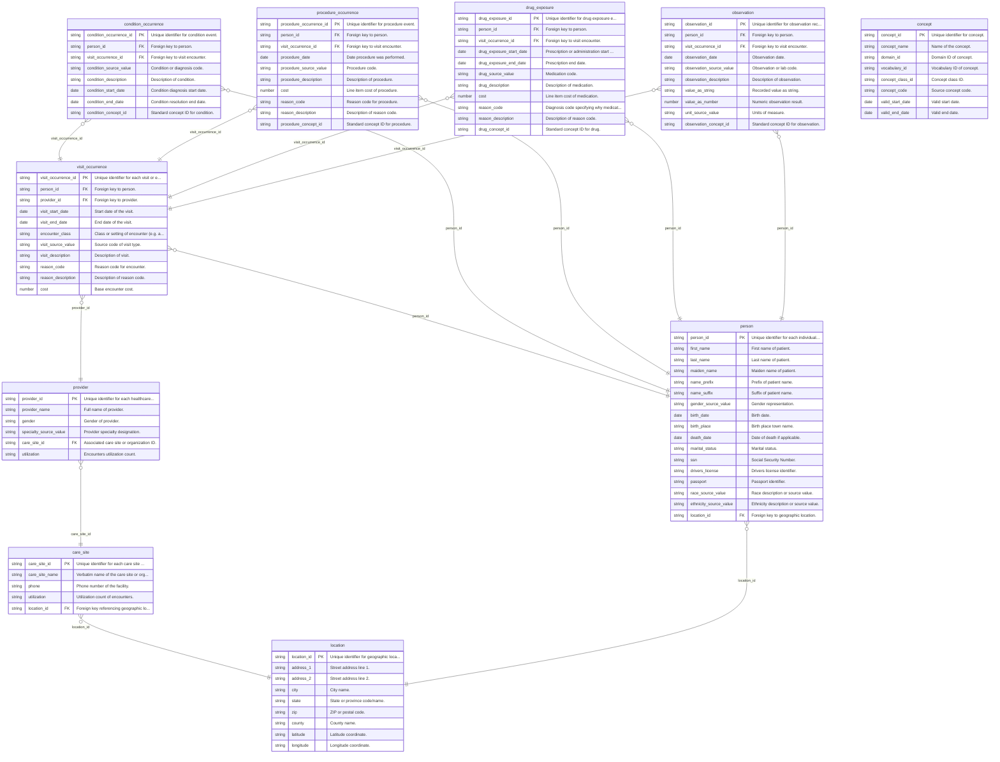

# Schema Alignment Diagnostic Report — synthea-omop

## Summary Results


## Detailed Analysis

# Schema Alignment Diagnostic Report — synthea-omop

- **Model**: `gemini-3.8-flash`
- **Domain**: Clinical & Healthcare
- **Status**: `SUCCESS (3/3)`
- **Iterations**: `3`
- **Source A**: `synthea` (12 tables, 111 cols)
- **Source B**: `omop` (39 tables, 432 cols)

## Schema Architectures (ER Diagrams)

### Source A Schema (`synthea`)

```mermaid
erDiagram
    allergies {
        string code "allergy code from snomed-ct"
        string description "description of the allergy"
        string encounter "foreign key to the encounter when the..."
        string patient "foreign key to the patient."
        date start "the date the allergy was diagnosed."
        date stop "the date the allergy ended, if applic..."
    }
    careplans {
        string code "code from snomed-ct"
        string description "description of the care plan."
        string encounter "foreign key to the encounter when the..."
        string id "primary key. unique identifier of the..."
        string patient "foreign key to the patient."
        string reasoncode "diagnosis code from snomed-ct that th..."
        string reasondescription "description of the reason code."
        date start "the date the care plan was initiated."
        date stop "the date the care plan ended, if appl..."
    }
    conditions {
        string code "diagnosis code from snomed-ct"
        string description "description of the condition."
        string encounter "foreign key to the encounter when the..."
        string patient "foreign key to the patient."
        date start "the date the condition was diagnosed."
        date stop "the date the condition resolved, if a..."
    }
    encounters {
        string code "encounter code from snomed-ct"
        string cost "the base cost of the encounter, not i..."
        string description "description of the type of encounter."
        string encounterclass "the class of the encounter, such as a..."
        string id "primary key. unique identifier of the..."
        string patient "foreign key to the patient."
        string provider "foreign key to the organization."
        string reasoncode "diagnosis code from snomed-ct, only i..."
        string reasondescription "description of the reason code."
        date start "the date and time the encounter started."
        date stop "the date and time the encounter concl..."
    }
    imaging_studies {
        string body_site_code "a snomed body structures code describ..."
        string body_site_description "description of the body site."
        date date "the date the imaging study was conduc..."
        string encounter "foreign key to the encounter where th..."
        string id "primary key. unique identifier of the..."
        string modality_code "a dicom-dcm code describing the metho..."
        string modality_description "description of the modality."
        string patient "foreign key to the patient."
        string sop_code "a dicom-sop code describing the subje..."
        string sop_description "description of the sop code."
    }
    immunizations {
        string code "immunization code from cvx."
        string cost "the line item cost of the immunization."
        date date "the date the immunization was adminis..."
        string description "description of the immunization."
        string encounter "foreign key to the encounter where th..."
        string patient "foreign key to the patient."
    }
    medications {
        string code "medication code from rxnorm."
        string cost "the line item cost of the medication."
        string description "description of the medication."
        string encounter "foreign key to the encounter where th..."
        string patient "foreign key to the patient."
        string reasoncode "diagnosis code from snomed-ct specify..."
        string reasondescription "description of the reason code."
        date start "the date the medication was prescribed."
        date stop "the date the prescription ended, if a..."
    }
    observations {
        string code "observation or lab code from loinc"
        date date "the date the observation was performed."
        string description "description of the observation or lab."
        string encounter "foreign key to the encounter where th..."
        string patient "foreign key to the patient."
        number type "the datatype of value text or numeric."
        string units "the units of measure for the value."
        string value "the recorded value of the observation."
    }
    organizations {
        string address "organization's street address without..."
        string city "street address city."
        string id "primary key of the organization."
        string name "name of the organization."
        string phone "organization's phone number."
        string state "street address state abbreviation."
        string utilization "the number of encounter's performed b..."
        string zip "street address zip or postal code."
    }
    patients {
        string address "patient's street address without comm..."
        date birthdate "the date the patient was born."
        string birthplace "name of the town where the patient wa..."
        string city "patient's address city."
        date deathdate "the date the patient died."
        string drivers "patient drivers license identifier."
        string ethnicity "description of the patient's primary ..."
        string first "first name of the patient."
        string gender "gender. m is male, f is female."
        string id "primary key. unique identifier of the..."
        string last "last or surname of the patient."
        string maiden "maiden name of the patient."
        string marital "marital status. m is married, s is si..."
        string passport "patient passport identifier."
        string prefix "name prefix, such as mr., mrs., dr., ..."
        string race "description of the patient's primary ..."
        string ssn "patient social security identifier."
        string state "patient's address state."
        string suffix "name suffix, such as phd, md, jd, etc."
        string zip "patient's zip code."
    }
    procedures {
        string code "procedure code from snomed-ct"
        string cost "the line item cost of the procedure."
        date date "the date the procedure was performed."
        string description "description of the procedure."
        string encounter "foreign key to the encounter where th..."
        string patient "foreign key to the patient."
        string reasoncode "diagnosis code from snomed-ct specify..."
        string reasondescription "description of the reason code."
    }
    providers {
        string address "provider's street address without com..."
        string city "street address city."
        string gender "gender. m is male, f is female."
        string id "primary key of the provider/clinician."
        string name "first and last name of the provider."
        string organization "foreign key to the organization that ..."
        string speciality "provider speciality."
        string state "street address state abbreviation."
        string utilization "the number of encounter's performed b..."
        string zip "street address zip or postal code."
    }
```



### Source B Schema (`omop`)

```mermaid
erDiagram
    care_site {
        string care_site_id PK "A unique identifier for each Care Site."
        string care_site_name "The verbatim description or name of t..."
        string care_site_source_value "The identifier for the Care Site in t..."
        string location_id FK "A foreign key to the geographic Locat..."
        string place_of_service_concept_id FK "A foreign key that refers to a Place ..."
        string place_of_service_source_value "The source code for the Place of Serv..."
    }
    cdm_source {
        string cdm_etl_reference "Version of the ETL script used. e.g. ..."
        string cdm_holder "The holder of the CDM instance."
        date cdm_release_date "The date the ETL script was completed..."
        string cdm_source_abbreviation "The abbreviation of the CDM instance."
        string cdm_source_name "The name of the CDM instance."
        string cdm_version "Version of the OMOP CDM used as strin..."
        string cdm_version_concept_id FK "The Concept Id representing the versi..."
        string source_description "The description of the CDM instance."
        string source_documentation_reference "The reference documentation for the s..."
        date source_release_date "The date the data was extracted from ..."
        string vocabulary_version "Version of the OMOP standardised voca..."
    }
    cohort {
        string cohort_definition_id "A foreign key to a record in the COHO..."
        date cohort_end_date "The date when the Cohort Definition c..."
        date cohort_start_date "The date when the Cohort Definition c..."
        string subject_id "A foreign key to the subject in the c..."
    }
    cohort_definition {
        string cohort_definition_description "A complete description of the Cohort ..."
        string cohort_definition_id "A unique identifier for each Cohort."
        string cohort_definition_name "A short description of the Cohort."
        string cohort_definition_syntax "Syntax or code to operationalize the ..."
        date cohort_initiation_date "A date to indicate when the Cohort wa..."
        string definition_type_concept_id FK "Type defining what kind of Cohort Def..."
        string subject_concept_id FK "A foreign key to the Concept to which..."
    }
    concept {
        string concept_class_id FK "The attribute or concept class of the..."
        string concept_code "The concept code represents the ident..."
        string concept_id PK "A unique identifier for each Concept ..."
        string concept_name "An unambiguous, meaningful and descri..."
        string domain_id FK "A foreign key to the [DOMAIN](https:/..."
        date invalid_reason "Reason the Concept was invalidated. P..."
        string standard_concept "This flag determines where a Concept ..."
        date valid_end_date "The date when the Concept became inva..."
        date valid_start_date "The date when the Concept was first r..."
        string vocabulary_id FK "A foreign key to the [VOCABULARY](htt..."
    }
    concept_ancestor {
        string ancestor_concept_id FK "A foreign key to the concept in the c..."
        string descendant_concept_id FK "A foreign key to the concept in the c..."
        string max_levels_of_separation "The maximum separation in number of l..."
        string min_levels_of_separation "The minimum separation in number of l..."
    }
    concept_class {
        string concept_class_concept_id FK "A foreign key that refers to an ident..."
        string concept_class_id PK "A unique key for each class."
        string concept_class_name "The name describing the Concept Class..."
    }
    concept_relationship {
        string concept_id_1 FK "A foreign key to a Concept in the [CO..."
        string concept_id_2 FK "A foreign key to a Concept in the [CO..."
        date invalid_reason "Reason the relationship was invalidat..."
        string relationship_id FK "A unique identifier to the type or na..."
        date valid_end_date "The date when the Concept Relationshi..."
        date valid_start_date "The date when the instance of the Con..."
    }
    concept_synonym {
        string concept_id FK "A foreign key to the Concept in the C..."
        string concept_synonym_name "The alternative name for the Concept."
        string language_concept_id FK "A foreign key to a Concept representi..."
    }
    condition_era {
        string condition_concept_id FK "A foreign key that refers to a standa..."
        date condition_era_end_date "The end date for the Condition Era co..."
        string condition_era_id "A unique identifier for each Conditio..."
        date condition_era_start_date "The start date for the Condition Era ..."
        string condition_occurrence_count "The number of individual Condition Oc..."
        string person_id FK "A foreign key identifier to the Perso..."
    }
    condition_occurrence {
        string condition_concept_id FK "A foreign key that refers to a Standa..."
        date condition_end_date "The date when the instance of the Con..."
        date condition_end_datetime "The date when the instance of the Con..."
        string condition_occurrence_id "A unique identifier for each Conditio..."
        string condition_source_concept_id FK "A foreign key to a Condition Concept ..."
        string condition_source_value "The source code for the condition as ..."
        date condition_start_date "The date when the instance of the Con..."
        date condition_start_datetime "The date and time when the instance o..."
        string condition_status_concept_id FK "A foreign key to the predefined conce..."
        string condition_status_source_value "The source code for the condition sta..."
        string condition_type_concept_id FK "A foreign key to the predefined Conce..."
        string person_id FK "A foreign key identifier to the Perso..."
        string provider_id FK "A foreign key to the Provider in the ..."
        string stop_reason "The reason that the condition was no ..."
        string visit_detail_id FK "A foreign key to the visit in the VIS..."
        string visit_occurrence_id FK "A foreign key to the visit in the VIS..."
    }
    cost {
        string amount_allowed "The contracted amount agreed between ..."
        string cost_domain_id FK "The concept representing the domain o..."
        string cost_event_id "A foreign key identifier to the event..."
        string cost_id "A unique identifier for each COST rec..."
        string cost_type_concept_id FK "A foreign key identifier to a concept..."
        integer currency_concept_id FK "A foreign key identifier to the conce..."
        string drg_concept_id FK "A foreign key to the predefined conce..."
        string drg_source_value "The 3-digit DRG source code as it app..."
        string paid_by_patient "The total amount paid by the Person a..."
        string paid_by_payer "The amount paid by the Payer for the ..."
        string paid_by_primary "The amount paid by a primary Payer th..."
        string paid_dispensing_fee "The amount paid by the Payer to a pha..."
        string paid_ingredient_cost "The amount paid by the Payer to a pha..."
        integer paid_patient_coinsurance "The amount paid by the Person as a jo..."
        string paid_patient_copay "The amount paid by the Person as a fi..."
        string paid_patient_deductible "The amount paid by the Person that is..."
        string payer_plan_period_id "A foreign key to the PAYER_PLAN_PERIO..."
        string revenue_code_concept_id FK "A foreign key referring to a Standard..."
        string revenue_code_source_value "The source code for the Revenue code ..."
        string total_charge "The total amount charged by some prov..."
        string total_cost "The cost incurred by the provider of ..."
        string total_paid "The total amount actually paid from a..."
    }
    death {
        string cause_concept_id FK "A foreign key referring to a standard..."
        string cause_source_concept_id FK "A foreign key to the concept that ref..."
        string cause_source_value "The source code for the cause of deat..."
        date death_date "The date the person was deceased. If ..."
        date death_datetime "The date and time the person was dece..."
        string death_type_concept_id FK "A foreign key referring to the predef..."
        string person_id FK "A foreign key identifier to the decea..."
    }
    device_exposure {
        string device_concept_id FK "A foreign key that refers to a Standa..."
        date device_exposure_end_date "The date the Device or supply was rem..."
        date device_exposure_end_datetime "The date and time the Device or suppl..."
        string device_exposure_id "A system-generated unique identifier ..."
        date device_exposure_start_date "The date the Device or supply was app..."
        date device_exposure_start_datetime "The date and time the Device or suppl..."
        string device_source_concept_id FK "A foreign key to a Device Concept tha..."
        string device_source_value "The source code for the Device as it ..."
        string device_type_concept_id FK "A foreign key to the predefined Conce..."
        string person_id FK "A foreign key identifier to the Perso..."
        string production_id "This is the Production Identifier (UD..."
        string provider_id FK "A foreign key to the provider in the ..."
        string quantity "The number of individual Devices used..."
        string unique_device_id "A UDI or equivalent identifying the i..."
        string unit_concept_id FK "UNIT_SOURCE_VALUES should be mapped t..."
        string unit_source_concept_id FK "This is the concept representing the ..."
        string unit_source_value "This field houses the verbatim value ..."
        string visit_detail_id FK "A foreign key to the visit in the vis..."
        string visit_occurrence_id FK "A foreign key to the visit in the VIS..."
    }
    domain {
        string domain_concept_id FK "A foreign key that refers to an ident..."
        string domain_id PK "A unique key for each domain."
        string domain_name "The name describing the Domain, e.g. ..."
    }
    dose_era {
        date dose_era_end_date "The end date for the drug era constru..."
        string dose_era_id "A unique identifier for each Dose Era."
        date dose_era_start_date "The start date for the drug era const..."
        number dose_value "The numeric value of the dose."
        string drug_concept_id FK "A foreign key that refers to a Standa..."
        string person_id FK "A foreign key identifier to the Perso..."
        string unit_concept_id FK "A foreign key that refers to a Standa..."
    }
    drug_era {
        string drug_concept_id FK "A foreign key that refers to a Standa..."
        date drug_era_end_date "The end date for the drug era constru..."
        string drug_era_id "A unique identifier for each Drug Era."
        date drug_era_start_date "The start date for the Drug Era const..."
        string drug_exposure_count "The number of individual Drug Exposur..."
        string gap_days "The number of days that are not cover..."
        string person_id FK "A foreign key identifier to the Perso..."
    }
    drug_exposure {
        string days_supply "The number of days of supply of the m..."
        string dose_unit_source_value "The information about the dose unit a..."
        string drug_concept_id FK "A foreign key that refers to a Standa..."
        date drug_exposure_end_date "The end date for the current instance..."
        date drug_exposure_end_datetime "The end date and time for the current..."
        string drug_exposure_id "A system-generated unique identifier ..."
        date drug_exposure_start_date "The start date for the current instan..."
        date drug_exposure_start_datetime "The start date and time for the curre..."
        string drug_source_concept_id FK "A foreign key to a Drug Concept that ..."
        string drug_source_value "The source code for the Drug as it ap..."
        string drug_type_concept_id FK "A foreign key to the predefined Conce..."
        string lot_number "An identifier assigned to a particula..."
        string person_id FK "A foreign key identifier to the perso..."
        string provider_id FK "A foreign key to the provider in the ..."
        string quantity "The quantity of drug as recorded in t..."
        string refills "The number of refills after the initi..."
        string route_concept_id FK "A foreign key to a predefined concept..."
        string route_source_value "The information about the route of ad..."
        integer sig "The directions ('signetur') on the Dr..."
        string stop_reason "The reason the Drug was stopped. Reas..."
        date verbatim_end_date "The known end date of a drug_exposure..."
        string visit_detail_id FK "A foreign key to the visit in the VIS..."
        string visit_occurrence_id FK "A foreign key to the visit in the vis..."
    }
    drug_strength {
        string amount_unit_concept_id FK "A foreign key to the Concept in the C..."
        number amount_value "The numeric value associated with the..."
        string box_size "The number of units of Clinical of Br..."
        string denominator_unit_concept_id FK "A foreign key to the Concept in the C..."
        integer denominator_value "The amount of total liquid (or other ..."
        string drug_concept_id FK "A foreign key to the Concept in the C..."
        string ingredient_concept_id FK "A foreign key to the Concept in the C..."
        date invalid_reason "Reason the concept was invalidated. P..."
        string numerator_unit_concept_id FK "A foreign key to the Concept in the C..."
        number numerator_value "The numeric value associated with the..."
        date valid_end_date "The date when the concept became inva..."
        date valid_start_date "The date when the Concept was first r..."
    }
    episode {
        string episode_concept_id FK "The EPISODE_CONCEPT_ID represents the..."
        date episode_end_date "The date when the instance of the Epi..."
        date episode_end_datetime "The date and time when the instance o..."
        string episode_id PK "A unique identifier for each Episode."
        string episode_number "For sequences of episodes, this is us..."
        string episode_object_concept_id FK "A Standard Concept representing the d..."
        integer episode_parent_id "Use this field to find the Episode th..."
        string episode_source_concept_id FK "A foreign key to an Episode Concept t..."
        string episode_source_value "The source code for the Episode as it..."
        date episode_start_date "The date when the Episode begins. Ple..."
        date episode_start_datetime "The date and time when the Episode be..."
        string episode_type_concept_id FK "This field can be used to determine t..."
        string person_id FK "The PERSON_ID of the PERSON for whom ..."
    }
    episode_event {
        string episode_event_field_concept_id FK "This field is the CONCEPT_ID that ide..."
        string episode_id FK "Use this field to link the EPISODE_EV..."
        string event_id "This field is the primary key of the ..."
    }
    fact_relationship {
        string domain_concept_id_1 FK "The concept representing the domain o..."
        string domain_concept_id_2 FK "The concept representing the domain o..."
        string fact_id_1 "The unique identifier in the table co..."
        string fact_id_2 "The unique identifier in the table co..."
        string relationship_concept_id FK "A foreign key to a Standard Concept I..."
    }
    location {
        string address_1 "The address field 1, typically used f..."
        string address_2 "The address field 2, typically used f..."
        string city "The city field as it appears in the s..."
        string country_concept_id FK "The Concept Id representing the count..."
        string country_source_value "The name of the country."
        string county "The county."
        string latitude "Must be between -90 and 90."
        string location_id PK "A unique identifier for each geograph..."
        string location_source_value "The verbatim information that is used..."
        string longitude "Must be between -180 and 180."
        string state "The state field as it appears in the ..."
        string zip "The zip or postal code."
    }
    measurement {
        string meas_event_field_concept_id FK "If the Measurement record is related ..."
        string measurement_concept_id FK "A foreign key to the standard measure..."
        date measurement_date "The date of the Measurement."
        date measurement_datetime "The date and time of the Measurement...."
        string measurement_event_id "If the Measurement record is related ..."
        string measurement_id "A unique identifier for each Measurem..."
        string measurement_source_concept_id FK "A foreign key to a Concept in the Sta..."
        string measurement_source_value "The Measurement name as it appears in..."
        string measurement_time "This is present for backwards compati..."
        string measurement_type_concept_id FK "A foreign key to the predefined Conce..."
        string operator_concept_id FK "A foreign key identifier to the prede..."
        string person_id FK "A foreign key identifier to the Perso..."
        string provider_id FK "A foreign key to the provider in the ..."
        string range_high "The upper limit of the normal range o..."
        string range_low "The lower limit of the normal range o..."
        string unit_concept_id FK "A foreign key to a Standard Concept I..."
        string unit_source_concept_id FK "This is the concept representing the ..."
        string unit_source_value "The source code for the unit as it ap..."
        string value_as_concept_id FK "A foreign key to a Measurement result..."
        number value_as_number "A Measurement result where the result..."
        string value_source_value "The source value associated with the ..."
        string visit_detail_id FK "A foreign key to the Visit in the VIS..."
        string visit_occurrence_id FK "A foreign key to the Visit in the VIS..."
    }
    metadata {
        string metadata_concept_id FK "The CONCEPT_ID that provides the meta..."
        date metadata_date "The date of the metadata attribute."
        datetime metadata_datetime "The datetime of the metadata attribute."
        string metadata_id "The unique key given to a Metadata re..."
        string metadata_type_concept_id FK "The CONCEPT_ID that provides the type..."
        string name "The name of the metadata attribute."
        string value_as_concept_id FK "The CONCEPT_ID that represents the va..."
        number value_as_number "This is the numerical value of the re..."
        string value_as_string "The string value of the metadata attr..."
    }
    note {
        string encoding_concept_id FK "A foreign key to the predefined Conce..."
        string language_concept_id FK "A foreign key to the predefined Conce..."
        string note_class_concept_id FK "A foreign key to the predefined Conce..."
        date note_date "The date the note was recorded."
        date note_datetime "The date and time the note was recorded."
        string note_event_field_concept_id FK "If the Note record is related to anot..."
        string note_event_id "If the Note record is related to anot..."
        string note_id "A unique identifier for each note."
        string note_source_value "The source value associated with the ..."
        string note_text "The content of the Note."
        string note_title "The title of the Note as it appears i..."
        string note_type_concept_id FK "A foreign key to the predefined Conce..."
        string person_id FK "A foreign key identifier to the Perso..."
        string provider_id FK "A foreign key to the Provider in the ..."
        string visit_detail_id FK "Foreign key to the Visit in the VISIT..."
        string visit_occurrence_id FK "Foreign key to the Visit in the VISIT..."
    }
    note_nlp {
        string lexical_variant "Raw text extracted from the NLP tool."
        date nlp_date "The date of the note processing.Usefu..."
        date nlp_datetime "The date and time of the note process..."
        string nlp_system "Name and version of the NLP system th..."
        string note_id "A foreign key to the Note table note ..."
        string note_nlp_concept_id FK "A foreign key to the predefined Conce..."
        string note_nlp_id "A unique identifier for each term ext..."
        string note_nlp_source_concept_id FK "A foreign key to a Concept that refer..."
        string offset "Character offset of the extracted ter..."
        string section_concept_id FK "A foreign key to the predefined Conce..."
        string snippet "A small window of text surrounding th..."
        string term_exists "A summary modifier that signifies pre..."
        integer term_modifiers "For the modifiers that are there, the..."
        date term_temporal "Term_temporal is to indicate if a con..."
    }
    observation {
        string obs_event_field_concept_id FK "If the Observation record is related ..."
        string observation_concept_id FK "A foreign key to the standard observa..."
        date observation_date "The date of the observation."
        date observation_datetime "The date and time of the observation."
        string observation_event_id "If the Observation record is related ..."
        string observation_id "A unique identifier for each observat..."
        string observation_source_concept_id FK "A foreign key to a Concept that refer..."
        string observation_source_value "The observation code as it appears in..."
        string observation_type_concept_id FK "A foreign key to the predefined conce..."
        string person_id FK "A foreign key identifier to the Perso..."
        string provider_id FK "A foreign key to the provider in the ..."
        integer qualifier_concept_id FK "A foreign key to a Standard Concept I..."
        string qualifier_source_value "The source value associated with a qu..."
        string unit_concept_id FK "A foreign key to a Standard Concept I..."
        string unit_source_value "The source code for the unit as it ap..."
        string value_as_concept_id FK "A foreign key to an observation resul..."
        number value_as_number "The observation result stored as a nu..."
        string value_as_string "The observation result stored as a st..."
        string value_source_value "This field houses the verbatim result..."
        string visit_detail_id FK "A foreign key to the visit in the VIS..."
        string visit_occurrence_id FK "A foreign key to the visit in the VIS..."
    }
    observation_period {
        date observation_period_end_date "The end date of the observation perio..."
        string observation_period_id "A unique identifier for each observat..."
        date observation_period_start_date "The start date of the observation per..."
        string period_type_concept_id FK "A foreign key identifier to the prede..."
        string person_id FK "A foreign key identifier to the perso..."
    }
    payer_plan_period {
        string family_source_value "The common identifier for all people ..."
        string payer_concept_id FK "This field represents the organizatio..."
        date payer_plan_period_end_date "End date of Plan coverage."
        date payer_plan_period_id "A unique identifier for each unique c..."
        date payer_plan_period_start_date "Start date of Plan coverage."
        string payer_source_concept_id FK "If the source data codes the Payer in..."
        string payer_source_value "This is the Payer as it appears in th..."
        string person_id FK "The Person covered by the Plan. A sin..."
        string plan_concept_id FK "This field represents the specific he..."
        string plan_source_concept_id FK "If the source data codes the Plan in ..."
        string plan_source_value "This is the health benefit Plan of th..."
        string sponsor_concept_id FK "This field represents the sponsor of ..."
        string sponsor_source_concept_id FK "If the source data codes the sponsor ..."
        string sponsor_source_value "The Plan sponsor as it appears in the..."
        string stop_reason_concept_id FK "This field represents the reason the ..."
        string stop_reason_source_concept_id FK "If the source data codes the stop rea..."
        string stop_reason_source_value "The Plan stop reason as it appears in..."
    }
    person {
        date birth_datetime "The date and time of birth of the per..."
        string care_site_id FK "A foreign key to the site of primary ..."
        date day_of_birth "The day of the month of birth of the ..."
        string ethnicity_concept_id FK "A foreign key that refers to the stan..."
        string ethnicity_source_concept_id FK "A foreign key to the ethnicity concep..."
        string ethnicity_source_value "The source code for the ethnicity of ..."
        string gender_concept_id FK "A foreign key that refers to an ident..."
        string gender_source_concept_id FK "A foreign key to the gender concept t..."
        string gender_source_value "The source code for the gender of the..."
        string location_id FK "A foreign key to the place of residen..."
        date month_of_birth "The month of birth of the person. For..."
        string person_id PK "A unique identifier for each person."
        string person_source_value "An (encrypted) key derived from the p..."
        string provider_id FK "A foreign key to the primary care pro..."
        string race_concept_id FK "A foreign key that refers to an ident..."
        string race_source_concept_id FK "A foreign key to the race concept tha..."
        string race_source_value "The source code for the race of the p..."
        date year_of_birth "The year of birth of the person. For ..."
    }
    procedure_occurrence {
        string modifier_concept_id FK "A foreign key to a Standard Concept i..."
        string modifier_source_value "The source code for the qualifier as ..."
        string person_id FK "A foreign key identifier to the Perso..."
        string procedure_concept_id FK "A foreign key that refers to a standa..."
        date procedure_date "The date on which the Procedure was p..."
        date procedure_datetime "The date and time on which the Proced..."
        date procedure_end_date "The date on which the Procedure finis..."
        date procedure_end_datetime "The date and time on which the Proced..."
        string procedure_occurrence_id "A system-generated unique identifier ..."
        string procedure_source_concept_id FK "A foreign key to a Procedure Concept ..."
        string procedure_source_value "The source code for the Procedure as ..."
        string procedure_type_concept_id FK "A foreign key to the predefined Conce..."
        string provider_id FK "A foreign key to the provider in the ..."
        string quantity "The quantity of procedures ordered or..."
        string visit_detail_id FK "A foreign key to the visit in the vis..."
        string visit_occurrence_id FK "A foreign key to the visit in the vis..."
    }
    provider {
        string care_site_id FK "A foreign key to the main Care Site w..."
        string dea "The Drug Enforcement Administration (..."
        string gender_concept_id FK "The gender of the Provider."
        string gender_source_concept_id FK "A foreign key to a Concept that refer..."
        string gender_source_value "The gender code for the Provider as i..."
        string npi "The National Provider Identifier (NPI..."
        string provider_id PK "A unique identifier for each Provider."
        string provider_name "A description of the Provider."
        string provider_source_value "The identifier used for the Provider ..."
        string specialty_concept_id FK "A foreign key to a Standard Specialty..."
        string specialty_source_concept_id FK "A foreign key to a Concept that refer..."
        string specialty_source_value "The source code for the Provider spec..."
        string year_of_birth "The year of birth of the Provider."
    }
    relationship {
        string defines_ancestry "Defines whether a hierarchical relati..."
        integer is_hierarchical "Defines whether a relationship define..."
        string relationship_concept_id FK "A foreign key that refers to an ident..."
        string relationship_id PK "The type of relationship captured by ..."
        string relationship_name "The text that describes the relations..."
        string reverse_relationship_id "The identifier for the relationship u..."
    }
    source_to_concept_map {
        date invalid_reason "Reason the mapping instance was inval..."
        integer source_code "The source code being translated into..."
        string source_code_description "An optional description for the sourc..."
        integer source_concept_id FK "A foreign key to the Source Concept t..."
        string source_vocabulary_id "A foreign key to the VOCABULARY table..."
        string target_concept_id FK "A foreign key to the target Concept t..."
        string target_vocabulary_id FK "A foreign key to the VOCABULARY table..."
        date valid_end_date "The date when the mapping instance be..."
        date valid_start_date "The date when the mapping instance wa..."
    }
    specimen {
        string anatomic_site_concept_id FK "A foreign key to a Standard Concept i..."
        string anatomic_site_source_value "The information about the anatomic si..."
        string disease_status_concept_id FK "A foreign key to a Standard Concept i..."
        string disease_status_source_value "The information about the disease sta..."
        string person_id FK "A foreign key identifier to the Perso..."
        string quantity "The amount of specimen collection fro..."
        string specimen_concept_id FK "A foreign key referring to a Standard..."
        date specimen_date "The date the specimen was obtained fr..."
        date specimen_datetime "The date and time on the date when th..."
        string specimen_id "A unique identifier for each specimen."
        string specimen_source_id "The Specimen identifier as it appears..."
        string specimen_source_value "The Specimen value as it appears in t..."
        string specimen_type_concept_id FK "A foreign key referring to the Concep..."
        number unit_concept_id FK "A foreign key to a Standard Concept i..."
        string unit_source_value "The information about the Unit as det..."
    }
    visit_detail {
        string admitted_from_concept_id FK "A foreign key to the predefined conce..."
        string admitted_from_source_value "The source code for the admitting sou..."
        string care_site_id FK "A foreign key to the care site in the..."
        string discharged_to_concept_id FK "A foreign key to the predefined conce..."
        string discharged_to_source_value "The source code for the discharge dis..."
        string person_id FK "A foreign key identifier to the Perso..."
        string preceding_visit_detail_id FK "A foreign key to the VISIT_DETAIL tab..."
        string provider_id FK "A foreign key to the provider in the ..."
        string visit_detail_concept_id FK "A foreign key that refers to a visit ..."
        date visit_detail_end_date "The end date of the visit. If this is..."
        date visit_detail_end_datetime "The date and time of the visit end."
        string visit_detail_id PK "A unique identifier for each Person"
        string visit_detail_parent_id FK "A foreign key to the VISIT_DETAIL tab..."
        string visit_detail_source_concept_id FK "A foreign key to a Concept that refer..."
        string visit_detail_source_value "The source code for the visit as it a..."
        date visit_detail_start_date "The start date of the visit."
        date visit_detail_start_datetime "The date and time of the visit started."
        string visit_detail_type_concept_id FK "A foreign key to the predefined Conce..."
        string visit_occurrence_id FK "A foreign key that refers to the reco..."
    }
    visit_occurrence {
        string admitted_from_concept_id FK "A foreign key to the predefined conce..."
        string admitted_from_source_value "The source code for the admitting sou..."
        string care_site_id FK "A foreign key to the care site in the..."
        string discharged_to_concept_id FK "A foreign key to the predefined conce..."
        string discharged_to_source_value "The source code for the discharge dis..."
        string person_id FK "A foreign key identifier to the Perso..."
        string preceding_visit_occurrence_id FK "A foreign key to the VISIT_OCCURRENCE..."
        string provider_id FK "A foreign key to the provider in the ..."
        string visit_concept_id FK "A foreign key that refers to a visit ..."
        date visit_end_date "The end date of the visit. If this is..."
        date visit_end_datetime "The date and time of the visit end."
        string visit_occurrence_id PK "A unique identifier for each Person"
        string visit_source_concept_id FK "A foreign key to a Concept that refer..."
        string visit_source_value "The source code for the visit as it a..."
        date visit_start_date "The start date of the visit."
        date visit_start_datetime "The date and time of the visit started."
        string visit_type_concept_id FK "A foreign key to the predefined Conce..."
    }
    vocabulary {
        string vocabulary_concept_id FK "A foreign key that refers to a standa..."
        string vocabulary_id PK "A unique identifier for each Vocabula..."
        integer vocabulary_name "The name describing the vocabulary, f..."
        string vocabulary_reference "External reference to documentation o..."
        string vocabulary_version "Version of the Vocabulary as indicate..."
    }
    care_site }o--|| location : "location_id"
    care_site }o--|| concept : "place_of_service_concept_id"
    cdm_source }o--|| concept : "cdm_version_concept_id"
    cohort_definition }o--|| concept : "definition_type_concept_id"
    cohort_definition }o--|| concept : "subject_concept_id"
    concept }o--|| concept_class : "concept_class_id"
    concept }o--|| domain : "domain_id"
    concept }o--|| vocabulary : "vocabulary_id"
    concept_ancestor }o--|| concept : "ancestor_concept_id"
    concept_ancestor }o--|| concept : "descendant_concept_id"
    concept_class }o--|| concept : "concept_class_concept_id"
    concept_relationship }o--|| concept : "concept_id_1"
    concept_relationship }o--|| concept : "concept_id_2"
    concept_relationship }o--|| relationship : "relationship_id"
    concept_synonym }o--|| concept : "concept_id"
    concept_synonym }o--|| concept : "language_concept_id"
    condition_era }o--|| concept : "condition_concept_id"
    condition_era }o--|| person : "person_id"
    condition_occurrence }o--|| concept : "condition_concept_id"
    condition_occurrence }o--|| concept : "condition_source_concept_id"
    condition_occurrence }o--|| concept : "condition_status_concept_id"
    condition_occurrence }o--|| concept : "condition_type_concept_id"
    condition_occurrence }o--|| person : "person_id"
    condition_occurrence }o--|| provider : "provider_id"
    condition_occurrence }o--|| visit_detail : "visit_detail_id"
    condition_occurrence }o--|| visit_occurrence : "visit_occurrence_id"
    cost }o--|| domain : "cost_domain_id"
    cost }o--|| concept : "cost_type_concept_id"
    cost }o--|| concept : "currency_concept_id"
    cost }o--|| concept : "drg_concept_id"
    cost }o--|| concept : "revenue_code_concept_id"
    death }o--|| concept : "cause_concept_id"
    death }o--|| concept : "cause_source_concept_id"
    death }o--|| concept : "death_type_concept_id"
    death }o--|| person : "person_id"
    device_exposure }o--|| concept : "device_concept_id"
    device_exposure }o--|| concept : "device_source_concept_id"
    device_exposure }o--|| concept : "device_type_concept_id"
    device_exposure }o--|| person : "person_id"
    device_exposure }o--|| provider : "provider_id"
    device_exposure }o--|| concept : "unit_concept_id"
    device_exposure }o--|| concept : "unit_source_concept_id"
    device_exposure }o--|| visit_detail : "visit_detail_id"
    device_exposure }o--|| visit_occurrence : "visit_occurrence_id"
    domain }o--|| concept : "domain_concept_id"
    dose_era }o--|| concept : "drug_concept_id"
    dose_era }o--|| person : "person_id"
    dose_era }o--|| concept : "unit_concept_id"
    drug_era }o--|| concept : "drug_concept_id"
    drug_era }o--|| person : "person_id"
    drug_exposure }o--|| concept : "drug_concept_id"
    drug_exposure }o--|| concept : "drug_source_concept_id"
    drug_exposure }o--|| concept : "drug_type_concept_id"
    drug_exposure }o--|| person : "person_id"
    drug_exposure }o--|| provider : "provider_id"
    drug_exposure }o--|| concept : "route_concept_id"
    drug_exposure }o--|| visit_detail : "visit_detail_id"
    drug_exposure }o--|| visit_occurrence : "visit_occurrence_id"
    drug_strength }o--|| concept : "amount_unit_concept_id"
    drug_strength }o--|| concept : "denominator_unit_concept_id"
    drug_strength }o--|| concept : "drug_concept_id"
    drug_strength }o--|| concept : "ingredient_concept_id"
    drug_strength }o--|| concept : "numerator_unit_concept_id"
    episode }o--|| concept : "episode_concept_id"
    episode }o--|| concept : "episode_object_concept_id"
    episode }o--|| concept : "episode_source_concept_id"
    episode }o--|| concept : "episode_type_concept_id"
    episode }o--|| person : "person_id"
    episode_event }o--|| concept : "episode_event_field_concept_id"
    episode_event }o--|| episode : "episode_id"
    fact_relationship }o--|| concept : "domain_concept_id_1"
    fact_relationship }o--|| concept : "domain_concept_id_2"
    fact_relationship }o--|| concept : "relationship_concept_id"
    location }o--|| concept : "country_concept_id"
    measurement }o--|| concept : "meas_event_field_concept_id"
    measurement }o--|| concept : "measurement_concept_id"
    measurement }o--|| concept : "measurement_source_concept_id"
    measurement }o--|| concept : "measurement_type_concept_id"
    measurement }o--|| concept : "operator_concept_id"
    measurement }o--|| person : "person_id"
    measurement }o--|| provider : "provider_id"
    measurement }o--|| concept : "unit_concept_id"
    measurement }o--|| concept : "unit_source_concept_id"
    measurement }o--|| concept : "value_as_concept_id"
    measurement }o--|| visit_detail : "visit_detail_id"
    measurement }o--|| visit_occurrence : "visit_occurrence_id"
    metadata }o--|| concept : "metadata_concept_id"
    metadata }o--|| concept : "metadata_type_concept_id"
    metadata }o--|| concept : "value_as_concept_id"
    note }o--|| concept : "encoding_concept_id"
    note }o--|| concept : "language_concept_id"
    note }o--|| concept : "note_class_concept_id"
    note }o--|| concept : "note_event_field_concept_id"
    note }o--|| concept : "note_type_concept_id"
    note }o--|| person : "person_id"
    note }o--|| provider : "provider_id"
    note }o--|| visit_detail : "visit_detail_id"
    note }o--|| visit_occurrence : "visit_occurrence_id"
    note_nlp }o--|| concept : "note_nlp_concept_id"
    note_nlp }o--|| concept : "note_nlp_source_concept_id"
    note_nlp }o--|| concept : "section_concept_id"
    observation }o--|| concept : "obs_event_field_concept_id"
    observation }o--|| concept : "observation_concept_id"
    observation }o--|| concept : "observation_source_concept_id"
    observation }o--|| concept : "observation_type_concept_id"
    observation }o--|| person : "person_id"
    observation }o--|| provider : "provider_id"
    observation }o--|| concept : "qualifier_concept_id"
    observation }o--|| concept : "unit_concept_id"
    observation }o--|| concept : "value_as_concept_id"
    observation }o--|| visit_detail : "visit_detail_id"
    observation }o--|| visit_occurrence : "visit_occurrence_id"
    observation_period }o--|| concept : "period_type_concept_id"
    observation_period }o--|| person : "person_id"
    payer_plan_period }o--|| concept : "payer_concept_id"
    payer_plan_period }o--|| concept : "payer_source_concept_id"
    payer_plan_period }o--|| person : "person_id"
    payer_plan_period }o--|| concept : "plan_concept_id"
    payer_plan_period }o--|| concept : "plan_source_concept_id"
    payer_plan_period }o--|| concept : "sponsor_concept_id"
    payer_plan_period }o--|| concept : "sponsor_source_concept_id"
    payer_plan_period }o--|| concept : "stop_reason_concept_id"
    payer_plan_period }o--|| concept : "stop_reason_source_concept_id"
    person }o--|| care_site : "care_site_id"
    person }o--|| concept : "ethnicity_concept_id"
    person }o--|| concept : "ethnicity_source_concept_id"
    person }o--|| concept : "gender_concept_id"
    person }o--|| concept : "gender_source_concept_id"
    person }o--|| location : "location_id"
    person }o--|| provider : "provider_id"
    person }o--|| concept : "race_concept_id"
    person }o--|| concept : "race_source_concept_id"
    procedure_occurrence }o--|| concept : "modifier_concept_id"
    procedure_occurrence }o--|| person : "person_id"
    procedure_occurrence }o--|| concept : "procedure_concept_id"
    procedure_occurrence }o--|| concept : "procedure_source_concept_id"
    procedure_occurrence }o--|| concept : "procedure_type_concept_id"
    procedure_occurrence }o--|| provider : "provider_id"
    procedure_occurrence }o--|| visit_detail : "visit_detail_id"
    procedure_occurrence }o--|| visit_occurrence : "visit_occurrence_id"
    provider }o--|| care_site : "care_site_id"
    provider }o--|| concept : "gender_concept_id"
    provider }o--|| concept : "gender_source_concept_id"
    provider }o--|| concept : "specialty_concept_id"
    provider }o--|| concept : "specialty_source_concept_id"
    relationship }o--|| concept : "relationship_concept_id"
    source_to_concept_map }o--|| concept : "source_concept_id"
    source_to_concept_map }o--|| concept : "target_concept_id"
    source_to_concept_map }o--|| vocabulary : "target_vocabulary_id"
    specimen }o--|| concept : "anatomic_site_concept_id"
    specimen }o--|| concept : "disease_status_concept_id"
    specimen }o--|| person : "person_id"
    specimen }o--|| concept : "specimen_concept_id"
    specimen }o--|| concept : "specimen_type_concept_id"
    specimen }o--|| concept : "unit_concept_id"
    visit_detail }o--|| concept : "admitted_from_concept_id"
    visit_detail }o--|| care_site : "care_site_id"
    visit_detail }o--|| concept : "discharged_to_concept_id"
    visit_detail }o--|| person : "person_id"
    visit_detail }o--|| visit_detail : "preceding_visit_detail_id"
    visit_detail }o--|| provider : "provider_id"
    visit_detail }o--|| concept : "visit_detail_concept_id"
    visit_detail }o--|| visit_detail : "visit_detail_parent_id"
    visit_detail }o--|| concept : "visit_detail_source_concept_id"
    visit_detail }o--|| concept : "visit_detail_type_concept_id"
    visit_detail }o--|| visit_occurrence : "visit_occurrence_id"
    visit_occurrence }o--|| concept : "admitted_from_concept_id"
    visit_occurrence }o--|| care_site : "care_site_id"
    visit_occurrence }o--|| concept : "discharged_to_concept_id"
    visit_occurrence }o--|| person : "person_id"
    visit_occurrence }o--|| visit_occurrence : "preceding_visit_occurrence_id"
    visit_occurrence }o--|| provider : "provider_id"
    visit_occurrence }o--|| concept : "visit_concept_id"
    visit_occurrence }o--|| concept : "visit_source_concept_id"
    visit_occurrence }o--|| concept : "visit_type_concept_id"
    vocabulary }o--|| concept : "vocabulary_concept_id"
```

### Generated Unified Target Schemas per Iteration

> [!NOTE]
> Use the toggles below to view the target schema ER diagram generated in each iteration. The representative run is expanded by default.

<details>
<summary><b>Iteration 1 Target Schema (17 tables, S_rel: 0.1420)</b></summary>

```mermaid
erDiagram
    location {
        string location_id PK "A unique identifier for each geograph..."
        string address_1 "The street address."
        string address_2 "The second line of address."
        string city "City name."
        string state "State abbreviation."
        string zip "Zip or postal code."
        string county "County name."
        string country_concept_id "Country concept ID."
        string country_source_value "Country source value or name."
        string latitude "Latitude coordinate."
        string longitude "Longitude coordinate."
        string location_source_value "Verbatim location string."
    }
    care_site {
        string care_site_id PK "A unique identifier for each Care Sit..."
        string care_site_name "The name of the care site or organiza..."
        string care_site_source_value "The identifier for the care site in s..."
        string location_id FK "Foreign key to geographic location."
        string phone "Phone number of the facility."
        string utilization "Encounter utilization count."
        string place_of_service_concept_id "Place of service concept ID."
        string place_of_service_source_value "Place of service source value."
    }
    provider {
        string provider_id PK "A unique identifier for each Provider..."
        string provider_name "Name of the provider."
        string provider_source_value "Identifier in the source data."
        string dea "DEA number."
        string npi "NPI number."
        string care_site_id FK "Foreign key to the care site / organi..."
        string specialty_source_value "Specialty text from source."
        string specialty_concept_id "Standard concept ID for provider spec..."
        string specialty_source_concept_id "Source concept ID for provider specia..."
        string gender_source_value "Gender code in source data."
        string gender_concept_id "Standard concept ID for gender."
        string gender_source_concept_id "Source concept ID for gender."
        string year_of_birth "Year of birth."
        string utilization "Provider encounter utilization count."
    }
    person {
        string person_id PK "A unique identifier for each patient ..."
        string person_source_value "Person identifier from source."
        string first_name "Given / first name of the patient."
        string last_name "Family / last name of the patient."
        string maiden_name "Maiden name."
        string name_prefix "Name prefix (e.g. Mr., Dr.)."
        string name_suffix "Name suffix (e.g. Jr., PhD)."
        date birth_date "Date of birth."
        date birth_datetime "Date and time of birth."
        date year_of_birth "Year of birth."
        date month_of_birth "Month of birth."
        date day_of_birth "Day of birth."
        string birthplace "Town/city where the person was born."
        string gender_source_value "Gender source value."
        string gender_concept_id "Standard concept ID for gender."
        string gender_source_concept_id "Source concept ID for gender."
        string race_source_value "Race source value."
        string race_concept_id "Standard concept ID for race."
        string race_source_concept_id "Source concept ID for race."
        string ethnicity_source_value "Ethnicity source value."
        string ethnicity_concept_id "Standard concept ID for ethnicity."
        string ethnicity_source_concept_id "Source concept ID for ethnicity."
        string marital_status "Marital status code."
        string ssn "Social Security Number."
        string drivers_license "Driver's license number."
        string passport "Passport number."
        string location_id FK "Foreign key to geographic location."
        string provider_id FK "Foreign key to primary care provider."
        string care_site_id FK "Foreign key to primary care site."
    }
    death {
        string person_id PK,FK "Foreign key to the deceased person."
        date death_date "Date of death."
        date death_datetime "Date and time of death."
        string death_type_concept_id "Concept ID reflecting type of death d..."
        string cause_concept_id "Standard concept ID for cause of death."
        string cause_source_value "Source value for cause of death."
        string cause_source_concept_id "Source concept ID for cause of death."
    }
    visit_occurrence {
        string visit_occurrence_id PK "Unique identifier for each visit or e..."
        string person_id FK "Foreign key to person experiencing th..."
        string visit_concept_id "Standard concept ID for the visit type."
        date visit_start_date "Start date of the visit."
        date visit_start_datetime "Start datetime of the visit."
        date visit_end_date "End date of the visit."
        date visit_end_datetime "End datetime of the visit."
        string visit_type_concept_id "Concept ID reflecting provenance of v..."
        string provider_id FK "Foreign key to attending provider."
        string care_site_id FK "Foreign key to facility care site."
        string visit_source_value "Visit source code / class description."
        string visit_source_description "Description of the encounter."
        string visit_source_concept_id "Source concept ID for visit."
        string admitted_from_concept_id "Admitted from concept ID."
        string admitted_from_source_value "Admitted from source value."
        string discharged_to_concept_id "Discharged to concept ID."
        string discharged_to_source_value "Discharged to source value."
        string preceding_visit_occurrence_id "Preceding visit occurrence ID."
        string reason_code "Diagnosis code targeted during encoun..."
        string reason_description "Reason description for the encounter."
        number cost "Base cost of the encounter."
    }
    condition_occurrence {
        string condition_occurrence_id PK "Unique identifier for each condition ..."
        string person_id FK "Foreign key to person experiencing co..."
        string condition_concept_id "Standard concept ID for condition."
        date condition_start_date "Start date of the condition."
        date condition_start_datetime "Start datetime of condition."
        date condition_end_date "Date the condition resolved."
        date condition_end_datetime "End datetime of condition."
        string condition_type_concept_id "Concept ID reflecting provenance of r..."
        string condition_status_concept_id "Status concept ID of condition."
        string stop_reason "Stop reason text."
        string provider_id FK "Foreign key to provider diagnosing co..."
        string visit_occurrence_id FK "Foreign key to visit occurrence."
        string visit_detail_id "Foreign key to visit detail."
        string condition_source_value "Source code for condition (e.g. SNOME..."
        string condition_source_description "Verbatim description of condition fro..."
        string condition_source_concept_id "Source concept ID for condition."
        string condition_status_source_value "Condition status source value."
    }
    drug_exposure {
        string drug_exposure_id PK "System-generated unique identifier fo..."
        string person_id FK "Foreign key to the person taking medi..."
        string drug_concept_id "Standard concept ID for drug."
        date drug_exposure_start_date "Start date for drug exposure/prescrip..."
        date drug_exposure_start_datetime "Start datetime for drug exposure."
        date drug_exposure_end_date "End date of prescription / exposure."
        date drug_exposure_end_datetime "End datetime for drug exposure."
        date verbatim_end_date "Verbatim end date."
        string drug_type_concept_id "Type concept ID for drug record."
        string stop_reason "Reason drug was stopped."
        string refills "Refills authorized."
        string quantity "Quantity dispensed or prescribed."
        string days_supply "Days of medication supply."
        integer sig "Prescription directions."
        string route_concept_id "Route concept ID."
        string lot_number "Manufacturer lot number."
        string provider_id FK "Foreign key to prescribing provider."
        string visit_occurrence_id FK "Foreign key to encounter visit."
        string visit_detail_id "Foreign key to visit detail."
        string drug_source_value "Medication source code (e.g. RxNorm)."
        string drug_source_description "Description of medication."
        string drug_source_concept_id "Source concept ID for drug."
        string route_source_value "Route source value."
        string dose_unit_source_value "Dose unit source value."
        string reason_code "Reason code why medication was prescr..."
        string reason_description "Description of reason code."
        number cost "Line item cost of the medication."
    }
    procedure_occurrence {
        string procedure_occurrence_id PK "Unique identifier for each procedure ..."
        string person_id FK "Foreign key to person undergoing proc..."
        string procedure_concept_id "Standard concept ID for procedure."
        date procedure_date "Date on which procedure was performed."
        date procedure_datetime "Date and time procedure was performed."
        date procedure_end_date "Date procedure finished."
        date procedure_end_datetime "Datetime procedure finished."
        string procedure_type_concept_id "Type concept ID for procedure record."
        string modifier_concept_id "Modifier concept ID."
        string quantity "Quantity of procedures ordered or adm..."
        string provider_id FK "Foreign key to provider performing pr..."
        string visit_occurrence_id FK "Foreign key to visit during which pro..."
        string visit_detail_id "Foreign key to visit detail."
        string procedure_source_value "Procedure code from source data (e.g...."
        string procedure_source_description "Description of procedure from source."
        string procedure_source_concept_id "Source concept ID for procedure."
        string modifier_source_value "Modifier source value."
        string reason_code "Diagnosis code specifying why procedu..."
        string reason_description "Description of reason code."
        number cost "Line item cost of procedure."
    }
    measurement {
        string measurement_id PK "Unique identifier for each measurement."
        string person_id FK "Foreign key to person."
        string measurement_concept_id "Standard concept ID for measurement."
        date measurement_date "Date of measurement."
        date measurement_datetime "Datetime of measurement."
        string measurement_time "Time of measurement."
        string measurement_type_concept_id "Measurement provenance type concept ID."
        string operator_concept_id "Operator concept ID (=, <, >, etc.)."
        number value_as_number "Measurement numeric result."
        string value_as_concept_id "Measurement concept result."
        string unit_concept_id "Unit standard concept ID."
        string range_low "Lower limit of normal range."
        string range_high "Upper limit of normal range."
        string provider_id FK "Foreign key to provider."
        string visit_occurrence_id FK "Foreign key to visit occurrence."
        string visit_detail_id "Foreign key to visit detail."
        string measurement_source_value "Measurement source code (e.g. LOINC)."
        string measurement_source_concept_id "Measurement source concept ID."
        string unit_source_value "Unit source value."
        string unit_source_concept_id "Unit source concept ID."
        string value_source_value "Verbatim value from source."
        string measurement_event_id "Measurement event ID."
        string meas_event_field_concept_id "Measurement event field concept ID."
    }
    observation {
        string observation_id PK "Unique identifier for each observation."
        string person_id FK "Foreign key to person."
        string observation_concept_id "Standard concept ID for observation."
        date observation_date "Date of observation."
        date observation_datetime "Datetime of observation."
        string observation_type_concept_id "Provenance concept ID."
        number value_as_number "Numeric value."
        string value_as_string "String value."
        string value_as_concept_id "Concept ID value."
        integer qualifier_concept_id "Qualifier concept ID."
        string unit_concept_id "Unit concept ID."
        string provider_id FK "Foreign key to provider."
        string visit_occurrence_id FK "Foreign key to visit occurrence."
        string visit_detail_id "Foreign key to visit detail."
        string observation_source_value "Source value of observation."
        string observation_source_concept_id "Source concept ID of observation."
        string unit_source_value "Unit source value."
        string qualifier_source_value "Qualifier source value."
        string value_source_value "Observation verbatim value."
        string observation_event_id "Observation event ID."
        string obs_event_field_concept_id "Observation event field concept ID."
    }
    immunization {
        string immunization_id PK "Primary key for immunization administ..."
        string person_id FK "Foreign key to patient."
        string visit_occurrence_id FK "Foreign key to encounter visit."
        date immunization_date "Date the immunization was administered."
        string immunization_code "Immunization CVX code."
        string immunization_description "Immunization description."
        number cost "Line item cost of immunization."
    }
    allergy {
        string allergy_id PK "Primary key for allergy diagnosed rec..."
        string person_id FK "Foreign key to the patient."
        string visit_occurrence_id FK "Foreign key to diagnosing encounter."
        string allergy_code "Allergy SNOMED-CT code."
        string allergy_description "Description of allergy."
        date start_date "Date the allergy was diagnosed."
        date end_date "Date the allergy ended."
    }
    care_plan {
        string care_plan_id PK "Unique identifier of care plan."
        string person_id FK "Foreign key to patient."
        string visit_occurrence_id FK "Foreign key to encounter initiating c..."
        string code "SNOMED-CT code for care plan."
        string description "Description of care plan."
        string reason_code "Reason SNOMED-CT code addressed."
        string reason_description "Description of reason code."
        date start_date "Date care plan initiated."
        date end_date "Date care plan ended."
    }
    imaging_study {
        string imaging_study_id PK "Unique identifier of imaging study."
        string person_id FK "Foreign key to patient."
        string visit_occurrence_id FK "Foreign key to encounter."
        date study_date "Date imaging study conducted."
        string body_site_code "SNOMED body site code."
        string body_site_description "Body site description."
        string modality_code "DICOM modality code."
        string modality_description "Modality description."
        string sop_code "DICOM SOP code."
        string sop_description "SOP description."
    }
    cost {
        string cost_id PK "Unique identifier for each cost record."
        string cost_event_id "Foreign key to the event record."
        string cost_domain_id "Domain ID of the cost event."
        string cost_type_concept_id "Cost type concept ID."
        integer currency_concept_id "Currency concept ID."
        number total_charge "Total charge."
        number total_cost "Total cost."
        number total_paid "Total paid."
        number paid_by_payer "Paid by payer."
        number paid_by_patient "Paid by patient."
        number paid_patient_copay "Paid patient copay."
        integer paid_patient_coinsurance "Paid patient coinsurance."
        number paid_patient_deductible "Paid patient deductible."
        number paid_by_primary "Paid by primary payer."
        number paid_ingredient_cost "Paid ingredient cost."
        number paid_dispensing_fee "Paid dispensing fee."
        string payer_plan_period_id "Payer plan period ID."
        number amount_allowed "Amount allowed."
        string revenue_code_concept_id "Revenue code concept ID."
        string revenue_code_source_value "Revenue code source value."
        string drg_concept_id "DRG concept ID."
        string drg_source_value "DRG source value."
    }
    concept {
        string concept_id PK "A unique identifier for each Concept."
        string concept_name "Descriptive name of concept."
        string domain_id "Domain the concept belongs to."
        string vocabulary_id "Vocabulary the concept is adapted from."
        string concept_class_id "Concept class ID."
        string standard_concept "Standard concept flag."
        string concept_code "Concept code from source vocabulary."
        date valid_start_date "Date concept recorded."
        date valid_end_date "Date concept deprecated."
        date invalid_reason "Invalid reason."
    }
    care_site }o--|| location : "location_id"
    provider }o--|| care_site : "care_site_id"
    person }o--|| location : "location_id"
    person }o--|| provider : "provider_id"
    person }o--|| care_site : "care_site_id"
    death }o--|| person : "person_id"
    visit_occurrence }o--|| person : "person_id"
    visit_occurrence }o--|| provider : "provider_id"
    visit_occurrence }o--|| care_site : "care_site_id"
    condition_occurrence }o--|| person : "person_id"
    condition_occurrence }o--|| visit_occurrence : "visit_occurrence_id"
    condition_occurrence }o--|| provider : "provider_id"
    drug_exposure }o--|| person : "person_id"
    drug_exposure }o--|| visit_occurrence : "visit_occurrence_id"
    drug_exposure }o--|| provider : "provider_id"
    procedure_occurrence }o--|| person : "person_id"
    procedure_occurrence }o--|| visit_occurrence : "visit_occurrence_id"
    procedure_occurrence }o--|| provider : "provider_id"
    measurement }o--|| person : "person_id"
    measurement }o--|| visit_occurrence : "visit_occurrence_id"
    measurement }o--|| provider : "provider_id"
    observation }o--|| person : "person_id"
    observation }o--|| visit_occurrence : "visit_occurrence_id"
    observation }o--|| provider : "provider_id"
    immunization }o--|| person : "person_id"
    immunization }o--|| visit_occurrence : "visit_occurrence_id"
    allergy }o--|| person : "person_id"
    allergy }o--|| visit_occurrence : "visit_occurrence_id"
    care_plan }o--|| person : "person_id"
    care_plan }o--|| visit_occurrence : "visit_occurrence_id"
    imaging_study }o--|| person : "person_id"
    imaging_study }o--|| visit_occurrence : "visit_occurrence_id"
```
</details>

<details>
<summary><b>Iteration 2 Target Schema (10 tables, S_rel: 0.0739)</b></summary>


</details>

<details open>
<summary><b>Iteration 3 Target Schema (14 tables, S_rel: 0.1193) [Representative / Final Run]</b></summary>


</details>

```mermaid
erDiagram
    location {
        string location_id PK "Unique identifier for each geographic..."
        string address_1 "Street address."
        string address_2 "Address line 2."
        string city "City name."
        string state "State abbreviation or name."
        string zip "Zip or postal code."
        string county "County name."
        string country_concept_id "Country concept identifier."
        string country_source_value "Country source name."
        string latitude "Latitude coordinate."
        string longitude "Longitude coordinate."
        string location_source_value "Verbatim location identifier or sourc..."
    }
    care_site {
        string care_site_id PK "Unique identifier for each care site ..."
        string care_site_name "Verbatim name of the care site or org..."
        string care_site_source_value "Identifier or source value for the ca..."
        string location_id FK "Foreign key to location table."
        string phone "Telephone contact number."
        string place_of_service_concept_id "Standardized place of service concept..."
        string place_of_service_source_value "Source code for place of service."
        string utilization "Number of encounters performed."
    }
    provider {
        string provider_id PK "Unique identifier for each clinician/..."
        string provider_name "Full name or description of the provi..."
        string provider_source_value "Provider identifier in the source data."
        string care_site_id FK "Foreign key to employer organization ..."
        string specialty_concept_id "Standardized specialty concept ID."
        string specialty_source_value "Verbatim specialty of the provider."
        string specialty_source_concept_id "Specialty source concept ID."
        string gender_concept_id "Standardized gender concept ID."
        string gender_source_value "Gender source value."
        string gender_source_concept_id "Gender source concept ID."
        string npi "National Provider Identifier (NPI)."
        string dea "DEA number of the provider."
        string year_of_birth "Year of birth of provider."
        string utilization "Encounters performed by provider."
    }
    person {
        string person_id PK "Unique identifier for each person/pat..."
        string person_source_value "Original patient identifier from source."
        string first_name "First name of the person."
        string last_name "Last or family name of the person."
        string maiden_name "Maiden name of the person."
        string prefix "Name prefix (e.g. Mr, Mrs)."
        string suffix "Name suffix (e.g. MD, PhD)."
        string marital_status "Marital status code."
        string ssn "Social security number."
        string drivers_license "Driver license identifier."
        string passport "Passport number."
        string birthplace "Birthplace town name."
        date birth_datetime "Full date and time of birth."
        date year_of_birth "Year of birth."
        date month_of_birth "Month of birth."
        date day_of_birth "Day of birth."
        string gender_concept_id "Standard concept ID for gender."
        string gender_source_value "Gender source value."
        string gender_source_concept_id "Gender source concept ID."
        string race_concept_id "Standard concept ID for race."
        string race_source_value "Race source value."
        string race_source_concept_id "Race source concept ID."
        string ethnicity_concept_id "Standard concept ID for ethnicity."
        string ethnicity_source_value "Ethnicity source value."
        string ethnicity_source_concept_id "Ethnicity source concept ID."
        string location_id FK "Foreign key to location table."
        string provider_id FK "Foreign key to primary care provider."
        string care_site_id FK "Foreign key to primary care site."
    }
    death {
        string person_id PK,FK "Foreign key to person who died."
        date death_date "Date when the person died."
        date death_datetime "Datetime when the person died."
        string death_type_concept_id "Type concept ID reflecting death prov..."
        string cause_concept_id "Standard concept ID for cause of death."
        string cause_source_value "Source value for cause of death."
        string cause_source_concept_id "Source concept ID for cause of death."
    }
    visit_occurrence {
        string visit_occurrence_id PK "Unique identifier for each visit or e..."
        string person_id FK "Foreign key to the person who had the..."
        string visit_concept_id "Standard concept ID for the visit typ..."
        date visit_start_date "Start date of the encounter."
        date visit_start_datetime "Start date and time of the encounter."
        date visit_end_date "End date of the encounter."
        date visit_end_datetime "End date and time of the encounter."
        string visit_type_concept_id "Standard concept ID for provenance of..."
        string provider_id FK "Foreign key to provider associated wi..."
        string care_site_id FK "Foreign key to organization / care site."
        string visit_source_value "Verbatim source code of encounter."
        string visit_source_concept_id "Source concept ID of encounter."
        string visit_source_description "Text description of visit."
        string encounter_class "Class of encounter (ambulatory, emerg..."
        string cost "Base cost of the encounter."
        string reason_code "Diagnosis code target of this encounter."
        string reason_description "Description of reason code."
        string preceding_visit_occurrence_id "Preceding visit occurrence identifier."
    }
    condition_occurrence {
        string condition_occurrence_id PK "Unique identifier for each condition ..."
        string person_id FK "Foreign key to person who experienced..."
        string condition_concept_id "Standard condition concept identifier."
        date condition_start_date "Date condition was diagnosed or started."
        date condition_start_datetime "Date and time condition started."
        date condition_end_date "Date condition ended or resolved."
        date condition_end_datetime "Date and time condition ended."
        string condition_type_concept_id "Concept ID reflecting type/provenance..."
        string condition_source_value "Source diagnosis code (e.g., SNOMED)."
        string condition_source_concept_id "Condition source concept ID."
        string condition_source_description "Verbatim description of the condition..."
        string visit_occurrence_id FK "Foreign key to encounter when diagnosed."
        string visit_detail_id "Foreign key to visit detail record."
        string provider_id FK "Provider diagnosing condition."
        string stop_reason "Reason condition stopped."
    }
    drug_exposure {
        string drug_exposure_id PK "Unique identifier for each drug utili..."
        string person_id FK "Foreign key to person who received th..."
        string drug_concept_id "Standard concept ID for the drug."
        date drug_exposure_start_date "Start date of prescription or adminis..."
        date drug_exposure_start_datetime "Start datetime of drug utilization."
        date drug_exposure_end_date "End date of prescription."
        date drug_exposure_end_datetime "End datetime of drug utilization."
        string drug_source_value "Verbatim or source medication/vaccine..."
        string drug_source_concept_id "Source concept ID for drug."
        string drug_source_description "Description of medication or immuniza..."
        string cost "Cost of the medication or vaccine."
        string visit_occurrence_id FK "Foreign key to encounter where prescr..."
        string reason_code "Diagnosis code reason for prescribing."
        string reason_description "Description of reason code."
        string provider_id FK "Foreign key to provider."
    }
    procedure_occurrence {
        string procedure_occurrence_id PK "Unique identifier for each procedure ..."
        string person_id FK "Foreign key to person undergoing proc..."
        string procedure_concept_id "Standard concept ID for procedure."
        date procedure_date "Date procedure was performed."
        date procedure_datetime "Date and time procedure was performed."
        string procedure_source_value "Procedure source code (e.g. SNOMED)."
        string procedure_source_concept_id "Procedure source concept ID."
        string procedure_source_description "Verbatim description of procedure."
        string cost "Line item cost of procedure."
        string reason_code "Reason code for procedure."
        string reason_description "Reason description."
        string visit_occurrence_id FK "Foreign key to encounter where proced..."
        string provider_id FK "Foreign key to clinician performing p..."
    }
    observation {
        string observation_id PK "Unique identifier for each observatio..."
        string person_id FK "Foreign key to person."
        string observation_concept_id "Standard observation concept identifier."
        date observation_date "Date observation was made."
        string observation_source_value "Observation code from source vocabulary."
        string observation_source_description "Observation description."
        number value_as_number "Numeric observation value."
        string value_as_string "Verbatim string observation value."
        string unit_source_value "Observation unit of measure source va..."
        number observation_type "Observation value type flag."
        string visit_occurrence_id FK "Foreign key to encounter where observ..."
    }
    imaging_study {
        string imaging_study_id PK "Unique identifier for imaging study."
        string person_id FK "Foreign key to person."
        string visit_occurrence_id FK "Foreign key to encounter."
        date study_date "Date imaging study was performed."
        string body_site_code "Body site SNOMED code."
        string body_site_description "Body site description."
        string modality_code "Modality DICOM code."
        string modality_description "Modality description."
        string sop_code "DICOM SOP code."
        string sop_description "SOP description."
    }
    care_plan {
        string care_plan_id PK "Unique identifier of care plan."
        string person_id FK "Foreign key to person."
        string visit_occurrence_id FK "Foreign key to encounter when initiated."
        string care_plan_code "Care plan SNOMED code."
        string care_plan_description "Care plan description."
        date start_date "Care plan initiation date."
        date end_date "Care plan conclusion date."
        string reason_code "Diagnosis reason code."
        string reason_description "Diagnosis reason description."
    }
    concept {
        string concept_id PK "Unique identifier for each concept ac..."
        string concept_name "Meaningful descriptive name for concept."
        string domain_id "Domain table the concept belongs to."
        string vocabulary_id "Vocabulary source code identifier."
        string concept_class_id "Concept class identifier."
        string standard_concept "Standard concept classification flag."
        string concept_code "Concept code in source vocabulary."
        date valid_start_date "Concept validity start date."
        date valid_end_date "Concept validity end date."
        date invalid_reason "Reason concept was invalidated."
    }
    cost {
        string cost_id PK "Unique identifier for each cost record."
        string cost_event_id "Foreign key to the event record."
        string cost_domain_id "Concept representing the domain of th..."
        string total_cost "Total cost incurred."
        string total_charge "Total charge billed."
        string total_paid "Total amount paid."
        string paid_by_patient "Amount paid by patient."
        string paid_by_payer "Amount paid by payer."
    }
    care_site }o--|| location : "location_id"
    provider }o--|| care_site : "care_site_id"
    person }o--|| care_site : "care_site_id"
    person }o--|| location : "location_id"
    person }o--|| provider : "provider_id"
    death }o--|| person : "person_id"
    visit_occurrence }o--|| care_site : "care_site_id"
    visit_occurrence }o--|| person : "person_id"
    visit_occurrence }o--|| provider : "provider_id"
    condition_occurrence }o--|| person : "person_id"
    condition_occurrence }o--|| provider : "provider_id"
    condition_occurrence }o--|| visit_occurrence : "visit_occurrence_id"
    drug_exposure }o--|| person : "person_id"
    drug_exposure }o--|| provider : "provider_id"
    drug_exposure }o--|| visit_occurrence : "visit_occurrence_id"
    procedure_occurrence }o--|| person : "person_id"
    procedure_occurrence }o--|| provider : "provider_id"
    procedure_occurrence }o--|| visit_occurrence : "visit_occurrence_id"
    observation }o--|| person : "person_id"
    observation }o--|| visit_occurrence : "visit_occurrence_id"
    imaging_study }o--|| person : "person_id"
    imaging_study }o--|| visit_occurrence : "visit_occurrence_id"
    care_plan }o--|| person : "person_id"
    care_plan }o--|| visit_occurrence : "visit_occurrence_id"
```

## Performance & Efficiency Summary

| Completeness (Cov_attr) | Structural Integrity (S_rel) | Intra-Table Uniqueness (M_unique) | Latency (s) | Total Tokens |
| --- | --- | --- | --- | --- |
| 0.4291 | 0.1117 | 0.9707 | 315.69s | 229,460 |

## Target Schema Detailed Specifications

### Target Table: `location`

| Column Name | Type | Key | Source Provenance | Description |
| --- | --- | --- | --- | --- |
| `location_id` | string | PK | `omop.location.location_id` | Unique identifier for each geographic location. |
| `address_1` | string | - | `synthea.patients.address`, `synthea.providers.address`, `synthea.organizations.address`, `omop.location.address_1` | Street address. |
| `address_2` | string | - | `omop.location.address_2` | Address line 2. |
| `city` | string | - | `synthea.patients.city`, `synthea.providers.city`, `synthea.organizations.city`, `omop.location.city` | City name. |
| `state` | string | - | `synthea.patients.state`, `synthea.providers.state`, `synthea.organizations.state`, `omop.location.state` | State abbreviation or name. |
| `zip` | string | - | `synthea.patients.zip`, `synthea.providers.zip`, `synthea.organizations.zip`, `omop.location.zip` | Zip or postal code. |
| `county` | string | - | `omop.location.county` | County name. |
| `country_concept_id` | string | - | `omop.location.country_concept_id` | Country concept identifier. |
| `country_source_value` | string | - | `omop.location.country_source_value` | Country source name. |
| `latitude` | string | - | `omop.location.latitude` | Latitude coordinate. |
| `longitude` | string | - | `omop.location.longitude` | Longitude coordinate. |
| `location_source_value` | string | - | `omop.location.location_source_value` | Verbatim location identifier or source value. |

### Target Table: `care_site`

| Column Name | Type | Key | Source Provenance | Description |
| --- | --- | --- | --- | --- |
| `care_site_id` | string | PK | `synthea.organizations.id`, `omop.care_site.care_site_id` | Unique identifier for each care site / organization. |
| `care_site_name` | string | - | `synthea.organizations.name`, `omop.care_site.care_site_name` | Verbatim name of the care site or organization. |
| `care_site_source_value` | string | - | `synthea.organizations.id`, `omop.care_site.care_site_source_value` | Identifier or source value for the care site. |
| `location_id` | string | FK -> `location.location_id` | `omop.care_site.location_id` | Foreign key to location table. |
| `phone` | string | - | `synthea.organizations.phone` | Telephone contact number. |
| `place_of_service_concept_id` | string | - | `omop.care_site.place_of_service_concept_id` | Standardized place of service concept id. |
| `place_of_service_source_value` | string | - | `omop.care_site.place_of_service_source_value` | Source code for place of service. |
| `utilization` | string | - | `synthea.organizations.utilization` | Number of encounters performed. |

### Target Table: `provider`

| Column Name | Type | Key | Source Provenance | Description |
| --- | --- | --- | --- | --- |
| `provider_id` | string | PK | `synthea.providers.id`, `omop.provider.provider_id` | Unique identifier for each clinician/provider. |
| `provider_name` | string | - | `synthea.providers.name`, `omop.provider.provider_name` | Full name or description of the provider. |
| `provider_source_value` | string | - | `synthea.providers.id`, `omop.provider.provider_source_value` | Provider identifier in the source data. |
| `care_site_id` | string | FK -> `care_site.care_site_id` | `synthea.providers.organization`, `omop.provider.care_site_id` | Foreign key to employer organization or care site. |
| `specialty_concept_id` | string | - | `omop.provider.specialty_concept_id` | Standardized specialty concept ID. |
| `specialty_source_value` | string | - | `synthea.providers.speciality`, `omop.provider.specialty_source_value` | Verbatim specialty of the provider. |
| `specialty_source_concept_id` | string | - | `omop.provider.specialty_source_concept_id` | Specialty source concept ID. |
| `gender_concept_id` | string | - | `omop.provider.gender_concept_id` | Standardized gender concept ID. |
| `gender_source_value` | string | - | `synthea.providers.gender`, `omop.provider.gender_source_value` | Gender source value. |
| `gender_source_concept_id` | string | - | `omop.provider.gender_source_concept_id` | Gender source concept ID. |
| `npi` | string | - | `omop.provider.npi` | National Provider Identifier (NPI). |
| `dea` | string | - | `omop.provider.dea` | DEA number of the provider. |
| `year_of_birth` | string | - | `omop.provider.year_of_birth` | Year of birth of provider. |
| `utilization` | string | - | `synthea.providers.utilization` | Encounters performed by provider. |

### Target Table: `person`

| Column Name | Type | Key | Source Provenance | Description |
| --- | --- | --- | --- | --- |
| `person_id` | string | PK | `synthea.patients.id`, `omop.person.person_id` | Unique identifier for each person/patient. |
| `person_source_value` | string | - | `synthea.patients.id`, `omop.person.person_source_value` | Original patient identifier from source. |
| `first_name` | string | - | `synthea.patients.first` | First name of the person. |
| `last_name` | string | - | `synthea.patients.last` | Last or family name of the person. |
| `maiden_name` | string | - | `synthea.patients.maiden` | Maiden name of the person. |
| `prefix` | string | - | `synthea.patients.prefix` | Name prefix (e.g. Mr, Mrs). |
| `suffix` | string | - | `synthea.patients.suffix` | Name suffix (e.g. MD, PhD). |
| `marital_status` | string | - | `synthea.patients.marital` | Marital status code. |
| `ssn` | string | - | `synthea.patients.ssn` | Social security number. |
| `drivers_license` | string | - | `synthea.patients.drivers` | Driver license identifier. |
| `passport` | string | - | `synthea.patients.passport` | Passport number. |
| `birthplace` | string | - | `synthea.patients.birthplace` | Birthplace town name. |
| `birth_datetime` | date | - | `synthea.patients.birthdate`, `omop.person.birth_datetime` | Full date and time of birth. |
| `year_of_birth` | date | - | `omop.person.year_of_birth` | Year of birth. |
| `month_of_birth` | date | - | `omop.person.month_of_birth` | Month of birth. |
| `day_of_birth` | date | - | `omop.person.day_of_birth` | Day of birth. |
| `gender_concept_id` | string | - | `omop.person.gender_concept_id` | Standard concept ID for gender. |
| `gender_source_value` | string | - | `synthea.patients.gender`, `omop.person.gender_source_value` | Gender source value. |
| `gender_source_concept_id` | string | - | `omop.person.gender_source_concept_id` | Gender source concept ID. |
| `race_concept_id` | string | - | `omop.person.race_concept_id` | Standard concept ID for race. |
| `race_source_value` | string | - | `synthea.patients.race`, `omop.person.race_source_value` | Race source value. |
| `race_source_concept_id` | string | - | `omop.person.race_source_concept_id` | Race source concept ID. |
| `ethnicity_concept_id` | string | - | `omop.person.ethnicity_concept_id` | Standard concept ID for ethnicity. |
| `ethnicity_source_value` | string | - | `synthea.patients.ethnicity`, `omop.person.ethnicity_source_value` | Ethnicity source value. |
| `ethnicity_source_concept_id` | string | - | `omop.person.ethnicity_source_concept_id` | Ethnicity source concept ID. |
| `location_id` | string | FK -> `location.location_id` | `omop.person.location_id` | Foreign key to location table. |
| `provider_id` | string | FK -> `provider.provider_id` | `omop.person.provider_id` | Foreign key to primary care provider. |
| `care_site_id` | string | FK -> `care_site.care_site_id` | `omop.person.care_site_id` | Foreign key to primary care site. |

### Target Table: `death`

| Column Name | Type | Key | Source Provenance | Description |
| --- | --- | --- | --- | --- |
| `person_id` | string | PK, FK | `synthea.patients.id`, `omop.death.person_id` | Foreign key to person who died. |
| `death_date` | date | - | `synthea.patients.deathdate`, `omop.death.death_date` | Date when the person died. |
| `death_datetime` | date | - | `omop.death.death_datetime` | Datetime when the person died. |
| `death_type_concept_id` | string | - | `omop.death.death_type_concept_id` | Type concept ID reflecting death provenance. |
| `cause_concept_id` | string | - | `omop.death.cause_concept_id` | Standard concept ID for cause of death. |
| `cause_source_value` | string | - | `omop.death.cause_source_value` | Source value for cause of death. |
| `cause_source_concept_id` | string | - | `omop.death.cause_source_concept_id` | Source concept ID for cause of death. |

### Target Table: `visit_occurrence`

| Column Name | Type | Key | Source Provenance | Description |
| --- | --- | --- | --- | --- |
| `visit_occurrence_id` | string | PK | `synthea.encounters.id`, `omop.visit_occurrence.visit_occurrence_id` | Unique identifier for each visit or encounter. |
| `person_id` | string | FK -> `person.person_id` | `synthea.encounters.patient`, `omop.visit_occurrence.person_id` | Foreign key to the person who had the encounter. |
| `visit_concept_id` | string | - | `omop.visit_occurrence.visit_concept_id` | Standard concept ID for the visit type or classification. |
| `visit_start_date` | date | - | `synthea.encounters.start`, `omop.visit_occurrence.visit_start_date` | Start date of the encounter. |
| `visit_start_datetime` | date | - | `omop.visit_occurrence.visit_start_datetime` | Start date and time of the encounter. |
| `visit_end_date` | date | - | `synthea.encounters.stop`, `omop.visit_occurrence.visit_end_date` | End date of the encounter. |
| `visit_end_datetime` | date | - | `omop.visit_occurrence.visit_end_datetime` | End date and time of the encounter. |
| `visit_type_concept_id` | string | - | `omop.visit_occurrence.visit_type_concept_id` | Standard concept ID for provenance of visit record. |
| `provider_id` | string | FK -> `provider.provider_id` | `omop.visit_occurrence.provider_id` | Foreign key to provider associated with visit. |
| `care_site_id` | string | FK -> `care_site.care_site_id` | `synthea.encounters.provider`, `omop.visit_occurrence.care_site_id` | Foreign key to organization / care site. |
| `visit_source_value` | string | - | `synthea.encounters.code`, `omop.visit_occurrence.visit_source_value` | Verbatim source code of encounter. |
| `visit_source_concept_id` | string | - | `omop.visit_occurrence.visit_source_concept_id` | Source concept ID of encounter. |
| `visit_source_description` | string | - | `synthea.encounters.description` | Text description of visit. |
| `encounter_class` | string | - | `synthea.encounters.encounterclass` | Class of encounter (ambulatory, emergency, inpatient, wellness, etc.). |
| `cost` | string | - | `synthea.encounters.cost` | Base cost of the encounter. |
| `reason_code` | string | - | `synthea.encounters.reasoncode` | Diagnosis code target of this encounter. |
| `reason_description` | string | - | `synthea.encounters.reasondescription` | Description of reason code. |
| `preceding_visit_occurrence_id` | string | - | `omop.visit_occurrence.preceding_visit_occurrence_id` | Preceding visit occurrence identifier. |

### Target Table: `condition_occurrence`

| Column Name | Type | Key | Source Provenance | Description |
| --- | --- | --- | --- | --- |
| `condition_occurrence_id` | string | PK | `omop.condition_occurrence.condition_occurrence_id` | Unique identifier for each condition occurrence event. |
| `person_id` | string | FK -> `person.person_id` | `synthea.conditions.patient`, `synthea.allergies.patient`, `omop.condition_occurrence.person_id` | Foreign key to person who experienced the condition. |
| `condition_concept_id` | string | - | `omop.condition_occurrence.condition_concept_id` | Standard condition concept identifier. |
| `condition_start_date` | date | - | `synthea.conditions.start`, `synthea.allergies.start`, `omop.condition_occurrence.condition_start_date` | Date condition was diagnosed or started. |
| `condition_start_datetime` | date | - | `omop.condition_occurrence.condition_start_datetime` | Date and time condition started. |
| `condition_end_date` | date | - | `synthea.conditions.stop`, `synthea.allergies.stop`, `omop.condition_occurrence.condition_end_date` | Date condition ended or resolved. |
| `condition_end_datetime` | date | - | `omop.condition_occurrence.condition_end_datetime` | Date and time condition ended. |
| `condition_type_concept_id` | string | - | `omop.condition_occurrence.condition_type_concept_id` | Concept ID reflecting type/provenance of condition record. |
| `condition_source_value` | string | - | `synthea.conditions.code`, `synthea.allergies.code`, `omop.condition_occurrence.condition_source_value` | Source diagnosis code (e.g., SNOMED). |
| `condition_source_concept_id` | string | - | `omop.condition_occurrence.condition_source_concept_id` | Condition source concept ID. |
| `condition_source_description` | string | - | `synthea.conditions.description`, `synthea.allergies.description` | Verbatim description of the condition or allergy. |
| `visit_occurrence_id` | string | FK -> `visit_occurrence.visit_occurrence_id` | `synthea.conditions.encounter`, `synthea.allergies.encounter`, `omop.condition_occurrence.visit_occurrence_id` | Foreign key to encounter when diagnosed. |
| `visit_detail_id` | string | - | `omop.condition_occurrence.visit_detail_id` | Foreign key to visit detail record. |
| `provider_id` | string | FK -> `provider.provider_id` | `omop.condition_occurrence.provider_id` | Provider diagnosing condition. |
| `stop_reason` | string | - | `omop.condition_occurrence.stop_reason` | Reason condition stopped. |

### Target Table: `drug_exposure`

| Column Name | Type | Key | Source Provenance | Description |
| --- | --- | --- | --- | --- |
| `drug_exposure_id` | string | PK | `omop.drug_exposure.drug_exposure_id` | Unique identifier for each drug utilization event. |
| `person_id` | string | FK -> `person.person_id` | `synthea.medications.patient`, `synthea.immunizations.patient`, `omop.drug_exposure.person_id` | Foreign key to person who received the medication. |
| `drug_concept_id` | string | - | `omop.drug_exposure.drug_concept_id` | Standard concept ID for the drug. |
| `drug_exposure_start_date` | date | - | `synthea.medications.start`, `synthea.immunizations.date`, `omop.drug_exposure.drug_exposure_start_date` | Start date of prescription or administration. |
| `drug_exposure_start_datetime` | date | - | `omop.drug_exposure.drug_exposure_start_datetime` | Start datetime of drug utilization. |
| `drug_exposure_end_date` | date | - | `synthea.medications.stop`, `omop.drug_exposure.drug_exposure_end_date` | End date of prescription. |
| `drug_exposure_end_datetime` | date | - | `omop.drug_exposure.drug_exposure_end_datetime` | End datetime of drug utilization. |
| `drug_source_value` | string | - | `synthea.medications.code`, `synthea.immunizations.code`, `omop.drug_exposure.drug_source_value` | Verbatim or source medication/vaccine code. |
| `drug_source_concept_id` | string | - | `omop.drug_exposure.drug_source_concept_id` | Source concept ID for drug. |
| `drug_source_description` | string | - | `synthea.medications.description`, `synthea.immunizations.description` | Description of medication or immunization. |
| `cost` | string | - | `synthea.medications.cost`, `synthea.immunizations.cost` | Cost of the medication or vaccine. |
| `visit_occurrence_id` | string | FK -> `visit_occurrence.visit_occurrence_id` | `synthea.medications.encounter`, `synthea.immunizations.encounter`, `omop.drug_exposure.visit_occurrence_id` | Foreign key to encounter where prescribed or administered. |
| `reason_code` | string | - | `synthea.medications.reasoncode` | Diagnosis code reason for prescribing. |
| `reason_description` | string | - | `synthea.medications.reasondescription` | Description of reason code. |
| `provider_id` | string | FK -> `provider.provider_id` | `omop.drug_exposure.provider_id` | Foreign key to provider. |

### Target Table: `procedure_occurrence`

| Column Name | Type | Key | Source Provenance | Description |
| --- | --- | --- | --- | --- |
| `procedure_occurrence_id` | string | PK | `omop.procedure_occurrence.procedure_occurrence_id` | Unique identifier for each procedure occurrence. |
| `person_id` | string | FK -> `person.person_id` | `synthea.procedures.patient`, `omop.procedure_occurrence.person_id` | Foreign key to person undergoing procedure. |
| `procedure_concept_id` | string | - | `omop.procedure_occurrence.procedure_concept_id` | Standard concept ID for procedure. |
| `procedure_date` | date | - | `synthea.procedures.date`, `omop.procedure_occurrence.procedure_date` | Date procedure was performed. |
| `procedure_datetime` | date | - | `omop.procedure_occurrence.procedure_datetime` | Date and time procedure was performed. |
| `procedure_source_value` | string | - | `synthea.procedures.code`, `omop.procedure_occurrence.procedure_source_value` | Procedure source code (e.g. SNOMED). |
| `procedure_source_concept_id` | string | - | `omop.procedure_occurrence.procedure_source_concept_id` | Procedure source concept ID. |
| `procedure_source_description` | string | - | `synthea.procedures.description` | Verbatim description of procedure. |
| `cost` | string | - | `synthea.procedures.cost` | Line item cost of procedure. |
| `reason_code` | string | - | `synthea.procedures.reasoncode` | Reason code for procedure. |
| `reason_description` | string | - | `synthea.procedures.reasondescription` | Reason description. |
| `visit_occurrence_id` | string | FK -> `visit_occurrence.visit_occurrence_id` | `synthea.procedures.encounter`, `omop.procedure_occurrence.visit_occurrence_id` | Foreign key to encounter where procedure occurred. |
| `provider_id` | string | FK -> `provider.provider_id` | `omop.procedure_occurrence.provider_id` | Foreign key to clinician performing procedure. |

### Target Table: `observation`

| Column Name | Type | Key | Source Provenance | Description |
| --- | --- | --- | --- | --- |
| `observation_id` | string | PK | `omop.observation.observation_id` | Unique identifier for each observation or clinical finding. |
| `person_id` | string | FK -> `person.person_id` | `synthea.observations.patient`, `omop.observation.person_id` | Foreign key to person. |
| `observation_concept_id` | string | - | `omop.observation.observation_concept_id` | Standard observation concept identifier. |
| `observation_date` | date | - | `synthea.observations.date`, `omop.observation.observation_date` | Date observation was made. |
| `observation_source_value` | string | - | `synthea.observations.code`, `omop.observation.observation_source_value` | Observation code from source vocabulary. |
| `observation_source_description` | string | - | `synthea.observations.description` | Observation description. |
| `value_as_number` | number | - | `omop.observation.value_as_number` | Numeric observation value. |
| `value_as_string` | string | - | `synthea.observations.value`, `omop.observation.value_as_string` | Verbatim string observation value. |
| `unit_source_value` | string | - | `synthea.observations.units`, `omop.observation.unit_source_value` | Observation unit of measure source value. |
| `observation_type` | number | - | `synthea.observations.type` | Observation value type flag. |
| `visit_occurrence_id` | string | FK -> `visit_occurrence.visit_occurrence_id` | `synthea.observations.encounter`, `omop.observation.visit_occurrence_id` | Foreign key to encounter where observation was performed. |

### Target Table: `imaging_study`

| Column Name | Type | Key | Source Provenance | Description |
| --- | --- | --- | --- | --- |
| `imaging_study_id` | string | PK | `synthea.imaging_studies.id` | Unique identifier for imaging study. |
| `person_id` | string | FK -> `person.person_id` | `synthea.imaging_studies.patient` | Foreign key to person. |
| `visit_occurrence_id` | string | FK -> `visit_occurrence.visit_occurrence_id` | `synthea.imaging_studies.encounter` | Foreign key to encounter. |
| `study_date` | date | - | `synthea.imaging_studies.date` | Date imaging study was performed. |
| `body_site_code` | string | - | `synthea.imaging_studies.body site code` | Body site SNOMED code. |
| `body_site_description` | string | - | `synthea.imaging_studies.body site description` | Body site description. |
| `modality_code` | string | - | `synthea.imaging_studies.modality code` | Modality DICOM code. |
| `modality_description` | string | - | `synthea.imaging_studies.modality description` | Modality description. |
| `sop_code` | string | - | `synthea.imaging_studies.sop code` | DICOM SOP code. |
| `sop_description` | string | - | `synthea.imaging_studies.sop description` | SOP description. |

### Target Table: `care_plan`

| Column Name | Type | Key | Source Provenance | Description |
| --- | --- | --- | --- | --- |
| `care_plan_id` | string | PK | `synthea.careplans.id` | Unique identifier of care plan. |
| `person_id` | string | FK -> `person.person_id` | `synthea.careplans.patient` | Foreign key to person. |
| `visit_occurrence_id` | string | FK -> `visit_occurrence.visit_occurrence_id` | `synthea.careplans.encounter` | Foreign key to encounter when initiated. |
| `care_plan_code` | string | - | `synthea.careplans.code` | Care plan SNOMED code. |
| `care_plan_description` | string | - | `synthea.careplans.description` | Care plan description. |
| `start_date` | date | - | `synthea.careplans.start` | Care plan initiation date. |
| `end_date` | date | - | `synthea.careplans.stop` | Care plan conclusion date. |
| `reason_code` | string | - | `synthea.careplans.reasoncode` | Diagnosis reason code. |
| `reason_description` | string | - | `synthea.careplans.reasondescription` | Diagnosis reason description. |

### Target Table: `concept`

| Column Name | Type | Key | Source Provenance | Description |
| --- | --- | --- | --- | --- |
| `concept_id` | string | PK | `omop.concept.concept_id` | Unique identifier for each concept across domains. |
| `concept_name` | string | - | `omop.concept.concept_name` | Meaningful descriptive name for concept. |
| `domain_id` | string | - | `omop.concept.domain_id` | Domain table the concept belongs to. |
| `vocabulary_id` | string | - | `omop.concept.vocabulary_id` | Vocabulary source code identifier. |
| `concept_class_id` | string | - | `omop.concept.concept_class_id` | Concept class identifier. |
| `standard_concept` | string | - | `omop.concept.standard_concept` | Standard concept classification flag. |
| `concept_code` | string | - | `omop.concept.concept_code` | Concept code in source vocabulary. |
| `valid_start_date` | date | - | `omop.concept.valid_start_date` | Concept validity start date. |
| `valid_end_date` | date | - | `omop.concept.valid_end_date` | Concept validity end date. |
| `invalid_reason` | date | - | `omop.concept.invalid_reason` | Reason concept was invalidated. |

### Target Table: `cost`

| Column Name | Type | Key | Source Provenance | Description |
| --- | --- | --- | --- | --- |
| `cost_id` | string | PK | `omop.cost.cost_id` | Unique identifier for each cost record. |
| `cost_event_id` | string | - | `omop.cost.cost_event_id` | Foreign key to the event record. |
| `cost_domain_id` | string | - | `omop.cost.cost_domain_id` | Concept representing the domain of the cost event. |
| `total_cost` | string | - | `omop.cost.total_cost` | Total cost incurred. |
| `total_charge` | string | - | `omop.cost.total_charge` | Total charge billed. |
| `total_paid` | string | - | `omop.cost.total_paid` | Total amount paid. |
| `paid_by_patient` | string | - | `omop.cost.paid_by_patient` | Amount paid by patient. |
| `paid_by_payer` | string | - | `omop.cost.paid_by_payer` | Amount paid by payer. |

## 3-Pillar Reference-Free Diagnostic Inspection

### Pillar 1: Information Preservation (Completeness)

- **Attribute Completeness ($Cov_{\text{attr}}$)**: `44.38%`

#### Dropped / Unmapped Source Attributes
- :x: `b:cdm_source.cdm_etl_reference`
- :x: `b:cdm_source.cdm_holder`
- :x: `b:cdm_source.cdm_release_date`
- :x: `b:cdm_source.cdm_source_abbreviation`
- :x: `b:cdm_source.cdm_source_name`
- :x: `b:cdm_source.cdm_version`
- :x: `b:cdm_source.cdm_version_concept_id`
- :x: `b:cdm_source.source_description`
- :x: `b:cdm_source.source_documentation_reference`
- :x: `b:cdm_source.source_release_date`
- :x: `b:cdm_source.vocabulary_version`
- :x: `b:cohort.cohort_definition_id`
- :x: `b:cohort.cohort_end_date`
- :x: `b:cohort.cohort_start_date`
- :x: `b:cohort.subject_id`
- :x: `b:cohort_definition.cohort_definition_description`
- :x: `b:cohort_definition.cohort_definition_id`
- :x: `b:cohort_definition.cohort_definition_name`
- :x: `b:cohort_definition.cohort_definition_syntax`
- :x: `b:cohort_definition.cohort_initiation_date`
- :x: `b:cohort_definition.definition_type_concept_id`
- :x: `b:cohort_definition.subject_concept_id`
- :x: `b:concept_ancestor.ancestor_concept_id`
- :x: `b:concept_ancestor.descendant_concept_id`
- :x: `b:concept_ancestor.max_levels_of_separation`
- :x: `b:concept_ancestor.min_levels_of_separation`
- :x: `b:concept_class.concept_class_concept_id`
- :x: `b:concept_class.concept_class_id`
- :x: `b:concept_class.concept_class_name`
- :x: `b:concept_relationship.concept_id_1`
- :x: `b:concept_relationship.concept_id_2`
- :x: `b:concept_relationship.invalid_reason`
- :x: `b:concept_relationship.relationship_id`
- :x: `b:concept_relationship.valid_end_date`
- :x: `b:concept_relationship.valid_start_date`
- :x: `b:concept_synonym.concept_id`
- :x: `b:concept_synonym.concept_synonym_name`
- :x: `b:concept_synonym.language_concept_id`
- :x: `b:condition_era.condition_concept_id`
- :x: `b:condition_era.condition_era_end_date`
- :x: `b:condition_era.condition_era_id`
- :x: `b:condition_era.condition_era_start_date`
- :x: `b:condition_era.condition_occurrence_count`
- :x: `b:condition_era.person_id`
- :x: `b:condition_occurrence.condition_status_concept_id`
- :x: `b:condition_occurrence.condition_status_source_value`
- :x: `b:cost.amount_allowed`
- :x: `b:cost.cost_type_concept_id`
- :x: `b:cost.currency_concept_id`
- :x: `b:cost.drg_concept_id`
- :x: `b:cost.drg_source_value`
- :x: `b:cost.paid_by_primary`
- :x: `b:cost.paid_dispensing_fee`
- :x: `b:cost.paid_ingredient_cost`
- :x: `b:cost.paid_patient_coinsurance`
- :x: `b:cost.paid_patient_copay`
- :x: `b:cost.paid_patient_deductible`
- :x: `b:cost.payer_plan_period_id`
- :x: `b:cost.revenue_code_concept_id`
- :x: `b:cost.revenue_code_source_value`
- :x: `b:device_exposure.device_concept_id`
- :x: `b:device_exposure.device_exposure_end_date`
- :x: `b:device_exposure.device_exposure_end_datetime`
- :x: `b:device_exposure.device_exposure_id`
- :x: `b:device_exposure.device_exposure_start_date`
- :x: `b:device_exposure.device_exposure_start_datetime`
- :x: `b:device_exposure.device_source_concept_id`
- :x: `b:device_exposure.device_source_value`
- :x: `b:device_exposure.device_type_concept_id`
- :x: `b:device_exposure.person_id`
- :x: `b:device_exposure.production_id`
- :x: `b:device_exposure.provider_id`
- :x: `b:device_exposure.quantity`
- :x: `b:device_exposure.unique_device_id`
- :x: `b:device_exposure.unit_concept_id`
- :x: `b:device_exposure.unit_source_concept_id`
- :x: `b:device_exposure.unit_source_value`
- :x: `b:device_exposure.visit_detail_id`
- :x: `b:device_exposure.visit_occurrence_id`
- :x: `b:domain.domain_concept_id`
- :x: `b:domain.domain_id`
- :x: `b:domain.domain_name`
- :x: `b:dose_era.dose_era_end_date`
- :x: `b:dose_era.dose_era_id`
- :x: `b:dose_era.dose_era_start_date`
- :x: `b:dose_era.dose_value`
- :x: `b:dose_era.drug_concept_id`
- :x: `b:dose_era.person_id`
- :x: `b:dose_era.unit_concept_id`
- :x: `b:drug_era.drug_concept_id`
- :x: `b:drug_era.drug_era_end_date`
- :x: `b:drug_era.drug_era_id`
- :x: `b:drug_era.drug_era_start_date`
- :x: `b:drug_era.drug_exposure_count`
- :x: `b:drug_era.gap_days`
- :x: `b:drug_era.person_id`
- :x: `b:drug_exposure.days_supply`
- :x: `b:drug_exposure.dose_unit_source_value`
- :x: `b:drug_exposure.drug_type_concept_id`
- :x: `b:drug_exposure.lot_number`
- :x: `b:drug_exposure.quantity`
- :x: `b:drug_exposure.refills`
- :x: `b:drug_exposure.route_concept_id`
- :x: `b:drug_exposure.route_source_value`
- :x: `b:drug_exposure.sig`
- :x: `b:drug_exposure.stop_reason`
- :x: `b:drug_exposure.verbatim_end_date`
- :x: `b:drug_exposure.visit_detail_id`
- :x: `b:drug_strength.amount_unit_concept_id`
- :x: `b:drug_strength.amount_value`
- :x: `b:drug_strength.box_size`
- :x: `b:drug_strength.denominator_unit_concept_id`
- :x: `b:drug_strength.denominator_value`
- :x: `b:drug_strength.drug_concept_id`
- :x: `b:drug_strength.ingredient_concept_id`
- :x: `b:drug_strength.invalid_reason`
- :x: `b:drug_strength.numerator_unit_concept_id`
- :x: `b:drug_strength.numerator_value`
- :x: `b:drug_strength.valid_end_date`
- :x: `b:drug_strength.valid_start_date`
- :x: `b:episode.episode_concept_id`
- :x: `b:episode.episode_end_date`
- :x: `b:episode.episode_end_datetime`
- :x: `b:episode.episode_id`
- :x: `b:episode.episode_number`
- :x: `b:episode.episode_object_concept_id`
- :x: `b:episode.episode_parent_id`
- :x: `b:episode.episode_source_concept_id`
- :x: `b:episode.episode_source_value`
- :x: `b:episode.episode_start_date`
- :x: `b:episode.episode_start_datetime`
- :x: `b:episode.episode_type_concept_id`
- :x: `b:episode.person_id`
- :x: `b:episode_event.episode_event_field_concept_id`
- :x: `b:episode_event.episode_id`
- :x: `b:episode_event.event_id`
- :x: `b:fact_relationship.domain_concept_id_1`
- :x: `b:fact_relationship.domain_concept_id_2`
- :x: `b:fact_relationship.fact_id_1`
- :x: `b:fact_relationship.fact_id_2`
- :x: `b:fact_relationship.relationship_concept_id`
- :x: `b:measurement.meas_event_field_concept_id`
- :x: `b:measurement.measurement_concept_id`
- :x: `b:measurement.measurement_date`
- :x: `b:measurement.measurement_datetime`
- :x: `b:measurement.measurement_event_id`
- :x: `b:measurement.measurement_id`
- :x: `b:measurement.measurement_source_concept_id`
- :x: `b:measurement.measurement_source_value`
- :x: `b:measurement.measurement_time`
- :x: `b:measurement.measurement_type_concept_id`
- :x: `b:measurement.operator_concept_id`
- :x: `b:measurement.person_id`
- :x: `b:measurement.provider_id`
- :x: `b:measurement.range_high`
- :x: `b:measurement.range_low`
- :x: `b:measurement.unit_concept_id`
- :x: `b:measurement.unit_source_concept_id`
- :x: `b:measurement.unit_source_value`
- :x: `b:measurement.value_as_concept_id`
- :x: `b:measurement.value_as_number`
- :x: `b:measurement.value_source_value`
- :x: `b:measurement.visit_detail_id`
- :x: `b:measurement.visit_occurrence_id`
- :x: `b:metadata.metadata_concept_id`
- :x: `b:metadata.metadata_date`
- :x: `b:metadata.metadata_datetime`
- :x: `b:metadata.metadata_id`
- :x: `b:metadata.metadata_type_concept_id`
- :x: `b:metadata.name`
- :x: `b:metadata.value_as_concept_id`
- :x: `b:metadata.value_as_number`
- :x: `b:metadata.value_as_string`
- :x: `b:note.encoding_concept_id`
- :x: `b:note.language_concept_id`
- :x: `b:note.note_class_concept_id`
- :x: `b:note.note_date`
- :x: `b:note.note_datetime`
- :x: `b:note.note_event_field_concept_id`
- :x: `b:note.note_event_id`
- :x: `b:note.note_id`
- :x: `b:note.note_source_value`
- :x: `b:note.note_text`
- :x: `b:note.note_title`
- :x: `b:note.note_type_concept_id`
- :x: `b:note.person_id`
- :x: `b:note.provider_id`
- :x: `b:note.visit_detail_id`
- :x: `b:note.visit_occurrence_id`
- :x: `b:note_nlp.lexical_variant`
- :x: `b:note_nlp.nlp_date`
- :x: `b:note_nlp.nlp_datetime`
- :x: `b:note_nlp.nlp_system`
- :x: `b:note_nlp.note_id`
- :x: `b:note_nlp.note_nlp_concept_id`
- :x: `b:note_nlp.note_nlp_id`
- :x: `b:note_nlp.note_nlp_source_concept_id`
- :x: `b:note_nlp.offset`
- :x: `b:note_nlp.section_concept_id`
- :x: `b:note_nlp.snippet`
- :x: `b:note_nlp.term_exists`
- :x: `b:note_nlp.term_modifiers`
- :x: `b:note_nlp.term_temporal`
- :x: `b:observation.obs_event_field_concept_id`
- :x: `b:observation.observation_datetime`
- :x: `b:observation.observation_event_id`
- :x: `b:observation.observation_source_concept_id`
- :x: `b:observation.observation_type_concept_id`
- :x: `b:observation.provider_id`
- :x: `b:observation.qualifier_concept_id`
- :x: `b:observation.qualifier_source_value`
- :x: `b:observation.unit_concept_id`
- :x: `b:observation.value_as_concept_id`
- :x: `b:observation.value_source_value`
- :x: `b:observation.visit_detail_id`
- :x: `b:observation_period.observation_period_end_date`
- :x: `b:observation_period.observation_period_id`
- :x: `b:observation_period.observation_period_start_date`
- :x: `b:observation_period.period_type_concept_id`
- :x: `b:observation_period.person_id`
- :x: `b:payer_plan_period.family_source_value`
- :x: `b:payer_plan_period.payer_concept_id`
- :x: `b:payer_plan_period.payer_plan_period_end_date`
- :x: `b:payer_plan_period.payer_plan_period_id`
- :x: `b:payer_plan_period.payer_plan_period_start_date`
- :x: `b:payer_plan_period.payer_source_concept_id`
- :x: `b:payer_plan_period.payer_source_value`
- :x: `b:payer_plan_period.person_id`
- :x: `b:payer_plan_period.plan_concept_id`
- :x: `b:payer_plan_period.plan_source_concept_id`
- :x: `b:payer_plan_period.plan_source_value`
- :x: `b:payer_plan_period.sponsor_concept_id`
- :x: `b:payer_plan_period.sponsor_source_concept_id`
- :x: `b:payer_plan_period.sponsor_source_value`
- :x: `b:payer_plan_period.stop_reason_concept_id`
- :x: `b:payer_plan_period.stop_reason_source_concept_id`
- :x: `b:payer_plan_period.stop_reason_source_value`
- :x: `b:procedure_occurrence.modifier_concept_id`
- :x: `b:procedure_occurrence.modifier_source_value`
- :x: `b:procedure_occurrence.procedure_end_date`
- :x: `b:procedure_occurrence.procedure_end_datetime`
- :x: `b:procedure_occurrence.procedure_type_concept_id`
- :x: `b:procedure_occurrence.quantity`
- :x: `b:procedure_occurrence.visit_detail_id`
- :x: `b:relationship.defines_ancestry`
- :x: `b:relationship.is_hierarchical`
- :x: `b:relationship.relationship_concept_id`
- :x: `b:relationship.relationship_id`
- :x: `b:relationship.relationship_name`
- :x: `b:relationship.reverse_relationship_id`
- :x: `b:source_to_concept_map.invalid_reason`
- :x: `b:source_to_concept_map.source_code`
- :x: `b:source_to_concept_map.source_code_description`
- :x: `b:source_to_concept_map.source_concept_id`
- :x: `b:source_to_concept_map.source_vocabulary_id`
- :x: `b:source_to_concept_map.target_concept_id`
- :x: `b:source_to_concept_map.target_vocabulary_id`
- :x: `b:source_to_concept_map.valid_end_date`
- :x: `b:source_to_concept_map.valid_start_date`
- :x: `b:specimen.anatomic_site_concept_id`
- :x: `b:specimen.anatomic_site_source_value`
- :x: `b:specimen.disease_status_concept_id`
- :x: `b:specimen.disease_status_source_value`
- :x: `b:specimen.person_id`
- :x: `b:specimen.quantity`
- :x: `b:specimen.specimen_concept_id`
- :x: `b:specimen.specimen_date`
- :x: `b:specimen.specimen_datetime`
- :x: `b:specimen.specimen_id`
- :x: `b:specimen.specimen_source_id`
- :x: `b:specimen.specimen_source_value`
- :x: `b:specimen.specimen_type_concept_id`
- :x: `b:specimen.unit_concept_id`
- :x: `b:specimen.unit_source_value`
- :x: `b:visit_detail.admitted_from_concept_id`
- :x: `b:visit_detail.admitted_from_source_value`
- :x: `b:visit_detail.care_site_id`
- :x: `b:visit_detail.discharged_to_concept_id`
- :x: `b:visit_detail.discharged_to_source_value`
- :x: `b:visit_detail.person_id`
- :x: `b:visit_detail.preceding_visit_detail_id`
- :x: `b:visit_detail.provider_id`
- :x: `b:visit_detail.visit_detail_concept_id`
- :x: `b:visit_detail.visit_detail_end_date`
- :x: `b:visit_detail.visit_detail_end_datetime`
- :x: `b:visit_detail.visit_detail_id`
- :x: `b:visit_detail.visit_detail_parent_id`
- :x: `b:visit_detail.visit_detail_source_concept_id`
- :x: `b:visit_detail.visit_detail_source_value`
- :x: `b:visit_detail.visit_detail_start_date`
- :x: `b:visit_detail.visit_detail_start_datetime`
- :x: `b:visit_detail.visit_detail_type_concept_id`
- :x: `b:visit_detail.visit_occurrence_id`
- :x: `b:visit_occurrence.admitted_from_concept_id`
- :x: `b:visit_occurrence.admitted_from_source_value`
- :x: `b:visit_occurrence.discharged_to_concept_id`
- :x: `b:visit_occurrence.discharged_to_source_value`
- :x: `b:vocabulary.vocabulary_concept_id`
- :x: `b:vocabulary.vocabulary_id`
- :x: `b:vocabulary.vocabulary_name`
- :x: `b:vocabulary.vocabulary_reference`
- :x: `b:vocabulary.vocabulary_version`

### Pillar 2: Structural & Referential Constraints

- **Primary Key Validity**: `100.00%`
- **Foreign Key Validity**: `100.00%` (24 declared FKs)
- **Source FK Preservation**: `11.93%` (21/176 source relationships preserved)
- **Combined Structural Score ($S_{\text{rel}}$)**: `0.1193`
- **Total Target Tables**: `14`

#### Unpreserved Source Foreign Keys
- :warning: Source omop FK 'care_site' -> 'concept' missing relationship in target (candidates: '{'care_site'}' -> '{'concept'}')
- :warning: Source omop FK 'cdm_source' -> 'concept' has unmapped columns in target
- :warning: Source omop FK 'cohort_definition' -> 'concept' has unmapped columns in target
- :warning: Source omop FK 'cohort_definition' -> 'concept' has unmapped columns in target
- :warning: Source omop FK 'concept' -> 'concept_class' has unmapped columns in target
- :warning: Source omop FK 'concept' -> 'domain' has unmapped columns in target
- :warning: Source omop FK 'concept' -> 'vocabulary' has unmapped columns in target
- :warning: Source omop FK 'concept_ancestor' -> 'concept' has unmapped columns in target
- :warning: Source omop FK 'concept_ancestor' -> 'concept' has unmapped columns in target
- :warning: Source omop FK 'concept_class' -> 'concept' has unmapped columns in target
- :warning: Source omop FK 'concept_relationship' -> 'concept' has unmapped columns in target
- :warning: Source omop FK 'concept_relationship' -> 'concept' has unmapped columns in target
- :warning: Source omop FK 'concept_relationship' -> 'relationship' has unmapped columns in target
- :warning: Source omop FK 'concept_synonym' -> 'concept' has unmapped columns in target
- :warning: Source omop FK 'concept_synonym' -> 'concept' has unmapped columns in target
- :warning: Source omop FK 'condition_era' -> 'concept' has unmapped columns in target
- :warning: Source omop FK 'condition_era' -> 'person' has unmapped columns in target
- :warning: Source omop FK 'condition_occurrence' -> 'concept' missing relationship in target (candidates: '{'condition_occurrence'}' -> '{'concept'}')
- :warning: Source omop FK 'condition_occurrence' -> 'concept' missing relationship in target (candidates: '{'condition_occurrence'}' -> '{'concept'}')
- :warning: Source omop FK 'condition_occurrence' -> 'concept' has unmapped columns in target
- :warning: Source omop FK 'condition_occurrence' -> 'concept' missing relationship in target (candidates: '{'condition_occurrence'}' -> '{'concept'}')
- :warning: Source omop FK 'condition_occurrence' -> 'visit_detail' has unmapped columns in target
- :warning: Source omop FK 'cost' -> 'domain' has unmapped columns in target
- :warning: Source omop FK 'cost' -> 'concept' has unmapped columns in target
- :warning: Source omop FK 'cost' -> 'concept' has unmapped columns in target
- :warning: Source omop FK 'cost' -> 'concept' has unmapped columns in target
- :warning: Source omop FK 'cost' -> 'concept' has unmapped columns in target
- :warning: Source omop FK 'death' -> 'concept' missing relationship in target (candidates: '{'death'}' -> '{'concept'}')
- :warning: Source omop FK 'death' -> 'concept' missing relationship in target (candidates: '{'death'}' -> '{'concept'}')
- :warning: Source omop FK 'death' -> 'concept' missing relationship in target (candidates: '{'death'}' -> '{'concept'}')
- :warning: Source omop FK 'device_exposure' -> 'concept' has unmapped columns in target
- :warning: Source omop FK 'device_exposure' -> 'concept' has unmapped columns in target
- :warning: Source omop FK 'device_exposure' -> 'concept' has unmapped columns in target
- :warning: Source omop FK 'device_exposure' -> 'person' has unmapped columns in target
- :warning: Source omop FK 'device_exposure' -> 'provider' has unmapped columns in target
- :warning: Source omop FK 'device_exposure' -> 'concept' has unmapped columns in target
- :warning: Source omop FK 'device_exposure' -> 'concept' has unmapped columns in target
- :warning: Source omop FK 'device_exposure' -> 'visit_detail' has unmapped columns in target
- :warning: Source omop FK 'device_exposure' -> 'visit_occurrence' has unmapped columns in target
- :warning: Source omop FK 'domain' -> 'concept' has unmapped columns in target
- :warning: Source omop FK 'dose_era' -> 'concept' has unmapped columns in target
- :warning: Source omop FK 'dose_era' -> 'person' has unmapped columns in target
- :warning: Source omop FK 'dose_era' -> 'concept' has unmapped columns in target
- :warning: Source omop FK 'drug_era' -> 'concept' has unmapped columns in target
- :warning: Source omop FK 'drug_era' -> 'person' has unmapped columns in target
- :warning: Source omop FK 'drug_exposure' -> 'concept' missing relationship in target (candidates: '{'drug_exposure'}' -> '{'concept'}')
- :warning: Source omop FK 'drug_exposure' -> 'concept' missing relationship in target (candidates: '{'drug_exposure'}' -> '{'concept'}')
- :warning: Source omop FK 'drug_exposure' -> 'concept' has unmapped columns in target
- :warning: Source omop FK 'drug_exposure' -> 'concept' has unmapped columns in target
- :warning: Source omop FK 'drug_exposure' -> 'visit_detail' has unmapped columns in target
- :warning: Source omop FK 'drug_strength' -> 'concept' has unmapped columns in target
- :warning: Source omop FK 'drug_strength' -> 'concept' has unmapped columns in target
- :warning: Source omop FK 'drug_strength' -> 'concept' has unmapped columns in target
- :warning: Source omop FK 'drug_strength' -> 'concept' has unmapped columns in target
- :warning: Source omop FK 'drug_strength' -> 'concept' has unmapped columns in target
- :warning: Source omop FK 'episode' -> 'concept' has unmapped columns in target
- :warning: Source omop FK 'episode' -> 'concept' has unmapped columns in target
- :warning: Source omop FK 'episode' -> 'concept' has unmapped columns in target
- :warning: Source omop FK 'episode' -> 'concept' has unmapped columns in target
- :warning: Source omop FK 'episode' -> 'person' has unmapped columns in target
- :warning: Source omop FK 'episode_event' -> 'concept' has unmapped columns in target
- :warning: Source omop FK 'episode_event' -> 'episode' has unmapped columns in target
- :warning: Source omop FK 'fact_relationship' -> 'concept' has unmapped columns in target
- :warning: Source omop FK 'fact_relationship' -> 'concept' has unmapped columns in target
- :warning: Source omop FK 'fact_relationship' -> 'concept' has unmapped columns in target
- :warning: Source omop FK 'location' -> 'concept' missing relationship in target (candidates: '{'location'}' -> '{'concept'}')
- :warning: Source omop FK 'measurement' -> 'concept' has unmapped columns in target
- :warning: Source omop FK 'measurement' -> 'concept' has unmapped columns in target
- :warning: Source omop FK 'measurement' -> 'concept' has unmapped columns in target
- :warning: Source omop FK 'measurement' -> 'concept' has unmapped columns in target
- :warning: Source omop FK 'measurement' -> 'concept' has unmapped columns in target
- :warning: Source omop FK 'measurement' -> 'person' has unmapped columns in target
- :warning: Source omop FK 'measurement' -> 'provider' has unmapped columns in target
- :warning: Source omop FK 'measurement' -> 'concept' has unmapped columns in target
- :warning: Source omop FK 'measurement' -> 'concept' has unmapped columns in target
- :warning: Source omop FK 'measurement' -> 'concept' has unmapped columns in target
- :warning: Source omop FK 'measurement' -> 'visit_detail' has unmapped columns in target
- :warning: Source omop FK 'measurement' -> 'visit_occurrence' has unmapped columns in target
- :warning: Source omop FK 'metadata' -> 'concept' has unmapped columns in target
- :warning: Source omop FK 'metadata' -> 'concept' has unmapped columns in target
- :warning: Source omop FK 'metadata' -> 'concept' has unmapped columns in target
- :warning: Source omop FK 'note' -> 'concept' has unmapped columns in target
- :warning: Source omop FK 'note' -> 'concept' has unmapped columns in target
- :warning: Source omop FK 'note' -> 'concept' has unmapped columns in target
- :warning: Source omop FK 'note' -> 'concept' has unmapped columns in target
- :warning: Source omop FK 'note' -> 'concept' has unmapped columns in target
- :warning: Source omop FK 'note' -> 'person' has unmapped columns in target
- :warning: Source omop FK 'note' -> 'provider' has unmapped columns in target
- :warning: Source omop FK 'note' -> 'visit_detail' has unmapped columns in target
- :warning: Source omop FK 'note' -> 'visit_occurrence' has unmapped columns in target
- :warning: Source omop FK 'note_nlp' -> 'concept' has unmapped columns in target
- :warning: Source omop FK 'note_nlp' -> 'concept' has unmapped columns in target
- :warning: Source omop FK 'note_nlp' -> 'concept' has unmapped columns in target
- :warning: Source omop FK 'observation' -> 'concept' has unmapped columns in target
- :warning: Source omop FK 'observation' -> 'concept' missing relationship in target (candidates: '{'observation'}' -> '{'concept'}')
- :warning: Source omop FK 'observation' -> 'concept' has unmapped columns in target
- :warning: Source omop FK 'observation' -> 'concept' has unmapped columns in target
- :warning: Source omop FK 'observation' -> 'provider' has unmapped columns in target
- :warning: Source omop FK 'observation' -> 'concept' has unmapped columns in target
- :warning: Source omop FK 'observation' -> 'concept' has unmapped columns in target
- :warning: Source omop FK 'observation' -> 'concept' has unmapped columns in target
- :warning: Source omop FK 'observation' -> 'visit_detail' has unmapped columns in target
- :warning: Source omop FK 'observation_period' -> 'concept' has unmapped columns in target
- :warning: Source omop FK 'observation_period' -> 'person' has unmapped columns in target
- :warning: Source omop FK 'payer_plan_period' -> 'concept' has unmapped columns in target
- :warning: Source omop FK 'payer_plan_period' -> 'concept' has unmapped columns in target
- :warning: Source omop FK 'payer_plan_period' -> 'person' has unmapped columns in target
- :warning: Source omop FK 'payer_plan_period' -> 'concept' has unmapped columns in target
- :warning: Source omop FK 'payer_plan_period' -> 'concept' has unmapped columns in target
- :warning: Source omop FK 'payer_plan_period' -> 'concept' has unmapped columns in target
- :warning: Source omop FK 'payer_plan_period' -> 'concept' has unmapped columns in target
- :warning: Source omop FK 'payer_plan_period' -> 'concept' has unmapped columns in target
- :warning: Source omop FK 'payer_plan_period' -> 'concept' has unmapped columns in target
- :warning: Source omop FK 'person' -> 'concept' missing relationship in target (candidates: '{'person'}' -> '{'concept'}')
- :warning: Source omop FK 'person' -> 'concept' missing relationship in target (candidates: '{'person'}' -> '{'concept'}')
- :warning: Source omop FK 'person' -> 'concept' missing relationship in target (candidates: '{'person'}' -> '{'concept'}')
- :warning: Source omop FK 'person' -> 'concept' missing relationship in target (candidates: '{'person'}' -> '{'concept'}')
- :warning: Source omop FK 'person' -> 'concept' missing relationship in target (candidates: '{'person'}' -> '{'concept'}')
- :warning: Source omop FK 'person' -> 'concept' missing relationship in target (candidates: '{'person'}' -> '{'concept'}')
- :warning: Source omop FK 'procedure_occurrence' -> 'concept' has unmapped columns in target
- :warning: Source omop FK 'procedure_occurrence' -> 'concept' missing relationship in target (candidates: '{'procedure_occurrence'}' -> '{'concept'}')
- :warning: Source omop FK 'procedure_occurrence' -> 'concept' missing relationship in target (candidates: '{'procedure_occurrence'}' -> '{'concept'}')
- :warning: Source omop FK 'procedure_occurrence' -> 'concept' has unmapped columns in target
- :warning: Source omop FK 'procedure_occurrence' -> 'visit_detail' has unmapped columns in target
- :warning: Source omop FK 'provider' -> 'concept' missing relationship in target (candidates: '{'provider'}' -> '{'concept'}')
- :warning: Source omop FK 'provider' -> 'concept' missing relationship in target (candidates: '{'provider'}' -> '{'concept'}')
- :warning: Source omop FK 'provider' -> 'concept' missing relationship in target (candidates: '{'provider'}' -> '{'concept'}')
- :warning: Source omop FK 'provider' -> 'concept' missing relationship in target (candidates: '{'provider'}' -> '{'concept'}')
- :warning: Source omop FK 'relationship' -> 'concept' has unmapped columns in target
- :warning: Source omop FK 'source_to_concept_map' -> 'concept' has unmapped columns in target
- :warning: Source omop FK 'source_to_concept_map' -> 'concept' has unmapped columns in target
- :warning: Source omop FK 'source_to_concept_map' -> 'vocabulary' has unmapped columns in target
- :warning: Source omop FK 'specimen' -> 'concept' has unmapped columns in target
- :warning: Source omop FK 'specimen' -> 'concept' has unmapped columns in target
- :warning: Source omop FK 'specimen' -> 'person' has unmapped columns in target
- :warning: Source omop FK 'specimen' -> 'concept' has unmapped columns in target
- :warning: Source omop FK 'specimen' -> 'concept' has unmapped columns in target
- :warning: Source omop FK 'specimen' -> 'concept' has unmapped columns in target
- :warning: Source omop FK 'visit_detail' -> 'concept' has unmapped columns in target
- :warning: Source omop FK 'visit_detail' -> 'care_site' has unmapped columns in target
- :warning: Source omop FK 'visit_detail' -> 'concept' has unmapped columns in target
- :warning: Source omop FK 'visit_detail' -> 'person' has unmapped columns in target
- :warning: Source omop FK 'visit_detail' -> 'visit_detail' has unmapped columns in target
- :warning: Source omop FK 'visit_detail' -> 'provider' has unmapped columns in target
- :warning: Source omop FK 'visit_detail' -> 'concept' has unmapped columns in target
- :warning: Source omop FK 'visit_detail' -> 'visit_detail' has unmapped columns in target
- :warning: Source omop FK 'visit_detail' -> 'concept' has unmapped columns in target
- :warning: Source omop FK 'visit_detail' -> 'concept' has unmapped columns in target
- :warning: Source omop FK 'visit_detail' -> 'visit_occurrence' has unmapped columns in target
- :warning: Source omop FK 'visit_occurrence' -> 'concept' has unmapped columns in target
- :warning: Source omop FK 'visit_occurrence' -> 'concept' has unmapped columns in target
- :warning: Source omop FK 'visit_occurrence' -> 'concept' missing relationship in target (candidates: '{'visit_occurrence'}' -> '{'concept'}')
- :warning: Source omop FK 'visit_occurrence' -> 'concept' missing relationship in target (candidates: '{'visit_occurrence'}' -> '{'concept'}')
- :warning: Source omop FK 'visit_occurrence' -> 'concept' missing relationship in target (candidates: '{'visit_occurrence'}' -> '{'concept'}')
- :warning: Source omop FK 'vocabulary' -> 'concept' has unmapped columns in target

### Pillar 3: Intrinsic Minimality & Non-Redundancy

- **Intra-Table Uniqueness ($M_{\text{unique}}$)**: `0.9635`

#### Flagged Intra-Table Candidate Clones
| Target Table | Column A | Column B | Data Type | Cosine Sim | Source Prov A | Source Prov B |
| --- | --- | --- | --- | --- | --- | --- |
| `death` | `death_date` | `death_datetime` | date | 0.9088 | synthea.patients.deathdate, omop.death.death_date | omop.death.death_datetime |
| `visit_occurrence` | `visit_start_date` | `visit_start_datetime` | date | 0.9402 | synthea.encounters.start, omop.visit_occurrence.visit_start_date | omop.visit_occurrence.visit_start_datetime |
| `visit_occurrence` | `visit_start_date` | `visit_end_date` | date | 0.9039 | synthea.encounters.start, omop.visit_occurrence.visit_start_date | synthea.encounters.stop, omop.visit_occurrence.visit_end_date |
| `visit_occurrence` | `visit_start_datetime` | `visit_end_date` | date | 0.8608 | omop.visit_occurrence.visit_start_datetime | synthea.encounters.stop, omop.visit_occurrence.visit_end_date |
| `visit_occurrence` | `visit_end_date` | `visit_end_datetime` | date | 0.9456 | synthea.encounters.stop, omop.visit_occurrence.visit_end_date | omop.visit_occurrence.visit_end_datetime |
| `condition_occurrence` | `condition_end_date` | `condition_end_datetime` | date | 0.9025 | synthea.conditions.stop, synthea.allergies.stop, omop.condition_occurrence.condition_end_date | omop.condition_occurrence.condition_end_datetime |
| `drug_exposure` | `drug_exposure_start_date` | `drug_exposure_start_datetime` | date | 0.8609 | synthea.medications.start, synthea.immunizations.date, omop.drug_exposure.drug_exposure_start_date | omop.drug_exposure.drug_exposure_start_datetime |
| `drug_exposure` | `drug_exposure_start_date` | `drug_exposure_end_date` | date | 0.8910 | synthea.medications.start, synthea.immunizations.date, omop.drug_exposure.drug_exposure_start_date | synthea.medications.stop, omop.drug_exposure.drug_exposure_end_date |
| `drug_exposure` | `drug_exposure_end_date` | `drug_exposure_end_datetime` | date | 0.8759 | synthea.medications.stop, omop.drug_exposure.drug_exposure_end_date | omop.drug_exposure.drug_exposure_end_datetime |
| `procedure_occurrence` | `procedure_date` | `procedure_datetime` | date | 0.9218 | synthea.procedures.date, omop.procedure_occurrence.procedure_date | omop.procedure_occurrence.procedure_datetime |

## Multi-Iteration Stability Analysis

| Iteration | Completeness | Integrity | Uniqueness | Clones Flagged | Latency (s) | Prompt Tokens | Completion Tokens | Total Tokens |
| --- | --- | --- | --- | --- | --- | --- | --- | --- |
| 1 | 0.5764 | 0.1420 | 0.9628 | 13 | 239.84s | 52,640 | 33,976 | 86,616 |
| 2 | 0.2670 | 0.0739 | 0.9857 | 3 | 153.47s | 52,640 | 13,418 | 66,058 |
| 3 | 0.4438 | 0.1193 | 0.9635 | 10 | 553.76s | 52,640 | 24,146 | 76,786 |

### Cross-Iteration Attribute Mapping Consensus

- **Total Co-Aligned Attribute Pairs**: `72`
- **Invariant / Stable Alignments (100% Agreement)**: `42`
- **Volatile / Flaky Alignments (<100% Agreement)**: `30`
- **Overall Consensus Ratio**: `58.33%`

### Topological & Relational Drift

- **Mean Table Count**: `13.67 ± 2.87` (Range: 10 – 17)
- **Relational Graph Edge Stability (Mean Pairwise Jaccard)**: `0.5660`

#### Volatile Cross-Source Alignments (Flakiness Breakdown)

| Source A Attribute | Source B Attribute | Agreement Rate | Runs | Assigned Target Field(s) |
| --- | --- | --- | --- | --- |
| `allergies.code` | `condition_occurrence.condition_source_value` | 33.3% | 1/3 | `condition_occurrence.condition_source_value` |
| `allergies.encounter` | `condition_occurrence.visit_occurrence_id` | 33.3% | 1/3 | `condition_occurrence.visit_occurrence_id` |
| `allergies.patient` | `condition_occurrence.person_id` | 33.3% | 1/3 | `condition_occurrence.person_id` |
| `allergies.start` | `condition_occurrence.condition_start_date` | 33.3% | 1/3 | `condition_occurrence.condition_start_date` |
| `allergies.stop` | `condition_occurrence.condition_end_date` | 33.3% | 1/3 | `condition_occurrence.condition_end_date` |
| `encounters.encounterclass` | `visit_occurrence.visit_source_value` | 33.3% | 1/3 | `visit_occurrence.visit_source_value` |
| `encounters.provider` | `visit_occurrence.care_site_id` | 33.3% | 1/3 | `visit_occurrence.care_site_id` |
| `encounters.provider` | `visit_occurrence.provider_id` | 66.7% | 2/3 | `visit_occurrence.provider_id` |
| `immunizations.code` | `drug_exposure.drug_source_value` | 33.3% | 1/3 | `drug_exposure.drug_source_value` |
| `immunizations.date` | `drug_exposure.drug_exposure_start_date` | 33.3% | 1/3 | `drug_exposure.drug_exposure_start_date` |
| `immunizations.encounter` | `drug_exposure.visit_occurrence_id` | 33.3% | 1/3 | `drug_exposure.visit_occurrence_id` |
| `immunizations.patient` | `drug_exposure.person_id` | 33.3% | 1/3 | `drug_exposure.person_id` |
| `observations.code` | `measurement.measurement_source_value` | 33.3% | 1/3 | `measurement.measurement_source_value` |
| `observations.code` | `observation.observation_source_value` | 66.7% | 2/3 | `observation.observation_source_value` |
| `observations.date` | `measurement.measurement_date` | 33.3% | 1/3 | `measurement.measurement_date` |
| `observations.date` | `observation.observation_date` | 66.7% | 2/3 | `observation.observation_date` |
| `observations.encounter` | `measurement.visit_occurrence_id` | 33.3% | 1/3 | `measurement.visit_occurrence_id` |
| `observations.encounter` | `observation.visit_occurrence_id` | 66.7% | 2/3 | `observation.visit_occurrence_id` |
| `observations.patient` | `measurement.person_id` | 33.3% | 1/3 | `measurement.person_id` |
| `observations.patient` | `observation.person_id` | 66.7% | 2/3 | `observation.person_id` |
| `observations.units` | `measurement.unit_source_value` | 33.3% | 1/3 | `measurement.unit_source_value` |
| `observations.units` | `observation.unit_source_value` | 66.7% | 2/3 | `observation.unit_source_value` |
| `observations.value` | `measurement.value_source_value` | 33.3% | 1/3 | `measurement.value_source_value` |
| `observations.value` | `observation.value_as_string` | 66.7% | 2/3 | `observation.value_as_string` |
| `organizations.id` | `care_site.care_site_source_value` | 66.7% | 2/3 | `care_site.care_site_source_value` |
| `patients.birthdate` | `person.birth_datetime` | 66.7% | 2/3 | `person.birth_date`, `person.birth_datetime` |
| `patients.id` | `death.person_id` | 66.7% | 2/3 | `death.person_id` |
| `patients.id` | `person.person_source_value` | 66.7% | 2/3 | `person.person_source_value` |
| `providers.gender` | `provider.gender_source_value` | 66.7% | 2/3 | `provider.gender_source_value` |
| `providers.id` | `provider.provider_source_value` | 66.7% | 2/3 | `provider.provider_source_value` |

#### Confirmed Invariant Alignments (42 pairs)

| Source A Attribute | Source B Attribute | Unified Target Field |
| --- | --- | --- |
| `conditions.code` | `condition_occurrence.condition_source_value` | `condition_occurrence.condition_source_value` |
| `conditions.encounter` | `condition_occurrence.visit_occurrence_id` | `condition_occurrence.visit_occurrence_id` |
| `conditions.patient` | `condition_occurrence.person_id` | `condition_occurrence.person_id` |
| `conditions.start` | `condition_occurrence.condition_start_date` | `condition_occurrence.condition_start_date` |
| `conditions.stop` | `condition_occurrence.condition_end_date` | `condition_occurrence.condition_end_date` |
| `encounters.code` | `visit_occurrence.visit_source_value` | `visit_occurrence.visit_source_value` |
| `encounters.id` | `visit_occurrence.visit_occurrence_id` | `visit_occurrence.visit_occurrence_id` |
| `encounters.patient` | `visit_occurrence.person_id` | `visit_occurrence.person_id` |
| `encounters.start` | `visit_occurrence.visit_start_date` | `visit_occurrence.visit_start_date` |
| `encounters.stop` | `visit_occurrence.visit_end_date` | `visit_occurrence.visit_end_date` |
| `medications.code` | `drug_exposure.drug_source_value` | `drug_exposure.drug_source_value` |
| `medications.encounter` | `drug_exposure.visit_occurrence_id` | `drug_exposure.visit_occurrence_id` |
| `medications.patient` | `drug_exposure.person_id` | `drug_exposure.person_id` |
| `medications.start` | `drug_exposure.drug_exposure_start_date` | `drug_exposure.drug_exposure_start_date` |
| `medications.stop` | `drug_exposure.drug_exposure_end_date` | `drug_exposure.drug_exposure_end_date` |
| `organizations.address` | `location.address_1` | `location.address_1` |
| `organizations.city` | `location.city` | `location.city` |
| `organizations.id` | `care_site.care_site_id` | `care_site.care_site_id` |
| `organizations.name` | `care_site.care_site_name` | `care_site.care_site_name` |
| `organizations.state` | `location.state` | `location.state` |
| `organizations.zip` | `location.zip` | `location.zip` |
| `patients.address` | `location.address_1` | `location.address_1` |
| `patients.city` | `location.city` | `location.city` |
| `patients.deathdate` | `death.death_date` | `death.death_date`, `person.death_date` |
| `patients.ethnicity` | `person.ethnicity_source_value` | `person.ethnicity_source_value` |
| `patients.gender` | `person.gender_source_value` | `person.gender_source_value` |
| `patients.id` | `person.person_id` | `person.person_id` |
| `patients.race` | `person.race_source_value` | `person.race_source_value` |
| `patients.state` | `location.state` | `location.state` |
| `patients.zip` | `location.zip` | `location.zip` |
| `procedures.code` | `procedure_occurrence.procedure_source_value` | `procedure_occurrence.procedure_source_value` |
| `procedures.date` | `procedure_occurrence.procedure_date` | `procedure_occurrence.procedure_date` |
| `procedures.encounter` | `procedure_occurrence.visit_occurrence_id` | `procedure_occurrence.visit_occurrence_id` |
| `procedures.patient` | `procedure_occurrence.person_id` | `procedure_occurrence.person_id` |
| `providers.address` | `location.address_1` | `location.address_1` |
| `providers.city` | `location.city` | `location.city` |
| `providers.id` | `provider.provider_id` | `provider.provider_id` |
| `providers.name` | `provider.provider_name` | `provider.provider_name` |
| `providers.organization` | `provider.care_site_id` | `provider.care_site_id` |
| `providers.speciality` | `provider.specialty_source_value` | `provider.specialty_source_value` |
| `providers.state` | `location.state` | `location.state` |
| `providers.zip` | `location.zip` | `location.zip` |

### Intra-Table Clone Stability

- **Candidate Clones Stability Ratio**: `13.33%` (2/15 stable)

## Diagnostic & Observability Telemetry

- **Candidate Clones CSV**: [`detected_clones.csv`](./detected_clones.csv)
- **Mapping Consensus CSV**: [`mapping_consensus.csv`](./mapping_consensus.csv)
- **LLM Execution Trace**: [`execution_trace.jsonl`](./execution_trace.jsonl)
- **Per-Iteration Artifacts**: [`iterations/`](./iterations/)

