# Schema Alignment Diagnostic Report — synthea-omop

## Summary Results


## Detailed Analysis

# Schema Alignment Diagnostic Report — synthea-omop

- **Model**: `gpt-5.6-sol`
- **Domain**: Clinical & Healthcare
- **Status**: `SUCCESS (3/3)`
- **Iterations**: `3`
- **Source A**: `synthea` (12 tables, 111 cols)
- **Source B**: `omop` (39 tables, 432 cols)

## Schema Architectures (ER Diagrams)

### Source A Schema (`synthea`)

```mermaid
erDiagram
    allergies {
        string code "allergy code from snomed-ct"
        string description "description of the allergy"
        string encounter "foreign key to the encounter when the..."
        string patient "foreign key to the patient."
        date start "the date the allergy was diagnosed."
        date stop "the date the allergy ended, if applic..."
    }
    careplans {
        string code "code from snomed-ct"
        string description "description of the care plan."
        string encounter "foreign key to the encounter when the..."
        string id "primary key. unique identifier of the..."
        string patient "foreign key to the patient."
        string reasoncode "diagnosis code from snomed-ct that th..."
        string reasondescription "description of the reason code."
        date start "the date the care plan was initiated."
        date stop "the date the care plan ended, if appl..."
    }
    conditions {
        string code "diagnosis code from snomed-ct"
        string description "description of the condition."
        string encounter "foreign key to the encounter when the..."
        string patient "foreign key to the patient."
        date start "the date the condition was diagnosed."
        date stop "the date the condition resolved, if a..."
    }
    encounters {
        string code "encounter code from snomed-ct"
        string cost "the base cost of the encounter, not i..."
        string description "description of the type of encounter."
        string encounterclass "the class of the encounter, such as a..."
        string id "primary key. unique identifier of the..."
        string patient "foreign key to the patient."
        string provider "foreign key to the organization."
        string reasoncode "diagnosis code from snomed-ct, only i..."
        string reasondescription "description of the reason code."
        date start "the date and time the encounter started."
        date stop "the date and time the encounter concl..."
    }
    imaging_studies {
        string body_site_code "a snomed body structures code describ..."
        string body_site_description "description of the body site."
        date date "the date the imaging study was conduc..."
        string encounter "foreign key to the encounter where th..."
        string id "primary key. unique identifier of the..."
        string modality_code "a dicom-dcm code describing the metho..."
        string modality_description "description of the modality."
        string patient "foreign key to the patient."
        string sop_code "a dicom-sop code describing the subje..."
        string sop_description "description of the sop code."
    }
    immunizations {
        string code "immunization code from cvx."
        string cost "the line item cost of the immunization."
        date date "the date the immunization was adminis..."
        string description "description of the immunization."
        string encounter "foreign key to the encounter where th..."
        string patient "foreign key to the patient."
    }
    medications {
        string code "medication code from rxnorm."
        string cost "the line item cost of the medication."
        string description "description of the medication."
        string encounter "foreign key to the encounter where th..."
        string patient "foreign key to the patient."
        string reasoncode "diagnosis code from snomed-ct specify..."
        string reasondescription "description of the reason code."
        date start "the date the medication was prescribed."
        date stop "the date the prescription ended, if a..."
    }
    observations {
        string code "observation or lab code from loinc"
        date date "the date the observation was performed."
        string description "description of the observation or lab."
        string encounter "foreign key to the encounter where th..."
        string patient "foreign key to the patient."
        number type "the datatype of value text or numeric."
        string units "the units of measure for the value."
        string value "the recorded value of the observation."
    }
    organizations {
        string address "organization's street address without..."
        string city "street address city."
        string id "primary key of the organization."
        string name "name of the organization."
        string phone "organization's phone number."
        string state "street address state abbreviation."
        string utilization "the number of encounter's performed b..."
        string zip "street address zip or postal code."
    }
    patients {
        string address "patient's street address without comm..."
        date birthdate "the date the patient was born."
        string birthplace "name of the town where the patient wa..."
        string city "patient's address city."
        date deathdate "the date the patient died."
        string drivers "patient drivers license identifier."
        string ethnicity "description of the patient's primary ..."
        string first "first name of the patient."
        string gender "gender. m is male, f is female."
        string id "primary key. unique identifier of the..."
        string last "last or surname of the patient."
        string maiden "maiden name of the patient."
        string marital "marital status. m is married, s is si..."
        string passport "patient passport identifier."
        string prefix "name prefix, such as mr., mrs., dr., ..."
        string race "description of the patient's primary ..."
        string ssn "patient social security identifier."
        string state "patient's address state."
        string suffix "name suffix, such as phd, md, jd, etc."
        string zip "patient's zip code."
    }
    procedures {
        string code "procedure code from snomed-ct"
        string cost "the line item cost of the procedure."
        date date "the date the procedure was performed."
        string description "description of the procedure."
        string encounter "foreign key to the encounter where th..."
        string patient "foreign key to the patient."
        string reasoncode "diagnosis code from snomed-ct specify..."
        string reasondescription "description of the reason code."
    }
    providers {
        string address "provider's street address without com..."
        string city "street address city."
        string gender "gender. m is male, f is female."
        string id "primary key of the provider/clinician."
        string name "first and last name of the provider."
        string organization "foreign key to the organization that ..."
        string speciality "provider speciality."
        string state "street address state abbreviation."
        string utilization "the number of encounter's performed b..."
        string zip "street address zip or postal code."
    }
```



### Source B Schema (`omop`)

```mermaid
erDiagram
    care_site {
        string care_site_id PK "A unique identifier for each Care Site."
        string care_site_name "The verbatim description or name of t..."
        string care_site_source_value "The identifier for the Care Site in t..."
        string location_id FK "A foreign key to the geographic Locat..."
        string place_of_service_concept_id FK "A foreign key that refers to a Place ..."
        string place_of_service_source_value "The source code for the Place of Serv..."
    }
    cdm_source {
        string cdm_etl_reference "Version of the ETL script used. e.g. ..."
        string cdm_holder "The holder of the CDM instance."
        date cdm_release_date "The date the ETL script was completed..."
        string cdm_source_abbreviation "The abbreviation of the CDM instance."
        string cdm_source_name "The name of the CDM instance."
        string cdm_version "Version of the OMOP CDM used as strin..."
        string cdm_version_concept_id FK "The Concept Id representing the versi..."
        string source_description "The description of the CDM instance."
        string source_documentation_reference "The reference documentation for the s..."
        date source_release_date "The date the data was extracted from ..."
        string vocabulary_version "Version of the OMOP standardised voca..."
    }
    cohort {
        string cohort_definition_id "A foreign key to a record in the COHO..."
        date cohort_end_date "The date when the Cohort Definition c..."
        date cohort_start_date "The date when the Cohort Definition c..."
        string subject_id "A foreign key to the subject in the c..."
    }
    cohort_definition {
        string cohort_definition_description "A complete description of the Cohort ..."
        string cohort_definition_id "A unique identifier for each Cohort."
        string cohort_definition_name "A short description of the Cohort."
        string cohort_definition_syntax "Syntax or code to operationalize the ..."
        date cohort_initiation_date "A date to indicate when the Cohort wa..."
        string definition_type_concept_id FK "Type defining what kind of Cohort Def..."
        string subject_concept_id FK "A foreign key to the Concept to which..."
    }
    concept {
        string concept_class_id FK "The attribute or concept class of the..."
        string concept_code "The concept code represents the ident..."
        string concept_id PK "A unique identifier for each Concept ..."
        string concept_name "An unambiguous, meaningful and descri..."
        string domain_id FK "A foreign key to the [DOMAIN](https:/..."
        date invalid_reason "Reason the Concept was invalidated. P..."
        string standard_concept "This flag determines where a Concept ..."
        date valid_end_date "The date when the Concept became inva..."
        date valid_start_date "The date when the Concept was first r..."
        string vocabulary_id FK "A foreign key to the [VOCABULARY](htt..."
    }
    concept_ancestor {
        string ancestor_concept_id FK "A foreign key to the concept in the c..."
        string descendant_concept_id FK "A foreign key to the concept in the c..."
        string max_levels_of_separation "The maximum separation in number of l..."
        string min_levels_of_separation "The minimum separation in number of l..."
    }
    concept_class {
        string concept_class_concept_id FK "A foreign key that refers to an ident..."
        string concept_class_id PK "A unique key for each class."
        string concept_class_name "The name describing the Concept Class..."
    }
    concept_relationship {
        string concept_id_1 FK "A foreign key to a Concept in the [CO..."
        string concept_id_2 FK "A foreign key to a Concept in the [CO..."
        date invalid_reason "Reason the relationship was invalidat..."
        string relationship_id FK "A unique identifier to the type or na..."
        date valid_end_date "The date when the Concept Relationshi..."
        date valid_start_date "The date when the instance of the Con..."
    }
    concept_synonym {
        string concept_id FK "A foreign key to the Concept in the C..."
        string concept_synonym_name "The alternative name for the Concept."
        string language_concept_id FK "A foreign key to a Concept representi..."
    }
    condition_era {
        string condition_concept_id FK "A foreign key that refers to a standa..."
        date condition_era_end_date "The end date for the Condition Era co..."
        string condition_era_id "A unique identifier for each Conditio..."
        date condition_era_start_date "The start date for the Condition Era ..."
        string condition_occurrence_count "The number of individual Condition Oc..."
        string person_id FK "A foreign key identifier to the Perso..."
    }
    condition_occurrence {
        string condition_concept_id FK "A foreign key that refers to a Standa..."
        date condition_end_date "The date when the instance of the Con..."
        date condition_end_datetime "The date when the instance of the Con..."
        string condition_occurrence_id "A unique identifier for each Conditio..."
        string condition_source_concept_id FK "A foreign key to a Condition Concept ..."
        string condition_source_value "The source code for the condition as ..."
        date condition_start_date "The date when the instance of the Con..."
        date condition_start_datetime "The date and time when the instance o..."
        string condition_status_concept_id FK "A foreign key to the predefined conce..."
        string condition_status_source_value "The source code for the condition sta..."
        string condition_type_concept_id FK "A foreign key to the predefined Conce..."
        string person_id FK "A foreign key identifier to the Perso..."
        string provider_id FK "A foreign key to the Provider in the ..."
        string stop_reason "The reason that the condition was no ..."
        string visit_detail_id FK "A foreign key to the visit in the VIS..."
        string visit_occurrence_id FK "A foreign key to the visit in the VIS..."
    }
    cost {
        string amount_allowed "The contracted amount agreed between ..."
        string cost_domain_id FK "The concept representing the domain o..."
        string cost_event_id "A foreign key identifier to the event..."
        string cost_id "A unique identifier for each COST rec..."
        string cost_type_concept_id FK "A foreign key identifier to a concept..."
        integer currency_concept_id FK "A foreign key identifier to the conce..."
        string drg_concept_id FK "A foreign key to the predefined conce..."
        string drg_source_value "The 3-digit DRG source code as it app..."
        string paid_by_patient "The total amount paid by the Person a..."
        string paid_by_payer "The amount paid by the Payer for the ..."
        string paid_by_primary "The amount paid by a primary Payer th..."
        string paid_dispensing_fee "The amount paid by the Payer to a pha..."
        string paid_ingredient_cost "The amount paid by the Payer to a pha..."
        integer paid_patient_coinsurance "The amount paid by the Person as a jo..."
        string paid_patient_copay "The amount paid by the Person as a fi..."
        string paid_patient_deductible "The amount paid by the Person that is..."
        string payer_plan_period_id "A foreign key to the PAYER_PLAN_PERIO..."
        string revenue_code_concept_id FK "A foreign key referring to a Standard..."
        string revenue_code_source_value "The source code for the Revenue code ..."
        string total_charge "The total amount charged by some prov..."
        string total_cost "The cost incurred by the provider of ..."
        string total_paid "The total amount actually paid from a..."
    }
    death {
        string cause_concept_id FK "A foreign key referring to a standard..."
        string cause_source_concept_id FK "A foreign key to the concept that ref..."
        string cause_source_value "The source code for the cause of deat..."
        date death_date "The date the person was deceased. If ..."
        date death_datetime "The date and time the person was dece..."
        string death_type_concept_id FK "A foreign key referring to the predef..."
        string person_id FK "A foreign key identifier to the decea..."
    }
    device_exposure {
        string device_concept_id FK "A foreign key that refers to a Standa..."
        date device_exposure_end_date "The date the Device or supply was rem..."
        date device_exposure_end_datetime "The date and time the Device or suppl..."
        string device_exposure_id "A system-generated unique identifier ..."
        date device_exposure_start_date "The date the Device or supply was app..."
        date device_exposure_start_datetime "The date and time the Device or suppl..."
        string device_source_concept_id FK "A foreign key to a Device Concept tha..."
        string device_source_value "The source code for the Device as it ..."
        string device_type_concept_id FK "A foreign key to the predefined Conce..."
        string person_id FK "A foreign key identifier to the Perso..."
        string production_id "This is the Production Identifier (UD..."
        string provider_id FK "A foreign key to the provider in the ..."
        string quantity "The number of individual Devices used..."
        string unique_device_id "A UDI or equivalent identifying the i..."
        string unit_concept_id FK "UNIT_SOURCE_VALUES should be mapped t..."
        string unit_source_concept_id FK "This is the concept representing the ..."
        string unit_source_value "This field houses the verbatim value ..."
        string visit_detail_id FK "A foreign key to the visit in the vis..."
        string visit_occurrence_id FK "A foreign key to the visit in the VIS..."
    }
    domain {
        string domain_concept_id FK "A foreign key that refers to an ident..."
        string domain_id PK "A unique key for each domain."
        string domain_name "The name describing the Domain, e.g. ..."
    }
    dose_era {
        date dose_era_end_date "The end date for the drug era constru..."
        string dose_era_id "A unique identifier for each Dose Era."
        date dose_era_start_date "The start date for the drug era const..."
        number dose_value "The numeric value of the dose."
        string drug_concept_id FK "A foreign key that refers to a Standa..."
        string person_id FK "A foreign key identifier to the Perso..."
        string unit_concept_id FK "A foreign key that refers to a Standa..."
    }
    drug_era {
        string drug_concept_id FK "A foreign key that refers to a Standa..."
        date drug_era_end_date "The end date for the drug era constru..."
        string drug_era_id "A unique identifier for each Drug Era."
        date drug_era_start_date "The start date for the Drug Era const..."
        string drug_exposure_count "The number of individual Drug Exposur..."
        string gap_days "The number of days that are not cover..."
        string person_id FK "A foreign key identifier to the Perso..."
    }
    drug_exposure {
        string days_supply "The number of days of supply of the m..."
        string dose_unit_source_value "The information about the dose unit a..."
        string drug_concept_id FK "A foreign key that refers to a Standa..."
        date drug_exposure_end_date "The end date for the current instance..."
        date drug_exposure_end_datetime "The end date and time for the current..."
        string drug_exposure_id "A system-generated unique identifier ..."
        date drug_exposure_start_date "The start date for the current instan..."
        date drug_exposure_start_datetime "The start date and time for the curre..."
        string drug_source_concept_id FK "A foreign key to a Drug Concept that ..."
        string drug_source_value "The source code for the Drug as it ap..."
        string drug_type_concept_id FK "A foreign key to the predefined Conce..."
        string lot_number "An identifier assigned to a particula..."
        string person_id FK "A foreign key identifier to the perso..."
        string provider_id FK "A foreign key to the provider in the ..."
        string quantity "The quantity of drug as recorded in t..."
        string refills "The number of refills after the initi..."
        string route_concept_id FK "A foreign key to a predefined concept..."
        string route_source_value "The information about the route of ad..."
        integer sig "The directions ('signetur') on the Dr..."
        string stop_reason "The reason the Drug was stopped. Reas..."
        date verbatim_end_date "The known end date of a drug_exposure..."
        string visit_detail_id FK "A foreign key to the visit in the VIS..."
        string visit_occurrence_id FK "A foreign key to the visit in the vis..."
    }
    drug_strength {
        string amount_unit_concept_id FK "A foreign key to the Concept in the C..."
        number amount_value "The numeric value associated with the..."
        string box_size "The number of units of Clinical of Br..."
        string denominator_unit_concept_id FK "A foreign key to the Concept in the C..."
        integer denominator_value "The amount of total liquid (or other ..."
        string drug_concept_id FK "A foreign key to the Concept in the C..."
        string ingredient_concept_id FK "A foreign key to the Concept in the C..."
        date invalid_reason "Reason the concept was invalidated. P..."
        string numerator_unit_concept_id FK "A foreign key to the Concept in the C..."
        number numerator_value "The numeric value associated with the..."
        date valid_end_date "The date when the concept became inva..."
        date valid_start_date "The date when the Concept was first r..."
    }
    episode {
        string episode_concept_id FK "The EPISODE_CONCEPT_ID represents the..."
        date episode_end_date "The date when the instance of the Epi..."
        date episode_end_datetime "The date and time when the instance o..."
        string episode_id PK "A unique identifier for each Episode."
        string episode_number "For sequences of episodes, this is us..."
        string episode_object_concept_id FK "A Standard Concept representing the d..."
        integer episode_parent_id "Use this field to find the Episode th..."
        string episode_source_concept_id FK "A foreign key to an Episode Concept t..."
        string episode_source_value "The source code for the Episode as it..."
        date episode_start_date "The date when the Episode begins. Ple..."
        date episode_start_datetime "The date and time when the Episode be..."
        string episode_type_concept_id FK "This field can be used to determine t..."
        string person_id FK "The PERSON_ID of the PERSON for whom ..."
    }
    episode_event {
        string episode_event_field_concept_id FK "This field is the CONCEPT_ID that ide..."
        string episode_id FK "Use this field to link the EPISODE_EV..."
        string event_id "This field is the primary key of the ..."
    }
    fact_relationship {
        string domain_concept_id_1 FK "The concept representing the domain o..."
        string domain_concept_id_2 FK "The concept representing the domain o..."
        string fact_id_1 "The unique identifier in the table co..."
        string fact_id_2 "The unique identifier in the table co..."
        string relationship_concept_id FK "A foreign key to a Standard Concept I..."
    }
    location {
        string address_1 "The address field 1, typically used f..."
        string address_2 "The address field 2, typically used f..."
        string city "The city field as it appears in the s..."
        string country_concept_id FK "The Concept Id representing the count..."
        string country_source_value "The name of the country."
        string county "The county."
        string latitude "Must be between -90 and 90."
        string location_id PK "A unique identifier for each geograph..."
        string location_source_value "The verbatim information that is used..."
        string longitude "Must be between -180 and 180."
        string state "The state field as it appears in the ..."
        string zip "The zip or postal code."
    }
    measurement {
        string meas_event_field_concept_id FK "If the Measurement record is related ..."
        string measurement_concept_id FK "A foreign key to the standard measure..."
        date measurement_date "The date of the Measurement."
        date measurement_datetime "The date and time of the Measurement...."
        string measurement_event_id "If the Measurement record is related ..."
        string measurement_id "A unique identifier for each Measurem..."
        string measurement_source_concept_id FK "A foreign key to a Concept in the Sta..."
        string measurement_source_value "The Measurement name as it appears in..."
        string measurement_time "This is present for backwards compati..."
        string measurement_type_concept_id FK "A foreign key to the predefined Conce..."
        string operator_concept_id FK "A foreign key identifier to the prede..."
        string person_id FK "A foreign key identifier to the Perso..."
        string provider_id FK "A foreign key to the provider in the ..."
        string range_high "The upper limit of the normal range o..."
        string range_low "The lower limit of the normal range o..."
        string unit_concept_id FK "A foreign key to a Standard Concept I..."
        string unit_source_concept_id FK "This is the concept representing the ..."
        string unit_source_value "The source code for the unit as it ap..."
        string value_as_concept_id FK "A foreign key to a Measurement result..."
        number value_as_number "A Measurement result where the result..."
        string value_source_value "The source value associated with the ..."
        string visit_detail_id FK "A foreign key to the Visit in the VIS..."
        string visit_occurrence_id FK "A foreign key to the Visit in the VIS..."
    }
    metadata {
        string metadata_concept_id FK "The CONCEPT_ID that provides the meta..."
        date metadata_date "The date of the metadata attribute."
        datetime metadata_datetime "The datetime of the metadata attribute."
        string metadata_id "The unique key given to a Metadata re..."
        string metadata_type_concept_id FK "The CONCEPT_ID that provides the type..."
        string name "The name of the metadata attribute."
        string value_as_concept_id FK "The CONCEPT_ID that represents the va..."
        number value_as_number "This is the numerical value of the re..."
        string value_as_string "The string value of the metadata attr..."
    }
    note {
        string encoding_concept_id FK "A foreign key to the predefined Conce..."
        string language_concept_id FK "A foreign key to the predefined Conce..."
        string note_class_concept_id FK "A foreign key to the predefined Conce..."
        date note_date "The date the note was recorded."
        date note_datetime "The date and time the note was recorded."
        string note_event_field_concept_id FK "If the Note record is related to anot..."
        string note_event_id "If the Note record is related to anot..."
        string note_id "A unique identifier for each note."
        string note_source_value "The source value associated with the ..."
        string note_text "The content of the Note."
        string note_title "The title of the Note as it appears i..."
        string note_type_concept_id FK "A foreign key to the predefined Conce..."
        string person_id FK "A foreign key identifier to the Perso..."
        string provider_id FK "A foreign key to the Provider in the ..."
        string visit_detail_id FK "Foreign key to the Visit in the VISIT..."
        string visit_occurrence_id FK "Foreign key to the Visit in the VISIT..."
    }
    note_nlp {
        string lexical_variant "Raw text extracted from the NLP tool."
        date nlp_date "The date of the note processing.Usefu..."
        date nlp_datetime "The date and time of the note process..."
        string nlp_system "Name and version of the NLP system th..."
        string note_id "A foreign key to the Note table note ..."
        string note_nlp_concept_id FK "A foreign key to the predefined Conce..."
        string note_nlp_id "A unique identifier for each term ext..."
        string note_nlp_source_concept_id FK "A foreign key to a Concept that refer..."
        string offset "Character offset of the extracted ter..."
        string section_concept_id FK "A foreign key to the predefined Conce..."
        string snippet "A small window of text surrounding th..."
        string term_exists "A summary modifier that signifies pre..."
        integer term_modifiers "For the modifiers that are there, the..."
        date term_temporal "Term_temporal is to indicate if a con..."
    }
    observation {
        string obs_event_field_concept_id FK "If the Observation record is related ..."
        string observation_concept_id FK "A foreign key to the standard observa..."
        date observation_date "The date of the observation."
        date observation_datetime "The date and time of the observation."
        string observation_event_id "If the Observation record is related ..."
        string observation_id "A unique identifier for each observat..."
        string observation_source_concept_id FK "A foreign key to a Concept that refer..."
        string observation_source_value "The observation code as it appears in..."
        string observation_type_concept_id FK "A foreign key to the predefined conce..."
        string person_id FK "A foreign key identifier to the Perso..."
        string provider_id FK "A foreign key to the provider in the ..."
        integer qualifier_concept_id FK "A foreign key to a Standard Concept I..."
        string qualifier_source_value "The source value associated with a qu..."
        string unit_concept_id FK "A foreign key to a Standard Concept I..."
        string unit_source_value "The source code for the unit as it ap..."
        string value_as_concept_id FK "A foreign key to an observation resul..."
        number value_as_number "The observation result stored as a nu..."
        string value_as_string "The observation result stored as a st..."
        string value_source_value "This field houses the verbatim result..."
        string visit_detail_id FK "A foreign key to the visit in the VIS..."
        string visit_occurrence_id FK "A foreign key to the visit in the VIS..."
    }
    observation_period {
        date observation_period_end_date "The end date of the observation perio..."
        string observation_period_id "A unique identifier for each observat..."
        date observation_period_start_date "The start date of the observation per..."
        string period_type_concept_id FK "A foreign key identifier to the prede..."
        string person_id FK "A foreign key identifier to the perso..."
    }
    payer_plan_period {
        string family_source_value "The common identifier for all people ..."
        string payer_concept_id FK "This field represents the organizatio..."
        date payer_plan_period_end_date "End date of Plan coverage."
        date payer_plan_period_id "A unique identifier for each unique c..."
        date payer_plan_period_start_date "Start date of Plan coverage."
        string payer_source_concept_id FK "If the source data codes the Payer in..."
        string payer_source_value "This is the Payer as it appears in th..."
        string person_id FK "The Person covered by the Plan. A sin..."
        string plan_concept_id FK "This field represents the specific he..."
        string plan_source_concept_id FK "If the source data codes the Plan in ..."
        string plan_source_value "This is the health benefit Plan of th..."
        string sponsor_concept_id FK "This field represents the sponsor of ..."
        string sponsor_source_concept_id FK "If the source data codes the sponsor ..."
        string sponsor_source_value "The Plan sponsor as it appears in the..."
        string stop_reason_concept_id FK "This field represents the reason the ..."
        string stop_reason_source_concept_id FK "If the source data codes the stop rea..."
        string stop_reason_source_value "The Plan stop reason as it appears in..."
    }
    person {
        date birth_datetime "The date and time of birth of the per..."
        string care_site_id FK "A foreign key to the site of primary ..."
        date day_of_birth "The day of the month of birth of the ..."
        string ethnicity_concept_id FK "A foreign key that refers to the stan..."
        string ethnicity_source_concept_id FK "A foreign key to the ethnicity concep..."
        string ethnicity_source_value "The source code for the ethnicity of ..."
        string gender_concept_id FK "A foreign key that refers to an ident..."
        string gender_source_concept_id FK "A foreign key to the gender concept t..."
        string gender_source_value "The source code for the gender of the..."
        string location_id FK "A foreign key to the place of residen..."
        date month_of_birth "The month of birth of the person. For..."
        string person_id PK "A unique identifier for each person."
        string person_source_value "An (encrypted) key derived from the p..."
        string provider_id FK "A foreign key to the primary care pro..."
        string race_concept_id FK "A foreign key that refers to an ident..."
        string race_source_concept_id FK "A foreign key to the race concept tha..."
        string race_source_value "The source code for the race of the p..."
        date year_of_birth "The year of birth of the person. For ..."
    }
    procedure_occurrence {
        string modifier_concept_id FK "A foreign key to a Standard Concept i..."
        string modifier_source_value "The source code for the qualifier as ..."
        string person_id FK "A foreign key identifier to the Perso..."
        string procedure_concept_id FK "A foreign key that refers to a standa..."
        date procedure_date "The date on which the Procedure was p..."
        date procedure_datetime "The date and time on which the Proced..."
        date procedure_end_date "The date on which the Procedure finis..."
        date procedure_end_datetime "The date and time on which the Proced..."
        string procedure_occurrence_id "A system-generated unique identifier ..."
        string procedure_source_concept_id FK "A foreign key to a Procedure Concept ..."
        string procedure_source_value "The source code for the Procedure as ..."
        string procedure_type_concept_id FK "A foreign key to the predefined Conce..."
        string provider_id FK "A foreign key to the provider in the ..."
        string quantity "The quantity of procedures ordered or..."
        string visit_detail_id FK "A foreign key to the visit in the vis..."
        string visit_occurrence_id FK "A foreign key to the visit in the vis..."
    }
    provider {
        string care_site_id FK "A foreign key to the main Care Site w..."
        string dea "The Drug Enforcement Administration (..."
        string gender_concept_id FK "The gender of the Provider."
        string gender_source_concept_id FK "A foreign key to a Concept that refer..."
        string gender_source_value "The gender code for the Provider as i..."
        string npi "The National Provider Identifier (NPI..."
        string provider_id PK "A unique identifier for each Provider."
        string provider_name "A description of the Provider."
        string provider_source_value "The identifier used for the Provider ..."
        string specialty_concept_id FK "A foreign key to a Standard Specialty..."
        string specialty_source_concept_id FK "A foreign key to a Concept that refer..."
        string specialty_source_value "The source code for the Provider spec..."
        string year_of_birth "The year of birth of the Provider."
    }
    relationship {
        string defines_ancestry "Defines whether a hierarchical relati..."
        integer is_hierarchical "Defines whether a relationship define..."
        string relationship_concept_id FK "A foreign key that refers to an ident..."
        string relationship_id PK "The type of relationship captured by ..."
        string relationship_name "The text that describes the relations..."
        string reverse_relationship_id "The identifier for the relationship u..."
    }
    source_to_concept_map {
        date invalid_reason "Reason the mapping instance was inval..."
        integer source_code "The source code being translated into..."
        string source_code_description "An optional description for the sourc..."
        integer source_concept_id FK "A foreign key to the Source Concept t..."
        string source_vocabulary_id "A foreign key to the VOCABULARY table..."
        string target_concept_id FK "A foreign key to the target Concept t..."
        string target_vocabulary_id FK "A foreign key to the VOCABULARY table..."
        date valid_end_date "The date when the mapping instance be..."
        date valid_start_date "The date when the mapping instance wa..."
    }
    specimen {
        string anatomic_site_concept_id FK "A foreign key to a Standard Concept i..."
        string anatomic_site_source_value "The information about the anatomic si..."
        string disease_status_concept_id FK "A foreign key to a Standard Concept i..."
        string disease_status_source_value "The information about the disease sta..."
        string person_id FK "A foreign key identifier to the Perso..."
        string quantity "The amount of specimen collection fro..."
        string specimen_concept_id FK "A foreign key referring to a Standard..."
        date specimen_date "The date the specimen was obtained fr..."
        date specimen_datetime "The date and time on the date when th..."
        string specimen_id "A unique identifier for each specimen."
        string specimen_source_id "The Specimen identifier as it appears..."
        string specimen_source_value "The Specimen value as it appears in t..."
        string specimen_type_concept_id FK "A foreign key referring to the Concep..."
        number unit_concept_id FK "A foreign key to a Standard Concept i..."
        string unit_source_value "The information about the Unit as det..."
    }
    visit_detail {
        string admitted_from_concept_id FK "A foreign key to the predefined conce..."
        string admitted_from_source_value "The source code for the admitting sou..."
        string care_site_id FK "A foreign key to the care site in the..."
        string discharged_to_concept_id FK "A foreign key to the predefined conce..."
        string discharged_to_source_value "The source code for the discharge dis..."
        string person_id FK "A foreign key identifier to the Perso..."
        string preceding_visit_detail_id FK "A foreign key to the VISIT_DETAIL tab..."
        string provider_id FK "A foreign key to the provider in the ..."
        string visit_detail_concept_id FK "A foreign key that refers to a visit ..."
        date visit_detail_end_date "The end date of the visit. If this is..."
        date visit_detail_end_datetime "The date and time of the visit end."
        string visit_detail_id PK "A unique identifier for each Person"
        string visit_detail_parent_id FK "A foreign key to the VISIT_DETAIL tab..."
        string visit_detail_source_concept_id FK "A foreign key to a Concept that refer..."
        string visit_detail_source_value "The source code for the visit as it a..."
        date visit_detail_start_date "The start date of the visit."
        date visit_detail_start_datetime "The date and time of the visit started."
        string visit_detail_type_concept_id FK "A foreign key to the predefined Conce..."
        string visit_occurrence_id FK "A foreign key that refers to the reco..."
    }
    visit_occurrence {
        string admitted_from_concept_id FK "A foreign key to the predefined conce..."
        string admitted_from_source_value "The source code for the admitting sou..."
        string care_site_id FK "A foreign key to the care site in the..."
        string discharged_to_concept_id FK "A foreign key to the predefined conce..."
        string discharged_to_source_value "The source code for the discharge dis..."
        string person_id FK "A foreign key identifier to the Perso..."
        string preceding_visit_occurrence_id FK "A foreign key to the VISIT_OCCURRENCE..."
        string provider_id FK "A foreign key to the provider in the ..."
        string visit_concept_id FK "A foreign key that refers to a visit ..."
        date visit_end_date "The end date of the visit. If this is..."
        date visit_end_datetime "The date and time of the visit end."
        string visit_occurrence_id PK "A unique identifier for each Person"
        string visit_source_concept_id FK "A foreign key to a Concept that refer..."
        string visit_source_value "The source code for the visit as it a..."
        date visit_start_date "The start date of the visit."
        date visit_start_datetime "The date and time of the visit started."
        string visit_type_concept_id FK "A foreign key to the predefined Conce..."
    }
    vocabulary {
        string vocabulary_concept_id FK "A foreign key that refers to a standa..."
        string vocabulary_id PK "A unique identifier for each Vocabula..."
        integer vocabulary_name "The name describing the vocabulary, f..."
        string vocabulary_reference "External reference to documentation o..."
        string vocabulary_version "Version of the Vocabulary as indicate..."
    }
    care_site }o--|| location : "location_id"
    care_site }o--|| concept : "place_of_service_concept_id"
    cdm_source }o--|| concept : "cdm_version_concept_id"
    cohort_definition }o--|| concept : "definition_type_concept_id"
    cohort_definition }o--|| concept : "subject_concept_id"
    concept }o--|| concept_class : "concept_class_id"
    concept }o--|| domain : "domain_id"
    concept }o--|| vocabulary : "vocabulary_id"
    concept_ancestor }o--|| concept : "ancestor_concept_id"
    concept_ancestor }o--|| concept : "descendant_concept_id"
    concept_class }o--|| concept : "concept_class_concept_id"
    concept_relationship }o--|| concept : "concept_id_1"
    concept_relationship }o--|| concept : "concept_id_2"
    concept_relationship }o--|| relationship : "relationship_id"
    concept_synonym }o--|| concept : "concept_id"
    concept_synonym }o--|| concept : "language_concept_id"
    condition_era }o--|| concept : "condition_concept_id"
    condition_era }o--|| person : "person_id"
    condition_occurrence }o--|| concept : "condition_concept_id"
    condition_occurrence }o--|| concept : "condition_source_concept_id"
    condition_occurrence }o--|| concept : "condition_status_concept_id"
    condition_occurrence }o--|| concept : "condition_type_concept_id"
    condition_occurrence }o--|| person : "person_id"
    condition_occurrence }o--|| provider : "provider_id"
    condition_occurrence }o--|| visit_detail : "visit_detail_id"
    condition_occurrence }o--|| visit_occurrence : "visit_occurrence_id"
    cost }o--|| domain : "cost_domain_id"
    cost }o--|| concept : "cost_type_concept_id"
    cost }o--|| concept : "currency_concept_id"
    cost }o--|| concept : "drg_concept_id"
    cost }o--|| concept : "revenue_code_concept_id"
    death }o--|| concept : "cause_concept_id"
    death }o--|| concept : "cause_source_concept_id"
    death }o--|| concept : "death_type_concept_id"
    death }o--|| person : "person_id"
    device_exposure }o--|| concept : "device_concept_id"
    device_exposure }o--|| concept : "device_source_concept_id"
    device_exposure }o--|| concept : "device_type_concept_id"
    device_exposure }o--|| person : "person_id"
    device_exposure }o--|| provider : "provider_id"
    device_exposure }o--|| concept : "unit_concept_id"
    device_exposure }o--|| concept : "unit_source_concept_id"
    device_exposure }o--|| visit_detail : "visit_detail_id"
    device_exposure }o--|| visit_occurrence : "visit_occurrence_id"
    domain }o--|| concept : "domain_concept_id"
    dose_era }o--|| concept : "drug_concept_id"
    dose_era }o--|| person : "person_id"
    dose_era }o--|| concept : "unit_concept_id"
    drug_era }o--|| concept : "drug_concept_id"
    drug_era }o--|| person : "person_id"
    drug_exposure }o--|| concept : "drug_concept_id"
    drug_exposure }o--|| concept : "drug_source_concept_id"
    drug_exposure }o--|| concept : "drug_type_concept_id"
    drug_exposure }o--|| person : "person_id"
    drug_exposure }o--|| provider : "provider_id"
    drug_exposure }o--|| concept : "route_concept_id"
    drug_exposure }o--|| visit_detail : "visit_detail_id"
    drug_exposure }o--|| visit_occurrence : "visit_occurrence_id"
    drug_strength }o--|| concept : "amount_unit_concept_id"
    drug_strength }o--|| concept : "denominator_unit_concept_id"
    drug_strength }o--|| concept : "drug_concept_id"
    drug_strength }o--|| concept : "ingredient_concept_id"
    drug_strength }o--|| concept : "numerator_unit_concept_id"
    episode }o--|| concept : "episode_concept_id"
    episode }o--|| concept : "episode_object_concept_id"
    episode }o--|| concept : "episode_source_concept_id"
    episode }o--|| concept : "episode_type_concept_id"
    episode }o--|| person : "person_id"
    episode_event }o--|| concept : "episode_event_field_concept_id"
    episode_event }o--|| episode : "episode_id"
    fact_relationship }o--|| concept : "domain_concept_id_1"
    fact_relationship }o--|| concept : "domain_concept_id_2"
    fact_relationship }o--|| concept : "relationship_concept_id"
    location }o--|| concept : "country_concept_id"
    measurement }o--|| concept : "meas_event_field_concept_id"
    measurement }o--|| concept : "measurement_concept_id"
    measurement }o--|| concept : "measurement_source_concept_id"
    measurement }o--|| concept : "measurement_type_concept_id"
    measurement }o--|| concept : "operator_concept_id"
    measurement }o--|| person : "person_id"
    measurement }o--|| provider : "provider_id"
    measurement }o--|| concept : "unit_concept_id"
    measurement }o--|| concept : "unit_source_concept_id"
    measurement }o--|| concept : "value_as_concept_id"
    measurement }o--|| visit_detail : "visit_detail_id"
    measurement }o--|| visit_occurrence : "visit_occurrence_id"
    metadata }o--|| concept : "metadata_concept_id"
    metadata }o--|| concept : "metadata_type_concept_id"
    metadata }o--|| concept : "value_as_concept_id"
    note }o--|| concept : "encoding_concept_id"
    note }o--|| concept : "language_concept_id"
    note }o--|| concept : "note_class_concept_id"
    note }o--|| concept : "note_event_field_concept_id"
    note }o--|| concept : "note_type_concept_id"
    note }o--|| person : "person_id"
    note }o--|| provider : "provider_id"
    note }o--|| visit_detail : "visit_detail_id"
    note }o--|| visit_occurrence : "visit_occurrence_id"
    note_nlp }o--|| concept : "note_nlp_concept_id"
    note_nlp }o--|| concept : "note_nlp_source_concept_id"
    note_nlp }o--|| concept : "section_concept_id"
    observation }o--|| concept : "obs_event_field_concept_id"
    observation }o--|| concept : "observation_concept_id"
    observation }o--|| concept : "observation_source_concept_id"
    observation }o--|| concept : "observation_type_concept_id"
    observation }o--|| person : "person_id"
    observation }o--|| provider : "provider_id"
    observation }o--|| concept : "qualifier_concept_id"
    observation }o--|| concept : "unit_concept_id"
    observation }o--|| concept : "value_as_concept_id"
    observation }o--|| visit_detail : "visit_detail_id"
    observation }o--|| visit_occurrence : "visit_occurrence_id"
    observation_period }o--|| concept : "period_type_concept_id"
    observation_period }o--|| person : "person_id"
    payer_plan_period }o--|| concept : "payer_concept_id"
    payer_plan_period }o--|| concept : "payer_source_concept_id"
    payer_plan_period }o--|| person : "person_id"
    payer_plan_period }o--|| concept : "plan_concept_id"
    payer_plan_period }o--|| concept : "plan_source_concept_id"
    payer_plan_period }o--|| concept : "sponsor_concept_id"
    payer_plan_period }o--|| concept : "sponsor_source_concept_id"
    payer_plan_period }o--|| concept : "stop_reason_concept_id"
    payer_plan_period }o--|| concept : "stop_reason_source_concept_id"
    person }o--|| care_site : "care_site_id"
    person }o--|| concept : "ethnicity_concept_id"
    person }o--|| concept : "ethnicity_source_concept_id"
    person }o--|| concept : "gender_concept_id"
    person }o--|| concept : "gender_source_concept_id"
    person }o--|| location : "location_id"
    person }o--|| provider : "provider_id"
    person }o--|| concept : "race_concept_id"
    person }o--|| concept : "race_source_concept_id"
    procedure_occurrence }o--|| concept : "modifier_concept_id"
    procedure_occurrence }o--|| person : "person_id"
    procedure_occurrence }o--|| concept : "procedure_concept_id"
    procedure_occurrence }o--|| concept : "procedure_source_concept_id"
    procedure_occurrence }o--|| concept : "procedure_type_concept_id"
    procedure_occurrence }o--|| provider : "provider_id"
    procedure_occurrence }o--|| visit_detail : "visit_detail_id"
    procedure_occurrence }o--|| visit_occurrence : "visit_occurrence_id"
    provider }o--|| care_site : "care_site_id"
    provider }o--|| concept : "gender_concept_id"
    provider }o--|| concept : "gender_source_concept_id"
    provider }o--|| concept : "specialty_concept_id"
    provider }o--|| concept : "specialty_source_concept_id"
    relationship }o--|| concept : "relationship_concept_id"
    source_to_concept_map }o--|| concept : "source_concept_id"
    source_to_concept_map }o--|| concept : "target_concept_id"
    source_to_concept_map }o--|| vocabulary : "target_vocabulary_id"
    specimen }o--|| concept : "anatomic_site_concept_id"
    specimen }o--|| concept : "disease_status_concept_id"
    specimen }o--|| person : "person_id"
    specimen }o--|| concept : "specimen_concept_id"
    specimen }o--|| concept : "specimen_type_concept_id"
    specimen }o--|| concept : "unit_concept_id"
    visit_detail }o--|| concept : "admitted_from_concept_id"
    visit_detail }o--|| care_site : "care_site_id"
    visit_detail }o--|| concept : "discharged_to_concept_id"
    visit_detail }o--|| person : "person_id"
    visit_detail }o--|| visit_detail : "preceding_visit_detail_id"
    visit_detail }o--|| provider : "provider_id"
    visit_detail }o--|| concept : "visit_detail_concept_id"
    visit_detail }o--|| visit_detail : "visit_detail_parent_id"
    visit_detail }o--|| concept : "visit_detail_source_concept_id"
    visit_detail }o--|| concept : "visit_detail_type_concept_id"
    visit_detail }o--|| visit_occurrence : "visit_occurrence_id"
    visit_occurrence }o--|| concept : "admitted_from_concept_id"
    visit_occurrence }o--|| care_site : "care_site_id"
    visit_occurrence }o--|| concept : "discharged_to_concept_id"
    visit_occurrence }o--|| person : "person_id"
    visit_occurrence }o--|| visit_occurrence : "preceding_visit_occurrence_id"
    visit_occurrence }o--|| provider : "provider_id"
    visit_occurrence }o--|| concept : "visit_concept_id"
    visit_occurrence }o--|| concept : "visit_source_concept_id"
    visit_occurrence }o--|| concept : "visit_type_concept_id"
    vocabulary }o--|| concept : "vocabulary_concept_id"
```

### Generated Unified Target Schemas per Iteration

> [!NOTE]
> Use the toggles below to view the target schema ER diagram generated in each iteration. The representative run is expanded by default.

```mermaid
erDiagram
    person {
        string person_id PK "Unique person identifier."
        string person_source_value "Source-system person identifier retai..."
        date birth_date "Person date of birth."
        date death_date "Person date of death when known."
        string name_prefix "Name prefix."
        string first_name "Given name."
        string last_name "Family name."
        string maiden_name "Maiden family name."
        string name_suffix "Name suffix."
        string birth_place "Birth place as source text."
        string gender_source_value "Gender value as represented by the so..."
        string gender_concept_id FK "Standardized gender concept."
        string race_source_value "Race value as represented by the source."
        string race_concept_id FK "Standardized race concept."
        string ethnicity_source_value "Ethnicity value as represented by the..."
        string ethnicity_concept_id FK "Standardized ethnicity concept."
        string marital_status_source_value "Marital status value as represented b..."
        string location_id FK "Residence location identifier."
        string primary_provider_id FK "Primary provider identifier."
        string primary_care_site_id FK "Primary care site identifier."
    }
    person_identifier {
        string person_identifier_id PK "Synthetic identifier record key."
        string person_id FK "Person owning the identifier."
        string identifier_type "Atomic identifier category such as dr..."
        string identifier_value "Identifier value."
    }
    location {
        string location_id PK "Unique geographic location identifier."
        string location_source_value "Source location identifier or verbati..."
        string address_line_1 "Primary street address line."
        string address_line_2 "Secondary street address line."
        string city "City."
        string county "County."
        string state_region "State or administrative region."
        string postal_code "Postal code."
        string country_source_value "Country source value."
        string country_concept_id FK "Standardized country concept."
        number latitude_degrees "Latitude in decimal degrees."
        number longitude_degrees "Longitude in decimal degrees."
    }
    care_site {
        string care_site_id PK "Unique care site identifier."
        string care_site_name "Care site name."
        string care_site_source_value "Source care site identifier."
        string location_id FK "Care site location."
        string phone_number "Care site telephone number."
        string place_of_service_concept_id FK "Standardized place-of-service concept."
        string place_of_service_source_value "Source place-of-service value."
        integer encounter_count "Reported number of encounters perform..."
    }
    provider {
        string provider_id PK "Unique provider identifier."
        string provider_source_value "Source provider identifier."
        string provider_name "Provider display name."
        string care_site_id FK "Provider's principal care site."
        string gender_source_value "Provider gender source value."
        string gender_concept_id FK "Standardized provider gender concept."
        string specialty_source_value "Provider specialty source value."
        string specialty_concept_id FK "Standardized provider specialty concept."
        string npi "National Provider Identifier."
        string dea_number "Drug Enforcement Administration ident..."
        integer birth_year "Provider year of birth."
        integer encounter_count "Reported number of encounters perform..."
    }
    visit {
        string visit_id PK "Unique visit or encounter identifier."
        string person_id FK "Person receiving care."
        string provider_id FK "Associated clinician provider."
        string care_site_id FK "Visited care site."
        string visit_concept_id FK "Standardized visit concept."
        string visit_source_code "Source encounter or visit code."
        string visit_description "Source description of the encounter t..."
        string visit_class_source_value "Source encounter class."
        datetime start_datetime "Visit start date and time."
        datetime end_datetime "Visit end date and time."
        string reason_source_code "Source code for the principal visit r..."
        string reason_description "Description of the principal visit re..."
        string preceding_visit_id FK "Immediately preceding visit."
    }
    condition {
        string condition_id PK "Unique condition occurrence identifie..."
        string person_id FK "Person experiencing the condition."
        string visit_id FK "Visit during which the condition was ..."
        string provider_id FK "Provider responsible for recording th..."
        string condition_concept_id FK "Standardized condition concept."
        string condition_source_code "Source condition code."
        string condition_description "Source condition description."
        datetime start_datetime "Condition onset or recording date and..."
        datetime end_datetime "Condition end date and time."
        string status_concept_id FK "Standardized condition status concept."
        string status_source_value "Source condition status."
        string stop_reason "Reason the condition ended."
    }
    drug_exposure {
        string drug_exposure_id PK "Unique drug exposure identifier; gene..."
        string person_id FK "Person receiving the drug."
        string visit_id FK "Visit associated with the drug exposure."
        string provider_id FK "Prescribing or administering provider."
        string drug_concept_id FK "Standardized drug concept."
        string drug_source_code "Source drug or vaccine code."
        string drug_description "Source drug or vaccine description."
        string exposure_category "Atomic category distinguishing medica..."
        datetime start_datetime "Drug exposure start or administration..."
        datetime end_datetime "Drug exposure end date and time."
        number quantity "Drug quantity."
        integer days_supply "Number of days supplied."
        integer refill_count "Number of refills."
        string route_concept_id FK "Standardized administration route."
        string route_source_value "Source administration route."
        string lot_number "Manufacturer lot identifier."
        string prescription_directions "Verbatim prescription directions."
        string reason_source_code "Source code for the prescribing reason."
        string reason_description "Description of the prescribing reason."
    }
    procedure {
        string procedure_id PK "Unique procedure identifier; generate..."
        string person_id FK "Person receiving the procedure."
        string visit_id FK "Visit during which the procedure occu..."
        string provider_id FK "Provider responsible for the procedure."
        string procedure_concept_id FK "Standardized procedure concept."
        string procedure_source_code "Source procedure code."
        string procedure_description "Source procedure description."
        datetime start_datetime "Procedure start date and time."
        datetime end_datetime "Procedure end date and time."
        number quantity "Number of procedures performed."
        string reason_source_code "Source code for the procedure reason."
        string reason_description "Description of the procedure reason."
    }
    clinical_observation {
        string clinical_observation_id PK "Unique observation or measurement ide..."
        string observation_kind "Atomic classification as observation ..."
        string person_id FK "Person about whom the value was recor..."
        string visit_id FK "Associated visit."
        string provider_id FK "Provider responsible for the observat..."
        string observation_concept_id FK "Standardized observation or measureme..."
        string source_code "Source observation or measurement code."
        string description "Source observation description."
        datetime observed_datetime "Date and time of observation."
        number value_number "Numeric result, normalized to the app..."
        string value_string "Textual result."
        string value_concept_id FK "Standardized categorical result concept."
        string source_value_type "Source-declared result datatype."
        string unit_source_value "Verbatim source unit."
        string unit_concept_id FK "Standardized unit concept, representi..."
        number range_low "Lower reference limit in the same nor..."
        number range_high "Upper reference limit in the same nor..."
    }
    allergy {
        string allergy_id PK "Synthetic allergy event identifier."
        string person_id FK "Person with the allergy."
        string visit_id FK "Visit at diagnosis."
        string allergy_source_code "Source allergy code."
        string allergy_description "Allergy description."
        date start_date "Allergy diagnosis date."
        date end_date "Allergy end date."
    }
    care_plan {
        string care_plan_id PK "Unique care plan identifier."
        string person_id FK "Person receiving the plan."
        string visit_id FK "Visit where the plan was initiated."
        string care_plan_source_code "Source care plan code."
        string care_plan_description "Care plan description."
        date start_date "Care plan start date."
        date end_date "Care plan end date."
        string reason_source_code "Source diagnosis code addressed by th..."
        string reason_description "Description of the plan reason."
    }
    imaging_study {
        string imaging_study_id PK "Unique imaging study identifier."
        string person_id FK "Person imaged."
        string visit_id FK "Visit where imaging occurred."
        date study_date "Imaging study date."
        string body_site_code "SNOMED body-site code."
        string body_site_description "Body-site description."
        string modality_code "DICOM modality code."
        string modality_description "Imaging modality description."
        string sop_code "DICOM SOP code."
        string sop_description "DICOM SOP description."
    }
    cost {
        string cost_id PK "Unique cost record identifier; genera..."
        string cost_event_id "Identifier of the clinical event to w..."
        string cost_domain_id FK "Domain identifying the event resource."
        string cost_category "Atomic category for source line-item ..."
        number source_cost_amount "Cost amount supplied by Synthea for t..."
        string currency_concept_id FK "Currency concept for monetary amounts."
        number total_charge "Total amount charged."
        number total_cost "Provider-incurred cost."
        number total_paid "Total amount paid."
        number paid_by_patient "Amount paid by the patient."
        number paid_by_payer "Amount paid by payer."
        number amount_allowed "Contractually allowed amount."
    }
    concept {
        string concept_id PK "Unique standardized concept identifier."
        string concept_code "Code within the source vocabulary."
        string concept_name "Concept name."
        string domain_id FK "Concept domain."
        string vocabulary_id FK "Concept vocabulary."
        string concept_class_id "Concept class."
        string standard_concept_flag "Standard or classification concept flag."
        date valid_start_date "Concept validity start date."
        date valid_end_date "Concept validity end date."
        string invalid_reason "Concept invalidation reason code."
    }
    domain {
        string domain_id PK "Unique domain identifier."
        string domain_name "Domain name."
        string domain_concept_id FK "Concept representing the domain."
    }
    vocabulary {
        string vocabulary_id PK "Unique vocabulary identifier."
        string vocabulary_name "Vocabulary name."
        string vocabulary_reference "External vocabulary reference."
        string vocabulary_version "Vocabulary version."
        string vocabulary_concept_id FK "Concept representing the vocabulary."
    }
    person }o--|| concept : "gender_concept_id"
    person }o--|| concept : "race_concept_id"
    person }o--|| concept : "ethnicity_concept_id"
    person }o--|| location : "location_id"
    person }o--|| provider : "primary_provider_id"
    person }o--|| care_site : "primary_care_site_id"
    person_identifier }o--|| person : "person_id"
    location }o--|| concept : "country_concept_id"
    care_site }o--|| location : "location_id"
    care_site }o--|| concept : "place_of_service_concept_id"
    provider }o--|| care_site : "care_site_id"
    provider }o--|| concept : "gender_concept_id"
    provider }o--|| concept : "specialty_concept_id"
    visit }o--|| person : "person_id"
    visit }o--|| provider : "provider_id"
    visit }o--|| care_site : "care_site_id"
    visit }o--|| concept : "visit_concept_id"
    visit }o--|| visit : "preceding_visit_id"
    condition }o--|| person : "person_id"
    condition }o--|| visit : "visit_id"
    condition }o--|| provider : "provider_id"
    condition }o--|| concept : "condition_concept_id"
    condition }o--|| concept : "status_concept_id"
    drug_exposure }o--|| person : "person_id"
    drug_exposure }o--|| visit : "visit_id"
    drug_exposure }o--|| provider : "provider_id"
    drug_exposure }o--|| concept : "drug_concept_id"
    drug_exposure }o--|| concept : "route_concept_id"
    procedure }o--|| person : "person_id"
    procedure }o--|| visit : "visit_id"
    procedure }o--|| provider : "provider_id"
    procedure }o--|| concept : "procedure_concept_id"
    clinical_observation }o--|| person : "person_id"
    clinical_observation }o--|| visit : "visit_id"
    clinical_observation }o--|| provider : "provider_id"
    clinical_observation }o--|| concept : "observation_concept_id"
    clinical_observation }o--|| concept : "value_concept_id"
    clinical_observation }o--|| concept : "unit_concept_id"
    allergy }o--|| person : "person_id"
    allergy }o--|| visit : "visit_id"
    care_plan }o--|| person : "person_id"
    care_plan }o--|| visit : "visit_id"
    imaging_study }o--|| person : "person_id"
    imaging_study }o--|| visit : "visit_id"
    cost }o--|| concept : "currency_concept_id"
    cost }o--|| domain : "cost_domain_id"
    concept }o--|| domain : "domain_id"
    concept }o--|| vocabulary : "vocabulary_id"
    domain }o--|| concept : "domain_concept_id"
    vocabulary }o--|| concept : "vocabulary_concept_id"
```

<details>
<summary><b>Iteration 1 Target Schema (17 tables, S_rel: 0.2784)</b></summary>


</details>

<details>
<summary><b>Iteration 2 Target Schema (15 tables, S_rel: 0.3807)</b></summary>

```mermaid
erDiagram
    concept {
        string concept_id PK "Globally unique clinical or vocabular..."
        string concept_code "Code assigned by the source vocabulary."
        string concept_name "Human-readable concept name."
        string domain_id "Clinical domain to which the concept ..."
        string vocabulary_id "Vocabulary containing the concept."
        string concept_class_id "Concept classification identifier."
        boolean is_standard "Whether the concept is standard after..."
        date valid_start_date "Date on which the concept became valid."
        date valid_end_date "Date on which the concept ceased to b..."
        string invalid_reason "Reason the concept was invalidated."
    }
    location {
        string location_id PK "Unique geographic location identifier..."
        string source_value "Source-system location identifier or ..."
        string address_line_1 "Primary street-address line."
        string address_line_2 "Secondary street-address line."
        string city "City or locality."
        string county "County or equivalent subdivision."
        string state "State, province, or equivalent subdiv..."
        string postal_code "Postal or ZIP code."
        string country_concept_id FK "Standard concept identifying the coun..."
        string country_source_value "Country name or code as supplied by t..."
        number latitude_degrees "Latitude in decimal degrees."
        number longitude_degrees "Longitude in decimal degrees."
    }
    care_site {
        string care_site_id PK "Unique identifier for an organization..."
        string care_site_name "Organization or care-site name."
        string source_value "Source-system care-site identifier."
        string location_id FK "Location of the care site."
        string place_of_service_concept_id FK "Standard place-of-service concept."
        string place_of_service_source_value "Source place-of-service code."
        string phone "Care-site telephone number."
        integer encounter_count "Source-reported number of encounters ..."
    }
    provider {
        string provider_id PK "Unique provider identifier."
        string provider_name "Provider name as supplied by the source."
        string source_value "Provider identifier retained from the..."
        string care_site_id FK "Provider's primary organization or ca..."
        string location_id FK "Provider address location; generated ..."
        string gender_concept_id FK "Standard provider gender concept."
        string gender_source_value "Provider gender as represented by the..."
        string gender_source_concept_id FK "Concept corresponding to the source g..."
        string specialty_concept_id FK "Standard provider specialty concept."
        string specialty_source_value "Provider specialty as represented by ..."
        string specialty_source_concept_id FK "Concept corresponding to the source s..."
        string npi "National Provider Identifier."
        string dea_number "Drug Enforcement Administration number."
        integer birth_year "Provider year of birth."
        integer encounter_count "Source-reported number of encounters ..."
    }
    person {
        string person_id PK "Unique person identifier."
        string source_value "Source-system person identifier retai..."
        datetime birth_datetime "Person's date and time of birth; date..."
        date death_date "Date of death."
        string gender_concept_id FK "Standard gender concept."
        string gender_source_value "Gender as represented by the source."
        string gender_source_concept_id FK "Concept corresponding to the source g..."
        string race_concept_id FK "Standard race concept."
        string race_source_value "Race as represented by the source."
        string race_source_concept_id FK "Concept corresponding to the source r..."
        string ethnicity_concept_id FK "Standard ethnicity concept."
        string ethnicity_source_value "Ethnicity as represented by the source."
        string ethnicity_source_concept_id FK "Concept corresponding to the source e..."
        string location_id FK "Person's residence location."
        string primary_provider_id FK "Person's primary provider."
        string primary_care_site_id FK "Person's primary care site."
        string name_prefix "Name prefix."
        string given_name "Given or first name."
        string family_name "Family or surname."
        string maiden_name "Maiden name."
        string name_suffix "Name suffix."
        string marital_status_source_value "Marital status as represented by the ..."
        string birthplace "Verbatim place of birth."
        string social_security_number "Social Security identifier."
        string drivers_license_number "Driver's license identifier."
        string passport_number "Passport identifier."
    }
    encounter {
        string encounter_id PK "Unique encounter or visit identifier."
        string person_id FK "Person receiving care."
        string provider_id FK "Clinician associated with the encounter."
        string care_site_id FK "Organization or care site where care ..."
        string encounter_concept_id FK "Standard encounter concept."
        string encounter_source_concept_id FK "Concept corresponding to the source e..."
        string encounter_source_value "Encounter code as represented by the ..."
        string encounter_description "Human-readable encounter description."
        string encounter_class_source_value "Source encounter class such as ambula..."
        string encounter_type_concept_id FK "Concept identifying encounter record ..."
        datetime start_datetime "Encounter start date and time."
        datetime end_datetime "Encounter end date and time."
        string reason_concept_id FK "Standard concept for the condition mo..."
        string reason_source_value "Source diagnosis code motivating the ..."
        string reason_description "Description of the encounter reason."
        string preceding_encounter_id FK "Immediately preceding encounter."
        string admitted_from_concept_id FK "Standard concept for admission source."
        string admitted_from_source_value "Admission source as represented by th..."
        string discharged_to_concept_id FK "Standard concept for discharge dispos..."
        string discharged_to_source_value "Discharge disposition as represented ..."
    }
    condition_occurrence {
        string condition_occurrence_id PK "Unique condition event identifier; ge..."
        string person_id FK "Person experiencing the condition."
        string encounter_id FK "Encounter during which the condition ..."
        string provider_id FK "Provider responsible for recording th..."
        string condition_concept_id FK "Standard condition concept."
        string condition_source_concept_id FK "Concept corresponding to the source c..."
        string condition_source_value "Condition code as represented by the ..."
        string condition_description "Human-readable condition description."
        datetime start_datetime "Date and time the condition was recor..."
        datetime end_datetime "Date and time the condition ended."
        string condition_type_concept_id FK "Concept identifying condition record ..."
        string condition_status_concept_id FK "Standard condition status concept."
        string condition_status_source_value "Condition status as represented by th..."
        string stop_reason "Reason the condition was no longer pr..."
    }
    drug_exposure {
        string drug_exposure_id PK "Unique medication exposure identifier..."
        string person_id FK "Person receiving the drug."
        string encounter_id FK "Encounter associated with the prescri..."
        string provider_id FK "Provider initiating the exposure."
        string drug_concept_id FK "Standard drug concept."
        string drug_source_concept_id FK "Concept corresponding to the source d..."
        string drug_source_value "Drug code as represented by the source."
        string drug_description "Human-readable drug description."
        datetime start_datetime "Drug exposure start date and time."
        datetime end_datetime "Drug exposure end date and time."
        date verbatim_end_date "End date supplied verbatim by the sou..."
        string drug_type_concept_id FK "Concept identifying drug-exposure typ..."
        number quantity "Quantity of drug supplied or administ..."
        integer days_supply "Number of supplied therapy days."
        integer refill_count "Number of refills after the initial p..."
        string route_concept_id FK "Standard administration-route concept."
        string route_source_value "Administration route as represented b..."
        string dose_unit_source_value "Dose unit as represented by the source."
        string sig_text "Prescription directions."
        string lot_number "Manufacturer lot number."
        string stop_reason "Reason drug exposure stopped."
        string reason_source_value "Source condition code motivating the ..."
        string reason_description "Description of the medication reason."
    }
    procedure_occurrence {
        string procedure_occurrence_id PK "Unique procedure identifier; generate..."
        string person_id FK "Person receiving the procedure."
        string encounter_id FK "Encounter during which the procedure ..."
        string provider_id FK "Provider responsible for the procedure."
        string procedure_concept_id FK "Standard procedure concept."
        string procedure_source_concept_id FK "Concept corresponding to the source p..."
        string procedure_source_value "Procedure code as represented by the ..."
        string procedure_description "Human-readable procedure description."
        datetime start_datetime "Procedure start date and time."
        datetime end_datetime "Procedure end date and time."
        string procedure_type_concept_id FK "Concept identifying procedure record ..."
        string modifier_concept_id FK "Standard procedure modifier concept."
        string modifier_source_value "Procedure modifier as represented by ..."
        number quantity "Number of procedures ordered or admin..."
        string reason_source_value "Source diagnosis code motivating the ..."
        string reason_description "Description of the procedure reason."
    }
    clinical_observation {
        string observation_id PK "Unique observation or measurement ide..."
        string observation_domain "Normalized domain discriminator: obse..."
        string person_id FK "Person about whom the result was reco..."
        string encounter_id FK "Encounter during which the result was..."
        string provider_id FK "Provider responsible for the result."
        string observation_concept_id FK "Standard observation or measurement c..."
        string source_concept_id FK "Concept corresponding to the source o..."
        string source_value "Observation or measurement code as re..."
        string observation_description "Human-readable observation or measure..."
        datetime observed_datetime "Date and time of the observation or m..."
        string type_concept_id FK "Concept identifying result type or pr..."
        number value_number "Numeric result value."
        string value_string "Textual result value."
        string value_concept_id FK "Standard concept representing a categ..."
        string value_source_value "Verbatim result retained from the sou..."
        string source_value_type "Source-declared datatype of the result."
        string unit_concept_id FK "Standard unit concept."
        string unit_source_value "Unit as represented by the source, no..."
        string operator_concept_id FK "Standard mathematical operator concept."
        number range_low "Lower reference-range bound in the sa..."
        number range_high "Upper reference-range bound in the sa..."
        string qualifier_concept_id FK "Standard qualifier concept."
        string qualifier_source_value "Qualifier as represented by the source."
    }
    allergy {
        string allergy_id PK "Synthetic unique allergy identifier."
        string person_id FK "Person with the allergy."
        string encounter_id FK "Encounter in which the allergy was di..."
        string allergy_source_value "SNOMED CT allergy code."
        string allergy_description "Human-readable allergy description."
        date start_date "Date the allergy was diagnosed."
        date end_date "Date the allergy ended."
    }
    care_plan {
        string care_plan_id PK "Unique care-plan identifier."
        string person_id FK "Person for whom the plan was created."
        string encounter_id FK "Encounter in which the plan was initi..."
        string care_plan_source_value "SNOMED CT care-plan code."
        string care_plan_description "Human-readable care-plan description."
        string reason_source_value "Diagnosis code addressed by the care ..."
        string reason_description "Description of the care-plan reason."
        date start_date "Care-plan initiation date."
        date end_date "Care-plan end date."
    }
    imaging_study {
        string imaging_study_id PK "Unique imaging-study identifier."
        string person_id FK "Person imaged."
        string encounter_id FK "Encounter in which imaging occurred."
        date study_date "Date of the imaging study."
        string body_site_source_value "SNOMED body-structure code."
        string body_site_description "Body-site description."
        string modality_source_value "DICOM modality code."
        string modality_description "Imaging modality description."
        string sop_source_value "DICOM SOP code."
        string sop_description "DICOM SOP description."
    }
    immunization {
        string immunization_id PK "Synthetic unique immunization identif..."
        string person_id FK "Person immunized."
        string encounter_id FK "Encounter in which immunization was a..."
        string immunization_source_value "CVX immunization code."
        string immunization_description "Human-readable immunization description."
        date administration_date "Date the immunization was administered."
    }
    event_cost {
        string cost_id PK "Unique cost record identifier; genera..."
        string cost_event_id "Identifier of the clinical event to w..."
        string cost_domain_id "Domain identifying the type of cost e..."
        string cost_type_concept_id FK "Concept identifying cost provenance o..."
        string currency_concept_id FK "Concept identifying the currency."
        number base_or_line_item_amount "Synthea base encounter or clinical li..."
        number total_charge "Total amount charged."
        number total_cost "Cost incurred by the provider."
        number total_paid "Total amount paid by all payers."
        number amount_allowed "Contractually allowed amount."
        number paid_by_patient "Amount paid by the patient."
        number paid_by_payer "Amount paid by the payer."
        number paid_by_primary "Amount paid by the primary payer."
        number paid_patient_copay "Patient copayment amount."
        number paid_patient_coinsurance "Patient coinsurance amount."
        number paid_patient_deductible "Patient deductible amount."
    }
    location }o--|| concept : "country_concept_id"
    care_site }o--|| location : "location_id"
    care_site }o--|| concept : "place_of_service_concept_id"
    provider }o--|| care_site : "care_site_id"
    provider }o--|| location : "location_id"
    provider }o--|| concept : "gender_concept_id"
    provider }o--|| concept : "gender_source_concept_id"
    provider }o--|| concept : "specialty_concept_id"
    provider }o--|| concept : "specialty_source_concept_id"
    person }o--|| concept : "gender_concept_id"
    person }o--|| concept : "gender_source_concept_id"
    person }o--|| concept : "race_concept_id"
    person }o--|| concept : "race_source_concept_id"
    person }o--|| concept : "ethnicity_concept_id"
    person }o--|| concept : "ethnicity_source_concept_id"
    person }o--|| location : "location_id"
    person }o--|| provider : "primary_provider_id"
    person }o--|| care_site : "primary_care_site_id"
    encounter }o--|| person : "person_id"
    encounter }o--|| provider : "provider_id"
    encounter }o--|| care_site : "care_site_id"
    encounter }o--|| concept : "encounter_concept_id"
    encounter }o--|| concept : "encounter_source_concept_id"
    encounter }o--|| concept : "encounter_type_concept_id"
    encounter }o--|| concept : "reason_concept_id"
    encounter }o--|| encounter : "preceding_encounter_id"
    encounter }o--|| concept : "admitted_from_concept_id"
    encounter }o--|| concept : "discharged_to_concept_id"
    condition_occurrence }o--|| person : "person_id"
    condition_occurrence }o--|| encounter : "encounter_id"
    condition_occurrence }o--|| provider : "provider_id"
    condition_occurrence }o--|| concept : "condition_concept_id"
    condition_occurrence }o--|| concept : "condition_source_concept_id"
    condition_occurrence }o--|| concept : "condition_type_concept_id"
    condition_occurrence }o--|| concept : "condition_status_concept_id"
    drug_exposure }o--|| person : "person_id"
    drug_exposure }o--|| encounter : "encounter_id"
    drug_exposure }o--|| provider : "provider_id"
    drug_exposure }o--|| concept : "drug_concept_id"
    drug_exposure }o--|| concept : "drug_source_concept_id"
    drug_exposure }o--|| concept : "drug_type_concept_id"
    drug_exposure }o--|| concept : "route_concept_id"
    procedure_occurrence }o--|| person : "person_id"
    procedure_occurrence }o--|| encounter : "encounter_id"
    procedure_occurrence }o--|| provider : "provider_id"
    procedure_occurrence }o--|| concept : "procedure_concept_id"
    procedure_occurrence }o--|| concept : "procedure_source_concept_id"
    procedure_occurrence }o--|| concept : "procedure_type_concept_id"
    procedure_occurrence }o--|| concept : "modifier_concept_id"
    clinical_observation }o--|| person : "person_id"
    clinical_observation }o--|| encounter : "encounter_id"
    clinical_observation }o--|| provider : "provider_id"
    clinical_observation }o--|| concept : "observation_concept_id"
    clinical_observation }o--|| concept : "source_concept_id"
    clinical_observation }o--|| concept : "type_concept_id"
    clinical_observation }o--|| concept : "value_concept_id"
    clinical_observation }o--|| concept : "unit_concept_id"
    clinical_observation }o--|| concept : "operator_concept_id"
    clinical_observation }o--|| concept : "qualifier_concept_id"
    allergy }o--|| person : "person_id"
    allergy }o--|| encounter : "encounter_id"
    care_plan }o--|| person : "person_id"
    care_plan }o--|| encounter : "encounter_id"
    imaging_study }o--|| person : "person_id"
    imaging_study }o--|| encounter : "encounter_id"
    immunization }o--|| person : "person_id"
    immunization }o--|| encounter : "encounter_id"
    event_cost }o--|| concept : "cost_type_concept_id"
    event_cost }o--|| concept : "currency_concept_id"
```
</details>

<details open>
<summary><b>Iteration 3 Target Schema (22 tables, S_rel: 0.4205) [Representative / Final Run]</b></summary>

```mermaid
erDiagram
    person {
        string person_id PK "Unified unique person identifier."
        string source_person_identifier "Source-system person identifier retai..."
        date birth_date "Complete date of birth when available."
        integer birth_year "Year of birth when supplied independe..."
        integer birth_month "Month of birth when supplied independ..."
        integer birth_day "Day of month of birth when supplied i..."
        date death_date "Date of death."
        string name_prefix "Name prefix."
        string given_name "Given name."
        string family_name "Family or surname."
        string maiden_name "Maiden name."
        string name_suffix "Name suffix."
        string birthplace_name "Verbatim birthplace name."
        string gender_source_value "Verbatim source gender value."
        string gender_concept_id FK "Standardized gender concept."
        string race_source_value "Verbatim source race value."
        string race_concept_id FK "Standardized race concept."
        string ethnicity_source_value "Verbatim source ethnicity value."
        string ethnicity_concept_id FK "Standardized ethnicity concept."
        string marital_status_source_value "Verbatim marital-status value."
        string social_security_number "Social Security identifier."
        string drivers_license_number "Driver's-license identifier."
        string passport_number "Passport identifier."
        string location_id FK "Residence location reference."
        string primary_care_site_id FK "Primary care-site reference."
        string primary_provider_id FK "Primary provider reference."
    }
    location {
        string location_id PK "Unique location identifier; generated..."
        string source_location_identifier "Source identifier for the location."
        string address_line_1 "Primary street-address line."
        string address_line_2 "Secondary street-address line."
        string city "City."
        string county "County."
        string state "State or first-level administrative a..."
        string postal_code "Postal code."
        string country_source_value "Verbatim country value."
        string country_concept_id FK "Standardized country concept."
        number latitude_degrees "Latitude in decimal degrees."
        number longitude_degrees "Longitude in decimal degrees."
    }
    care_site {
        string care_site_id PK "Unique healthcare organization or car..."
        string care_site_name "Care-site name."
        string source_care_site_identifier "Source-system care-site identifier."
        string location_id FK "Care-site location reference."
        string phone_number "Care-site telephone number."
        string place_of_service_source_value "Verbatim place-of-service value."
        string place_of_service_concept_id FK "Standardized place-of-service concept."
        integer encounter_count "Reported number of encounters perform..."
    }
    provider {
        string provider_id PK "Unique provider identifier."
        string source_provider_identifier "Source-system provider identifier."
        string provider_name "Provider display name retained atomic..."
        string care_site_id FK "Provider's primary organization or ca..."
        string gender_source_value "Verbatim provider gender value."
        string gender_concept_id FK "Standardized provider gender concept."
        string specialty_source_value "Verbatim provider specialty."
        string specialty_concept_id FK "Standardized provider specialty concept."
        string national_provider_identifier "National Provider Identifier."
        string dea_number "Drug Enforcement Administration number."
        integer birth_year "Provider year of birth."
        integer encounter_count "Reported number of encounters perform..."
    }
    encounter {
        string encounter_id PK "Unique encounter or visit identifier."
        string person_id FK "Person receiving care."
        string provider_id FK "Clinician associated with the encounter."
        string care_site_id FK "Organization or care site where the e..."
        datetime start_datetime "Encounter start date and time."
        datetime end_datetime "Encounter end date and time."
        string visit_source_value "Verbatim encounter code or class value."
        string visit_description "Source description of the encounter."
        string encounter_class_source_value "Source encounter class."
        string visit_concept_id FK "Standardized visit concept."
        string visit_source_concept_id FK "Vocabulary concept for the source vis..."
        string visit_type_concept_id FK "Concept describing visit record prove..."
        string reason_source_code "Source diagnosis code giving the enco..."
        string reason_description "Source description of encounter reason."
        string preceding_encounter_id FK "Immediately preceding encounter."
        string admitted_from_source_value "Verbatim admission source."
        string discharged_to_source_value "Verbatim discharge disposition."
    }
    encounter_detail {
        string encounter_detail_id PK "Unique nested encounter-detail identi..."
        string encounter_id FK "Parent encounter."
        string person_id FK "Person receiving care."
        string provider_id FK "Associated provider."
        string care_site_id FK "Associated care site."
        string parent_encounter_detail_id FK "Immediate parent detail."
        string preceding_encounter_detail_id FK "Immediately preceding detail."
        datetime start_datetime "Detail start date and time."
        datetime end_datetime "Detail end date and time."
        string detail_source_value "Source detail code."
        string detail_concept_id FK "Standardized visit-detail concept."
    }
    condition {
        string condition_id PK "Unique condition occurrence identifie..."
        string person_id FK "Person experiencing the condition."
        string encounter_id FK "Encounter during which the condition ..."
        string encounter_detail_id FK "Detailed encounter during which the c..."
        string provider_id FK "Provider responsible for recording th..."
        datetime start_datetime "Condition onset or recorded start."
        datetime end_datetime "Condition end."
        string source_code "Verbatim source condition code."
        string source_description "Source description of the condition."
        string condition_concept_id FK "Standardized condition concept."
        string source_concept_id FK "Vocabulary concept corresponding to t..."
        string condition_type_concept_id FK "Concept describing condition-record p..."
        string status_source_value "Verbatim condition status."
        string status_concept_id FK "Standardized condition-status concept."
        string stop_reason "Reason the condition ended."
    }
    allergy {
        string allergy_id PK "Synthetic unique allergy identifier."
        string person_id FK "Person with the allergy."
        string encounter_id FK "Encounter where the allergy was diagn..."
        date start_date "Allergy diagnosis date."
        date end_date "Allergy end date."
        string source_code "Source allergy code."
        string source_description "Source allergy description."
    }
    care_plan {
        string care_plan_id PK "Unique care-plan identifier."
        string person_id FK "Person covered by the care plan."
        string encounter_id FK "Encounter where the care plan was ini..."
        date start_date "Care-plan start date."
        date end_date "Care-plan end date."
        string source_code "Source care-plan code."
        string source_description "Care-plan description."
        string reason_source_code "Source diagnosis code addressed by th..."
        string reason_description "Description of the care-plan reason."
    }
    drug_exposure {
        string drug_exposure_id PK "Unique drug-exposure identifier; gene..."
        string person_id FK "Person exposed to the drug."
        string encounter_id FK "Encounter associated with the drug ex..."
        string provider_id FK "Prescribing or administering provider."
        datetime start_datetime "Drug-exposure start."
        datetime end_datetime "Drug-exposure end."
        string source_code "Verbatim source drug code."
        string source_description "Source medication description."
        string drug_concept_id FK "Standardized drug concept."
        string source_concept_id FK "Vocabulary concept corresponding to t..."
        string drug_type_concept_id FK "Concept describing drug-record proven..."
        number quantity "Drug quantity."
        integer days_supply "Days of supplied medication."
        integer refill_count "Number of refills after the initial p..."
        string route_source_value "Verbatim administration route."
        string route_concept_id FK "Standardized administration-route con..."
        string prescription_instructions "Prescription directions."
        string lot_number "Manufacturer lot identifier."
        string stop_reason "Reason the exposure stopped."
        string reason_source_code "Source diagnosis code for the prescri..."
        string reason_description "Description of the prescription reason."
    }
    immunization {
        string immunization_id PK "Synthetic unique immunization identif..."
        string person_id FK "Immunized person."
        string encounter_id FK "Encounter where the immunization was ..."
        date administration_date "Immunization administration date."
        string source_code "CVX or other source immunization code."
        string source_description "Source immunization description."
    }
    procedure {
        string procedure_id PK "Unique procedure identifier; generate..."
        string person_id FK "Person receiving the procedure."
        string encounter_id FK "Encounter associated with the procedure."
        string provider_id FK "Provider responsible for the procedure."
        datetime start_datetime "Procedure start."
        datetime end_datetime "Procedure end."
        string source_code "Verbatim source procedure code."
        string source_description "Source procedure description."
        string procedure_concept_id FK "Standardized procedure concept."
        string source_concept_id FK "Vocabulary concept corresponding to t..."
        string procedure_type_concept_id FK "Concept describing procedure-record p..."
        number quantity "Number of procedures ordered or admin..."
        string modifier_source_value "Verbatim procedure modifier."
        string modifier_concept_id FK "Standardized procedure modifier concept."
        string reason_source_code "Source diagnosis code explaining the ..."
        string reason_description "Description of procedure reason."
    }
    measurement {
        string measurement_id PK "Unique measurement identifier; genera..."
        string person_id FK "Measured person."
        string encounter_id FK "Encounter associated with the measure..."
        string provider_id FK "Provider responsible for the measurem..."
        datetime measurement_datetime "Measurement date and time."
        string source_code "Verbatim measurement code."
        string source_description "Source measurement description."
        string measurement_concept_id FK "Standardized measurement concept."
        string source_concept_id FK "Vocabulary concept corresponding to t..."
        number value_number "Numeric result in the normalized unit..."
        string value_source_value "Verbatim source result."
        string value_concept_id FK "Standardized categorical result concept."
        string unit_source_value "Verbatim source unit."
        string unit_concept_id FK "Standardized unit concept; SI units a..."
        number range_low "Lower reference-range bound."
        number range_high "Upper reference-range bound."
        string operator_concept_id FK "Comparison-operator concept."
    }
    observation {
        string observation_id PK "Unique non-measurement observation id..."
        string person_id FK "Observed person."
        string encounter_id FK "Encounter associated with the observa..."
        string provider_id FK "Provider responsible for the observat..."
        datetime observation_datetime "Observation date and time."
        string source_code "Verbatim observation code."
        string source_description "Source observation description."
        string observation_concept_id FK "Standardized observation concept."
        string source_concept_id FK "Vocabulary concept corresponding to t..."
        number value_number "Numeric observation result."
        string value_string "Text observation result."
        string value_source_value "Verbatim source result."
        string value_concept_id FK "Standardized categorical result concept."
        string unit_source_value "Verbatim source unit."
        string unit_concept_id FK "Standardized unit concept."
        string qualifier_source_value "Verbatim qualifier."
        string qualifier_concept_id FK "Standardized qualifier concept."
    }
    imaging_study {
        string imaging_study_id PK "Unique imaging-study identifier."
        string person_id FK "Imaged person."
        string encounter_id FK "Encounter where imaging occurred."
        date study_date "Date of imaging study."
        string body_site_code "Source body-site code."
        string body_site_description "Body-site description."
        string modality_code "DICOM modality code."
        string modality_description "Imaging-modality description."
        string sop_code "DICOM SOP code."
        string sop_description "DICOM SOP description."
    }
    cost {
        string cost_id PK "Unique cost-record identifier; genera..."
        string event_domain "Domain of the event to which the cost..."
        string event_id "Identifier of the costed event within..."
        string cost_type_concept_id FK "Concept describing cost provenance."
        string currency_concept_id FK "Currency concept for all monetary amo..."
        number base_or_line_item_amount "Source base or line-item charge where..."
        number total_charge "Total amount charged."
        number total_cost "Provider-incurred cost."
        number total_paid "Total amount paid."
        number amount_allowed "Contracted allowed amount."
        number paid_by_patient "Amount paid by the patient."
        number paid_by_payer "Amount paid by the payer."
    }
    concept {
        string concept_id PK "Globally unique standardized concept ..."
        string concept_code "Code within the source vocabulary."
        string concept_name "Preferred concept name."
        string domain_id "Concept domain identifier."
        string vocabulary_id FK "Vocabulary identifier."
        string concept_class_id "Concept-class identifier."
        string standard_concept_status "Standard or classification status."
        date valid_start_date "Concept validity start."
        date valid_end_date "Concept validity end."
        string invalid_reason "Reason the concept was invalidated."
    }
    vocabulary {
        string vocabulary_id PK "Unique vocabulary identifier."
        string vocabulary_name "Vocabulary name."
        string vocabulary_reference "External vocabulary reference."
        string vocabulary_version "Vocabulary version."
        string vocabulary_concept_id FK "Concept representing the vocabulary."
    }
    concept_relationship {
        string source_concept_id PK,FK "Source concept in a directional relat..."
        string target_concept_id PK,FK "Target concept in a directional relat..."
        string relationship_id PK "Relationship-type identifier."
        date valid_start_date "Relationship validity start."
        date valid_end_date "Relationship validity end."
        string invalid_reason "Reason the relationship was invalidated."
    }
    cohort_definition {
        string cohort_definition_id PK "Unique cohort-definition identifier."
        string name "Short cohort name."
        string description "Complete cohort description."
        string definition_syntax "Executable or declarative cohort syntax."
        date initiation_date "Date cohort generation was initiated."
        string definition_type_concept_id FK "Cohort-definition type concept."
        string subject_domain_concept_id FK "Concept identifying the cohort subjec..."
    }
    cohort_membership {
        string cohort_definition_id PK,FK "Cohort definition."
        string subject_id PK "Identifier of the cohort subject in t..."
        date start_date PK "Membership start date."
        date end_date "Membership end date."
    }
    source_metadata {
        string metadata_id PK "Unique metadata identifier; generated..."
        string name "Metadata attribute name."
        string value_string "String metadata value."
        number value_number "Numeric metadata value."
        string value_concept_id FK "Concept-valued metadata value."
        date metadata_date "Metadata date."
        datetime metadata_datetime "Metadata date and time."
        string cdm_version "OMOP CDM version."
        string vocabulary_version "Loaded standardized-vocabulary version."
        string etl_reference "ETL implementation reference."
        date source_release_date "Source-data release date."
    }
    person }o--|| location : "location_id"
    person }o--|| care_site : "primary_care_site_id"
    person }o--|| provider : "primary_provider_id"
    person }o--|| concept : "gender_concept_id"
    person }o--|| concept : "race_concept_id"
    person }o--|| concept : "ethnicity_concept_id"
    location }o--|| concept : "country_concept_id"
    care_site }o--|| location : "location_id"
    care_site }o--|| concept : "place_of_service_concept_id"
    provider }o--|| care_site : "care_site_id"
    provider }o--|| concept : "gender_concept_id"
    provider }o--|| concept : "specialty_concept_id"
    encounter }o--|| person : "person_id"
    encounter }o--|| provider : "provider_id"
    encounter }o--|| care_site : "care_site_id"
    encounter }o--|| encounter : "preceding_encounter_id"
    encounter }o--|| concept : "visit_concept_id"
    encounter }o--|| concept : "visit_source_concept_id"
    encounter }o--|| concept : "visit_type_concept_id"
    encounter_detail }o--|| encounter : "encounter_id"
    encounter_detail }o--|| person : "person_id"
    encounter_detail }o--|| provider : "provider_id"
    encounter_detail }o--|| care_site : "care_site_id"
    encounter_detail }o--|| encounter_detail : "parent_encounter_detail_id"
    encounter_detail }o--|| encounter_detail : "preceding_encounter_detail_id"
    encounter_detail }o--|| concept : "detail_concept_id"
    condition }o--|| person : "person_id"
    condition }o--|| encounter : "encounter_id"
    condition }o--|| encounter_detail : "encounter_detail_id"
    condition }o--|| provider : "provider_id"
    condition }o--|| concept : "condition_concept_id"
    condition }o--|| concept : "source_concept_id"
    condition }o--|| concept : "condition_type_concept_id"
    condition }o--|| concept : "status_concept_id"
    allergy }o--|| person : "person_id"
    allergy }o--|| encounter : "encounter_id"
    care_plan }o--|| person : "person_id"
    care_plan }o--|| encounter : "encounter_id"
    drug_exposure }o--|| person : "person_id"
    drug_exposure }o--|| encounter : "encounter_id"
    drug_exposure }o--|| provider : "provider_id"
    drug_exposure }o--|| concept : "drug_concept_id"
    drug_exposure }o--|| concept : "source_concept_id"
    drug_exposure }o--|| concept : "drug_type_concept_id"
    drug_exposure }o--|| concept : "route_concept_id"
    immunization }o--|| person : "person_id"
    immunization }o--|| encounter : "encounter_id"
    procedure }o--|| person : "person_id"
    procedure }o--|| encounter : "encounter_id"
    procedure }o--|| provider : "provider_id"
    procedure }o--|| concept : "procedure_concept_id"
    procedure }o--|| concept : "source_concept_id"
    procedure }o--|| concept : "procedure_type_concept_id"
    procedure }o--|| concept : "modifier_concept_id"
    measurement }o--|| person : "person_id"
    measurement }o--|| encounter : "encounter_id"
    measurement }o--|| provider : "provider_id"
    measurement }o--|| concept : "measurement_concept_id"
    measurement }o--|| concept : "source_concept_id"
    measurement }o--|| concept : "value_concept_id"
    measurement }o--|| concept : "unit_concept_id"
    measurement }o--|| concept : "operator_concept_id"
    observation }o--|| person : "person_id"
    observation }o--|| encounter : "encounter_id"
    observation }o--|| provider : "provider_id"
    observation }o--|| concept : "observation_concept_id"
    observation }o--|| concept : "source_concept_id"
    observation }o--|| concept : "value_concept_id"
    observation }o--|| concept : "unit_concept_id"
    observation }o--|| concept : "qualifier_concept_id"
    imaging_study }o--|| person : "person_id"
    imaging_study }o--|| encounter : "encounter_id"
    cost }o--|| concept : "cost_type_concept_id"
    cost }o--|| concept : "currency_concept_id"
    concept }o--|| vocabulary : "vocabulary_id"
    vocabulary }o--|| concept : "vocabulary_concept_id"
    concept_relationship }o--|| concept : "source_concept_id"
    concept_relationship }o--|| concept : "target_concept_id"
    cohort_definition }o--|| concept : "definition_type_concept_id"
    cohort_definition }o--|| concept : "subject_domain_concept_id"
    cohort_membership }o--|| cohort_definition : "cohort_definition_id"
    source_metadata }o--|| concept : "value_concept_id"
```
</details>

## Performance & Efficiency Summary

| Completeness (Cov_attr) | Structural Integrity (S_rel) | Intra-Table Uniqueness (M_unique) | Latency (s) | Total Tokens |
| --- | --- | --- | --- | --- |
| 0.5243 | 0.3599 | 0.9897 | 105.60s | 179,486 |

## Target Schema Detailed Specifications

### Target Table: `person`

| Column Name | Type | Key | Source Provenance | Description |
| --- | --- | --- | --- | --- |
| `person_id` | string | PK | `synthea.patients.id`, `omop.person.person_id` | Unified unique person identifier. |
| `source_person_identifier` | string | - | `omop.person.person_source_value` | Source-system person identifier retained for traceability. |
| `birth_date` | date | - | `synthea.patients.birthdate`, `omop.person.birth_datetime` | Complete date of birth when available. |
| `birth_year` | integer | - | `omop.person.year_of_birth` | Year of birth when supplied independently of a complete date. |
| `birth_month` | integer | - | `omop.person.month_of_birth` | Month of birth when supplied independently of a complete date. |
| `birth_day` | integer | - | `omop.person.day_of_birth` | Day of month of birth when supplied independently of a complete date. |
| `death_date` | date | - | `synthea.patients.deathdate`, `omop.death.death_date` | Date of death. |
| `name_prefix` | string | - | `synthea.patients.prefix` | Name prefix. |
| `given_name` | string | - | `synthea.patients.first` | Given name. |
| `family_name` | string | - | `synthea.patients.last` | Family or surname. |
| `maiden_name` | string | - | `synthea.patients.maiden` | Maiden name. |
| `name_suffix` | string | - | `synthea.patients.suffix` | Name suffix. |
| `birthplace_name` | string | - | `synthea.patients.birthplace` | Verbatim birthplace name. |
| `gender_source_value` | string | - | `synthea.patients.gender`, `omop.person.gender_source_value` | Verbatim source gender value. |
| `gender_concept_id` | string | FK -> `concept.concept_id` | `omop.person.gender_concept_id` | Standardized gender concept. |
| `race_source_value` | string | - | `synthea.patients.race`, `omop.person.race_source_value` | Verbatim source race value. |
| `race_concept_id` | string | FK -> `concept.concept_id` | `omop.person.race_concept_id` | Standardized race concept. |
| `ethnicity_source_value` | string | - | `synthea.patients.ethnicity`, `omop.person.ethnicity_source_value` | Verbatim source ethnicity value. |
| `ethnicity_concept_id` | string | FK -> `concept.concept_id` | `omop.person.ethnicity_concept_id` | Standardized ethnicity concept. |
| `marital_status_source_value` | string | - | `synthea.patients.marital` | Verbatim marital-status value. |
| `social_security_number` | string | - | `synthea.patients.ssn` | Social Security identifier. |
| `drivers_license_number` | string | - | `synthea.patients.drivers` | Driver's-license identifier. |
| `passport_number` | string | - | `synthea.patients.passport` | Passport identifier. |
| `location_id` | string | FK -> `location.location_id` | `omop.person.location_id` | Residence location reference. |
| `primary_care_site_id` | string | FK -> `care_site.care_site_id` | `omop.person.care_site_id` | Primary care-site reference. |
| `primary_provider_id` | string | FK -> `provider.provider_id` | `omop.person.provider_id` | Primary provider reference. |

### Target Table: `location`

| Column Name | Type | Key | Source Provenance | Description |
| --- | --- | --- | --- | --- |
| `location_id` | string | PK | `omop.location.location_id` | Unique location identifier; generated for Synthea address records where required. |
| `source_location_identifier` | string | - | `omop.location.location_source_value` | Source identifier for the location. |
| `address_line_1` | string | - | `synthea.patients.address`, `synthea.organizations.address`, `synthea.providers.address`, `omop.location.address_1` | Primary street-address line. |
| `address_line_2` | string | - | `omop.location.address_2` | Secondary street-address line. |
| `city` | string | - | `synthea.patients.city`, `synthea.organizations.city`, `synthea.providers.city`, `omop.location.city` | City. |
| `county` | string | - | `omop.location.county` | County. |
| `state` | string | - | `synthea.patients.state`, `synthea.organizations.state`, `synthea.providers.state`, `omop.location.state` | State or first-level administrative area. |
| `postal_code` | string | - | `synthea.patients.zip`, `synthea.organizations.zip`, `synthea.providers.zip`, `omop.location.zip` | Postal code. |
| `country_source_value` | string | - | `omop.location.country_source_value` | Verbatim country value. |
| `country_concept_id` | string | FK -> `concept.concept_id` | `omop.location.country_concept_id` | Standardized country concept. |
| `latitude_degrees` | number | - | `omop.location.latitude` | Latitude in decimal degrees. |
| `longitude_degrees` | number | - | `omop.location.longitude` | Longitude in decimal degrees. |

### Target Table: `care_site`

| Column Name | Type | Key | Source Provenance | Description |
| --- | --- | --- | --- | --- |
| `care_site_id` | string | PK | `synthea.organizations.id`, `omop.care_site.care_site_id` | Unique healthcare organization or care-site identifier. |
| `care_site_name` | string | - | `synthea.organizations.name`, `omop.care_site.care_site_name` | Care-site name. |
| `source_care_site_identifier` | string | - | `omop.care_site.care_site_source_value` | Source-system care-site identifier. |
| `location_id` | string | FK -> `location.location_id` | `omop.care_site.location_id` | Care-site location reference. |
| `phone_number` | string | - | `synthea.organizations.phone` | Care-site telephone number. |
| `place_of_service_source_value` | string | - | `omop.care_site.place_of_service_source_value` | Verbatim place-of-service value. |
| `place_of_service_concept_id` | string | FK -> `concept.concept_id` | `omop.care_site.place_of_service_concept_id` | Standardized place-of-service concept. |
| `encounter_count` | integer | - | `synthea.organizations.utilization` | Reported number of encounters performed at the site. |

### Target Table: `provider`

| Column Name | Type | Key | Source Provenance | Description |
| --- | --- | --- | --- | --- |
| `provider_id` | string | PK | `synthea.providers.id`, `omop.provider.provider_id` | Unique provider identifier. |
| `source_provider_identifier` | string | - | `omop.provider.provider_source_value` | Source-system provider identifier. |
| `provider_name` | string | - | `synthea.providers.name`, `omop.provider.provider_name` | Provider display name retained atomically because the source does not expose reliable name components. |
| `care_site_id` | string | FK -> `care_site.care_site_id` | `synthea.providers.organization`, `omop.provider.care_site_id` | Provider's primary organization or care site. |
| `gender_source_value` | string | - | `synthea.providers.gender`, `omop.provider.gender_source_value` | Verbatim provider gender value. |
| `gender_concept_id` | string | FK -> `concept.concept_id` | `omop.provider.gender_concept_id` | Standardized provider gender concept. |
| `specialty_source_value` | string | - | `synthea.providers.speciality`, `omop.provider.specialty_source_value` | Verbatim provider specialty. |
| `specialty_concept_id` | string | FK -> `concept.concept_id` | `omop.provider.specialty_concept_id` | Standardized provider specialty concept. |
| `national_provider_identifier` | string | - | `omop.provider.npi` | National Provider Identifier. |
| `dea_number` | string | - | `omop.provider.dea` | Drug Enforcement Administration number. |
| `birth_year` | integer | - | `omop.provider.year_of_birth` | Provider year of birth. |
| `encounter_count` | integer | - | `synthea.providers.utilization` | Reported number of encounters performed by the provider. |

### Target Table: `encounter`

| Column Name | Type | Key | Source Provenance | Description |
| --- | --- | --- | --- | --- |
| `encounter_id` | string | PK | `synthea.encounters.id`, `omop.visit_occurrence.visit_occurrence_id` | Unique encounter or visit identifier. |
| `person_id` | string | FK -> `person.person_id` | `synthea.encounters.patient`, `omop.visit_occurrence.person_id` | Person receiving care. |
| `provider_id` | string | FK -> `provider.provider_id` | `omop.visit_occurrence.provider_id` | Clinician associated with the encounter. |
| `care_site_id` | string | FK -> `care_site.care_site_id` | `synthea.encounters.provider`, `omop.visit_occurrence.care_site_id` | Organization or care site where the encounter occurred. |
| `start_datetime` | datetime | - | `synthea.encounters.start`, `omop.visit_occurrence.visit_start_datetime` | Encounter start date and time. |
| `end_datetime` | datetime | - | `synthea.encounters.stop`, `omop.visit_occurrence.visit_end_datetime` | Encounter end date and time. |
| `visit_source_value` | string | - | `synthea.encounters.code`, `omop.visit_occurrence.visit_source_value` | Verbatim encounter code or class value. |
| `visit_description` | string | - | `synthea.encounters.description` | Source description of the encounter. |
| `encounter_class_source_value` | string | - | `synthea.encounters.encounterclass` | Source encounter class. |
| `visit_concept_id` | string | FK -> `concept.concept_id` | `omop.visit_occurrence.visit_concept_id` | Standardized visit concept. |
| `visit_source_concept_id` | string | FK -> `concept.concept_id` | `omop.visit_occurrence.visit_source_concept_id` | Vocabulary concept for the source visit code. |
| `visit_type_concept_id` | string | FK -> `concept.concept_id` | `omop.visit_occurrence.visit_type_concept_id` | Concept describing visit record provenance. |
| `reason_source_code` | string | - | `synthea.encounters.reasoncode` | Source diagnosis code giving the encounter reason. |
| `reason_description` | string | - | `synthea.encounters.reasondescription` | Source description of encounter reason. |
| `preceding_encounter_id` | string | FK -> `encounter.encounter_id` | `omop.visit_occurrence.preceding_visit_occurrence_id` | Immediately preceding encounter. |
| `admitted_from_source_value` | string | - | `omop.visit_occurrence.admitted_from_source_value` | Verbatim admission source. |
| `discharged_to_source_value` | string | - | `omop.visit_occurrence.discharged_to_source_value` | Verbatim discharge disposition. |

### Target Table: `encounter_detail`

| Column Name | Type | Key | Source Provenance | Description |
| --- | --- | --- | --- | --- |
| `encounter_detail_id` | string | PK | `omop.visit_detail.visit_detail_id` | Unique nested encounter-detail identifier. |
| `encounter_id` | string | FK -> `encounter.encounter_id` | `omop.visit_detail.visit_occurrence_id` | Parent encounter. |
| `person_id` | string | FK -> `person.person_id` | `omop.visit_detail.person_id` | Person receiving care. |
| `provider_id` | string | FK -> `provider.provider_id` | `omop.visit_detail.provider_id` | Associated provider. |
| `care_site_id` | string | FK -> `care_site.care_site_id` | `omop.visit_detail.care_site_id` | Associated care site. |
| `parent_encounter_detail_id` | string | FK -> `encounter_detail.encounter_detail_id` | `omop.visit_detail.visit_detail_parent_id` | Immediate parent detail. |
| `preceding_encounter_detail_id` | string | FK -> `encounter_detail.encounter_detail_id` | `omop.visit_detail.preceding_visit_detail_id` | Immediately preceding detail. |
| `start_datetime` | datetime | - | `omop.visit_detail.visit_detail_start_datetime` | Detail start date and time. |
| `end_datetime` | datetime | - | `omop.visit_detail.visit_detail_end_datetime` | Detail end date and time. |
| `detail_source_value` | string | - | `omop.visit_detail.visit_detail_source_value` | Source detail code. |
| `detail_concept_id` | string | FK -> `concept.concept_id` | `omop.visit_detail.visit_detail_concept_id` | Standardized visit-detail concept. |

### Target Table: `condition`

| Column Name | Type | Key | Source Provenance | Description |
| --- | --- | --- | --- | --- |
| `condition_id` | string | PK | `omop.condition_occurrence.condition_occurrence_id` | Unique condition occurrence identifier; generated for Synthea rows lacking an explicit key. |
| `person_id` | string | FK -> `person.person_id` | `synthea.conditions.patient`, `omop.condition_occurrence.person_id` | Person experiencing the condition. |
| `encounter_id` | string | FK -> `encounter.encounter_id` | `synthea.conditions.encounter`, `omop.condition_occurrence.visit_occurrence_id` | Encounter during which the condition was recorded. |
| `encounter_detail_id` | string | FK -> `encounter_detail.encounter_detail_id` | `omop.condition_occurrence.visit_detail_id` | Detailed encounter during which the condition was recorded. |
| `provider_id` | string | FK -> `provider.provider_id` | `omop.condition_occurrence.provider_id` | Provider responsible for recording the condition. |
| `start_datetime` | datetime | - | `synthea.conditions.start`, `omop.condition_occurrence.condition_start_datetime` | Condition onset or recorded start. |
| `end_datetime` | datetime | - | `synthea.conditions.stop`, `omop.condition_occurrence.condition_end_datetime` | Condition end. |
| `source_code` | string | - | `synthea.conditions.code`, `omop.condition_occurrence.condition_source_value` | Verbatim source condition code. |
| `source_description` | string | - | `synthea.conditions.description` | Source description of the condition. |
| `condition_concept_id` | string | FK -> `concept.concept_id` | `omop.condition_occurrence.condition_concept_id` | Standardized condition concept. |
| `source_concept_id` | string | FK -> `concept.concept_id` | `omop.condition_occurrence.condition_source_concept_id` | Vocabulary concept corresponding to the source condition code. |
| `condition_type_concept_id` | string | FK -> `concept.concept_id` | `omop.condition_occurrence.condition_type_concept_id` | Concept describing condition-record provenance. |
| `status_source_value` | string | - | `omop.condition_occurrence.condition_status_source_value` | Verbatim condition status. |
| `status_concept_id` | string | FK -> `concept.concept_id` | `omop.condition_occurrence.condition_status_concept_id` | Standardized condition-status concept. |
| `stop_reason` | string | - | `omop.condition_occurrence.stop_reason` | Reason the condition ended. |

### Target Table: `allergy`

| Column Name | Type | Key | Source Provenance | Description |
| --- | --- | --- | --- | --- |
| `allergy_id` | string | PK | - | Synthetic unique allergy identifier. |
| `person_id` | string | FK -> `person.person_id` | `synthea.allergies.patient` | Person with the allergy. |
| `encounter_id` | string | FK -> `encounter.encounter_id` | `synthea.allergies.encounter` | Encounter where the allergy was diagnosed. |
| `start_date` | date | - | `synthea.allergies.start` | Allergy diagnosis date. |
| `end_date` | date | - | `synthea.allergies.stop` | Allergy end date. |
| `source_code` | string | - | `synthea.allergies.code` | Source allergy code. |
| `source_description` | string | - | `synthea.allergies.description` | Source allergy description. |

### Target Table: `care_plan`

| Column Name | Type | Key | Source Provenance | Description |
| --- | --- | --- | --- | --- |
| `care_plan_id` | string | PK | `synthea.careplans.id` | Unique care-plan identifier. |
| `person_id` | string | FK -> `person.person_id` | `synthea.careplans.patient` | Person covered by the care plan. |
| `encounter_id` | string | FK -> `encounter.encounter_id` | `synthea.careplans.encounter` | Encounter where the care plan was initiated. |
| `start_date` | date | - | `synthea.careplans.start` | Care-plan start date. |
| `end_date` | date | - | `synthea.careplans.stop` | Care-plan end date. |
| `source_code` | string | - | `synthea.careplans.code` | Source care-plan code. |
| `source_description` | string | - | `synthea.careplans.description` | Care-plan description. |
| `reason_source_code` | string | - | `synthea.careplans.reasoncode` | Source diagnosis code addressed by the care plan. |
| `reason_description` | string | - | `synthea.careplans.reasondescription` | Description of the care-plan reason. |

### Target Table: `drug_exposure`

| Column Name | Type | Key | Source Provenance | Description |
| --- | --- | --- | --- | --- |
| `drug_exposure_id` | string | PK | `omop.drug_exposure.drug_exposure_id` | Unique drug-exposure identifier; generated for Synthea medication rows lacking an explicit key. |
| `person_id` | string | FK -> `person.person_id` | `synthea.medications.patient`, `omop.drug_exposure.person_id` | Person exposed to the drug. |
| `encounter_id` | string | FK -> `encounter.encounter_id` | `synthea.medications.encounter`, `omop.drug_exposure.visit_occurrence_id` | Encounter associated with the drug exposure. |
| `provider_id` | string | FK -> `provider.provider_id` | `omop.drug_exposure.provider_id` | Prescribing or administering provider. |
| `start_datetime` | datetime | - | `synthea.medications.start`, `omop.drug_exposure.drug_exposure_start_datetime` | Drug-exposure start. |
| `end_datetime` | datetime | - | `synthea.medications.stop`, `omop.drug_exposure.drug_exposure_end_datetime` | Drug-exposure end. |
| `source_code` | string | - | `synthea.medications.code`, `omop.drug_exposure.drug_source_value` | Verbatim source drug code. |
| `source_description` | string | - | `synthea.medications.description` | Source medication description. |
| `drug_concept_id` | string | FK -> `concept.concept_id` | `omop.drug_exposure.drug_concept_id` | Standardized drug concept. |
| `source_concept_id` | string | FK -> `concept.concept_id` | `omop.drug_exposure.drug_source_concept_id` | Vocabulary concept corresponding to the source drug code. |
| `drug_type_concept_id` | string | FK -> `concept.concept_id` | `omop.drug_exposure.drug_type_concept_id` | Concept describing drug-record provenance. |
| `quantity` | number | - | `omop.drug_exposure.quantity` | Drug quantity. |
| `days_supply` | integer | - | `omop.drug_exposure.days_supply` | Days of supplied medication. |
| `refill_count` | integer | - | `omop.drug_exposure.refills` | Number of refills after the initial prescription. |
| `route_source_value` | string | - | `omop.drug_exposure.route_source_value` | Verbatim administration route. |
| `route_concept_id` | string | FK -> `concept.concept_id` | `omop.drug_exposure.route_concept_id` | Standardized administration-route concept. |
| `prescription_instructions` | string | - | `omop.drug_exposure.sig` | Prescription directions. |
| `lot_number` | string | - | `omop.drug_exposure.lot_number` | Manufacturer lot identifier. |
| `stop_reason` | string | - | `omop.drug_exposure.stop_reason` | Reason the exposure stopped. |
| `reason_source_code` | string | - | `synthea.medications.reasoncode` | Source diagnosis code for the prescription reason. |
| `reason_description` | string | - | `synthea.medications.reasondescription` | Description of the prescription reason. |

### Target Table: `immunization`

| Column Name | Type | Key | Source Provenance | Description |
| --- | --- | --- | --- | --- |
| `immunization_id` | string | PK | - | Synthetic unique immunization identifier. |
| `person_id` | string | FK -> `person.person_id` | `synthea.immunizations.patient` | Immunized person. |
| `encounter_id` | string | FK -> `encounter.encounter_id` | `synthea.immunizations.encounter` | Encounter where the immunization was administered. |
| `administration_date` | date | - | `synthea.immunizations.date` | Immunization administration date. |
| `source_code` | string | - | `synthea.immunizations.code` | CVX or other source immunization code. |
| `source_description` | string | - | `synthea.immunizations.description` | Source immunization description. |

### Target Table: `procedure`

| Column Name | Type | Key | Source Provenance | Description |
| --- | --- | --- | --- | --- |
| `procedure_id` | string | PK | `omop.procedure_occurrence.procedure_occurrence_id` | Unique procedure identifier; generated for Synthea rows lacking an explicit key. |
| `person_id` | string | FK -> `person.person_id` | `synthea.procedures.patient`, `omop.procedure_occurrence.person_id` | Person receiving the procedure. |
| `encounter_id` | string | FK -> `encounter.encounter_id` | `synthea.procedures.encounter`, `omop.procedure_occurrence.visit_occurrence_id` | Encounter associated with the procedure. |
| `provider_id` | string | FK -> `provider.provider_id` | `omop.procedure_occurrence.provider_id` | Provider responsible for the procedure. |
| `start_datetime` | datetime | - | `synthea.procedures.date`, `omop.procedure_occurrence.procedure_datetime` | Procedure start. |
| `end_datetime` | datetime | - | `omop.procedure_occurrence.procedure_end_datetime` | Procedure end. |
| `source_code` | string | - | `synthea.procedures.code`, `omop.procedure_occurrence.procedure_source_value` | Verbatim source procedure code. |
| `source_description` | string | - | `synthea.procedures.description` | Source procedure description. |
| `procedure_concept_id` | string | FK -> `concept.concept_id` | `omop.procedure_occurrence.procedure_concept_id` | Standardized procedure concept. |
| `source_concept_id` | string | FK -> `concept.concept_id` | `omop.procedure_occurrence.procedure_source_concept_id` | Vocabulary concept corresponding to the source procedure code. |
| `procedure_type_concept_id` | string | FK -> `concept.concept_id` | `omop.procedure_occurrence.procedure_type_concept_id` | Concept describing procedure-record provenance. |
| `quantity` | number | - | `omop.procedure_occurrence.quantity` | Number of procedures ordered or administered. |
| `modifier_source_value` | string | - | `omop.procedure_occurrence.modifier_source_value` | Verbatim procedure modifier. |
| `modifier_concept_id` | string | FK -> `concept.concept_id` | `omop.procedure_occurrence.modifier_concept_id` | Standardized procedure modifier concept. |
| `reason_source_code` | string | - | `synthea.procedures.reasoncode` | Source diagnosis code explaining the procedure. |
| `reason_description` | string | - | `synthea.procedures.reasondescription` | Description of procedure reason. |

### Target Table: `measurement`

| Column Name | Type | Key | Source Provenance | Description |
| --- | --- | --- | --- | --- |
| `measurement_id` | string | PK | `omop.measurement.measurement_id` | Unique measurement identifier; generated for numeric Synthea observation rows. |
| `person_id` | string | FK -> `person.person_id` | `synthea.observations.patient`, `omop.measurement.person_id` | Measured person. |
| `encounter_id` | string | FK -> `encounter.encounter_id` | `synthea.observations.encounter`, `omop.measurement.visit_occurrence_id` | Encounter associated with the measurement. |
| `provider_id` | string | FK -> `provider.provider_id` | `omop.measurement.provider_id` | Provider responsible for the measurement. |
| `measurement_datetime` | datetime | - | `synthea.observations.date`, `omop.measurement.measurement_datetime` | Measurement date and time. |
| `source_code` | string | - | `synthea.observations.code`, `omop.measurement.measurement_source_value` | Verbatim measurement code. |
| `source_description` | string | - | `synthea.observations.description` | Source measurement description. |
| `measurement_concept_id` | string | FK -> `concept.concept_id` | `omop.measurement.measurement_concept_id` | Standardized measurement concept. |
| `source_concept_id` | string | FK -> `concept.concept_id` | `omop.measurement.measurement_source_concept_id` | Vocabulary concept corresponding to the source measurement code. |
| `value_number` | number | - | `synthea.observations.value`, `omop.measurement.value_as_number` | Numeric result in the normalized unit represented by unit_concept_id. |
| `value_source_value` | string | - | `synthea.observations.value`, `omop.measurement.value_source_value` | Verbatim source result. |
| `value_concept_id` | string | FK -> `concept.concept_id` | `omop.measurement.value_as_concept_id` | Standardized categorical result concept. |
| `unit_source_value` | string | - | `synthea.observations.units`, `omop.measurement.unit_source_value` | Verbatim source unit. |
| `unit_concept_id` | string | FK -> `concept.concept_id` | `omop.measurement.unit_concept_id` | Standardized unit concept; SI units are preferred for normalized numeric values. |
| `range_low` | number | - | `omop.measurement.range_low` | Lower reference-range bound. |
| `range_high` | number | - | `omop.measurement.range_high` | Upper reference-range bound. |
| `operator_concept_id` | string | FK -> `concept.concept_id` | `omop.measurement.operator_concept_id` | Comparison-operator concept. |

### Target Table: `observation`

| Column Name | Type | Key | Source Provenance | Description |
| --- | --- | --- | --- | --- |
| `observation_id` | string | PK | `omop.observation.observation_id` | Unique non-measurement observation identifier; generated for applicable Synthea rows. |
| `person_id` | string | FK -> `person.person_id` | `synthea.observations.patient`, `omop.observation.person_id` | Observed person. |
| `encounter_id` | string | FK -> `encounter.encounter_id` | `synthea.observations.encounter`, `omop.observation.visit_occurrence_id` | Encounter associated with the observation. |
| `provider_id` | string | FK -> `provider.provider_id` | `omop.observation.provider_id` | Provider responsible for the observation. |
| `observation_datetime` | datetime | - | `synthea.observations.date`, `omop.observation.observation_datetime` | Observation date and time. |
| `source_code` | string | - | `synthea.observations.code`, `omop.observation.observation_source_value` | Verbatim observation code. |
| `source_description` | string | - | `synthea.observations.description` | Source observation description. |
| `observation_concept_id` | string | FK -> `concept.concept_id` | `omop.observation.observation_concept_id` | Standardized observation concept. |
| `source_concept_id` | string | FK -> `concept.concept_id` | `omop.observation.observation_source_concept_id` | Vocabulary concept corresponding to the source observation code. |
| `value_number` | number | - | `synthea.observations.value`, `omop.observation.value_as_number` | Numeric observation result. |
| `value_string` | string | - | `synthea.observations.value`, `omop.observation.value_as_string` | Text observation result. |
| `value_source_value` | string | - | `synthea.observations.value`, `omop.observation.value_source_value` | Verbatim source result. |
| `value_concept_id` | string | FK -> `concept.concept_id` | `omop.observation.value_as_concept_id` | Standardized categorical result concept. |
| `unit_source_value` | string | - | `synthea.observations.units`, `omop.observation.unit_source_value` | Verbatim source unit. |
| `unit_concept_id` | string | FK -> `concept.concept_id` | `omop.observation.unit_concept_id` | Standardized unit concept. |
| `qualifier_source_value` | string | - | `omop.observation.qualifier_source_value` | Verbatim qualifier. |
| `qualifier_concept_id` | string | FK -> `concept.concept_id` | `omop.observation.qualifier_concept_id` | Standardized qualifier concept. |

### Target Table: `imaging_study`

| Column Name | Type | Key | Source Provenance | Description |
| --- | --- | --- | --- | --- |
| `imaging_study_id` | string | PK | `synthea.imaging_studies.id` | Unique imaging-study identifier. |
| `person_id` | string | FK -> `person.person_id` | `synthea.imaging_studies.patient` | Imaged person. |
| `encounter_id` | string | FK -> `encounter.encounter_id` | `synthea.imaging_studies.encounter` | Encounter where imaging occurred. |
| `study_date` | date | - | `synthea.imaging_studies.date` | Date of imaging study. |
| `body_site_code` | string | - | `synthea.imaging_studies.body site code` | Source body-site code. |
| `body_site_description` | string | - | `synthea.imaging_studies.body site description` | Body-site description. |
| `modality_code` | string | - | `synthea.imaging_studies.modality code` | DICOM modality code. |
| `modality_description` | string | - | `synthea.imaging_studies.modality description` | Imaging-modality description. |
| `sop_code` | string | - | `synthea.imaging_studies.sop code` | DICOM SOP code. |
| `sop_description` | string | - | `synthea.imaging_studies.sop description` | DICOM SOP description. |

### Target Table: `cost`

| Column Name | Type | Key | Source Provenance | Description |
| --- | --- | --- | --- | --- |
| `cost_id` | string | PK | `omop.cost.cost_id` | Unique cost-record identifier; generated for Synthea line-item costs. |
| `event_domain` | string | - | `omop.cost.cost_domain_id` | Domain of the event to which the cost belongs. |
| `event_id` | string | - | `omop.cost.cost_event_id` | Identifier of the costed event within its domain. |
| `cost_type_concept_id` | string | FK -> `concept.concept_id` | `omop.cost.cost_type_concept_id` | Concept describing cost provenance. |
| `currency_concept_id` | string | FK -> `concept.concept_id` | `omop.cost.currency_concept_id` | Currency concept for all monetary amounts. |
| `base_or_line_item_amount` | number | - | `synthea.encounters.cost`, `synthea.immunizations.cost`, `synthea.medications.cost`, `synthea.procedures.cost` | Source base or line-item charge where no more specific payment semantics are available. |
| `total_charge` | number | - | `omop.cost.total_charge` | Total amount charged. |
| `total_cost` | number | - | `omop.cost.total_cost` | Provider-incurred cost. |
| `total_paid` | number | - | `omop.cost.total_paid` | Total amount paid. |
| `amount_allowed` | number | - | `omop.cost.amount_allowed` | Contracted allowed amount. |
| `paid_by_patient` | number | - | `omop.cost.paid_by_patient` | Amount paid by the patient. |
| `paid_by_payer` | number | - | `omop.cost.paid_by_payer` | Amount paid by the payer. |

### Target Table: `concept`

| Column Name | Type | Key | Source Provenance | Description |
| --- | --- | --- | --- | --- |
| `concept_id` | string | PK | `omop.concept.concept_id` | Globally unique standardized concept identifier. |
| `concept_code` | string | - | `omop.concept.concept_code` | Code within the source vocabulary. |
| `concept_name` | string | - | `omop.concept.concept_name` | Preferred concept name. |
| `domain_id` | string | - | `omop.concept.domain_id` | Concept domain identifier. |
| `vocabulary_id` | string | FK -> `vocabulary.vocabulary_id` | `omop.concept.vocabulary_id` | Vocabulary identifier. |
| `concept_class_id` | string | - | `omop.concept.concept_class_id` | Concept-class identifier. |
| `standard_concept_status` | string | - | `omop.concept.standard_concept` | Standard or classification status. |
| `valid_start_date` | date | - | `omop.concept.valid_start_date` | Concept validity start. |
| `valid_end_date` | date | - | `omop.concept.valid_end_date` | Concept validity end. |
| `invalid_reason` | string | - | `omop.concept.invalid_reason` | Reason the concept was invalidated. |

### Target Table: `vocabulary`

| Column Name | Type | Key | Source Provenance | Description |
| --- | --- | --- | --- | --- |
| `vocabulary_id` | string | PK | `omop.vocabulary.vocabulary_id` | Unique vocabulary identifier. |
| `vocabulary_name` | string | - | `omop.vocabulary.vocabulary_name` | Vocabulary name. |
| `vocabulary_reference` | string | - | `omop.vocabulary.vocabulary_reference` | External vocabulary reference. |
| `vocabulary_version` | string | - | `omop.vocabulary.vocabulary_version` | Vocabulary version. |
| `vocabulary_concept_id` | string | FK -> `concept.concept_id` | `omop.vocabulary.vocabulary_concept_id` | Concept representing the vocabulary. |

### Target Table: `concept_relationship`

| Column Name | Type | Key | Source Provenance | Description |
| --- | --- | --- | --- | --- |
| `source_concept_id` | string | PK, FK | `omop.concept_relationship.concept_id_1` | Source concept in a directional relationship. |
| `target_concept_id` | string | PK, FK | `omop.concept_relationship.concept_id_2` | Target concept in a directional relationship. |
| `relationship_id` | string | PK | `omop.concept_relationship.relationship_id` | Relationship-type identifier. |
| `valid_start_date` | date | - | `omop.concept_relationship.valid_start_date` | Relationship validity start. |
| `valid_end_date` | date | - | `omop.concept_relationship.valid_end_date` | Relationship validity end. |
| `invalid_reason` | string | - | `omop.concept_relationship.invalid_reason` | Reason the relationship was invalidated. |

### Target Table: `cohort_definition`

| Column Name | Type | Key | Source Provenance | Description |
| --- | --- | --- | --- | --- |
| `cohort_definition_id` | string | PK | `omop.cohort_definition.cohort_definition_id` | Unique cohort-definition identifier. |
| `name` | string | - | `omop.cohort_definition.cohort_definition_name` | Short cohort name. |
| `description` | string | - | `omop.cohort_definition.cohort_definition_description` | Complete cohort description. |
| `definition_syntax` | string | - | `omop.cohort_definition.cohort_definition_syntax` | Executable or declarative cohort syntax. |
| `initiation_date` | date | - | `omop.cohort_definition.cohort_initiation_date` | Date cohort generation was initiated. |
| `definition_type_concept_id` | string | FK -> `concept.concept_id` | `omop.cohort_definition.definition_type_concept_id` | Cohort-definition type concept. |
| `subject_domain_concept_id` | string | FK -> `concept.concept_id` | `omop.cohort_definition.subject_concept_id` | Concept identifying the cohort subject domain. |

### Target Table: `cohort_membership`

| Column Name | Type | Key | Source Provenance | Description |
| --- | --- | --- | --- | --- |
| `cohort_definition_id` | string | PK, FK | `omop.cohort.cohort_definition_id` | Cohort definition. |
| `subject_id` | string | PK | `omop.cohort.subject_id` | Identifier of the cohort subject in the domain declared by the definition. |
| `start_date` | date | PK | `omop.cohort.cohort_start_date` | Membership start date. |
| `end_date` | date | - | `omop.cohort.cohort_end_date` | Membership end date. |

### Target Table: `source_metadata`

| Column Name | Type | Key | Source Provenance | Description |
| --- | --- | --- | --- | --- |
| `metadata_id` | string | PK | `omop.metadata.metadata_id` | Unique metadata identifier; generated for singleton CDM source metadata when absent. |
| `name` | string | - | `omop.metadata.name`, `omop.cdm_source.cdm_source_name` | Metadata attribute name. |
| `value_string` | string | - | `omop.metadata.value_as_string`, `omop.cdm_source.source_description` | String metadata value. |
| `value_number` | number | - | `omop.metadata.value_as_number` | Numeric metadata value. |
| `value_concept_id` | string | FK -> `concept.concept_id` | `omop.metadata.value_as_concept_id`, `omop.cdm_source.cdm_version_concept_id` | Concept-valued metadata value. |
| `metadata_date` | date | - | `omop.metadata.metadata_date`, `omop.cdm_source.cdm_release_date` | Metadata date. |
| `metadata_datetime` | datetime | - | `omop.metadata.metadata_datetime` | Metadata date and time. |
| `cdm_version` | string | - | `omop.cdm_source.cdm_version` | OMOP CDM version. |
| `vocabulary_version` | string | - | `omop.cdm_source.vocabulary_version` | Loaded standardized-vocabulary version. |
| `etl_reference` | string | - | `omop.cdm_source.cdm_etl_reference` | ETL implementation reference. |
| `source_release_date` | date | - | `omop.cdm_source.source_release_date` | Source-data release date. |

## 3-Pillar Reference-Free Diagnostic Inspection

### Pillar 1: Information Preservation (Completeness)

- **Attribute Completeness ($Cov_{\text{attr}}$)**: `57.83%`

#### Dropped / Unmapped Source Attributes
- :x: `a:observations.type`
- :x: `b:cdm_source.cdm_holder`
- :x: `b:cdm_source.cdm_source_abbreviation`
- :x: `b:cdm_source.source_documentation_reference`
- :x: `b:concept_ancestor.ancestor_concept_id`
- :x: `b:concept_ancestor.descendant_concept_id`
- :x: `b:concept_ancestor.max_levels_of_separation`
- :x: `b:concept_ancestor.min_levels_of_separation`
- :x: `b:concept_class.concept_class_concept_id`
- :x: `b:concept_class.concept_class_id`
- :x: `b:concept_class.concept_class_name`
- :x: `b:concept_synonym.concept_id`
- :x: `b:concept_synonym.concept_synonym_name`
- :x: `b:concept_synonym.language_concept_id`
- :x: `b:condition_era.condition_concept_id`
- :x: `b:condition_era.condition_era_end_date`
- :x: `b:condition_era.condition_era_id`
- :x: `b:condition_era.condition_era_start_date`
- :x: `b:condition_era.condition_occurrence_count`
- :x: `b:condition_era.person_id`
- :x: `b:condition_occurrence.condition_end_date`
- :x: `b:condition_occurrence.condition_start_date`
- :x: `b:cost.drg_concept_id`
- :x: `b:cost.drg_source_value`
- :x: `b:cost.paid_by_primary`
- :x: `b:cost.paid_dispensing_fee`
- :x: `b:cost.paid_ingredient_cost`
- :x: `b:cost.paid_patient_coinsurance`
- :x: `b:cost.paid_patient_copay`
- :x: `b:cost.paid_patient_deductible`
- :x: `b:cost.payer_plan_period_id`
- :x: `b:cost.revenue_code_concept_id`
- :x: `b:cost.revenue_code_source_value`
- :x: `b:death.cause_concept_id`
- :x: `b:death.cause_source_concept_id`
- :x: `b:death.cause_source_value`
- :x: `b:death.death_datetime`
- :x: `b:death.death_type_concept_id`
- :x: `b:death.person_id`
- :x: `b:device_exposure.device_concept_id`
- :x: `b:device_exposure.device_exposure_end_date`
- :x: `b:device_exposure.device_exposure_end_datetime`
- :x: `b:device_exposure.device_exposure_id`
- :x: `b:device_exposure.device_exposure_start_date`
- :x: `b:device_exposure.device_exposure_start_datetime`
- :x: `b:device_exposure.device_source_concept_id`
- :x: `b:device_exposure.device_source_value`
- :x: `b:device_exposure.device_type_concept_id`
- :x: `b:device_exposure.person_id`
- :x: `b:device_exposure.production_id`
- :x: `b:device_exposure.provider_id`
- :x: `b:device_exposure.quantity`
- :x: `b:device_exposure.unique_device_id`
- :x: `b:device_exposure.unit_concept_id`
- :x: `b:device_exposure.unit_source_concept_id`
- :x: `b:device_exposure.unit_source_value`
- :x: `b:device_exposure.visit_detail_id`
- :x: `b:device_exposure.visit_occurrence_id`
- :x: `b:domain.domain_concept_id`
- :x: `b:domain.domain_id`
- :x: `b:domain.domain_name`
- :x: `b:dose_era.dose_era_end_date`
- :x: `b:dose_era.dose_era_id`
- :x: `b:dose_era.dose_era_start_date`
- :x: `b:dose_era.dose_value`
- :x: `b:dose_era.drug_concept_id`
- :x: `b:dose_era.person_id`
- :x: `b:dose_era.unit_concept_id`
- :x: `b:drug_era.drug_concept_id`
- :x: `b:drug_era.drug_era_end_date`
- :x: `b:drug_era.drug_era_id`
- :x: `b:drug_era.drug_era_start_date`
- :x: `b:drug_era.drug_exposure_count`
- :x: `b:drug_era.gap_days`
- :x: `b:drug_era.person_id`
- :x: `b:drug_exposure.dose_unit_source_value`
- :x: `b:drug_exposure.drug_exposure_end_date`
- :x: `b:drug_exposure.drug_exposure_start_date`
- :x: `b:drug_exposure.verbatim_end_date`
- :x: `b:drug_exposure.visit_detail_id`
- :x: `b:drug_strength.amount_unit_concept_id`
- :x: `b:drug_strength.amount_value`
- :x: `b:drug_strength.box_size`
- :x: `b:drug_strength.denominator_unit_concept_id`
- :x: `b:drug_strength.denominator_value`
- :x: `b:drug_strength.drug_concept_id`
- :x: `b:drug_strength.ingredient_concept_id`
- :x: `b:drug_strength.invalid_reason`
- :x: `b:drug_strength.numerator_unit_concept_id`
- :x: `b:drug_strength.numerator_value`
- :x: `b:drug_strength.valid_end_date`
- :x: `b:drug_strength.valid_start_date`
- :x: `b:episode.episode_concept_id`
- :x: `b:episode.episode_end_date`
- :x: `b:episode.episode_end_datetime`
- :x: `b:episode.episode_id`
- :x: `b:episode.episode_number`
- :x: `b:episode.episode_object_concept_id`
- :x: `b:episode.episode_parent_id`
- :x: `b:episode.episode_source_concept_id`
- :x: `b:episode.episode_source_value`
- :x: `b:episode.episode_start_date`
- :x: `b:episode.episode_start_datetime`
- :x: `b:episode.episode_type_concept_id`
- :x: `b:episode.person_id`
- :x: `b:episode_event.episode_event_field_concept_id`
- :x: `b:episode_event.episode_id`
- :x: `b:episode_event.event_id`
- :x: `b:fact_relationship.domain_concept_id_1`
- :x: `b:fact_relationship.domain_concept_id_2`
- :x: `b:fact_relationship.fact_id_1`
- :x: `b:fact_relationship.fact_id_2`
- :x: `b:fact_relationship.relationship_concept_id`
- :x: `b:measurement.meas_event_field_concept_id`
- :x: `b:measurement.measurement_date`
- :x: `b:measurement.measurement_event_id`
- :x: `b:measurement.measurement_time`
- :x: `b:measurement.measurement_type_concept_id`
- :x: `b:measurement.unit_source_concept_id`
- :x: `b:measurement.visit_detail_id`
- :x: `b:metadata.metadata_concept_id`
- :x: `b:metadata.metadata_type_concept_id`
- :x: `b:note.encoding_concept_id`
- :x: `b:note.language_concept_id`
- :x: `b:note.note_class_concept_id`
- :x: `b:note.note_date`
- :x: `b:note.note_datetime`
- :x: `b:note.note_event_field_concept_id`
- :x: `b:note.note_event_id`
- :x: `b:note.note_id`
- :x: `b:note.note_source_value`
- :x: `b:note.note_text`
- :x: `b:note.note_title`
- :x: `b:note.note_type_concept_id`
- :x: `b:note.person_id`
- :x: `b:note.provider_id`
- :x: `b:note.visit_detail_id`
- :x: `b:note.visit_occurrence_id`
- :x: `b:note_nlp.lexical_variant`
- :x: `b:note_nlp.nlp_date`
- :x: `b:note_nlp.nlp_datetime`
- :x: `b:note_nlp.nlp_system`
- :x: `b:note_nlp.note_id`
- :x: `b:note_nlp.note_nlp_concept_id`
- :x: `b:note_nlp.note_nlp_id`
- :x: `b:note_nlp.note_nlp_source_concept_id`
- :x: `b:note_nlp.offset`
- :x: `b:note_nlp.section_concept_id`
- :x: `b:note_nlp.snippet`
- :x: `b:note_nlp.term_exists`
- :x: `b:note_nlp.term_modifiers`
- :x: `b:note_nlp.term_temporal`
- :x: `b:observation.obs_event_field_concept_id`
- :x: `b:observation.observation_date`
- :x: `b:observation.observation_event_id`
- :x: `b:observation.observation_type_concept_id`
- :x: `b:observation.visit_detail_id`
- :x: `b:observation_period.observation_period_end_date`
- :x: `b:observation_period.observation_period_id`
- :x: `b:observation_period.observation_period_start_date`
- :x: `b:observation_period.period_type_concept_id`
- :x: `b:observation_period.person_id`
- :x: `b:payer_plan_period.family_source_value`
- :x: `b:payer_plan_period.payer_concept_id`
- :x: `b:payer_plan_period.payer_plan_period_end_date`
- :x: `b:payer_plan_period.payer_plan_period_id`
- :x: `b:payer_plan_period.payer_plan_period_start_date`
- :x: `b:payer_plan_period.payer_source_concept_id`
- :x: `b:payer_plan_period.payer_source_value`
- :x: `b:payer_plan_period.person_id`
- :x: `b:payer_plan_period.plan_concept_id`
- :x: `b:payer_plan_period.plan_source_concept_id`
- :x: `b:payer_plan_period.plan_source_value`
- :x: `b:payer_plan_period.sponsor_concept_id`
- :x: `b:payer_plan_period.sponsor_source_concept_id`
- :x: `b:payer_plan_period.sponsor_source_value`
- :x: `b:payer_plan_period.stop_reason_concept_id`
- :x: `b:payer_plan_period.stop_reason_source_concept_id`
- :x: `b:payer_plan_period.stop_reason_source_value`
- :x: `b:person.ethnicity_source_concept_id`
- :x: `b:person.gender_source_concept_id`
- :x: `b:person.race_source_concept_id`
- :x: `b:procedure_occurrence.procedure_date`
- :x: `b:procedure_occurrence.procedure_end_date`
- :x: `b:procedure_occurrence.visit_detail_id`
- :x: `b:provider.gender_source_concept_id`
- :x: `b:provider.specialty_source_concept_id`
- :x: `b:relationship.defines_ancestry`
- :x: `b:relationship.is_hierarchical`
- :x: `b:relationship.relationship_concept_id`
- :x: `b:relationship.relationship_id`
- :x: `b:relationship.relationship_name`
- :x: `b:relationship.reverse_relationship_id`
- :x: `b:source_to_concept_map.invalid_reason`
- :x: `b:source_to_concept_map.source_code`
- :x: `b:source_to_concept_map.source_code_description`
- :x: `b:source_to_concept_map.source_concept_id`
- :x: `b:source_to_concept_map.source_vocabulary_id`
- :x: `b:source_to_concept_map.target_concept_id`
- :x: `b:source_to_concept_map.target_vocabulary_id`
- :x: `b:source_to_concept_map.valid_end_date`
- :x: `b:source_to_concept_map.valid_start_date`
- :x: `b:specimen.anatomic_site_concept_id`
- :x: `b:specimen.anatomic_site_source_value`
- :x: `b:specimen.disease_status_concept_id`
- :x: `b:specimen.disease_status_source_value`
- :x: `b:specimen.person_id`
- :x: `b:specimen.quantity`
- :x: `b:specimen.specimen_concept_id`
- :x: `b:specimen.specimen_date`
- :x: `b:specimen.specimen_datetime`
- :x: `b:specimen.specimen_id`
- :x: `b:specimen.specimen_source_id`
- :x: `b:specimen.specimen_source_value`
- :x: `b:specimen.specimen_type_concept_id`
- :x: `b:specimen.unit_concept_id`
- :x: `b:specimen.unit_source_value`
- :x: `b:visit_detail.admitted_from_concept_id`
- :x: `b:visit_detail.admitted_from_source_value`
- :x: `b:visit_detail.discharged_to_concept_id`
- :x: `b:visit_detail.discharged_to_source_value`
- :x: `b:visit_detail.visit_detail_end_date`
- :x: `b:visit_detail.visit_detail_source_concept_id`
- :x: `b:visit_detail.visit_detail_start_date`
- :x: `b:visit_detail.visit_detail_type_concept_id`
- :x: `b:visit_occurrence.admitted_from_concept_id`
- :x: `b:visit_occurrence.discharged_to_concept_id`
- :x: `b:visit_occurrence.visit_end_date`
- :x: `b:visit_occurrence.visit_start_date`

### Pillar 2: Structural & Referential Constraints

- **Primary Key Validity**: `100.00%`
- **Foreign Key Validity**: `100.00%` (82 declared FKs)
- **Source FK Preservation**: `42.05%` (74/176 source relationships preserved)
- **Combined Structural Score ($S_{\text{rel}}$)**: `0.4205`
- **Total Target Tables**: `22`

#### Unpreserved Source Foreign Keys
- :warning: Source omop FK 'concept' -> 'concept_class' has unmapped columns in target
- :warning: Source omop FK 'concept' -> 'domain' has unmapped columns in target
- :warning: Source omop FK 'concept_ancestor' -> 'concept' has unmapped columns in target
- :warning: Source omop FK 'concept_ancestor' -> 'concept' has unmapped columns in target
- :warning: Source omop FK 'concept_class' -> 'concept' has unmapped columns in target
- :warning: Source omop FK 'concept_relationship' -> 'relationship' has unmapped columns in target
- :warning: Source omop FK 'concept_synonym' -> 'concept' has unmapped columns in target
- :warning: Source omop FK 'concept_synonym' -> 'concept' has unmapped columns in target
- :warning: Source omop FK 'condition_era' -> 'concept' has unmapped columns in target
- :warning: Source omop FK 'condition_era' -> 'person' has unmapped columns in target
- :warning: Source omop FK 'cost' -> 'domain' has unmapped columns in target
- :warning: Source omop FK 'cost' -> 'concept' has unmapped columns in target
- :warning: Source omop FK 'cost' -> 'concept' has unmapped columns in target
- :warning: Source omop FK 'death' -> 'concept' has unmapped columns in target
- :warning: Source omop FK 'death' -> 'concept' has unmapped columns in target
- :warning: Source omop FK 'death' -> 'concept' has unmapped columns in target
- :warning: Source omop FK 'death' -> 'person' has unmapped columns in target
- :warning: Source omop FK 'device_exposure' -> 'concept' has unmapped columns in target
- :warning: Source omop FK 'device_exposure' -> 'concept' has unmapped columns in target
- :warning: Source omop FK 'device_exposure' -> 'concept' has unmapped columns in target
- :warning: Source omop FK 'device_exposure' -> 'person' has unmapped columns in target
- :warning: Source omop FK 'device_exposure' -> 'provider' has unmapped columns in target
- :warning: Source omop FK 'device_exposure' -> 'concept' has unmapped columns in target
- :warning: Source omop FK 'device_exposure' -> 'concept' has unmapped columns in target
- :warning: Source omop FK 'device_exposure' -> 'visit_detail' has unmapped columns in target
- :warning: Source omop FK 'device_exposure' -> 'visit_occurrence' has unmapped columns in target
- :warning: Source omop FK 'domain' -> 'concept' has unmapped columns in target
- :warning: Source omop FK 'dose_era' -> 'concept' has unmapped columns in target
- :warning: Source omop FK 'dose_era' -> 'person' has unmapped columns in target
- :warning: Source omop FK 'dose_era' -> 'concept' has unmapped columns in target
- :warning: Source omop FK 'drug_era' -> 'concept' has unmapped columns in target
- :warning: Source omop FK 'drug_era' -> 'person' has unmapped columns in target
- :warning: Source omop FK 'drug_exposure' -> 'visit_detail' has unmapped columns in target
- :warning: Source omop FK 'drug_strength' -> 'concept' has unmapped columns in target
- :warning: Source omop FK 'drug_strength' -> 'concept' has unmapped columns in target
- :warning: Source omop FK 'drug_strength' -> 'concept' has unmapped columns in target
- :warning: Source omop FK 'drug_strength' -> 'concept' has unmapped columns in target
- :warning: Source omop FK 'drug_strength' -> 'concept' has unmapped columns in target
- :warning: Source omop FK 'episode' -> 'concept' has unmapped columns in target
- :warning: Source omop FK 'episode' -> 'concept' has unmapped columns in target
- :warning: Source omop FK 'episode' -> 'concept' has unmapped columns in target
- :warning: Source omop FK 'episode' -> 'concept' has unmapped columns in target
- :warning: Source omop FK 'episode' -> 'person' has unmapped columns in target
- :warning: Source omop FK 'episode_event' -> 'concept' has unmapped columns in target
- :warning: Source omop FK 'episode_event' -> 'episode' has unmapped columns in target
- :warning: Source omop FK 'fact_relationship' -> 'concept' has unmapped columns in target
- :warning: Source omop FK 'fact_relationship' -> 'concept' has unmapped columns in target
- :warning: Source omop FK 'fact_relationship' -> 'concept' has unmapped columns in target
- :warning: Source omop FK 'measurement' -> 'concept' has unmapped columns in target
- :warning: Source omop FK 'measurement' -> 'concept' has unmapped columns in target
- :warning: Source omop FK 'measurement' -> 'concept' has unmapped columns in target
- :warning: Source omop FK 'measurement' -> 'visit_detail' has unmapped columns in target
- :warning: Source omop FK 'metadata' -> 'concept' has unmapped columns in target
- :warning: Source omop FK 'metadata' -> 'concept' has unmapped columns in target
- :warning: Source omop FK 'note' -> 'concept' has unmapped columns in target
- :warning: Source omop FK 'note' -> 'concept' has unmapped columns in target
- :warning: Source omop FK 'note' -> 'concept' has unmapped columns in target
- :warning: Source omop FK 'note' -> 'concept' has unmapped columns in target
- :warning: Source omop FK 'note' -> 'concept' has unmapped columns in target
- :warning: Source omop FK 'note' -> 'person' has unmapped columns in target
- :warning: Source omop FK 'note' -> 'provider' has unmapped columns in target
- :warning: Source omop FK 'note' -> 'visit_detail' has unmapped columns in target
- :warning: Source omop FK 'note' -> 'visit_occurrence' has unmapped columns in target
- :warning: Source omop FK 'note_nlp' -> 'concept' has unmapped columns in target
- :warning: Source omop FK 'note_nlp' -> 'concept' has unmapped columns in target
- :warning: Source omop FK 'note_nlp' -> 'concept' has unmapped columns in target
- :warning: Source omop FK 'observation' -> 'concept' has unmapped columns in target
- :warning: Source omop FK 'observation' -> 'concept' has unmapped columns in target
- :warning: Source omop FK 'observation' -> 'visit_detail' has unmapped columns in target
- :warning: Source omop FK 'observation_period' -> 'concept' has unmapped columns in target
- :warning: Source omop FK 'observation_period' -> 'person' has unmapped columns in target
- :warning: Source omop FK 'payer_plan_period' -> 'concept' has unmapped columns in target
- :warning: Source omop FK 'payer_plan_period' -> 'concept' has unmapped columns in target
- :warning: Source omop FK 'payer_plan_period' -> 'person' has unmapped columns in target
- :warning: Source omop FK 'payer_plan_period' -> 'concept' has unmapped columns in target
- :warning: Source omop FK 'payer_plan_period' -> 'concept' has unmapped columns in target
- :warning: Source omop FK 'payer_plan_period' -> 'concept' has unmapped columns in target
- :warning: Source omop FK 'payer_plan_period' -> 'concept' has unmapped columns in target
- :warning: Source omop FK 'payer_plan_period' -> 'concept' has unmapped columns in target
- :warning: Source omop FK 'payer_plan_period' -> 'concept' has unmapped columns in target
- :warning: Source omop FK 'person' -> 'concept' has unmapped columns in target
- :warning: Source omop FK 'person' -> 'concept' has unmapped columns in target
- :warning: Source omop FK 'person' -> 'concept' has unmapped columns in target
- :warning: Source omop FK 'procedure_occurrence' -> 'visit_detail' has unmapped columns in target
- :warning: Source omop FK 'provider' -> 'concept' has unmapped columns in target
- :warning: Source omop FK 'provider' -> 'concept' has unmapped columns in target
- :warning: Source omop FK 'relationship' -> 'concept' has unmapped columns in target
- :warning: Source omop FK 'source_to_concept_map' -> 'concept' has unmapped columns in target
- :warning: Source omop FK 'source_to_concept_map' -> 'concept' has unmapped columns in target
- :warning: Source omop FK 'source_to_concept_map' -> 'vocabulary' has unmapped columns in target
- :warning: Source omop FK 'specimen' -> 'concept' has unmapped columns in target
- :warning: Source omop FK 'specimen' -> 'concept' has unmapped columns in target
- :warning: Source omop FK 'specimen' -> 'person' has unmapped columns in target
- :warning: Source omop FK 'specimen' -> 'concept' has unmapped columns in target
- :warning: Source omop FK 'specimen' -> 'concept' has unmapped columns in target
- :warning: Source omop FK 'specimen' -> 'concept' has unmapped columns in target
- :warning: Source omop FK 'visit_detail' -> 'concept' has unmapped columns in target
- :warning: Source omop FK 'visit_detail' -> 'concept' has unmapped columns in target
- :warning: Source omop FK 'visit_detail' -> 'concept' has unmapped columns in target
- :warning: Source omop FK 'visit_detail' -> 'concept' has unmapped columns in target
- :warning: Source omop FK 'visit_occurrence' -> 'concept' has unmapped columns in target
- :warning: Source omop FK 'visit_occurrence' -> 'concept' has unmapped columns in target

### Pillar 3: Intrinsic Minimality & Non-Redundancy

- **Intra-Table Uniqueness ($M_{\text{unique}}$)**: `0.9899`

#### Flagged Intra-Table Candidate Clones
| Target Table | Column A | Column B | Data Type | Cosine Sim | Source Prov A | Source Prov B |
| --- | --- | --- | --- | --- | --- | --- |
| `location` | `address_line_1` | `address_line_2` | string | 0.8988 | synthea.patients.address, synthea.organizations.address, synthea.providers.address, omop.location.address_1 | omop.location.address_2 |
| `condition` | `encounter_id` | `encounter_detail_id` | string | 0.9363 | synthea.conditions.encounter, omop.condition_occurrence.visit_occurrence_id | omop.condition_occurrence.visit_detail_id |
| `drug_exposure` | `start_datetime` | `end_datetime` | datetime | 0.8724 | synthea.medications.start, omop.drug_exposure.drug_exposure_start_datetime | synthea.medications.stop, omop.drug_exposure.drug_exposure_end_datetime |
| `measurement` | `value_source_value` | `unit_source_value` | string | 0.8676 | synthea.observations.value, omop.measurement.value_source_value | synthea.observations.units, omop.measurement.unit_source_value |
| `observation` | `value_source_value` | `unit_source_value` | string | 0.8676 | synthea.observations.value, omop.observation.value_source_value | synthea.observations.units, omop.observation.unit_source_value |
| `source_metadata` | `metadata_date` | `metadata_datetime` | date | 0.8804 | omop.metadata.metadata_date, omop.cdm_source.cdm_release_date | omop.metadata.metadata_datetime |

## Multi-Iteration Stability Analysis

| Iteration | Completeness | Integrity | Uniqueness | Clones Flagged | Latency (s) | Prompt Tokens | Completion Tokens | Total Tokens |
| --- | --- | --- | --- | --- | --- | --- | --- | --- |
| 1 | 0.4825 | 0.2784 | 0.9951 | 3 | 88.15s | 45,883 | 11,891 | 57,774 |
| 2 | 0.5120 | 0.3807 | 0.9840 | 8 | 102.69s | 45,883 | 13,729 | 59,612 |
| 3 | 0.5783 | 0.4205 | 0.9899 | 6 | 125.97s | 45,883 | 16,217 | 62,100 |

### Cross-Iteration Attribute Mapping Consensus

- **Total Co-Aligned Attribute Pairs**: `74`
- **Invariant / Stable Alignments (100% Agreement)**: `60`
- **Volatile / Flaky Alignments (<100% Agreement)**: `14`
- **Overall Consensus Ratio**: `81.08%`

### Topological & Relational Drift

- **Mean Table Count**: `18.00 ± 2.94` (Range: 15 – 22)
- **Relational Graph Edge Stability (Mean Pairwise Jaccard)**: `0.2607`

#### Volatile Cross-Source Alignments (Flakiness Breakdown)

| Source A Attribute | Source B Attribute | Agreement Rate | Runs | Assigned Target Field(s) |
| --- | --- | --- | --- | --- |
| `conditions.start` | `condition_occurrence.condition_start_date` | 33.3% | 1/3 | `condition.start_datetime` |
| `conditions.stop` | `condition_occurrence.condition_end_date` | 33.3% | 1/3 | `condition.end_datetime` |
| `encounters.start` | `visit_occurrence.visit_start_date` | 33.3% | 1/3 | `visit.start_datetime` |
| `encounters.stop` | `visit_occurrence.visit_end_date` | 33.3% | 1/3 | `visit.end_datetime` |
| `immunizations.code` | `drug_exposure.drug_source_value` | 33.3% | 1/3 | `drug_exposure.drug_source_code` |
| `immunizations.date` | `drug_exposure.drug_exposure_start_date` | 33.3% | 1/3 | `drug_exposure.start_datetime` |
| `immunizations.date` | `drug_exposure.drug_exposure_start_datetime` | 33.3% | 1/3 | `drug_exposure.start_datetime` |
| `immunizations.encounter` | `drug_exposure.visit_occurrence_id` | 33.3% | 1/3 | `drug_exposure.visit_id` |
| `immunizations.patient` | `drug_exposure.person_id` | 33.3% | 1/3 | `drug_exposure.person_id` |
| `medications.start` | `drug_exposure.drug_exposure_start_date` | 33.3% | 1/3 | `drug_exposure.start_datetime` |
| `medications.stop` | `drug_exposure.drug_exposure_end_date` | 33.3% | 1/3 | `drug_exposure.end_datetime` |
| `observations.date` | `measurement.measurement_date` | 33.3% | 1/3 | `clinical_observation.observed_datetime` |
| `observations.date` | `observation.observation_date` | 33.3% | 1/3 | `clinical_observation.observed_datetime` |
| `procedures.date` | `procedure_occurrence.procedure_date` | 33.3% | 1/3 | `procedure.start_datetime` |

#### Confirmed Invariant Alignments (60 pairs)

| Source A Attribute | Source B Attribute | Unified Target Field |
| --- | --- | --- |
| `conditions.code` | `condition_occurrence.condition_source_value` | `condition.condition_source_code`, `condition.source_code`, `condition_occurrence.condition_source_value` |
| `conditions.encounter` | `condition_occurrence.visit_occurrence_id` | `condition.encounter_id`, `condition.visit_id`, `condition_occurrence.encounter_id` |
| `conditions.patient` | `condition_occurrence.person_id` | `condition.person_id`, `condition_occurrence.person_id` |
| `conditions.start` | `condition_occurrence.condition_start_datetime` | `condition.start_datetime`, `condition_occurrence.start_datetime` |
| `conditions.stop` | `condition_occurrence.condition_end_datetime` | `condition.end_datetime`, `condition_occurrence.end_datetime` |
| `encounters.code` | `visit_occurrence.visit_source_value` | `encounter.encounter_source_value`, `encounter.visit_source_value`, `visit.visit_source_code` |
| `encounters.id` | `visit_occurrence.visit_occurrence_id` | `encounter.encounter_id`, `visit.visit_id` |
| `encounters.patient` | `visit_occurrence.person_id` | `encounter.person_id`, `visit.person_id` |
| `encounters.provider` | `visit_occurrence.care_site_id` | `encounter.care_site_id`, `visit.care_site_id` |
| `encounters.start` | `visit_occurrence.visit_start_datetime` | `encounter.start_datetime`, `visit.start_datetime` |
| `encounters.stop` | `visit_occurrence.visit_end_datetime` | `encounter.end_datetime`, `visit.end_datetime` |
| `medications.code` | `drug_exposure.drug_source_value` | `drug_exposure.drug_source_code`, `drug_exposure.drug_source_value`, `drug_exposure.source_code` |
| `medications.encounter` | `drug_exposure.visit_occurrence_id` | `drug_exposure.encounter_id`, `drug_exposure.visit_id` |
| `medications.patient` | `drug_exposure.person_id` | `drug_exposure.person_id` |
| `medications.start` | `drug_exposure.drug_exposure_start_datetime` | `drug_exposure.start_datetime` |
| `medications.stop` | `drug_exposure.drug_exposure_end_datetime` | `drug_exposure.end_datetime` |
| `observations.code` | `measurement.measurement_source_value` | `clinical_observation.source_code`, `clinical_observation.source_value`, `measurement.source_code` |
| `observations.code` | `observation.observation_source_value` | `clinical_observation.source_code`, `clinical_observation.source_value`, `observation.source_code` |
| `observations.date` | `measurement.measurement_datetime` | `clinical_observation.observed_datetime`, `measurement.measurement_datetime` |
| `observations.date` | `observation.observation_datetime` | `clinical_observation.observed_datetime`, `observation.observation_datetime` |
| `observations.encounter` | `measurement.visit_occurrence_id` | `clinical_observation.encounter_id`, `clinical_observation.visit_id`, `measurement.encounter_id` |
| `observations.encounter` | `observation.visit_occurrence_id` | `clinical_observation.encounter_id`, `clinical_observation.visit_id`, `observation.encounter_id` |
| `observations.patient` | `measurement.person_id` | `clinical_observation.person_id`, `measurement.person_id` |
| `observations.patient` | `observation.person_id` | `clinical_observation.person_id`, `observation.person_id` |
| `observations.units` | `measurement.unit_source_value` | `clinical_observation.unit_source_value`, `measurement.unit_source_value` |
| `observations.units` | `observation.unit_source_value` | `clinical_observation.unit_source_value`, `observation.unit_source_value` |
| `observations.value` | `measurement.value_as_number` | `clinical_observation.value_number`, `measurement.value_number` |
| `observations.value` | `measurement.value_source_value` | `clinical_observation.value_source_value`, `clinical_observation.value_string`, `measurement.value_source_value` |
| `observations.value` | `observation.value_as_number` | `clinical_observation.value_number`, `observation.value_number` |
| `observations.value` | `observation.value_as_string` | `clinical_observation.value_string`, `observation.value_string` |
| `observations.value` | `observation.value_source_value` | `clinical_observation.value_source_value`, `clinical_observation.value_string`, `observation.value_source_value` |
| `organizations.address` | `location.address_1` | `location.address_line_1` |
| `organizations.city` | `location.city` | `location.city` |
| `organizations.id` | `care_site.care_site_id` | `care_site.care_site_id` |
| `organizations.name` | `care_site.care_site_name` | `care_site.care_site_name` |
| `organizations.state` | `location.state` | `location.state`, `location.state_region` |
| `organizations.zip` | `location.zip` | `location.postal_code` |
| `patients.address` | `location.address_1` | `location.address_line_1` |
| `patients.birthdate` | `person.birth_datetime` | `person.birth_date`, `person.birth_datetime` |
| `patients.city` | `location.city` | `location.city` |
| `patients.deathdate` | `death.death_date` | `person.death_date` |
| `patients.ethnicity` | `person.ethnicity_source_value` | `person.ethnicity_source_value` |
| `patients.gender` | `person.gender_source_value` | `person.gender_source_value` |
| `patients.id` | `person.person_id` | `person.person_id` |
| `patients.race` | `person.race_source_value` | `person.race_source_value` |
| `patients.state` | `location.state` | `location.state`, `location.state_region` |
| `patients.zip` | `location.zip` | `location.postal_code` |
| `procedures.code` | `procedure_occurrence.procedure_source_value` | `procedure.procedure_source_code`, `procedure.source_code`, `procedure_occurrence.procedure_source_value` |
| `procedures.date` | `procedure_occurrence.procedure_datetime` | `procedure.start_datetime`, `procedure_occurrence.start_datetime` |
| `procedures.encounter` | `procedure_occurrence.visit_occurrence_id` | `procedure.encounter_id`, `procedure.visit_id`, `procedure_occurrence.encounter_id` |
| `procedures.patient` | `procedure_occurrence.person_id` | `procedure.person_id`, `procedure_occurrence.person_id` |
| `providers.address` | `location.address_1` | `location.address_line_1` |
| `providers.city` | `location.city` | `location.city` |
| `providers.gender` | `provider.gender_source_value` | `provider.gender_source_value` |
| `providers.id` | `provider.provider_id` | `provider.provider_id` |
| `providers.name` | `provider.provider_name` | `provider.provider_name` |
| `providers.organization` | `provider.care_site_id` | `provider.care_site_id` |
| `providers.speciality` | `provider.specialty_source_value` | `provider.specialty_source_value` |
| `providers.state` | `location.state` | `location.state`, `location.state_region` |
| `providers.zip` | `location.zip` | `location.postal_code` |

### Intra-Table Clone Stability

- **Candidate Clones Stability Ratio**: `15.38%` (2/13 stable)

## Diagnostic & Observability Telemetry

- **Candidate Clones CSV**: [`detected_clones.csv`](./detected_clones.csv)
- **Mapping Consensus CSV**: [`mapping_consensus.csv`](./mapping_consensus.csv)
- **LLM Execution Trace**: [`execution_trace.jsonl`](./execution_trace.jsonl)
- **Per-Iteration Artifacts**: [`iterations/`](./iterations/)

