# Schema Alignment Diagnostic Report — synthea-omop

## Summary Results


## Detailed Analysis

# Schema Alignment Diagnostic Report — synthea-omop

- **Model**: `mistral-medium-latest`
- **Domain**: Clinical & Healthcare
- **Status**: `PARTIAL (2/3)`
- **Iterations**: `3`
- **Source A**: `synthea` (12 tables, 111 cols)
- **Source B**: `omop` (39 tables, 432 cols)

> [!WARNING]
> **1/3 iterations failed** (Iterations: 2). Metrics and consensus below are calculated exclusively on valid runs.

## Schema Architectures (ER Diagrams)

### Source A Schema (`synthea`)

```mermaid
erDiagram
    allergies {
        string code "allergy code from snomed-ct"
        string description "description of the allergy"
        string encounter "foreign key to the encounter when the..."
        string patient "foreign key to the patient."
        date start "the date the allergy was diagnosed."
        date stop "the date the allergy ended, if applic..."
    }
    careplans {
        string code "code from snomed-ct"
        string description "description of the care plan."
        string encounter "foreign key to the encounter when the..."
        string id "primary key. unique identifier of the..."
        string patient "foreign key to the patient."
        string reasoncode "diagnosis code from snomed-ct that th..."
        string reasondescription "description of the reason code."
        date start "the date the care plan was initiated."
        date stop "the date the care plan ended, if appl..."
    }
    conditions {
        string code "diagnosis code from snomed-ct"
        string description "description of the condition."
        string encounter "foreign key to the encounter when the..."
        string patient "foreign key to the patient."
        date start "the date the condition was diagnosed."
        date stop "the date the condition resolved, if a..."
    }
    encounters {
        string code "encounter code from snomed-ct"
        string cost "the base cost of the encounter, not i..."
        string description "description of the type of encounter."
        string encounterclass "the class of the encounter, such as a..."
        string id "primary key. unique identifier of the..."
        string patient "foreign key to the patient."
        string provider "foreign key to the organization."
        string reasoncode "diagnosis code from snomed-ct, only i..."
        string reasondescription "description of the reason code."
        date start "the date and time the encounter started."
        date stop "the date and time the encounter concl..."
    }
    imaging_studies {
        string body_site_code "a snomed body structures code describ..."
        string body_site_description "description of the body site."
        date date "the date the imaging study was conduc..."
        string encounter "foreign key to the encounter where th..."
        string id "primary key. unique identifier of the..."
        string modality_code "a dicom-dcm code describing the metho..."
        string modality_description "description of the modality."
        string patient "foreign key to the patient."
        string sop_code "a dicom-sop code describing the subje..."
        string sop_description "description of the sop code."
    }
    immunizations {
        string code "immunization code from cvx."
        string cost "the line item cost of the immunization."
        date date "the date the immunization was adminis..."
        string description "description of the immunization."
        string encounter "foreign key to the encounter where th..."
        string patient "foreign key to the patient."
    }
    medications {
        string code "medication code from rxnorm."
        string cost "the line item cost of the medication."
        string description "description of the medication."
        string encounter "foreign key to the encounter where th..."
        string patient "foreign key to the patient."
        string reasoncode "diagnosis code from snomed-ct specify..."
        string reasondescription "description of the reason code."
        date start "the date the medication was prescribed."
        date stop "the date the prescription ended, if a..."
    }
    observations {
        string code "observation or lab code from loinc"
        date date "the date the observation was performed."
        string description "description of the observation or lab."
        string encounter "foreign key to the encounter where th..."
        string patient "foreign key to the patient."
        number type "the datatype of value text or numeric."
        string units "the units of measure for the value."
        string value "the recorded value of the observation."
    }
    organizations {
        string address "organization's street address without..."
        string city "street address city."
        string id "primary key of the organization."
        string name "name of the organization."
        string phone "organization's phone number."
        string state "street address state abbreviation."
        string utilization "the number of encounter's performed b..."
        string zip "street address zip or postal code."
    }
    patients {
        string address "patient's street address without comm..."
        date birthdate "the date the patient was born."
        string birthplace "name of the town where the patient wa..."
        string city "patient's address city."
        date deathdate "the date the patient died."
        string drivers "patient drivers license identifier."
        string ethnicity "description of the patient's primary ..."
        string first "first name of the patient."
        string gender "gender. m is male, f is female."
        string id "primary key. unique identifier of the..."
        string last "last or surname of the patient."
        string maiden "maiden name of the patient."
        string marital "marital status. m is married, s is si..."
        string passport "patient passport identifier."
        string prefix "name prefix, such as mr., mrs., dr., ..."
        string race "description of the patient's primary ..."
        string ssn "patient social security identifier."
        string state "patient's address state."
        string suffix "name suffix, such as phd, md, jd, etc."
        string zip "patient's zip code."
    }
    procedures {
        string code "procedure code from snomed-ct"
        string cost "the line item cost of the procedure."
        date date "the date the procedure was performed."
        string description "description of the procedure."
        string encounter "foreign key to the encounter where th..."
        string patient "foreign key to the patient."
        string reasoncode "diagnosis code from snomed-ct specify..."
        string reasondescription "description of the reason code."
    }
    providers {
        string address "provider's street address without com..."
        string city "street address city."
        string gender "gender. m is male, f is female."
        string id "primary key of the provider/clinician."
        string name "first and last name of the provider."
        string organization "foreign key to the organization that ..."
        string speciality "provider speciality."
        string state "street address state abbreviation."
        string utilization "the number of encounter's performed b..."
        string zip "street address zip or postal code."
    }
```



### Source B Schema (`omop`)

```mermaid
erDiagram
    care_site {
        string care_site_id PK "A unique identifier for each Care Site."
        string care_site_name "The verbatim description or name of t..."
        string care_site_source_value "The identifier for the Care Site in t..."
        string location_id FK "A foreign key to the geographic Locat..."
        string place_of_service_concept_id FK "A foreign key that refers to a Place ..."
        string place_of_service_source_value "The source code for the Place of Serv..."
    }
    cdm_source {
        string cdm_etl_reference "Version of the ETL script used. e.g. ..."
        string cdm_holder "The holder of the CDM instance."
        date cdm_release_date "The date the ETL script was completed..."
        string cdm_source_abbreviation "The abbreviation of the CDM instance."
        string cdm_source_name "The name of the CDM instance."
        string cdm_version "Version of the OMOP CDM used as strin..."
        string cdm_version_concept_id FK "The Concept Id representing the versi..."
        string source_description "The description of the CDM instance."
        string source_documentation_reference "The reference documentation for the s..."
        date source_release_date "The date the data was extracted from ..."
        string vocabulary_version "Version of the OMOP standardised voca..."
    }
    cohort {
        string cohort_definition_id "A foreign key to a record in the COHO..."
        date cohort_end_date "The date when the Cohort Definition c..."
        date cohort_start_date "The date when the Cohort Definition c..."
        string subject_id "A foreign key to the subject in the c..."
    }
    cohort_definition {
        string cohort_definition_description "A complete description of the Cohort ..."
        string cohort_definition_id "A unique identifier for each Cohort."
        string cohort_definition_name "A short description of the Cohort."
        string cohort_definition_syntax "Syntax or code to operationalize the ..."
        date cohort_initiation_date "A date to indicate when the Cohort wa..."
        string definition_type_concept_id FK "Type defining what kind of Cohort Def..."
        string subject_concept_id FK "A foreign key to the Concept to which..."
    }
    concept {
        string concept_class_id FK "The attribute or concept class of the..."
        string concept_code "The concept code represents the ident..."
        string concept_id PK "A unique identifier for each Concept ..."
        string concept_name "An unambiguous, meaningful and descri..."
        string domain_id FK "A foreign key to the [DOMAIN](https:/..."
        date invalid_reason "Reason the Concept was invalidated. P..."
        string standard_concept "This flag determines where a Concept ..."
        date valid_end_date "The date when the Concept became inva..."
        date valid_start_date "The date when the Concept was first r..."
        string vocabulary_id FK "A foreign key to the [VOCABULARY](htt..."
    }
    concept_ancestor {
        string ancestor_concept_id FK "A foreign key to the concept in the c..."
        string descendant_concept_id FK "A foreign key to the concept in the c..."
        string max_levels_of_separation "The maximum separation in number of l..."
        string min_levels_of_separation "The minimum separation in number of l..."
    }
    concept_class {
        string concept_class_concept_id FK "A foreign key that refers to an ident..."
        string concept_class_id PK "A unique key for each class."
        string concept_class_name "The name describing the Concept Class..."
    }
    concept_relationship {
        string concept_id_1 FK "A foreign key to a Concept in the [CO..."
        string concept_id_2 FK "A foreign key to a Concept in the [CO..."
        date invalid_reason "Reason the relationship was invalidat..."
        string relationship_id FK "A unique identifier to the type or na..."
        date valid_end_date "The date when the Concept Relationshi..."
        date valid_start_date "The date when the instance of the Con..."
    }
    concept_synonym {
        string concept_id FK "A foreign key to the Concept in the C..."
        string concept_synonym_name "The alternative name for the Concept."
        string language_concept_id FK "A foreign key to a Concept representi..."
    }
    condition_era {
        string condition_concept_id FK "A foreign key that refers to a standa..."
        date condition_era_end_date "The end date for the Condition Era co..."
        string condition_era_id "A unique identifier for each Conditio..."
        date condition_era_start_date "The start date for the Condition Era ..."
        string condition_occurrence_count "The number of individual Condition Oc..."
        string person_id FK "A foreign key identifier to the Perso..."
    }
    condition_occurrence {
        string condition_concept_id FK "A foreign key that refers to a Standa..."
        date condition_end_date "The date when the instance of the Con..."
        date condition_end_datetime "The date when the instance of the Con..."
        string condition_occurrence_id "A unique identifier for each Conditio..."
        string condition_source_concept_id FK "A foreign key to a Condition Concept ..."
        string condition_source_value "The source code for the condition as ..."
        date condition_start_date "The date when the instance of the Con..."
        date condition_start_datetime "The date and time when the instance o..."
        string condition_status_concept_id FK "A foreign key to the predefined conce..."
        string condition_status_source_value "The source code for the condition sta..."
        string condition_type_concept_id FK "A foreign key to the predefined Conce..."
        string person_id FK "A foreign key identifier to the Perso..."
        string provider_id FK "A foreign key to the Provider in the ..."
        string stop_reason "The reason that the condition was no ..."
        string visit_detail_id FK "A foreign key to the visit in the VIS..."
        string visit_occurrence_id FK "A foreign key to the visit in the VIS..."
    }
    cost {
        string amount_allowed "The contracted amount agreed between ..."
        string cost_domain_id FK "The concept representing the domain o..."
        string cost_event_id "A foreign key identifier to the event..."
        string cost_id "A unique identifier for each COST rec..."
        string cost_type_concept_id FK "A foreign key identifier to a concept..."
        integer currency_concept_id FK "A foreign key identifier to the conce..."
        string drg_concept_id FK "A foreign key to the predefined conce..."
        string drg_source_value "The 3-digit DRG source code as it app..."
        string paid_by_patient "The total amount paid by the Person a..."
        string paid_by_payer "The amount paid by the Payer for the ..."
        string paid_by_primary "The amount paid by a primary Payer th..."
        string paid_dispensing_fee "The amount paid by the Payer to a pha..."
        string paid_ingredient_cost "The amount paid by the Payer to a pha..."
        integer paid_patient_coinsurance "The amount paid by the Person as a jo..."
        string paid_patient_copay "The amount paid by the Person as a fi..."
        string paid_patient_deductible "The amount paid by the Person that is..."
        string payer_plan_period_id "A foreign key to the PAYER_PLAN_PERIO..."
        string revenue_code_concept_id FK "A foreign key referring to a Standard..."
        string revenue_code_source_value "The source code for the Revenue code ..."
        string total_charge "The total amount charged by some prov..."
        string total_cost "The cost incurred by the provider of ..."
        string total_paid "The total amount actually paid from a..."
    }
    death {
        string cause_concept_id FK "A foreign key referring to a standard..."
        string cause_source_concept_id FK "A foreign key to the concept that ref..."
        string cause_source_value "The source code for the cause of deat..."
        date death_date "The date the person was deceased. If ..."
        date death_datetime "The date and time the person was dece..."
        string death_type_concept_id FK "A foreign key referring to the predef..."
        string person_id FK "A foreign key identifier to the decea..."
    }
    device_exposure {
        string device_concept_id FK "A foreign key that refers to a Standa..."
        date device_exposure_end_date "The date the Device or supply was rem..."
        date device_exposure_end_datetime "The date and time the Device or suppl..."
        string device_exposure_id "A system-generated unique identifier ..."
        date device_exposure_start_date "The date the Device or supply was app..."
        date device_exposure_start_datetime "The date and time the Device or suppl..."
        string device_source_concept_id FK "A foreign key to a Device Concept tha..."
        string device_source_value "The source code for the Device as it ..."
        string device_type_concept_id FK "A foreign key to the predefined Conce..."
        string person_id FK "A foreign key identifier to the Perso..."
        string production_id "This is the Production Identifier (UD..."
        string provider_id FK "A foreign key to the provider in the ..."
        string quantity "The number of individual Devices used..."
        string unique_device_id "A UDI or equivalent identifying the i..."
        string unit_concept_id FK "UNIT_SOURCE_VALUES should be mapped t..."
        string unit_source_concept_id FK "This is the concept representing the ..."
        string unit_source_value "This field houses the verbatim value ..."
        string visit_detail_id FK "A foreign key to the visit in the vis..."
        string visit_occurrence_id FK "A foreign key to the visit in the VIS..."
    }
    domain {
        string domain_concept_id FK "A foreign key that refers to an ident..."
        string domain_id PK "A unique key for each domain."
        string domain_name "The name describing the Domain, e.g. ..."
    }
    dose_era {
        date dose_era_end_date "The end date for the drug era constru..."
        string dose_era_id "A unique identifier for each Dose Era."
        date dose_era_start_date "The start date for the drug era const..."
        number dose_value "The numeric value of the dose."
        string drug_concept_id FK "A foreign key that refers to a Standa..."
        string person_id FK "A foreign key identifier to the Perso..."
        string unit_concept_id FK "A foreign key that refers to a Standa..."
    }
    drug_era {
        string drug_concept_id FK "A foreign key that refers to a Standa..."
        date drug_era_end_date "The end date for the drug era constru..."
        string drug_era_id "A unique identifier for each Drug Era."
        date drug_era_start_date "The start date for the Drug Era const..."
        string drug_exposure_count "The number of individual Drug Exposur..."
        string gap_days "The number of days that are not cover..."
        string person_id FK "A foreign key identifier to the Perso..."
    }
    drug_exposure {
        string days_supply "The number of days of supply of the m..."
        string dose_unit_source_value "The information about the dose unit a..."
        string drug_concept_id FK "A foreign key that refers to a Standa..."
        date drug_exposure_end_date "The end date for the current instance..."
        date drug_exposure_end_datetime "The end date and time for the current..."
        string drug_exposure_id "A system-generated unique identifier ..."
        date drug_exposure_start_date "The start date for the current instan..."
        date drug_exposure_start_datetime "The start date and time for the curre..."
        string drug_source_concept_id FK "A foreign key to a Drug Concept that ..."
        string drug_source_value "The source code for the Drug as it ap..."
        string drug_type_concept_id FK "A foreign key to the predefined Conce..."
        string lot_number "An identifier assigned to a particula..."
        string person_id FK "A foreign key identifier to the perso..."
        string provider_id FK "A foreign key to the provider in the ..."
        string quantity "The quantity of drug as recorded in t..."
        string refills "The number of refills after the initi..."
        string route_concept_id FK "A foreign key to a predefined concept..."
        string route_source_value "The information about the route of ad..."
        integer sig "The directions ('signetur') on the Dr..."
        string stop_reason "The reason the Drug was stopped. Reas..."
        date verbatim_end_date "The known end date of a drug_exposure..."
        string visit_detail_id FK "A foreign key to the visit in the VIS..."
        string visit_occurrence_id FK "A foreign key to the visit in the vis..."
    }
    drug_strength {
        string amount_unit_concept_id FK "A foreign key to the Concept in the C..."
        number amount_value "The numeric value associated with the..."
        string box_size "The number of units of Clinical of Br..."
        string denominator_unit_concept_id FK "A foreign key to the Concept in the C..."
        integer denominator_value "The amount of total liquid (or other ..."
        string drug_concept_id FK "A foreign key to the Concept in the C..."
        string ingredient_concept_id FK "A foreign key to the Concept in the C..."
        date invalid_reason "Reason the concept was invalidated. P..."
        string numerator_unit_concept_id FK "A foreign key to the Concept in the C..."
        number numerator_value "The numeric value associated with the..."
        date valid_end_date "The date when the concept became inva..."
        date valid_start_date "The date when the Concept was first r..."
    }
    episode {
        string episode_concept_id FK "The EPISODE_CONCEPT_ID represents the..."
        date episode_end_date "The date when the instance of the Epi..."
        date episode_end_datetime "The date and time when the instance o..."
        string episode_id PK "A unique identifier for each Episode."
        string episode_number "For sequences of episodes, this is us..."
        string episode_object_concept_id FK "A Standard Concept representing the d..."
        integer episode_parent_id "Use this field to find the Episode th..."
        string episode_source_concept_id FK "A foreign key to an Episode Concept t..."
        string episode_source_value "The source code for the Episode as it..."
        date episode_start_date "The date when the Episode begins. Ple..."
        date episode_start_datetime "The date and time when the Episode be..."
        string episode_type_concept_id FK "This field can be used to determine t..."
        string person_id FK "The PERSON_ID of the PERSON for whom ..."
    }
    episode_event {
        string episode_event_field_concept_id FK "This field is the CONCEPT_ID that ide..."
        string episode_id FK "Use this field to link the EPISODE_EV..."
        string event_id "This field is the primary key of the ..."
    }
    fact_relationship {
        string domain_concept_id_1 FK "The concept representing the domain o..."
        string domain_concept_id_2 FK "The concept representing the domain o..."
        string fact_id_1 "The unique identifier in the table co..."
        string fact_id_2 "The unique identifier in the table co..."
        string relationship_concept_id FK "A foreign key to a Standard Concept I..."
    }
    location {
        string address_1 "The address field 1, typically used f..."
        string address_2 "The address field 2, typically used f..."
        string city "The city field as it appears in the s..."
        string country_concept_id FK "The Concept Id representing the count..."
        string country_source_value "The name of the country."
        string county "The county."
        string latitude "Must be between -90 and 90."
        string location_id PK "A unique identifier for each geograph..."
        string location_source_value "The verbatim information that is used..."
        string longitude "Must be between -180 and 180."
        string state "The state field as it appears in the ..."
        string zip "The zip or postal code."
    }
    measurement {
        string meas_event_field_concept_id FK "If the Measurement record is related ..."
        string measurement_concept_id FK "A foreign key to the standard measure..."
        date measurement_date "The date of the Measurement."
        date measurement_datetime "The date and time of the Measurement...."
        string measurement_event_id "If the Measurement record is related ..."
        string measurement_id "A unique identifier for each Measurem..."
        string measurement_source_concept_id FK "A foreign key to a Concept in the Sta..."
        string measurement_source_value "The Measurement name as it appears in..."
        string measurement_time "This is present for backwards compati..."
        string measurement_type_concept_id FK "A foreign key to the predefined Conce..."
        string operator_concept_id FK "A foreign key identifier to the prede..."
        string person_id FK "A foreign key identifier to the Perso..."
        string provider_id FK "A foreign key to the provider in the ..."
        string range_high "The upper limit of the normal range o..."
        string range_low "The lower limit of the normal range o..."
        string unit_concept_id FK "A foreign key to a Standard Concept I..."
        string unit_source_concept_id FK "This is the concept representing the ..."
        string unit_source_value "The source code for the unit as it ap..."
        string value_as_concept_id FK "A foreign key to a Measurement result..."
        number value_as_number "A Measurement result where the result..."
        string value_source_value "The source value associated with the ..."
        string visit_detail_id FK "A foreign key to the Visit in the VIS..."
        string visit_occurrence_id FK "A foreign key to the Visit in the VIS..."
    }
    metadata {
        string metadata_concept_id FK "The CONCEPT_ID that provides the meta..."
        date metadata_date "The date of the metadata attribute."
        datetime metadata_datetime "The datetime of the metadata attribute."
        string metadata_id "The unique key given to a Metadata re..."
        string metadata_type_concept_id FK "The CONCEPT_ID that provides the type..."
        string name "The name of the metadata attribute."
        string value_as_concept_id FK "The CONCEPT_ID that represents the va..."
        number value_as_number "This is the numerical value of the re..."
        string value_as_string "The string value of the metadata attr..."
    }
    note {
        string encoding_concept_id FK "A foreign key to the predefined Conce..."
        string language_concept_id FK "A foreign key to the predefined Conce..."
        string note_class_concept_id FK "A foreign key to the predefined Conce..."
        date note_date "The date the note was recorded."
        date note_datetime "The date and time the note was recorded."
        string note_event_field_concept_id FK "If the Note record is related to anot..."
        string note_event_id "If the Note record is related to anot..."
        string note_id "A unique identifier for each note."
        string note_source_value "The source value associated with the ..."
        string note_text "The content of the Note."
        string note_title "The title of the Note as it appears i..."
        string note_type_concept_id FK "A foreign key to the predefined Conce..."
        string person_id FK "A foreign key identifier to the Perso..."
        string provider_id FK "A foreign key to the Provider in the ..."
        string visit_detail_id FK "Foreign key to the Visit in the VISIT..."
        string visit_occurrence_id FK "Foreign key to the Visit in the VISIT..."
    }
    note_nlp {
        string lexical_variant "Raw text extracted from the NLP tool."
        date nlp_date "The date of the note processing.Usefu..."
        date nlp_datetime "The date and time of the note process..."
        string nlp_system "Name and version of the NLP system th..."
        string note_id "A foreign key to the Note table note ..."
        string note_nlp_concept_id FK "A foreign key to the predefined Conce..."
        string note_nlp_id "A unique identifier for each term ext..."
        string note_nlp_source_concept_id FK "A foreign key to a Concept that refer..."
        string offset "Character offset of the extracted ter..."
        string section_concept_id FK "A foreign key to the predefined Conce..."
        string snippet "A small window of text surrounding th..."
        string term_exists "A summary modifier that signifies pre..."
        integer term_modifiers "For the modifiers that are there, the..."
        date term_temporal "Term_temporal is to indicate if a con..."
    }
    observation {
        string obs_event_field_concept_id FK "If the Observation record is related ..."
        string observation_concept_id FK "A foreign key to the standard observa..."
        date observation_date "The date of the observation."
        date observation_datetime "The date and time of the observation."
        string observation_event_id "If the Observation record is related ..."
        string observation_id "A unique identifier for each observat..."
        string observation_source_concept_id FK "A foreign key to a Concept that refer..."
        string observation_source_value "The observation code as it appears in..."
        string observation_type_concept_id FK "A foreign key to the predefined conce..."
        string person_id FK "A foreign key identifier to the Perso..."
        string provider_id FK "A foreign key to the provider in the ..."
        integer qualifier_concept_id FK "A foreign key to a Standard Concept I..."
        string qualifier_source_value "The source value associated with a qu..."
        string unit_concept_id FK "A foreign key to a Standard Concept I..."
        string unit_source_value "The source code for the unit as it ap..."
        string value_as_concept_id FK "A foreign key to an observation resul..."
        number value_as_number "The observation result stored as a nu..."
        string value_as_string "The observation result stored as a st..."
        string value_source_value "This field houses the verbatim result..."
        string visit_detail_id FK "A foreign key to the visit in the VIS..."
        string visit_occurrence_id FK "A foreign key to the visit in the VIS..."
    }
    observation_period {
        date observation_period_end_date "The end date of the observation perio..."
        string observation_period_id "A unique identifier for each observat..."
        date observation_period_start_date "The start date of the observation per..."
        string period_type_concept_id FK "A foreign key identifier to the prede..."
        string person_id FK "A foreign key identifier to the perso..."
    }
    payer_plan_period {
        string family_source_value "The common identifier for all people ..."
        string payer_concept_id FK "This field represents the organizatio..."
        date payer_plan_period_end_date "End date of Plan coverage."
        date payer_plan_period_id "A unique identifier for each unique c..."
        date payer_plan_period_start_date "Start date of Plan coverage."
        string payer_source_concept_id FK "If the source data codes the Payer in..."
        string payer_source_value "This is the Payer as it appears in th..."
        string person_id FK "The Person covered by the Plan. A sin..."
        string plan_concept_id FK "This field represents the specific he..."
        string plan_source_concept_id FK "If the source data codes the Plan in ..."
        string plan_source_value "This is the health benefit Plan of th..."
        string sponsor_concept_id FK "This field represents the sponsor of ..."
        string sponsor_source_concept_id FK "If the source data codes the sponsor ..."
        string sponsor_source_value "The Plan sponsor as it appears in the..."
        string stop_reason_concept_id FK "This field represents the reason the ..."
        string stop_reason_source_concept_id FK "If the source data codes the stop rea..."
        string stop_reason_source_value "The Plan stop reason as it appears in..."
    }
    person {
        date birth_datetime "The date and time of birth of the per..."
        string care_site_id FK "A foreign key to the site of primary ..."
        date day_of_birth "The day of the month of birth of the ..."
        string ethnicity_concept_id FK "A foreign key that refers to the stan..."
        string ethnicity_source_concept_id FK "A foreign key to the ethnicity concep..."
        string ethnicity_source_value "The source code for the ethnicity of ..."
        string gender_concept_id FK "A foreign key that refers to an ident..."
        string gender_source_concept_id FK "A foreign key to the gender concept t..."
        string gender_source_value "The source code for the gender of the..."
        string location_id FK "A foreign key to the place of residen..."
        date month_of_birth "The month of birth of the person. For..."
        string person_id PK "A unique identifier for each person."
        string person_source_value "An (encrypted) key derived from the p..."
        string provider_id FK "A foreign key to the primary care pro..."
        string race_concept_id FK "A foreign key that refers to an ident..."
        string race_source_concept_id FK "A foreign key to the race concept tha..."
        string race_source_value "The source code for the race of the p..."
        date year_of_birth "The year of birth of the person. For ..."
    }
    procedure_occurrence {
        string modifier_concept_id FK "A foreign key to a Standard Concept i..."
        string modifier_source_value "The source code for the qualifier as ..."
        string person_id FK "A foreign key identifier to the Perso..."
        string procedure_concept_id FK "A foreign key that refers to a standa..."
        date procedure_date "The date on which the Procedure was p..."
        date procedure_datetime "The date and time on which the Proced..."
        date procedure_end_date "The date on which the Procedure finis..."
        date procedure_end_datetime "The date and time on which the Proced..."
        string procedure_occurrence_id "A system-generated unique identifier ..."
        string procedure_source_concept_id FK "A foreign key to a Procedure Concept ..."
        string procedure_source_value "The source code for the Procedure as ..."
        string procedure_type_concept_id FK "A foreign key to the predefined Conce..."
        string provider_id FK "A foreign key to the provider in the ..."
        string quantity "The quantity of procedures ordered or..."
        string visit_detail_id FK "A foreign key to the visit in the vis..."
        string visit_occurrence_id FK "A foreign key to the visit in the vis..."
    }
    provider {
        string care_site_id FK "A foreign key to the main Care Site w..."
        string dea "The Drug Enforcement Administration (..."
        string gender_concept_id FK "The gender of the Provider."
        string gender_source_concept_id FK "A foreign key to a Concept that refer..."
        string gender_source_value "The gender code for the Provider as i..."
        string npi "The National Provider Identifier (NPI..."
        string provider_id PK "A unique identifier for each Provider."
        string provider_name "A description of the Provider."
        string provider_source_value "The identifier used for the Provider ..."
        string specialty_concept_id FK "A foreign key to a Standard Specialty..."
        string specialty_source_concept_id FK "A foreign key to a Concept that refer..."
        string specialty_source_value "The source code for the Provider spec..."
        string year_of_birth "The year of birth of the Provider."
    }
    relationship {
        string defines_ancestry "Defines whether a hierarchical relati..."
        integer is_hierarchical "Defines whether a relationship define..."
        string relationship_concept_id FK "A foreign key that refers to an ident..."
        string relationship_id PK "The type of relationship captured by ..."
        string relationship_name "The text that describes the relations..."
        string reverse_relationship_id "The identifier for the relationship u..."
    }
    source_to_concept_map {
        date invalid_reason "Reason the mapping instance was inval..."
        integer source_code "The source code being translated into..."
        string source_code_description "An optional description for the sourc..."
        integer source_concept_id FK "A foreign key to the Source Concept t..."
        string source_vocabulary_id "A foreign key to the VOCABULARY table..."
        string target_concept_id FK "A foreign key to the target Concept t..."
        string target_vocabulary_id FK "A foreign key to the VOCABULARY table..."
        date valid_end_date "The date when the mapping instance be..."
        date valid_start_date "The date when the mapping instance wa..."
    }
    specimen {
        string anatomic_site_concept_id FK "A foreign key to a Standard Concept i..."
        string anatomic_site_source_value "The information about the anatomic si..."
        string disease_status_concept_id FK "A foreign key to a Standard Concept i..."
        string disease_status_source_value "The information about the disease sta..."
        string person_id FK "A foreign key identifier to the Perso..."
        string quantity "The amount of specimen collection fro..."
        string specimen_concept_id FK "A foreign key referring to a Standard..."
        date specimen_date "The date the specimen was obtained fr..."
        date specimen_datetime "The date and time on the date when th..."
        string specimen_id "A unique identifier for each specimen."
        string specimen_source_id "The Specimen identifier as it appears..."
        string specimen_source_value "The Specimen value as it appears in t..."
        string specimen_type_concept_id FK "A foreign key referring to the Concep..."
        number unit_concept_id FK "A foreign key to a Standard Concept i..."
        string unit_source_value "The information about the Unit as det..."
    }
    visit_detail {
        string admitted_from_concept_id FK "A foreign key to the predefined conce..."
        string admitted_from_source_value "The source code for the admitting sou..."
        string care_site_id FK "A foreign key to the care site in the..."
        string discharged_to_concept_id FK "A foreign key to the predefined conce..."
        string discharged_to_source_value "The source code for the discharge dis..."
        string person_id FK "A foreign key identifier to the Perso..."
        string preceding_visit_detail_id FK "A foreign key to the VISIT_DETAIL tab..."
        string provider_id FK "A foreign key to the provider in the ..."
        string visit_detail_concept_id FK "A foreign key that refers to a visit ..."
        date visit_detail_end_date "The end date of the visit. If this is..."
        date visit_detail_end_datetime "The date and time of the visit end."
        string visit_detail_id PK "A unique identifier for each Person"
        string visit_detail_parent_id FK "A foreign key to the VISIT_DETAIL tab..."
        string visit_detail_source_concept_id FK "A foreign key to a Concept that refer..."
        string visit_detail_source_value "The source code for the visit as it a..."
        date visit_detail_start_date "The start date of the visit."
        date visit_detail_start_datetime "The date and time of the visit started."
        string visit_detail_type_concept_id FK "A foreign key to the predefined Conce..."
        string visit_occurrence_id FK "A foreign key that refers to the reco..."
    }
    visit_occurrence {
        string admitted_from_concept_id FK "A foreign key to the predefined conce..."
        string admitted_from_source_value "The source code for the admitting sou..."
        string care_site_id FK "A foreign key to the care site in the..."
        string discharged_to_concept_id FK "A foreign key to the predefined conce..."
        string discharged_to_source_value "The source code for the discharge dis..."
        string person_id FK "A foreign key identifier to the Perso..."
        string preceding_visit_occurrence_id FK "A foreign key to the VISIT_OCCURRENCE..."
        string provider_id FK "A foreign key to the provider in the ..."
        string visit_concept_id FK "A foreign key that refers to a visit ..."
        date visit_end_date "The end date of the visit. If this is..."
        date visit_end_datetime "The date and time of the visit end."
        string visit_occurrence_id PK "A unique identifier for each Person"
        string visit_source_concept_id FK "A foreign key to a Concept that refer..."
        string visit_source_value "The source code for the visit as it a..."
        date visit_start_date "The start date of the visit."
        date visit_start_datetime "The date and time of the visit started."
        string visit_type_concept_id FK "A foreign key to the predefined Conce..."
    }
    vocabulary {
        string vocabulary_concept_id FK "A foreign key that refers to a standa..."
        string vocabulary_id PK "A unique identifier for each Vocabula..."
        integer vocabulary_name "The name describing the vocabulary, f..."
        string vocabulary_reference "External reference to documentation o..."
        string vocabulary_version "Version of the Vocabulary as indicate..."
    }
    care_site }o--|| location : "location_id"
    care_site }o--|| concept : "place_of_service_concept_id"
    cdm_source }o--|| concept : "cdm_version_concept_id"
    cohort_definition }o--|| concept : "definition_type_concept_id"
    cohort_definition }o--|| concept : "subject_concept_id"
    concept }o--|| concept_class : "concept_class_id"
    concept }o--|| domain : "domain_id"
    concept }o--|| vocabulary : "vocabulary_id"
    concept_ancestor }o--|| concept : "ancestor_concept_id"
    concept_ancestor }o--|| concept : "descendant_concept_id"
    concept_class }o--|| concept : "concept_class_concept_id"
    concept_relationship }o--|| concept : "concept_id_1"
    concept_relationship }o--|| concept : "concept_id_2"
    concept_relationship }o--|| relationship : "relationship_id"
    concept_synonym }o--|| concept : "concept_id"
    concept_synonym }o--|| concept : "language_concept_id"
    condition_era }o--|| concept : "condition_concept_id"
    condition_era }o--|| person : "person_id"
    condition_occurrence }o--|| concept : "condition_concept_id"
    condition_occurrence }o--|| concept : "condition_source_concept_id"
    condition_occurrence }o--|| concept : "condition_status_concept_id"
    condition_occurrence }o--|| concept : "condition_type_concept_id"
    condition_occurrence }o--|| person : "person_id"
    condition_occurrence }o--|| provider : "provider_id"
    condition_occurrence }o--|| visit_detail : "visit_detail_id"
    condition_occurrence }o--|| visit_occurrence : "visit_occurrence_id"
    cost }o--|| domain : "cost_domain_id"
    cost }o--|| concept : "cost_type_concept_id"
    cost }o--|| concept : "currency_concept_id"
    cost }o--|| concept : "drg_concept_id"
    cost }o--|| concept : "revenue_code_concept_id"
    death }o--|| concept : "cause_concept_id"
    death }o--|| concept : "cause_source_concept_id"
    death }o--|| concept : "death_type_concept_id"
    death }o--|| person : "person_id"
    device_exposure }o--|| concept : "device_concept_id"
    device_exposure }o--|| concept : "device_source_concept_id"
    device_exposure }o--|| concept : "device_type_concept_id"
    device_exposure }o--|| person : "person_id"
    device_exposure }o--|| provider : "provider_id"
    device_exposure }o--|| concept : "unit_concept_id"
    device_exposure }o--|| concept : "unit_source_concept_id"
    device_exposure }o--|| visit_detail : "visit_detail_id"
    device_exposure }o--|| visit_occurrence : "visit_occurrence_id"
    domain }o--|| concept : "domain_concept_id"
    dose_era }o--|| concept : "drug_concept_id"
    dose_era }o--|| person : "person_id"
    dose_era }o--|| concept : "unit_concept_id"
    drug_era }o--|| concept : "drug_concept_id"
    drug_era }o--|| person : "person_id"
    drug_exposure }o--|| concept : "drug_concept_id"
    drug_exposure }o--|| concept : "drug_source_concept_id"
    drug_exposure }o--|| concept : "drug_type_concept_id"
    drug_exposure }o--|| person : "person_id"
    drug_exposure }o--|| provider : "provider_id"
    drug_exposure }o--|| concept : "route_concept_id"
    drug_exposure }o--|| visit_detail : "visit_detail_id"
    drug_exposure }o--|| visit_occurrence : "visit_occurrence_id"
    drug_strength }o--|| concept : "amount_unit_concept_id"
    drug_strength }o--|| concept : "denominator_unit_concept_id"
    drug_strength }o--|| concept : "drug_concept_id"
    drug_strength }o--|| concept : "ingredient_concept_id"
    drug_strength }o--|| concept : "numerator_unit_concept_id"
    episode }o--|| concept : "episode_concept_id"
    episode }o--|| concept : "episode_object_concept_id"
    episode }o--|| concept : "episode_source_concept_id"
    episode }o--|| concept : "episode_type_concept_id"
    episode }o--|| person : "person_id"
    episode_event }o--|| concept : "episode_event_field_concept_id"
    episode_event }o--|| episode : "episode_id"
    fact_relationship }o--|| concept : "domain_concept_id_1"
    fact_relationship }o--|| concept : "domain_concept_id_2"
    fact_relationship }o--|| concept : "relationship_concept_id"
    location }o--|| concept : "country_concept_id"
    measurement }o--|| concept : "meas_event_field_concept_id"
    measurement }o--|| concept : "measurement_concept_id"
    measurement }o--|| concept : "measurement_source_concept_id"
    measurement }o--|| concept : "measurement_type_concept_id"
    measurement }o--|| concept : "operator_concept_id"
    measurement }o--|| person : "person_id"
    measurement }o--|| provider : "provider_id"
    measurement }o--|| concept : "unit_concept_id"
    measurement }o--|| concept : "unit_source_concept_id"
    measurement }o--|| concept : "value_as_concept_id"
    measurement }o--|| visit_detail : "visit_detail_id"
    measurement }o--|| visit_occurrence : "visit_occurrence_id"
    metadata }o--|| concept : "metadata_concept_id"
    metadata }o--|| concept : "metadata_type_concept_id"
    metadata }o--|| concept : "value_as_concept_id"
    note }o--|| concept : "encoding_concept_id"
    note }o--|| concept : "language_concept_id"
    note }o--|| concept : "note_class_concept_id"
    note }o--|| concept : "note_event_field_concept_id"
    note }o--|| concept : "note_type_concept_id"
    note }o--|| person : "person_id"
    note }o--|| provider : "provider_id"
    note }o--|| visit_detail : "visit_detail_id"
    note }o--|| visit_occurrence : "visit_occurrence_id"
    note_nlp }o--|| concept : "note_nlp_concept_id"
    note_nlp }o--|| concept : "note_nlp_source_concept_id"
    note_nlp }o--|| concept : "section_concept_id"
    observation }o--|| concept : "obs_event_field_concept_id"
    observation }o--|| concept : "observation_concept_id"
    observation }o--|| concept : "observation_source_concept_id"
    observation }o--|| concept : "observation_type_concept_id"
    observation }o--|| person : "person_id"
    observation }o--|| provider : "provider_id"
    observation }o--|| concept : "qualifier_concept_id"
    observation }o--|| concept : "unit_concept_id"
    observation }o--|| concept : "value_as_concept_id"
    observation }o--|| visit_detail : "visit_detail_id"
    observation }o--|| visit_occurrence : "visit_occurrence_id"
    observation_period }o--|| concept : "period_type_concept_id"
    observation_period }o--|| person : "person_id"
    payer_plan_period }o--|| concept : "payer_concept_id"
    payer_plan_period }o--|| concept : "payer_source_concept_id"
    payer_plan_period }o--|| person : "person_id"
    payer_plan_period }o--|| concept : "plan_concept_id"
    payer_plan_period }o--|| concept : "plan_source_concept_id"
    payer_plan_period }o--|| concept : "sponsor_concept_id"
    payer_plan_period }o--|| concept : "sponsor_source_concept_id"
    payer_plan_period }o--|| concept : "stop_reason_concept_id"
    payer_plan_period }o--|| concept : "stop_reason_source_concept_id"
    person }o--|| care_site : "care_site_id"
    person }o--|| concept : "ethnicity_concept_id"
    person }o--|| concept : "ethnicity_source_concept_id"
    person }o--|| concept : "gender_concept_id"
    person }o--|| concept : "gender_source_concept_id"
    person }o--|| location : "location_id"
    person }o--|| provider : "provider_id"
    person }o--|| concept : "race_concept_id"
    person }o--|| concept : "race_source_concept_id"
    procedure_occurrence }o--|| concept : "modifier_concept_id"
    procedure_occurrence }o--|| person : "person_id"
    procedure_occurrence }o--|| concept : "procedure_concept_id"
    procedure_occurrence }o--|| concept : "procedure_source_concept_id"
    procedure_occurrence }o--|| concept : "procedure_type_concept_id"
    procedure_occurrence }o--|| provider : "provider_id"
    procedure_occurrence }o--|| visit_detail : "visit_detail_id"
    procedure_occurrence }o--|| visit_occurrence : "visit_occurrence_id"
    provider }o--|| care_site : "care_site_id"
    provider }o--|| concept : "gender_concept_id"
    provider }o--|| concept : "gender_source_concept_id"
    provider }o--|| concept : "specialty_concept_id"
    provider }o--|| concept : "specialty_source_concept_id"
    relationship }o--|| concept : "relationship_concept_id"
    source_to_concept_map }o--|| concept : "source_concept_id"
    source_to_concept_map }o--|| concept : "target_concept_id"
    source_to_concept_map }o--|| vocabulary : "target_vocabulary_id"
    specimen }o--|| concept : "anatomic_site_concept_id"
    specimen }o--|| concept : "disease_status_concept_id"
    specimen }o--|| person : "person_id"
    specimen }o--|| concept : "specimen_concept_id"
    specimen }o--|| concept : "specimen_type_concept_id"
    specimen }o--|| concept : "unit_concept_id"
    visit_detail }o--|| concept : "admitted_from_concept_id"
    visit_detail }o--|| care_site : "care_site_id"
    visit_detail }o--|| concept : "discharged_to_concept_id"
    visit_detail }o--|| person : "person_id"
    visit_detail }o--|| visit_detail : "preceding_visit_detail_id"
    visit_detail }o--|| provider : "provider_id"
    visit_detail }o--|| concept : "visit_detail_concept_id"
    visit_detail }o--|| visit_detail : "visit_detail_parent_id"
    visit_detail }o--|| concept : "visit_detail_source_concept_id"
    visit_detail }o--|| concept : "visit_detail_type_concept_id"
    visit_detail }o--|| visit_occurrence : "visit_occurrence_id"
    visit_occurrence }o--|| concept : "admitted_from_concept_id"
    visit_occurrence }o--|| care_site : "care_site_id"
    visit_occurrence }o--|| concept : "discharged_to_concept_id"
    visit_occurrence }o--|| person : "person_id"
    visit_occurrence }o--|| visit_occurrence : "preceding_visit_occurrence_id"
    visit_occurrence }o--|| provider : "provider_id"
    visit_occurrence }o--|| concept : "visit_concept_id"
    visit_occurrence }o--|| concept : "visit_source_concept_id"
    visit_occurrence }o--|| concept : "visit_type_concept_id"
    vocabulary }o--|| concept : "vocabulary_concept_id"
```

### Generated Unified Target Schemas per Iteration

> [!NOTE]
> Use the toggles below to view the target schema ER diagram generated in each iteration. The representative run is expanded by default.

<details>
<summary><b>Iteration 1 Target Schema (19 tables, S_rel: 0.4545)</b></summary>

```mermaid
erDiagram
    person {
        string person_id PK "Unique identifier for each person."
        string first_name "First name of the person."
        string last_name "Last or surname of the person."
        string maiden_name "Maiden name of the person."
        string prefix "Name prefix (e.g., Mr., Mrs., Dr.)."
        string suffix "Name suffix (e.g., PhD, MD)."
        string gender "Gender as simple code (m/f)."
        string gender_concept_id "Standardized gender concept identifier."
        string gender_source_value "Original gender code from source data."
        date birth_date "Date of birth of the person."
        date death_date "Date of death of the person."
        datetime death_datetime "Date and time of death of the person."
        string race "Primary race description."
        string race_concept_id "Standardized race concept identifier."
        string race_source_value "Original race code from source data."
        string ethnicity "Primary ethnicity description."
        string ethnicity_concept_id "Standardized ethnicity concept identi..."
        string ethnicity_source_value "Original ethnicity code from source d..."
        string birthplace "Name of the town where the person was..."
        string marital_status "Marital status (m=married, s=single)."
        string ssn "Social security number."
        string drivers_license "Driver's license identifier."
        string passport "Passport identifier."
        string location_id FK "Foreign key to the person's primary a..."
        string primary_provider_id FK "Foreign key to the primary care provi..."
        string primary_care_site_id FK "Foreign key to the primary care site/..."
        string person_source_value "Encrypted source identifier for the p..."
    }
    location {
        string location_id PK "Unique identifier for each geographic..."
        string address_1 "First line of the address (street add..."
        string address_2 "Second line of the address (apartment..."
        string city "City of the address."
        string state "State abbreviation of the address."
        string zip "ZIP or postal code."
        string country "Country name."
        string country_concept_id FK "Standardized country concept identifier."
        string county "County of the address."
        number latitude "Geographic latitude (decimal degrees)."
        number longitude "Geographic longitude (decimal degrees)."
        string location_source_value "Original location identifier from sou..."
    }
    organization {
        string organization_id PK "Unique identifier for each organizati..."
        string name "Name of the organization."
        string organization_source_value "Original organization identifier from..."
        string location_id FK "Foreign key to the organization's add..."
        string phone "Organization phone number."
        integer utilization "Number of encounters performed by thi..."
        string place_of_service_concept_id FK "Standardized place of service concept..."
        string place_of_service_source_value "Original place of service code from s..."
    }
    provider {
        string provider_id PK "Unique identifier for each provider/c..."
        string name "Full name of the provider."
        string provider_source_value "Original provider identifier from sou..."
        string organization_id FK "Foreign key to the organization where..."
        string gender "Gender as simple code (m/f)."
        string gender_concept_id FK "Standardized gender concept identifier."
        string gender_source_value "Original gender code from source data."
        string specialty "Provider specialty description."
        string specialty_concept_id FK "Standardized specialty concept identi..."
        string specialty_source_value "Original specialty code from source d..."
        string npi "National Provider Identifier (NPI)."
        string dea "Drug Enforcement Administration (DEA)..."
        integer year_of_birth "Year of birth of the provider."
        string location_id FK "Foreign key to the provider's address..."
    }
    visit_occurrence {
        string visit_occurrence_id PK "Unique identifier for each visit/enco..."
        string person_id FK "Foreign key to the person."
        string provider_id FK "Foreign key to the individual provide..."
        string organization_id FK "Foreign key to the organization/care ..."
        date visit_start_date "Start date of the visit."
        datetime visit_start_datetime "Start date and time of the visit."
        date visit_end_date "End date of the visit."
        datetime visit_end_datetime "End date and time of the visit."
        string visit_concept_id FK "Standardized visit concept identifier."
        string visit_source_value "Original visit code from source data."
        string visit_source_concept_id FK "Standardized concept for the source v..."
        string visit_type_concept_id FK "Standardized concept for the visit type."
        string code "Encounter code from SNOMED-CT."
        string description "Description of the encounter type."
        string encounterclass "Class of encounter (ambulatory, emerg..."
        string reason_code "Diagnosis code for the encounter reas..."
        string reason_description "Description of the encounter reason."
        string preceding_visit_occurrence_id FK "Foreign key to the immediately preced..."
    }
    visit_detail {
        string visit_detail_id PK "Unique identifier for each visit deta..."
        string visit_occurrence_id FK "Foreign key to the parent visit occur..."
        string person_id FK "Foreign key to the person."
        string provider_id FK "Foreign key to the provider associate..."
        string organization_id FK "Foreign key to the organization/care ..."
        date visit_detail_start_date "Start date of the visit detail."
        datetime visit_detail_start_datetime "Start date and time of the visit detail."
        date visit_detail_end_date "End date of the visit detail."
        datetime visit_detail_end_datetime "End date and time of the visit detail."
        string visit_detail_concept_id FK "Standardized visit detail concept ide..."
        string visit_detail_source_value "Original visit detail code from sourc..."
        string visit_detail_source_concept_id FK "Standardized concept for the source v..."
        string visit_detail_type_concept_id FK "Standardized concept for the visit de..."
        string admitted_from_concept_id FK "Standardized concept for admitting so..."
        string admitted_from_source_value "Original admitting source code from s..."
        string discharged_to_concept_id FK "Standardized concept for discharge di..."
        string discharged_to_source_value "Original discharge disposition code f..."
        string visit_detail_parent_id FK "Foreign key to the parent visit detai..."
        string preceding_visit_detail_id FK "Foreign key to the immediately preced..."
    }
    condition_occurrence {
        string condition_occurrence_id PK "Unique identifier for each condition ..."
        string person_id FK "Foreign key to the person."
        string condition_concept_id FK "Standardized condition concept identi..."
        string condition_source_value "Original condition code from source d..."
        string condition_source_concept_id FK "Standardized concept for the source c..."
        date condition_start_date "Start date of the condition."
        datetime condition_start_datetime "Start date and time of the condition."
        date condition_end_date "End date of the condition."
        datetime condition_end_datetime "End date and time of the condition."
        string condition_type_concept_id FK "Standardized concept for condition type."
        string condition_status_concept_id FK "Standardized concept for condition st..."
        string condition_status_source_value "Original condition status code from s..."
        string stop_reason "Reason the condition ended."
        string visit_occurrence_id FK "Foreign key to the visit during which..."
        string visit_detail_id FK "Foreign key to the visit detail."
        string provider_id FK "Foreign key to the provider who diagn..."
        string description "Description of the condition."
    }
    allergy {
        string allergy_id PK "Synthetic unique identifier for each ..."
        string person_id FK "Foreign key to the person."
        string allergy_concept_id FK "Standardized allergy concept identifi..."
        string allergy_source_value "Original allergy code from source data."
        string description "Description of the allergy."
        date start_date "Date the allergy was diagnosed."
        date end_date "Date the allergy ended (if applicable)."
        string visit_occurrence_id FK "Foreign key to the visit during which..."
    }
    drug_exposure {
        string drug_exposure_id PK "Unique identifier for each drug expos..."
        string person_id FK "Foreign key to the person."
        string drug_concept_id FK "Standardized drug concept identifier ..."
        string drug_source_value "Original drug code from source data."
        string drug_source_concept_id FK "Standardized concept for the source d..."
        string drug_type_concept_id FK "Standardized concept for drug exposur..."
        date start_date "Start date of the drug exposure."
        datetime start_datetime "Start date and time of the drug expos..."
        date end_date "End date of the drug exposure."
        datetime end_datetime "End date and time of the drug exposure."
        number quantity "Quantity of drug administered/prescri..."
        integer refills "Number of prescription refills."
        integer days_supply "Number of days of supply."
        string route_concept_id FK "Standardized route of administration ..."
        string route_source_value "Original route code from source data."
        string dose_unit_source_value "Original dose unit from source data."
        string lot_number "Manufacturer lot number."
        string stop_reason "Reason the drug was stopped."
        date verbatim_end_date "Known end date from source data."
        string provider_id FK "Foreign key to the provider who presc..."
        string visit_occurrence_id FK "Foreign key to the visit during which..."
        string visit_detail_id FK "Foreign key to the visit detail."
        number cost "Line item cost of the medication."
        string reason_code "Diagnosis code for why the medication..."
        string reason_description "Description of the reason code."
        string description "Description of the medication."
    }
    procedure_occurrence {
        string procedure_occurrence_id PK "Unique identifier for each procedure ..."
        string person_id FK "Foreign key to the person."
        string procedure_concept_id FK "Standardized procedure concept identi..."
        string procedure_source_value "Original procedure code from source d..."
        string procedure_source_concept_id FK "Standardized concept for the source p..."
        date procedure_date "Date the procedure was performed."
        datetime procedure_datetime "Date and time the procedure was perfo..."
        date procedure_end_date "Date the procedure finished."
        datetime procedure_end_datetime "Date and time the procedure finished."
        string procedure_type_concept_id FK "Standardized concept for procedure type."
        string modifier_concept_id FK "Standardized concept for procedure mo..."
        string modifier_source_value "Original modifier code from source data."
        number quantity "Quantity of procedures performed."
        string provider_id FK "Foreign key to the provider who perfo..."
        string visit_occurrence_id FK "Foreign key to the visit during which..."
        string visit_detail_id FK "Foreign key to the visit detail."
        number cost "Line item cost of the procedure."
        string reason_code "Diagnosis code for why the procedure ..."
        string reason_description "Description of the reason code."
        string description "Description of the procedure."
    }
    observation {
        string observation_id PK "Unique identifier for each observatio..."
        string person_id FK "Foreign key to the person."
        string observation_concept_id FK "Standardized observation/measurement ..."
        string observation_source_value "Original observation code from source..."
        string observation_source_concept_id FK "Standardized concept for the source o..."
        date observation_date "Date of the observation."
        datetime observation_datetime "Date and time of the observation."
        string observation_type_concept_id FK "Standardized concept for observation ..."
        string value_source_value "Original observation result value fro..."
        number value_as_number "Numeric value of the observation result."
        string value_as_string "String value of the observation result."
        string value_as_concept_id FK "Concept identifier for the observatio..."
        string unit_concept_id FK "Standardized unit concept identifier."
        string unit_source_value "Original unit from source data."
        string qualifier_concept_id FK "Standardized qualifier concept identi..."
        string qualifier_source_value "Original qualifier from source data."
        number range_low "Lower limit of normal range."
        number range_high "Upper limit of normal range."
        string operator_concept_id FK "Standardized operator concept (e.g., ..."
        string provider_id FK "Foreign key to the provider who recor..."
        string visit_occurrence_id FK "Foreign key to the visit during which..."
        string visit_detail_id FK "Foreign key to the visit detail."
        string description "Description of the observation."
        string obs_event_field_concept_id FK "Concept identifying the table of the ..."
        string obs_event_id "Primary key of the linked event recor..."
    }
    imaging_study {
        string imaging_study_id PK "Unique identifier for each imaging st..."
        string person_id FK "Foreign key to the person."
        string visit_occurrence_id FK "Foreign key to the visit during which..."
        date study_date "Date the imaging study was conducted."
        string body_site_concept_id FK "Standardized body site concept identi..."
        string body_site_source_value "Original body site code from source d..."
        string body_site_description "Description of the body site."
        string modality_concept_id FK "Standardized modality concept identif..."
        string modality_source_value "Original modality code from source data."
        string modality_description "Description of the imaging modality."
        string sop_concept_id FK "Standardized SOP concept identifier (..."
        string sop_source_value "Original SOP code from source data."
        string sop_description "Description of the SOP code."
    }
    immunization {
        string immunization_id PK "Synthetic unique identifier for each ..."
        string person_id FK "Foreign key to the person."
        string visit_occurrence_id FK "Foreign key to the visit during which..."
        date immunization_date "Date the immunization was administered."
        string immunization_concept_id FK "Standardized immunization concept ide..."
        string immunization_source_value "Original immunization code from sourc..."
        string description "Description of the immunization."
        number cost "Line item cost of the immunization."
    }
    care_plan {
        string care_plan_id PK "Unique identifier for each care plan."
        string person_id FK "Foreign key to the person."
        string visit_occurrence_id FK "Foreign key to the visit during which..."
        string care_plan_concept_id FK "Standardized care plan concept identi..."
        string care_plan_source_value "Original care plan code from source d..."
        string description "Description of the care plan."
        date start_date "Date the care plan was initiated."
        date end_date "Date the care plan ended."
        string reason_concept_id FK "Standardized reason concept identifie..."
        string reason_description "Description of the reason for the car..."
    }
    concept {
        string concept_id PK "Unique identifier for each concept ac..."
        string concept_name "Unambiguous, meaningful name for the ..."
        string domain_id FK "Foreign key to the domain the concept..."
        string vocabulary_id FK "Foreign key to the vocabulary the con..."
        string concept_class_id FK "Foreign key to the concept class."
        string concept_code "The concept code in the source vocabu..."
        date valid_start_date "Date when the concept was first recor..."
        date valid_end_date "Date when the concept became invalid."
        date invalid_reason "Reason the concept was invalidated (d..."
        string standard_concept "Flag indicating if concept is standar..."
    }
    domain {
        string domain_id PK "Unique identifier for each domain."
        string domain_name "Name describing the domain (e.g., Con..."
        string domain_concept_id FK "Foreign key to the domain concept."
    }
    vocabulary {
        string vocabulary_id PK "Unique identifier for each vocabulary."
        string vocabulary_name "Name describing the vocabulary."
        string vocabulary_concept_id FK "Foreign key to the vocabulary concept."
        string vocabulary_version "Version of the vocabulary."
        string vocabulary_reference "External reference to vocabulary docu..."
    }
    concept_class {
        string concept_class_id PK "Unique identifier for each concept cl..."
        string concept_class_name "Name describing the concept class."
        string concept_class_concept_id FK "Foreign key to the concept class conc..."
    }
    relationship {
        string relationship_id PK "Unique identifier for each relationsh..."
        string relationship_name "Name describing the relationship type."
        string relationship_concept_id FK "Foreign key to the relationship concept."
        boolean is_hierarchical "Indicates if the relationship defines..."
        boolean defines_ancestry "Indicates if the relationship contrib..."
        string reverse_relationship_id FK "Identifier for the reverse relationship."
    }
    person }o--|| location : "location_id"
    person }o--|| provider : "primary_provider_id"
    person }o--|| organization : "primary_care_site_id"
    location }o--|| concept : "country_concept_id"
    organization }o--|| location : "location_id"
    organization }o--|| concept : "place_of_service_concept_id"
    provider }o--|| organization : "organization_id"
    provider }o--|| location : "location_id"
    provider }o--|| concept : "gender_concept_id"
    provider }o--|| concept : "specialty_concept_id"
    visit_occurrence }o--|| person : "person_id"
    visit_occurrence }o--|| provider : "provider_id"
    visit_occurrence }o--|| organization : "organization_id"
    visit_occurrence }o--|| visit_occurrence : "preceding_visit_occurrence_id"
    visit_occurrence }o--|| concept : "visit_concept_id"
    visit_occurrence }o--|| concept : "visit_source_concept_id"
    visit_occurrence }o--|| concept : "visit_type_concept_id"
    visit_detail }o--|| visit_occurrence : "visit_occurrence_id"
    visit_detail }o--|| person : "person_id"
    visit_detail }o--|| provider : "provider_id"
    visit_detail }o--|| organization : "organization_id"
    visit_detail }o--|| visit_detail : "visit_detail_parent_id"
    visit_detail }o--|| visit_detail : "preceding_visit_detail_id"
    visit_detail }o--|| concept : "visit_detail_concept_id"
    visit_detail }o--|| concept : "visit_detail_source_concept_id"
    visit_detail }o--|| concept : "visit_detail_type_concept_id"
    visit_detail }o--|| concept : "admitted_from_concept_id"
    visit_detail }o--|| concept : "discharged_to_concept_id"
    condition_occurrence }o--|| person : "person_id"
    condition_occurrence }o--|| concept : "condition_concept_id"
    condition_occurrence }o--|| concept : "condition_source_concept_id"
    condition_occurrence }o--|| concept : "condition_type_concept_id"
    condition_occurrence }o--|| concept : "condition_status_concept_id"
    condition_occurrence }o--|| visit_occurrence : "visit_occurrence_id"
    condition_occurrence }o--|| visit_detail : "visit_detail_id"
    condition_occurrence }o--|| provider : "provider_id"
    allergy }o--|| person : "person_id"
    allergy }o--|| concept : "allergy_concept_id"
    allergy }o--|| visit_occurrence : "visit_occurrence_id"
    drug_exposure }o--|| person : "person_id"
    drug_exposure }o--|| concept : "drug_concept_id"
    drug_exposure }o--|| concept : "drug_source_concept_id"
    drug_exposure }o--|| concept : "drug_type_concept_id"
    drug_exposure }o--|| concept : "route_concept_id"
    drug_exposure }o--|| provider : "provider_id"
    drug_exposure }o--|| visit_occurrence : "visit_occurrence_id"
    drug_exposure }o--|| visit_detail : "visit_detail_id"
    procedure_occurrence }o--|| person : "person_id"
    procedure_occurrence }o--|| concept : "procedure_concept_id"
    procedure_occurrence }o--|| concept : "procedure_source_concept_id"
    procedure_occurrence }o--|| concept : "procedure_type_concept_id"
    procedure_occurrence }o--|| concept : "modifier_concept_id"
    procedure_occurrence }o--|| provider : "provider_id"
    procedure_occurrence }o--|| visit_occurrence : "visit_occurrence_id"
    procedure_occurrence }o--|| visit_detail : "visit_detail_id"
    observation }o--|| person : "person_id"
    observation }o--|| concept : "observation_concept_id"
    observation }o--|| concept : "observation_source_concept_id"
    observation }o--|| concept : "observation_type_concept_id"
    observation }o--|| concept : "value_as_concept_id"
    observation }o--|| concept : "unit_concept_id"
    observation }o--|| concept : "qualifier_concept_id"
    observation }o--|| concept : "operator_concept_id"
    observation }o--|| provider : "provider_id"
    observation }o--|| visit_occurrence : "visit_occurrence_id"
    observation }o--|| visit_detail : "visit_detail_id"
    observation }o--|| concept : "obs_event_field_concept_id"
    imaging_study }o--|| person : "person_id"
    imaging_study }o--|| visit_occurrence : "visit_occurrence_id"
    imaging_study }o--|| concept : "body_site_concept_id"
    imaging_study }o--|| concept : "modality_concept_id"
    imaging_study }o--|| concept : "sop_concept_id"
    immunization }o--|| person : "person_id"
    immunization }o--|| visit_occurrence : "visit_occurrence_id"
    immunization }o--|| concept : "immunization_concept_id"
    care_plan }o--|| person : "person_id"
    care_plan }o--|| visit_occurrence : "visit_occurrence_id"
    care_plan }o--|| concept : "care_plan_concept_id"
    care_plan }o--|| concept : "reason_concept_id"
    concept }o--|| domain : "domain_id"
    concept }o--|| vocabulary : "vocabulary_id"
    concept }o--|| concept_class : "concept_class_id"
    domain }o--|| concept : "domain_concept_id"
    vocabulary }o--|| concept : "vocabulary_concept_id"
    concept_class }o--|| concept : "concept_class_concept_id"
    relationship }o--|| concept : "relationship_concept_id"
    relationship }o--|| relationship : "reverse_relationship_id"
```
</details>

<details open>
<summary><b>Iteration 3 Target Schema (25 tables, S_rel: 0.6006) [Representative / Final Run]</b></summary>

```mermaid
erDiagram
    person {
        string person_id PK "Unique identifier for each person"
        string first_name "First name of the person"
        string last_name "Last name or surname of the person"
        string maiden_name "Maiden name of the person"
        string prefix "Name prefix (e.g., Mr., Mrs., Dr.)"
        string suffix "Name suffix (e.g., PhD, MD, JD)"
        string gender_concept_id FK "Standard concept identifier for gender"
        string gender_source_value "Source code for gender as it appears ..."
        string gender_source_concept_id FK "Concept identifier for the gender sou..."
        date birth_date "Date of birth of the person"
        datetime birth_datetime "Date and time of birth of the person"
        integer year_of_birth "Year of birth of the person"
        integer month_of_birth "Month of birth of the person"
        integer day_of_birth "Day of birth of the person"
        date death_date "Date of death of the person"
        datetime death_datetime "Date and time of death of the person"
        string race_concept_id FK "Standard concept identifier for race"
        string race_source_value "Source code for race as it appears in..."
        string race_source_concept_id FK "Concept identifier for the race sourc..."
        string ethnicity_concept_id FK "Standard concept identifier for ethni..."
        string ethnicity_source_value "Source code for ethnicity as it appea..."
        string ethnicity_source_concept_id FK "Concept identifier for the ethnicity ..."
        string location_id FK "Foreign key to the location table for..."
        string provider_id FK "Foreign key to the primary care provider"
        string care_site_id FK "Foreign key to the site of primary care"
        string person_source_value "Source value for the person identifier"
        string ssn "Social security number"
        string drivers_license "Driver's license identifier"
        string passport "Passport identifier"
        string marital_status "Marital status of the person"
        string birthplace "Name of the town where the person was..."
    }
    location {
        string location_id PK "Unique identifier for each geographic..."
        string address_1 "Address line 1 (typically street addr..."
        string address_2 "Address line 2 (additional detail suc..."
        string city "City of the address"
        string state "State of the address"
        string zip "Zip or postal code"
        string county "County of the address"
        string country_concept_id FK "Concept identifier for the country"
        string country_source_value "Source value for the country"
        number latitude "Latitude of the location"
        number longitude "Longitude of the location"
        string location_source_value "Source value for the location identifier"
    }
    care_site {
        string care_site_id PK "Unique identifier for each care site"
        string care_site_name "Name of the care site"
        string care_site_source_value "Source value for the care site identi..."
        string location_id FK "Foreign key to the geographic location"
        string place_of_service_concept_id FK "Concept identifier for the place of s..."
        string place_of_service_source_value "Source value for the place of service"
        string phone "Phone number of the care site"
        integer utilization "Number of encounters performed by thi..."
    }
    provider {
        string provider_id PK "Unique identifier for each provider"
        string provider_name "Name of the provider"
        string provider_source_value "Source value for the provider identifier"
        string npi "National Provider Identifier"
        string dea "Drug Enforcement Administration number"
        string gender_concept_id FK "Concept identifier for provider gender"
        string gender_source_value "Source value for provider gender"
        string gender_source_concept_id FK "Concept identifier for the provider g..."
        string specialty_concept_id FK "Concept identifier for provider speci..."
        string specialty_source_value "Source value for provider specialty"
        string specialty_source_concept_id FK "Concept identifier for the specialty ..."
        string care_site_id FK "Foreign key to the main care site whe..."
        integer year_of_birth "Year of birth of the provider"
        string location_id FK "Foreign key to the provider's address..."
        integer utilization "Number of encounters performed by thi..."
    }
    visit_occurrence {
        string visit_occurrence_id PK "Unique identifier for each visit occu..."
        string person_id FK "Foreign key to the person"
        string visit_concept_id FK "Concept identifier for the visit type"
        date visit_start_date "Start date of the visit"
        datetime visit_start_datetime "Start date and time of the visit"
        date visit_end_date "End date of the visit"
        datetime visit_end_datetime "End date and time of the visit"
        string visit_type_concept_id FK "Concept identifier for the type of vi..."
        string provider_id FK "Foreign key to the provider associate..."
        string care_site_id FK "Foreign key to the care site where th..."
        string admitted_from_concept_id FK "Concept identifier for the admitting ..."
        string admitted_from_source_value "Source value for the admitting source"
        string discharged_to_concept_id FK "Concept identifier for the discharge ..."
        string discharged_to_source_value "Source value for the discharge dispos..."
        string visit_source_concept_id FK "Concept identifier for the visit sour..."
        string visit_source_value "Source value for the visit"
        string preceding_visit_occurrence_id FK "Foreign key to the preceding visit oc..."
        string encounter_class "Class of the encounter (ambulatory, e..."
        string description "Description of the visit type"
        number base_cost "Base cost of the encounter"
        string reason_source_value "Source value for the reason for the v..."
    }
    visit_detail {
        string visit_detail_id PK "Unique identifier for each visit detail"
        string person_id FK "Foreign key to the person"
        string visit_detail_concept_id FK "Concept identifier for the visit deta..."
        date visit_detail_start_date "Start date of the visit detail"
        datetime visit_detail_start_datetime "Start date and time of the visit detail"
        date visit_detail_end_date "End date of the visit detail"
        datetime visit_detail_end_datetime "End date and time of the visit detail"
        string visit_detail_type_concept_id FK "Concept identifier for the type of vi..."
        string provider_id FK "Foreign key to the provider associate..."
        string care_site_id FK "Foreign key to the care site for the ..."
        string admitted_from_concept_id FK "Concept identifier for the admitting ..."
        string admitted_from_source_value "Source value for the admitting source"
        string discharged_to_concept_id FK "Concept identifier for the discharge ..."
        string discharged_to_source_value "Source value for the discharge dispos..."
        string visit_occurrence_id FK "Foreign key to the parent visit occur..."
        string visit_detail_parent_id FK "Foreign key to the parent visit detail"
        string preceding_visit_detail_id FK "Foreign key to the preceding visit de..."
        string visit_detail_source_concept_id FK "Concept identifier for the visit deta..."
        string visit_detail_source_value "Source value for the visit detail"
    }
    condition_occurrence {
        string condition_occurrence_id PK "Unique identifier for each condition ..."
        string person_id FK "Foreign key to the person"
        string condition_concept_id FK "Standard concept identifier for the c..."
        date condition_start_date "Start date of the condition"
        datetime condition_start_datetime "Start date and time of the condition"
        date condition_end_date "End date of the condition"
        datetime condition_end_datetime "End date and time of the condition"
        string condition_type_concept_id FK "Concept identifier for the type of co..."
        string condition_status_concept_id FK "Concept identifier for the condition ..."
        string condition_status_source_value "Source value for the condition status"
        string stop_reason "Reason the condition was no longer pr..."
        string provider_id FK "Foreign key to the provider who diagn..."
        string visit_occurrence_id FK "Foreign key to the visit occurrence d..."
        string visit_detail_id FK "Foreign key to the visit detail durin..."
        string condition_source_value "Source code for the condition as it a..."
        string condition_source_concept_id FK "Concept identifier for the condition ..."
        string description "Description of the condition"
    }
    condition_era {
        string condition_era_id PK "Unique identifier for each condition era"
        string person_id FK "Foreign key to the person"
        string condition_concept_id FK "Standard concept identifier for the c..."
        date condition_era_start_date "Start date of the condition era"
        date condition_era_end_date "End date of the condition era"
        integer condition_occurrence_count "Number of condition occurrences used ..."
    }
    drug_exposure {
        string drug_exposure_id PK "Unique identifier for each drug exposure"
        string person_id FK "Foreign key to the person"
        string drug_concept_id FK "Standard concept identifier for the drug"
        date drug_exposure_start_date "Start date of the drug exposure"
        datetime drug_exposure_start_datetime "Start date and time of the drug exposure"
        date drug_exposure_end_date "End date of the drug exposure"
        datetime drug_exposure_end_datetime "End date and time of the drug exposure"
        string drug_type_concept_id FK "Concept identifier for the type of dr..."
        string stop_reason "Reason the drug was stopped"
        integer refills "Number of refills after the initial p..."
        number quantity "Quantity of drug as recorded in the p..."
        integer days_supply "Number of days of supply of the medic..."
        string route_concept_id FK "Concept identifier for the route of a..."
        string route_source_value "Source value for the route of adminis..."
        string lot_number "Lot number of the drug"
        string provider_id FK "Foreign key to the provider who presc..."
        string visit_occurrence_id FK "Foreign key to the visit occurrence d..."
        string visit_detail_id FK "Foreign key to the visit detail durin..."
        string drug_source_value "Source code for the drug as it appear..."
        string drug_source_concept_id FK "Concept identifier for the drug sourc..."
        string dose_unit_source_value "Source value for the dose unit"
        string sig "Directions on the drug prescription"
        date verbatim_end_date "Known end date of drug exposure as pr..."
        number line_item_cost "Line item cost of the medication"
        string description "Description of the medication"
        string reason_source_value "Source value for the reason the medic..."
        string reason_description "Description of the reason the medicat..."
    }
    drug_era {
        string drug_era_id PK "Unique identifier for each drug era"
        string person_id FK "Foreign key to the person"
        string drug_concept_id FK "Standard concept identifier for the d..."
        date drug_era_start_date "Start date for the drug era"
        date drug_era_end_date "End date for the drug era"
        integer drug_exposure_count "Number of drug exposures used to cons..."
        integer gap_days "Number of days not covered by drug ex..."
    }
    dose_era {
        string dose_era_id PK "Unique identifier for each dose era"
        string person_id FK "Foreign key to the person"
        string drug_concept_id FK "Standard concept identifier for the d..."
        date dose_era_start_date "Start date for the dose era"
        date dose_era_end_date "End date for the dose era"
        number dose_value "Numeric value of the dose"
        string unit_concept_id FK "Concept identifier for the unit of th..."
    }
    procedure_occurrence {
        string procedure_occurrence_id PK "Unique identifier for each procedure ..."
        string person_id FK "Foreign key to the person"
        string procedure_concept_id FK "Standard concept identifier for the p..."
        date procedure_date "Date on which the procedure was perfo..."
        datetime procedure_datetime "Date and time on which the procedure ..."
        date procedure_end_date "Date on which the procedure finished"
        datetime procedure_end_datetime "Date and time on which the procedure ..."
        string procedure_type_concept_id FK "Concept identifier for the type of pr..."
        string modifier_concept_id FK "Concept identifier for a modifier to ..."
        string modifier_source_value "Source value for the procedure modifier"
        integer quantity "Quantity of procedures ordered or adm..."
        string provider_id FK "Foreign key to the provider who carri..."
        string visit_occurrence_id FK "Foreign key to the visit occurrence d..."
        string visit_detail_id FK "Foreign key to the visit detail durin..."
        string procedure_source_value "Source code for the procedure as it a..."
        string procedure_source_concept_id FK "Concept identifier for the procedure ..."
        string visit_concept_id FK "Concept identifier for the visit type"
        string description "Description of the procedure"
        number line_item_cost "Line item cost of the procedure"
        string reason_source_value "Source value for the reason the proce..."
        string reason_description "Description of the reason the procedu..."
    }
    allergy {
        string allergy_id PK "Unique identifier for each allergy"
        string person_id FK "Foreign key to the person"
        string visit_occurrence_id FK "Foreign key to the visit occurrence w..."
        string allergy_concept_id FK "Standard concept identifier for the a..."
        string allergy_source_value "Source code for the allergy as it app..."
        string allergy_description "Description of the allergy"
        date allergy_start_date "Date the allergy was diagnosed"
        date allergy_end_date "Date the allergy ended, if applicable"
    }
    observation {
        string observation_id PK "Unique identifier for each observation"
        string person_id FK "Foreign key to the person"
        string observation_concept_id FK "Standard concept identifier for the o..."
        date observation_date "Date of the observation"
        datetime observation_datetime "Date and time of the observation"
        string observation_type_concept_id FK "Concept identifier for the type of ob..."
        number value_as_number "Observation result stored as a number"
        string value_as_string "Observation result stored as a string"
        string value_as_concept_id FK "Observation result stored as a concep..."
        string qualifier_concept_id FK "Concept identifier for a qualifier of..."
        string qualifier_source_value "Source value for the observation qual..."
        string unit_concept_id FK "Concept identifier for the unit of me..."
        string unit_source_value "Source value for the unit of measurement"
        string provider_id FK "Foreign key to the provider who made ..."
        string visit_occurrence_id FK "Foreign key to the visit occurrence d..."
        string visit_detail_id FK "Foreign key to the visit detail durin..."
        string observation_source_value "Source code for the observation as it..."
        string observation_source_concept_id FK "Concept identifier for the observatio..."
        string value_source_value "Source value for the observation result"
        string description "Description of the observation"
    }
    measurement {
        string measurement_id PK "Unique identifier for each measurement"
        string person_id FK "Foreign key to the person"
        string measurement_concept_id FK "Standard concept identifier for the m..."
        date measurement_date "Date of the measurement"
        datetime measurement_datetime "Date and time of the measurement"
        string measurement_type_concept_id FK "Concept identifier for the type of me..."
        number value_as_number "Measurement result stored as a number"
        string value_as_concept_id FK "Measurement result stored as a concep..."
        string value_source_value "Source value for the measurement result"
        string unit_concept_id FK "Concept identifier for the unit of me..."
        string unit_source_value "Source value for the unit of measurement"
        number range_low "Lower limit of the normal range"
        number range_high "Upper limit of the normal range"
        string operator_concept_id FK "Concept identifier for the mathematic..."
        string provider_id FK "Foreign key to the provider who initi..."
        string visit_occurrence_id FK "Foreign key to the visit occurrence d..."
        string visit_detail_id FK "Foreign key to the visit detail durin..."
        string measurement_source_value "Source code for the measurement as it..."
        string measurement_source_concept_id FK "Concept identifier for the measuremen..."
        string description "Description of the measurement"
    }
    imaging_study {
        string imaging_study_id PK "Unique identifier for each imaging study"
        string person_id FK "Foreign key to the person"
        string visit_occurrence_id FK "Foreign key to the visit occurrence w..."
        date imaging_study_date "Date the imaging study was conducted"
        string modality_concept_id FK "Concept identifier for the imaging mo..."
        string modality_source_value "Source code for the imaging modality"
        string modality_description "Description of the imaging modality"
        string body_site_concept_id FK "Concept identifier for the body site ..."
        string body_site_source_value "Source code for the body site"
        string body_site_description "Description of the body site"
        string sop_concept_id FK "Concept identifier for the SOP code"
        string sop_source_value "Source code for the SOP"
        string sop_description "Description of the SOP code"
    }
    immunization {
        string immunization_id PK "Unique identifier for each immunization"
        string person_id FK "Foreign key to the person"
        string visit_occurrence_id FK "Foreign key to the visit occurrence w..."
        date immunization_date "Date the immunization was administered"
        string immunization_concept_id FK "Concept identifier for the immunization"
        string immunization_source_value "Source code for the immunization"
        string description "Description of the immunization"
        number line_item_cost "Line item cost of the immunization"
    }
    device_exposure {
        string device_exposure_id PK "Unique identifier for each device exp..."
        string person_id FK "Foreign key to the person"
        string device_concept_id FK "Standard concept identifier for the d..."
        date device_exposure_start_date "Start date of the device exposure"
        datetime device_exposure_start_datetime "Start date and time of the device exp..."
        date device_exposure_end_date "End date of the device exposure"
        datetime device_exposure_end_datetime "End date and time of the device exposure"
        string device_type_concept_id FK "Concept identifier for the type of de..."
        string unique_device_id "UDI or equivalent identifying the ins..."
        string production_id "Production Identifier (UDI-PI) portio..."
        integer quantity "Number of individual devices used for..."
        string provider_id FK "Foreign key to the provider who initi..."
        string visit_occurrence_id FK "Foreign key to the visit occurrence d..."
        string visit_detail_id FK "Foreign key to the visit detail durin..."
        string device_source_value "Source code for the device as it appe..."
        string device_source_concept_id FK "Concept identifier for the device sou..."
        string unit_concept_id FK "Concept identifier for the unit assoc..."
        string unit_source_value "Source value for the unit"
        string unit_source_concept_id FK "Concept identifier for the unit sourc..."
    }
    concept {
        string concept_id PK "Unique identifier for each concept"
        string concept_name "Name for the concept"
        string concept_code "Concept code from the source vocabulary"
        string concept_class_id FK "Attribute or concept class of the con..."
        string vocabulary_id FK "Foreign key to the vocabulary table"
        string domain_id FK "Foreign key to the domain table"
        string standard_concept "Flag indicating if concept is standard"
        date valid_start_date "Date when the concept was first recorded"
        date valid_end_date "Date when the concept became invalid"
        string invalid_reason "Reason the concept was invalidated"
    }
    concept_class {
        string concept_class_id PK "Unique key for each concept class"
        string concept_class_name "Name describing the concept class"
        string concept_class_concept_id FK "Foreign key to the concept representi..."
    }
    domain {
        string domain_id PK "Unique key for each domain"
        string domain_name "Name describing the domain"
        string domain_concept_id FK "Foreign key to the concept representi..."
    }
    vocabulary {
        string vocabulary_id PK "Unique identifier for each vocabulary"
        string vocabulary_name "Name describing the vocabulary"
        string vocabulary_reference "External reference to documentation a..."
        string vocabulary_version "Version of the vocabulary"
        string vocabulary_concept_id FK "Foreign key to the concept representi..."
    }
    relationship {
        string relationship_id PK "The type of relationship captured by ..."
        string relationship_name "Text that describes the relationship ..."
        string relationship_concept_id FK "Foreign key to the concept for the un..."
        boolean is_hierarchical "Flag indicating if the relationship d..."
        string defines_ancestry "Flag indicating if a hierarchical rel..."
        string reverse_relationship_id "Identifier for the relationship used ..."
    }
    death {
        string person_id FK "Foreign key to the deceased person"
        date death_date "Date the person was deceased"
        datetime death_datetime "Date and time the person was deceased"
        string death_type_concept_id FK "Concept identifier reflecting how the..."
        string cause_concept_id FK "Standard concept identifier for the c..."
        string cause_source_concept_id FK "Concept identifier for the code used ..."
        string cause_source_value "Source code for the cause of death as..."
    }
    cost {
        string cost_id PK "Unique identifier for each cost record"
        string cost_event_id "Foreign key to the event for which co..."
        string cost_domain_id FK "Concept representing the domain of th..."
        string cost_type_concept_id FK "Concept identifier for the provenance..."
        integer currency_concept_id FK "Concept identifier representing the c..."
        number total_charge "Total amount charged by the provider"
        number total_cost "Cost incurred by the provider"
        number total_paid "Total amount actually paid from all p..."
        number paid_by_patient "Total amount paid by the person"
        number paid_by_payer "Amount paid by the payer"
        string payer_plan_period_id FK "Foreign key to the payer plan period"
    }
    person }o--|| location : "location_id"
    person }o--|| provider : "provider_id"
    person }o--|| care_site : "care_site_id"
    person }o--|| concept : "gender_concept_id"
    person }o--|| concept : "gender_source_concept_id"
    person }o--|| concept : "race_concept_id"
    person }o--|| concept : "race_source_concept_id"
    person }o--|| concept : "ethnicity_concept_id"
    person }o--|| concept : "ethnicity_source_concept_id"
    location }o--|| concept : "country_concept_id"
    care_site }o--|| location : "location_id"
    care_site }o--|| concept : "place_of_service_concept_id"
    provider }o--|| care_site : "care_site_id"
    provider }o--|| concept : "gender_concept_id"
    provider }o--|| concept : "gender_source_concept_id"
    provider }o--|| concept : "specialty_concept_id"
    provider }o--|| concept : "specialty_source_concept_id"
    provider }o--|| location : "location_id"
    visit_occurrence }o--|| person : "person_id"
    visit_occurrence }o--|| concept : "visit_concept_id"
    visit_occurrence }o--|| concept : "visit_type_concept_id"
    visit_occurrence }o--|| provider : "provider_id"
    visit_occurrence }o--|| care_site : "care_site_id"
    visit_occurrence }o--|| concept : "admitted_from_concept_id"
    visit_occurrence }o--|| concept : "discharged_to_concept_id"
    visit_occurrence }o--|| concept : "visit_source_concept_id"
    visit_occurrence }o--|| visit_occurrence : "preceding_visit_occurrence_id"
    visit_detail }o--|| person : "person_id"
    visit_detail }o--|| concept : "visit_detail_concept_id"
    visit_detail }o--|| concept : "visit_detail_type_concept_id"
    visit_detail }o--|| provider : "provider_id"
    visit_detail }o--|| care_site : "care_site_id"
    visit_detail }o--|| concept : "admitted_from_concept_id"
    visit_detail }o--|| concept : "discharged_to_concept_id"
    visit_detail }o--|| visit_occurrence : "visit_occurrence_id"
    visit_detail }o--|| visit_detail : "visit_detail_parent_id"
    visit_detail }o--|| visit_detail : "preceding_visit_detail_id"
    visit_detail }o--|| concept : "visit_detail_source_concept_id"
    condition_occurrence }o--|| person : "person_id"
    condition_occurrence }o--|| concept : "condition_concept_id"
    condition_occurrence }o--|| concept : "condition_type_concept_id"
    condition_occurrence }o--|| concept : "condition_status_concept_id"
    condition_occurrence }o--|| provider : "provider_id"
    condition_occurrence }o--|| visit_occurrence : "visit_occurrence_id"
    condition_occurrence }o--|| visit_detail : "visit_detail_id"
    condition_occurrence }o--|| concept : "condition_source_concept_id"
    condition_era }o--|| person : "person_id"
    condition_era }o--|| concept : "condition_concept_id"
    drug_exposure }o--|| person : "person_id"
    drug_exposure }o--|| concept : "drug_concept_id"
    drug_exposure }o--|| concept : "drug_type_concept_id"
    drug_exposure }o--|| provider : "provider_id"
    drug_exposure }o--|| visit_occurrence : "visit_occurrence_id"
    drug_exposure }o--|| visit_detail : "visit_detail_id"
    drug_exposure }o--|| concept : "drug_source_concept_id"
    drug_exposure }o--|| concept : "route_concept_id"
    drug_era }o--|| person : "person_id"
    drug_era }o--|| concept : "drug_concept_id"
    dose_era }o--|| person : "person_id"
    dose_era }o--|| concept : "drug_concept_id"
    dose_era }o--|| concept : "unit_concept_id"
    procedure_occurrence }o--|| person : "person_id"
    procedure_occurrence }o--|| concept : "procedure_concept_id"
    procedure_occurrence }o--|| concept : "procedure_type_concept_id"
    procedure_occurrence }o--|| concept : "modifier_concept_id"
    procedure_occurrence }o--|| provider : "provider_id"
    procedure_occurrence }o--|| visit_occurrence : "visit_occurrence_id"
    procedure_occurrence }o--|| visit_detail : "visit_detail_id"
    procedure_occurrence }o--|| concept : "procedure_source_concept_id"
    procedure_occurrence }o--|| concept : "visit_concept_id"
    allergy }o--|| person : "person_id"
    allergy }o--|| visit_occurrence : "visit_occurrence_id"
    allergy }o--|| concept : "allergy_concept_id"
    observation }o--|| person : "person_id"
    observation }o--|| concept : "observation_concept_id"
    observation }o--|| concept : "observation_type_concept_id"
    observation }o--|| concept : "value_as_concept_id"
    observation }o--|| concept : "qualifier_concept_id"
    observation }o--|| concept : "unit_concept_id"
    observation }o--|| provider : "provider_id"
    observation }o--|| visit_occurrence : "visit_occurrence_id"
    observation }o--|| visit_detail : "visit_detail_id"
    observation }o--|| concept : "observation_source_concept_id"
    measurement }o--|| person : "person_id"
    measurement }o--|| concept : "measurement_concept_id"
    measurement }o--|| concept : "measurement_type_concept_id"
    measurement }o--|| concept : "value_as_concept_id"
    measurement }o--|| concept : "unit_concept_id"
    measurement }o--|| concept : "operator_concept_id"
    measurement }o--|| provider : "provider_id"
    measurement }o--|| visit_occurrence : "visit_occurrence_id"
    measurement }o--|| visit_detail : "visit_detail_id"
    measurement }o--|| concept : "measurement_source_concept_id"
    imaging_study }o--|| person : "person_id"
    imaging_study }o--|| visit_occurrence : "visit_occurrence_id"
    imaging_study }o--|| concept : "modality_concept_id"
    imaging_study }o--|| concept : "body_site_concept_id"
    imaging_study }o--|| concept : "sop_concept_id"
    immunization }o--|| person : "person_id"
    immunization }o--|| visit_occurrence : "visit_occurrence_id"
    immunization }o--|| concept : "immunization_concept_id"
    device_exposure }o--|| person : "person_id"
    device_exposure }o--|| concept : "device_concept_id"
    device_exposure }o--|| concept : "device_type_concept_id"
    device_exposure }o--|| provider : "provider_id"
    device_exposure }o--|| visit_occurrence : "visit_occurrence_id"
    device_exposure }o--|| visit_detail : "visit_detail_id"
    device_exposure }o--|| concept : "device_source_concept_id"
    device_exposure }o--|| concept : "unit_concept_id"
    device_exposure }o--|| concept : "unit_source_concept_id"
    concept }o--|| concept_class : "concept_class_id"
    concept }o--|| vocabulary : "vocabulary_id"
    concept }o--|| domain : "domain_id"
    concept_class }o--|| concept : "concept_class_concept_id"
    domain }o--|| concept : "domain_concept_id"
    vocabulary }o--|| concept : "vocabulary_concept_id"
    relationship }o--|| concept : "relationship_concept_id"
    death }o--|| person : "person_id"
    death }o--|| concept : "death_type_concept_id"
    death }o--|| concept : "cause_concept_id"
    death }o--|| concept : "cause_source_concept_id"
    cost }o--|| domain : "cost_domain_id"
    cost }o--|| concept : "cost_type_concept_id"
    cost }o--|| concept : "currency_concept_id"
```
</details>

## Performance & Efficiency Summary

| Completeness (Cov_attr) | Structural Integrity (S_rel) | Intra-Table Uniqueness (M_unique) | Latency (s) | Total Tokens | Estimated Cost (USD) |
| --- | --- | --- | --- | --- | --- |
| 0.6151 | 0.5275 | 0.9463 | 268.17s | 192,046 | $0.3841 |

## Target Schema Detailed Specifications

### Target Table: `person`

| Column Name | Type | Key | Source Provenance | Description |
| --- | --- | --- | --- | --- |
| `person_id` | string | PK | `synthea.patients.id`, `omop.person.person_id` | Unique identifier for each person |
| `first_name` | string | - | `synthea.patients.first` | First name of the person |
| `last_name` | string | - | `synthea.patients.last` | Last name or surname of the person |
| `maiden_name` | string | - | `synthea.patients.maiden` | Maiden name of the person |
| `prefix` | string | - | `synthea.patients.prefix` | Name prefix (e.g., Mr., Mrs., Dr.) |
| `suffix` | string | - | `synthea.patients.suffix` | Name suffix (e.g., PhD, MD, JD) |
| `gender_concept_id` | string | FK -> `concept.concept_id` | `omop.person.gender_concept_id` | Standard concept identifier for gender |
| `gender_source_value` | string | - | `synthea.patients.gender`, `omop.person.gender_source_value` | Source code for gender as it appears in source data |
| `gender_source_concept_id` | string | FK -> `concept.concept_id` | `omop.person.gender_source_concept_id` | Concept identifier for the gender source code |
| `birth_date` | date | - | `synthea.patients.birthdate` | Date of birth of the person |
| `birth_datetime` | datetime | - | `omop.person.birth_datetime` | Date and time of birth of the person |
| `year_of_birth` | integer | - | `omop.person.year_of_birth` | Year of birth of the person |
| `month_of_birth` | integer | - | `omop.person.month_of_birth` | Month of birth of the person |
| `day_of_birth` | integer | - | `omop.person.day_of_birth` | Day of birth of the person |
| `death_date` | date | - | `synthea.patients.deathdate` | Date of death of the person |
| `death_datetime` | datetime | - | `omop.death.death_datetime` | Date and time of death of the person |
| `race_concept_id` | string | FK -> `concept.concept_id` | `omop.person.race_concept_id` | Standard concept identifier for race |
| `race_source_value` | string | - | `synthea.patients.race`, `omop.person.race_source_value` | Source code for race as it appears in source data |
| `race_source_concept_id` | string | FK -> `concept.concept_id` | `omop.person.race_source_concept_id` | Concept identifier for the race source code |
| `ethnicity_concept_id` | string | FK -> `concept.concept_id` | `omop.person.ethnicity_concept_id` | Standard concept identifier for ethnicity |
| `ethnicity_source_value` | string | - | `synthea.patients.ethnicity`, `omop.person.ethnicity_source_value` | Source code for ethnicity as it appears in source data |
| `ethnicity_source_concept_id` | string | FK -> `concept.concept_id` | `omop.person.ethnicity_source_concept_id` | Concept identifier for the ethnicity source code |
| `location_id` | string | FK -> `location.location_id` | `omop.person.location_id` | Foreign key to the location table for person's address |
| `provider_id` | string | FK -> `provider.provider_id` | `omop.person.provider_id` | Foreign key to the primary care provider |
| `care_site_id` | string | FK -> `care_site.care_site_id` | `omop.person.care_site_id` | Foreign key to the site of primary care |
| `person_source_value` | string | - | `omop.person.person_source_value` | Source value for the person identifier |
| `ssn` | string | - | `synthea.patients.ssn` | Social security number |
| `drivers_license` | string | - | `synthea.patients.drivers` | Driver's license identifier |
| `passport` | string | - | `synthea.patients.passport` | Passport identifier |
| `marital_status` | string | - | `synthea.patients.marital` | Marital status of the person |
| `birthplace` | string | - | `synthea.patients.birthplace` | Name of the town where the person was born |

### Target Table: `location`

| Column Name | Type | Key | Source Provenance | Description |
| --- | --- | --- | --- | --- |
| `location_id` | string | PK | `omop.location.location_id` | Unique identifier for each geographic location |
| `address_1` | string | - | `omop.location.address_1`, `synthea.patients.address`, `synthea.organizations.address`, `synthea.providers.address` | Address line 1 (typically street address) |
| `address_2` | string | - | `omop.location.address_2` | Address line 2 (additional detail such as buildings, suites, floors) |
| `city` | string | - | `omop.location.city`, `synthea.patients.city`, `synthea.organizations.city`, `synthea.providers.city` | City of the address |
| `state` | string | - | `omop.location.state`, `synthea.patients.state`, `synthea.organizations.state`, `synthea.providers.state` | State of the address |
| `zip` | string | - | `omop.location.zip`, `synthea.patients.zip`, `synthea.organizations.zip`, `synthea.providers.zip` | Zip or postal code |
| `county` | string | - | `omop.location.county` | County of the address |
| `country_concept_id` | string | FK -> `concept.concept_id` | `omop.location.country_concept_id` | Concept identifier for the country |
| `country_source_value` | string | - | `omop.location.country_source_value` | Source value for the country |
| `latitude` | number | - | `omop.location.latitude` | Latitude of the location |
| `longitude` | number | - | `omop.location.longitude` | Longitude of the location |
| `location_source_value` | string | - | `omop.location.location_source_value` | Source value for the location identifier |

### Target Table: `care_site`

| Column Name | Type | Key | Source Provenance | Description |
| --- | --- | --- | --- | --- |
| `care_site_id` | string | PK | `omop.care_site.care_site_id`, `synthea.organizations.id` | Unique identifier for each care site |
| `care_site_name` | string | - | `omop.care_site.care_site_name`, `synthea.organizations.name` | Name of the care site |
| `care_site_source_value` | string | - | `omop.care_site.care_site_source_value` | Source value for the care site identifier |
| `location_id` | string | FK -> `location.location_id` | `omop.care_site.location_id` | Foreign key to the geographic location |
| `place_of_service_concept_id` | string | FK -> `concept.concept_id` | `omop.care_site.place_of_service_concept_id` | Concept identifier for the place of service |
| `place_of_service_source_value` | string | - | `omop.care_site.place_of_service_source_value` | Source value for the place of service |
| `phone` | string | - | `synthea.organizations.phone` | Phone number of the care site |
| `utilization` | integer | - | `synthea.organizations.utilization` | Number of encounters performed by this organization |

### Target Table: `provider`

| Column Name | Type | Key | Source Provenance | Description |
| --- | --- | --- | --- | --- |
| `provider_id` | string | PK | `omop.provider.provider_id`, `synthea.providers.id` | Unique identifier for each provider |
| `provider_name` | string | - | `omop.provider.provider_name`, `synthea.providers.name` | Name of the provider |
| `provider_source_value` | string | - | `omop.provider.provider_source_value` | Source value for the provider identifier |
| `npi` | string | - | `omop.provider.npi` | National Provider Identifier |
| `dea` | string | - | `omop.provider.dea` | Drug Enforcement Administration number |
| `gender_concept_id` | string | FK -> `concept.concept_id` | `omop.provider.gender_concept_id` | Concept identifier for provider gender |
| `gender_source_value` | string | - | `synthea.providers.gender`, `omop.provider.gender_source_value` | Source value for provider gender |
| `gender_source_concept_id` | string | FK -> `concept.concept_id` | `omop.provider.gender_source_concept_id` | Concept identifier for the provider gender source code |
| `specialty_concept_id` | string | FK -> `concept.concept_id` | `omop.provider.specialty_concept_id` | Concept identifier for provider specialty |
| `specialty_source_value` | string | - | `synthea.providers.speciality`, `omop.provider.specialty_source_value` | Source value for provider specialty |
| `specialty_source_concept_id` | string | FK -> `concept.concept_id` | `omop.provider.specialty_source_concept_id` | Concept identifier for the specialty source code |
| `care_site_id` | string | FK -> `care_site.care_site_id` | `omop.provider.care_site_id`, `synthea.providers.organization` | Foreign key to the main care site where the provider is practicing |
| `year_of_birth` | integer | - | `omop.provider.year_of_birth` | Year of birth of the provider |
| `location_id` | string | FK -> `location.location_id` | - | Foreign key to the provider's address location |
| `utilization` | integer | - | `synthea.providers.utilization` | Number of encounters performed by this provider |

### Target Table: `visit_occurrence`

| Column Name | Type | Key | Source Provenance | Description |
| --- | --- | --- | --- | --- |
| `visit_occurrence_id` | string | PK | `synthea.encounters.id`, `omop.visit_occurrence.visit_occurrence_id` | Unique identifier for each visit occurrence |
| `person_id` | string | FK -> `person.person_id` | `synthea.encounters.patient`, `omop.visit_occurrence.person_id` | Foreign key to the person |
| `visit_concept_id` | string | FK -> `concept.concept_id` | `omop.visit_occurrence.visit_concept_id` | Concept identifier for the visit type |
| `visit_start_date` | date | - | `synthea.encounters.start`, `omop.visit_occurrence.visit_start_date` | Start date of the visit |
| `visit_start_datetime` | datetime | - | `omop.visit_occurrence.visit_start_datetime` | Start date and time of the visit |
| `visit_end_date` | date | - | `synthea.encounters.stop`, `omop.visit_occurrence.visit_end_date` | End date of the visit |
| `visit_end_datetime` | datetime | - | `omop.visit_occurrence.visit_end_datetime` | End date and time of the visit |
| `visit_type_concept_id` | string | FK -> `concept.concept_id` | `omop.visit_occurrence.visit_type_concept_id` | Concept identifier for the type of visit record source |
| `provider_id` | string | FK -> `provider.provider_id` | `synthea.encounters.provider`, `omop.visit_occurrence.provider_id` | Foreign key to the provider associated with the visit |
| `care_site_id` | string | FK -> `care_site.care_site_id` | `omop.visit_occurrence.care_site_id` | Foreign key to the care site where the visit occurred |
| `admitted_from_concept_id` | string | FK -> `concept.concept_id` | `omop.visit_occurrence.admitted_from_concept_id` | Concept identifier for the admitting source |
| `admitted_from_source_value` | string | - | `omop.visit_occurrence.admitted_from_source_value` | Source value for the admitting source |
| `discharged_to_concept_id` | string | FK -> `concept.concept_id` | `omop.visit_occurrence.discharged_to_concept_id` | Concept identifier for the discharge disposition |
| `discharged_to_source_value` | string | - | `omop.visit_occurrence.discharged_to_source_value` | Source value for the discharge disposition |
| `visit_source_concept_id` | string | FK -> `concept.concept_id` | `omop.visit_occurrence.visit_source_concept_id` | Concept identifier for the visit source code |
| `visit_source_value` | string | - | `synthea.encounters.code`, `omop.visit_occurrence.visit_source_value` | Source value for the visit |
| `preceding_visit_occurrence_id` | string | FK -> `visit_occurrence.visit_occurrence_id` | `omop.visit_occurrence.preceding_visit_occurrence_id` | Foreign key to the preceding visit occurrence |
| `encounter_class` | string | - | `synthea.encounters.encounterclass` | Class of the encounter (ambulatory, emergency, inpatient, wellness, urgentcare) |
| `description` | string | - | `synthea.encounters.description` | Description of the visit type |
| `base_cost` | number | - | `synthea.encounters.cost` | Base cost of the encounter |
| `reason_source_value` | string | - | `synthea.encounters.reasoncode` | Source value for the reason for the visit |

### Target Table: `visit_detail`

| Column Name | Type | Key | Source Provenance | Description |
| --- | --- | --- | --- | --- |
| `visit_detail_id` | string | PK | `omop.visit_detail.visit_detail_id` | Unique identifier for each visit detail |
| `person_id` | string | FK -> `person.person_id` | `omop.visit_detail.person_id` | Foreign key to the person |
| `visit_detail_concept_id` | string | FK -> `concept.concept_id` | `omop.visit_detail.visit_detail_concept_id` | Concept identifier for the visit detail type |
| `visit_detail_start_date` | date | - | `omop.visit_detail.visit_detail_start_date` | Start date of the visit detail |
| `visit_detail_start_datetime` | datetime | - | `omop.visit_detail.visit_detail_start_datetime` | Start date and time of the visit detail |
| `visit_detail_end_date` | date | - | `omop.visit_detail.visit_detail_end_date` | End date of the visit detail |
| `visit_detail_end_datetime` | datetime | - | `omop.visit_detail.visit_detail_end_datetime` | End date and time of the visit detail |
| `visit_detail_type_concept_id` | string | FK -> `concept.concept_id` | `omop.visit_detail.visit_detail_type_concept_id` | Concept identifier for the type of visit detail record source |
| `provider_id` | string | FK -> `provider.provider_id` | `omop.visit_detail.provider_id` | Foreign key to the provider associated with the visit detail |
| `care_site_id` | string | FK -> `care_site.care_site_id` | `omop.visit_detail.care_site_id` | Foreign key to the care site for the visit detail |
| `admitted_from_concept_id` | string | FK -> `concept.concept_id` | `omop.visit_detail.admitted_from_concept_id` | Concept identifier for the admitting source |
| `admitted_from_source_value` | string | - | `omop.visit_detail.admitted_from_source_value` | Source value for the admitting source |
| `discharged_to_concept_id` | string | FK -> `concept.concept_id` | `omop.visit_detail.discharged_to_concept_id` | Concept identifier for the discharge disposition |
| `discharged_to_source_value` | string | - | `omop.visit_detail.discharged_to_source_value` | Source value for the discharge disposition |
| `visit_occurrence_id` | string | FK -> `visit_occurrence.visit_occurrence_id` | `omop.visit_detail.visit_occurrence_id` | Foreign key to the parent visit occurrence |
| `visit_detail_parent_id` | string | FK -> `visit_detail.visit_detail_id` | `omop.visit_detail.visit_detail_parent_id` | Foreign key to the parent visit detail |
| `preceding_visit_detail_id` | string | FK -> `visit_detail.visit_detail_id` | `omop.visit_detail.preceding_visit_detail_id` | Foreign key to the preceding visit detail |
| `visit_detail_source_concept_id` | string | FK -> `concept.concept_id` | `omop.visit_detail.visit_detail_source_concept_id` | Concept identifier for the visit detail source code |
| `visit_detail_source_value` | string | - | `omop.visit_detail.visit_detail_source_value` | Source value for the visit detail |

### Target Table: `condition_occurrence`

| Column Name | Type | Key | Source Provenance | Description |
| --- | --- | --- | --- | --- |
| `condition_occurrence_id` | string | PK | `omop.condition_occurrence.condition_occurrence_id` | Unique identifier for each condition occurrence |
| `person_id` | string | FK -> `person.person_id` | `synthea.conditions.patient`, `omop.condition_occurrence.person_id` | Foreign key to the person |
| `condition_concept_id` | string | FK -> `concept.concept_id` | `synthea.conditions.code`, `omop.condition_occurrence.condition_concept_id` | Standard concept identifier for the condition |
| `condition_start_date` | date | - | `synthea.conditions.start`, `omop.condition_occurrence.condition_start_date` | Start date of the condition |
| `condition_start_datetime` | datetime | - | `omop.condition_occurrence.condition_start_datetime` | Start date and time of the condition |
| `condition_end_date` | date | - | `synthea.conditions.stop`, `omop.condition_occurrence.condition_end_date` | End date of the condition |
| `condition_end_datetime` | datetime | - | `omop.condition_occurrence.condition_end_datetime` | End date and time of the condition |
| `condition_type_concept_id` | string | FK -> `concept.concept_id` | `omop.condition_occurrence.condition_type_concept_id` | Concept identifier for the type of condition occurrence |
| `condition_status_concept_id` | string | FK -> `concept.concept_id` | `omop.condition_occurrence.condition_status_concept_id` | Concept identifier for the condition status |
| `condition_status_source_value` | string | - | `omop.condition_occurrence.condition_status_source_value` | Source value for the condition status |
| `stop_reason` | string | - | `omop.condition_occurrence.stop_reason` | Reason the condition was no longer present |
| `provider_id` | string | FK -> `provider.provider_id` | `omop.condition_occurrence.provider_id` | Foreign key to the provider who diagnosed the condition |
| `visit_occurrence_id` | string | FK -> `visit_occurrence.visit_occurrence_id` | `synthea.conditions.encounter`, `omop.condition_occurrence.visit_occurrence_id` | Foreign key to the visit occurrence during which the condition was diagnosed |
| `visit_detail_id` | string | FK -> `visit_detail.visit_detail_id` | `omop.condition_occurrence.visit_detail_id` | Foreign key to the visit detail during which the condition was diagnosed |
| `condition_source_value` | string | - | `synthea.conditions.code`, `omop.condition_occurrence.condition_source_value` | Source code for the condition as it appears in source data |
| `condition_source_concept_id` | string | FK -> `concept.concept_id` | `omop.condition_occurrence.condition_source_concept_id` | Concept identifier for the condition source code |
| `description` | string | - | `synthea.conditions.description` | Description of the condition |

### Target Table: `condition_era`

| Column Name | Type | Key | Source Provenance | Description |
| --- | --- | --- | --- | --- |
| `condition_era_id` | string | PK | `omop.condition_era.condition_era_id` | Unique identifier for each condition era |
| `person_id` | string | FK -> `person.person_id` | `omop.condition_era.person_id` | Foreign key to the person |
| `condition_concept_id` | string | FK -> `concept.concept_id` | `omop.condition_era.condition_concept_id` | Standard concept identifier for the condition |
| `condition_era_start_date` | date | - | `omop.condition_era.condition_era_start_date` | Start date of the condition era |
| `condition_era_end_date` | date | - | `omop.condition_era.condition_era_end_date` | End date of the condition era |
| `condition_occurrence_count` | integer | - | `omop.condition_era.condition_occurrence_count` | Number of condition occurrences used to construct the era |

### Target Table: `drug_exposure`

| Column Name | Type | Key | Source Provenance | Description |
| --- | --- | --- | --- | --- |
| `drug_exposure_id` | string | PK | `omop.drug_exposure.drug_exposure_id` | Unique identifier for each drug exposure |
| `person_id` | string | FK -> `person.person_id` | `synthea.medications.patient`, `omop.drug_exposure.person_id` | Foreign key to the person |
| `drug_concept_id` | string | FK -> `concept.concept_id` | `synthea.medications.code`, `omop.drug_exposure.drug_concept_id` | Standard concept identifier for the drug |
| `drug_exposure_start_date` | date | - | `synthea.medications.start`, `omop.drug_exposure.drug_exposure_start_date` | Start date of the drug exposure |
| `drug_exposure_start_datetime` | datetime | - | `omop.drug_exposure.drug_exposure_start_datetime` | Start date and time of the drug exposure |
| `drug_exposure_end_date` | date | - | `synthea.medications.stop`, `omop.drug_exposure.drug_exposure_end_date` | End date of the drug exposure |
| `drug_exposure_end_datetime` | datetime | - | `omop.drug_exposure.drug_exposure_end_datetime` | End date and time of the drug exposure |
| `drug_type_concept_id` | string | FK -> `concept.concept_id` | `omop.drug_exposure.drug_type_concept_id` | Concept identifier for the type of drug exposure |
| `stop_reason` | string | - | `omop.drug_exposure.stop_reason` | Reason the drug was stopped |
| `refills` | integer | - | `omop.drug_exposure.refills` | Number of refills after the initial prescription |
| `quantity` | number | - | `omop.drug_exposure.quantity` | Quantity of drug as recorded in the prescription or dispensing record |
| `days_supply` | integer | - | `omop.drug_exposure.days_supply` | Number of days of supply of the medication |
| `route_concept_id` | string | FK -> `concept.concept_id` | `omop.drug_exposure.route_concept_id` | Concept identifier for the route of administration |
| `route_source_value` | string | - | `omop.drug_exposure.route_source_value` | Source value for the route of administration |
| `lot_number` | string | - | `omop.drug_exposure.lot_number` | Lot number of the drug |
| `provider_id` | string | FK -> `provider.provider_id` | `omop.drug_exposure.provider_id` | Foreign key to the provider who prescribed or administered the drug |
| `visit_occurrence_id` | string | FK -> `visit_occurrence.visit_occurrence_id` | `synthea.medications.encounter`, `omop.drug_exposure.visit_occurrence_id` | Foreign key to the visit occurrence during which the drug was prescribed |
| `visit_detail_id` | string | FK -> `visit_detail.visit_detail_id` | `omop.drug_exposure.visit_detail_id` | Foreign key to the visit detail during which the drug was prescribed |
| `drug_source_value` | string | - | `synthea.medications.code`, `omop.drug_exposure.drug_source_value` | Source code for the drug as it appears in source data |
| `drug_source_concept_id` | string | FK -> `concept.concept_id` | `omop.drug_exposure.drug_source_concept_id` | Concept identifier for the drug source code |
| `dose_unit_source_value` | string | - | `omop.drug_exposure.dose_unit_source_value` | Source value for the dose unit |
| `sig` | string | - | `omop.drug_exposure.sig` | Directions on the drug prescription |
| `verbatim_end_date` | date | - | `omop.drug_exposure.verbatim_end_date` | Known end date of drug exposure as provided by the source |
| `line_item_cost` | number | - | `synthea.medications.cost` | Line item cost of the medication |
| `description` | string | - | `synthea.medications.description` | Description of the medication |
| `reason_source_value` | string | - | `synthea.medications.reasoncode` | Source value for the reason the medication was prescribed |
| `reason_description` | string | - | `synthea.medications.reasondescription` | Description of the reason the medication was prescribed |

### Target Table: `drug_era`

| Column Name | Type | Key | Source Provenance | Description |
| --- | --- | --- | --- | --- |
| `drug_era_id` | string | PK | `omop.drug_era.drug_era_id` | Unique identifier for each drug era |
| `person_id` | string | FK -> `person.person_id` | `omop.drug_era.person_id` | Foreign key to the person |
| `drug_concept_id` | string | FK -> `concept.concept_id` | `omop.drug_era.drug_concept_id` | Standard concept identifier for the drug ingredient |
| `drug_era_start_date` | date | - | `omop.drug_era.drug_era_start_date` | Start date for the drug era |
| `drug_era_end_date` | date | - | `omop.drug_era.drug_era_end_date` | End date for the drug era |
| `drug_exposure_count` | integer | - | `omop.drug_era.drug_exposure_count` | Number of drug exposures used to construct the era |
| `gap_days` | integer | - | `omop.drug_era.gap_days` | Number of days not covered by drug exposure records |

### Target Table: `dose_era`

| Column Name | Type | Key | Source Provenance | Description |
| --- | --- | --- | --- | --- |
| `dose_era_id` | string | PK | `omop.dose_era.dose_era_id` | Unique identifier for each dose era |
| `person_id` | string | FK -> `person.person_id` | `omop.dose_era.person_id` | Foreign key to the person |
| `drug_concept_id` | string | FK -> `concept.concept_id` | `omop.dose_era.drug_concept_id` | Standard concept identifier for the drug ingredient |
| `dose_era_start_date` | date | - | `omop.dose_era.dose_era_start_date` | Start date for the dose era |
| `dose_era_end_date` | date | - | `omop.dose_era.dose_era_end_date` | End date for the dose era |
| `dose_value` | number | - | `omop.dose_era.dose_value` | Numeric value of the dose |
| `unit_concept_id` | string | FK -> `concept.concept_id` | `omop.dose_era.unit_concept_id` | Concept identifier for the unit of the dose |

### Target Table: `procedure_occurrence`

| Column Name | Type | Key | Source Provenance | Description |
| --- | --- | --- | --- | --- |
| `procedure_occurrence_id` | string | PK | `omop.procedure_occurrence.procedure_occurrence_id` | Unique identifier for each procedure occurrence |
| `person_id` | string | FK -> `person.person_id` | `synthea.procedures.patient`, `omop.procedure_occurrence.person_id` | Foreign key to the person |
| `procedure_concept_id` | string | FK -> `concept.concept_id` | `synthea.procedures.code`, `omop.procedure_occurrence.procedure_concept_id` | Standard concept identifier for the procedure |
| `procedure_date` | date | - | `synthea.procedures.date`, `omop.procedure_occurrence.procedure_date` | Date on which the procedure was performed |
| `procedure_datetime` | datetime | - | `omop.procedure_occurrence.procedure_datetime` | Date and time on which the procedure was performed |
| `procedure_end_date` | date | - | `omop.procedure_occurrence.procedure_end_date` | Date on which the procedure finished |
| `procedure_end_datetime` | datetime | - | `omop.procedure_occurrence.procedure_end_datetime` | Date and time on which the procedure finished |
| `procedure_type_concept_id` | string | FK -> `concept.concept_id` | `omop.procedure_occurrence.procedure_type_concept_id` | Concept identifier for the type of procedure record source |
| `modifier_concept_id` | string | FK -> `concept.concept_id` | `omop.procedure_occurrence.modifier_concept_id` | Concept identifier for a modifier to the procedure |
| `modifier_source_value` | string | - | `omop.procedure_occurrence.modifier_source_value` | Source value for the procedure modifier |
| `quantity` | integer | - | `omop.procedure_occurrence.quantity` | Quantity of procedures ordered or administered |
| `provider_id` | string | FK -> `provider.provider_id` | `omop.procedure_occurrence.provider_id` | Foreign key to the provider who carried out the procedure |
| `visit_occurrence_id` | string | FK -> `visit_occurrence.visit_occurrence_id` | `synthea.procedures.encounter`, `omop.procedure_occurrence.visit_occurrence_id` | Foreign key to the visit occurrence during which the procedure was carried out |
| `visit_detail_id` | string | FK -> `visit_detail.visit_detail_id` | `omop.procedure_occurrence.visit_detail_id` | Foreign key to the visit detail during which the procedure was carried out |
| `procedure_source_value` | string | - | `synthea.procedures.code`, `omop.procedure_occurrence.procedure_source_value` | Source code for the procedure as it appears in source data |
| `procedure_source_concept_id` | string | FK -> `concept.concept_id` | `omop.procedure_occurrence.procedure_source_concept_id` | Concept identifier for the procedure source code |
| `visit_concept_id` | string | FK -> `concept.concept_id` | `omop.procedure_occurrence.visit_concept_id` | Concept identifier for the visit type |
| `description` | string | - | `synthea.procedures.description` | Description of the procedure |
| `line_item_cost` | number | - | `synthea.procedures.cost` | Line item cost of the procedure |
| `reason_source_value` | string | - | `synthea.procedures.reasoncode` | Source value for the reason the procedure was performed |
| `reason_description` | string | - | `synthea.procedures.reasondescription` | Description of the reason the procedure was performed |

### Target Table: `allergy`

| Column Name | Type | Key | Source Provenance | Description |
| --- | --- | --- | --- | --- |
| `allergy_id` | string | PK | - | Unique identifier for each allergy |
| `person_id` | string | FK -> `person.person_id` | `synthea.allergies.patient` | Foreign key to the person |
| `visit_occurrence_id` | string | FK -> `visit_occurrence.visit_occurrence_id` | `synthea.allergies.encounter` | Foreign key to the visit occurrence when the allergy was diagnosed |
| `allergy_concept_id` | string | FK -> `concept.concept_id` | `synthea.allergies.code` | Standard concept identifier for the allergy |
| `allergy_source_value` | string | - | `synthea.allergies.code` | Source code for the allergy as it appears in source data |
| `allergy_description` | string | - | `synthea.allergies.description` | Description of the allergy |
| `allergy_start_date` | date | - | `synthea.allergies.start` | Date the allergy was diagnosed |
| `allergy_end_date` | date | - | `synthea.allergies.stop` | Date the allergy ended, if applicable |

### Target Table: `observation`

| Column Name | Type | Key | Source Provenance | Description |
| --- | --- | --- | --- | --- |
| `observation_id` | string | PK | `omop.observation.observation_id` | Unique identifier for each observation |
| `person_id` | string | FK -> `person.person_id` | `synthea.observations.patient`, `omop.observation.person_id` | Foreign key to the person |
| `observation_concept_id` | string | FK -> `concept.concept_id` | `synthea.observations.code`, `omop.observation.observation_concept_id` | Standard concept identifier for the observation |
| `observation_date` | date | - | `synthea.observations.date`, `omop.observation.observation_date` | Date of the observation |
| `observation_datetime` | datetime | - | `omop.observation.observation_datetime` | Date and time of the observation |
| `observation_type_concept_id` | string | FK -> `concept.concept_id` | `omop.observation.observation_type_concept_id` | Concept identifier for the type of observation |
| `value_as_number` | number | - | `omop.observation.value_as_number` | Observation result stored as a number |
| `value_as_string` | string | - | `synthea.observations.value`, `omop.observation.value_as_string` | Observation result stored as a string |
| `value_as_concept_id` | string | FK -> `concept.concept_id` | `omop.observation.value_as_concept_id` | Observation result stored as a concept identifier |
| `qualifier_concept_id` | string | FK -> `concept.concept_id` | `omop.observation.qualifier_concept_id` | Concept identifier for a qualifier of the observation |
| `qualifier_source_value` | string | - | `omop.observation.qualifier_source_value` | Source value for the observation qualifier |
| `unit_concept_id` | string | FK -> `concept.concept_id` | `omop.observation.unit_concept_id` | Concept identifier for the unit of measurement |
| `unit_source_value` | string | - | `synthea.observations.units`, `omop.observation.unit_source_value` | Source value for the unit of measurement |
| `provider_id` | string | FK -> `provider.provider_id` | `omop.observation.provider_id` | Foreign key to the provider who made the observation |
| `visit_occurrence_id` | string | FK -> `visit_occurrence.visit_occurrence_id` | `synthea.observations.encounter`, `omop.observation.visit_occurrence_id` | Foreign key to the visit occurrence during which the observation was recorded |
| `visit_detail_id` | string | FK -> `visit_detail.visit_detail_id` | `omop.observation.visit_detail_id` | Foreign key to the visit detail during which the observation was recorded |
| `observation_source_value` | string | - | `synthea.observations.code`, `omop.observation.observation_source_value` | Source code for the observation as it appears in source data |
| `observation_source_concept_id` | string | FK -> `concept.concept_id` | `omop.observation.observation_source_concept_id` | Concept identifier for the observation source code |
| `value_source_value` | string | - | `omop.observation.value_source_value` | Source value for the observation result |
| `description` | string | - | `synthea.observations.description` | Description of the observation |

### Target Table: `measurement`

| Column Name | Type | Key | Source Provenance | Description |
| --- | --- | --- | --- | --- |
| `measurement_id` | string | PK | `omop.measurement.measurement_id` | Unique identifier for each measurement |
| `person_id` | string | FK -> `person.person_id` | `synthea.observations.patient`, `omop.measurement.person_id` | Foreign key to the person |
| `measurement_concept_id` | string | FK -> `concept.concept_id` | `synthea.observations.code`, `omop.measurement.measurement_concept_id` | Standard concept identifier for the measurement |
| `measurement_date` | date | - | `synthea.observations.date`, `omop.measurement.measurement_date` | Date of the measurement |
| `measurement_datetime` | datetime | - | `omop.measurement.measurement_datetime` | Date and time of the measurement |
| `measurement_type_concept_id` | string | FK -> `concept.concept_id` | `omop.measurement.measurement_type_concept_id` | Concept identifier for the type of measurement record source |
| `value_as_number` | number | - | `synthea.observations.value`, `omop.measurement.value_as_number` | Measurement result stored as a number |
| `value_as_concept_id` | string | FK -> `concept.concept_id` | `omop.measurement.value_as_concept_id` | Measurement result stored as a concept identifier |
| `value_source_value` | string | - | `synthea.observations.value`, `omop.measurement.value_source_value` | Source value for the measurement result |
| `unit_concept_id` | string | FK -> `concept.concept_id` | `synthea.observations.units`, `omop.measurement.unit_concept_id` | Concept identifier for the unit of measurement |
| `unit_source_value` | string | - | `synthea.observations.units`, `omop.measurement.unit_source_value` | Source value for the unit of measurement |
| `range_low` | number | - | `omop.measurement.range_low` | Lower limit of the normal range |
| `range_high` | number | - | `omop.measurement.range_high` | Upper limit of the normal range |
| `operator_concept_id` | string | FK -> `concept.concept_id` | `omop.measurement.operator_concept_id` | Concept identifier for the mathematical operator |
| `provider_id` | string | FK -> `provider.provider_id` | `omop.measurement.provider_id` | Foreign key to the provider who initiated or obtained the measurement |
| `visit_occurrence_id` | string | FK -> `visit_occurrence.visit_occurrence_id` | `synthea.observations.encounter`, `omop.measurement.visit_occurrence_id` | Foreign key to the visit occurrence during which the measurement was recorded |
| `visit_detail_id` | string | FK -> `visit_detail.visit_detail_id` | `omop.measurement.visit_detail_id` | Foreign key to the visit detail during which the measurement was recorded |
| `measurement_source_value` | string | - | `synthea.observations.code`, `omop.measurement.measurement_source_value` | Source code for the measurement as it appears in source data |
| `measurement_source_concept_id` | string | FK -> `concept.concept_id` | `omop.measurement.measurement_source_concept_id` | Concept identifier for the measurement source code |
| `description` | string | - | `synthea.observations.description` | Description of the measurement |

### Target Table: `imaging_study`

| Column Name | Type | Key | Source Provenance | Description |
| --- | --- | --- | --- | --- |
| `imaging_study_id` | string | PK | `synthea.imaging_studies.id` | Unique identifier for each imaging study |
| `person_id` | string | FK -> `person.person_id` | `synthea.imaging_studies.patient` | Foreign key to the person |
| `visit_occurrence_id` | string | FK -> `visit_occurrence.visit_occurrence_id` | `synthea.imaging_studies.encounter` | Foreign key to the visit occurrence where the imaging study was conducted |
| `imaging_study_date` | date | - | `synthea.imaging_studies.date` | Date the imaging study was conducted |
| `modality_concept_id` | string | FK -> `concept.concept_id` | - | Concept identifier for the imaging modality |
| `modality_source_value` | string | - | `synthea.imaging_studies.modality code` | Source code for the imaging modality |
| `modality_description` | string | - | `synthea.imaging_studies.modality description` | Description of the imaging modality |
| `body_site_concept_id` | string | FK -> `concept.concept_id` | - | Concept identifier for the body site imaged |
| `body_site_source_value` | string | - | `synthea.imaging_studies.body site code` | Source code for the body site |
| `body_site_description` | string | - | `synthea.imaging_studies.body site description` | Description of the body site |
| `sop_concept_id` | string | FK -> `concept.concept_id` | - | Concept identifier for the SOP code |
| `sop_source_value` | string | - | `synthea.imaging_studies.sop code` | Source code for the SOP |
| `sop_description` | string | - | `synthea.imaging_studies.sop description` | Description of the SOP code |

### Target Table: `immunization`

| Column Name | Type | Key | Source Provenance | Description |
| --- | --- | --- | --- | --- |
| `immunization_id` | string | PK | - | Unique identifier for each immunization |
| `person_id` | string | FK -> `person.person_id` | `synthea.immunizations.patient` | Foreign key to the person |
| `visit_occurrence_id` | string | FK -> `visit_occurrence.visit_occurrence_id` | `synthea.immunizations.encounter` | Foreign key to the visit occurrence where the immunization was administered |
| `immunization_date` | date | - | `synthea.immunizations.date` | Date the immunization was administered |
| `immunization_concept_id` | string | FK -> `concept.concept_id` | - | Concept identifier for the immunization |
| `immunization_source_value` | string | - | `synthea.immunizations.code` | Source code for the immunization |
| `description` | string | - | `synthea.immunizations.description` | Description of the immunization |
| `line_item_cost` | number | - | `synthea.immunizations.cost` | Line item cost of the immunization |

### Target Table: `device_exposure`

| Column Name | Type | Key | Source Provenance | Description |
| --- | --- | --- | --- | --- |
| `device_exposure_id` | string | PK | `omop.device_exposure.device_exposure_id` | Unique identifier for each device exposure |
| `person_id` | string | FK -> `person.person_id` | `omop.device_exposure.person_id` | Foreign key to the person |
| `device_concept_id` | string | FK -> `concept.concept_id` | `omop.device_exposure.device_concept_id` | Standard concept identifier for the device |
| `device_exposure_start_date` | date | - | `omop.device_exposure.device_exposure_start_date` | Start date of the device exposure |
| `device_exposure_start_datetime` | datetime | - | `omop.device_exposure.device_exposure_start_datetime` | Start date and time of the device exposure |
| `device_exposure_end_date` | date | - | `omop.device_exposure.device_exposure_end_date` | End date of the device exposure |
| `device_exposure_end_datetime` | datetime | - | `omop.device_exposure.device_exposure_end_datetime` | End date and time of the device exposure |
| `device_type_concept_id` | string | FK -> `concept.concept_id` | `omop.device_exposure.device_type_concept_id` | Concept identifier for the type of device exposure |
| `unique_device_id` | string | - | `omop.device_exposure.unique_device_id` | UDI or equivalent identifying the instance of the device |
| `production_id` | string | - | `omop.device_exposure.production_id` | Production Identifier (UDI-PI) portion of the Unique Device Identification |
| `quantity` | integer | - | `omop.device_exposure.quantity` | Number of individual devices used for the exposure |
| `provider_id` | string | FK -> `provider.provider_id` | `omop.device_exposure.provider_id` | Foreign key to the provider who initiated or administered the device |
| `visit_occurrence_id` | string | FK -> `visit_occurrence.visit_occurrence_id` | `omop.device_exposure.visit_occurrence_id` | Foreign key to the visit occurrence during which the device was used |
| `visit_detail_id` | string | FK -> `visit_detail.visit_detail_id` | `omop.device_exposure.visit_detail_id` | Foreign key to the visit detail during which the device was used |
| `device_source_value` | string | - | `omop.device_exposure.device_source_value` | Source code for the device as it appears in source data |
| `device_source_concept_id` | string | FK -> `concept.concept_id` | `omop.device_exposure.device_source_concept_id` | Concept identifier for the device source code |
| `unit_concept_id` | string | FK -> `concept.concept_id` | `omop.device_exposure.unit_concept_id` | Concept identifier for the unit associated with the numeric quantity |
| `unit_source_value` | string | - | `omop.device_exposure.unit_source_value` | Source value for the unit |
| `unit_source_concept_id` | string | FK -> `concept.concept_id` | `omop.device_exposure.unit_source_concept_id` | Concept identifier for the unit source code |

### Target Table: `concept`

| Column Name | Type | Key | Source Provenance | Description |
| --- | --- | --- | --- | --- |
| `concept_id` | string | PK | `omop.concept.concept_id` | Unique identifier for each concept |
| `concept_name` | string | - | `omop.concept.concept_name` | Name for the concept |
| `concept_code` | string | - | `omop.concept.concept_code` | Concept code from the source vocabulary |
| `concept_class_id` | string | FK -> `concept_class.concept_class_id` | `omop.concept.concept_class_id` | Attribute or concept class of the concept |
| `vocabulary_id` | string | FK -> `vocabulary.vocabulary_id` | `omop.concept.vocabulary_id` | Foreign key to the vocabulary table |
| `domain_id` | string | FK -> `domain.domain_id` | `omop.concept.domain_id` | Foreign key to the domain table |
| `standard_concept` | string | - | `omop.concept.standard_concept` | Flag indicating if concept is standard |
| `valid_start_date` | date | - | `omop.concept.valid_start_date` | Date when the concept was first recorded |
| `valid_end_date` | date | - | `omop.concept.valid_end_date` | Date when the concept became invalid |
| `invalid_reason` | string | - | `omop.concept.invalid_reason` | Reason the concept was invalidated |

### Target Table: `concept_class`

| Column Name | Type | Key | Source Provenance | Description |
| --- | --- | --- | --- | --- |
| `concept_class_id` | string | PK | `omop.concept_class.concept_class_id` | Unique key for each concept class |
| `concept_class_name` | string | - | `omop.concept_class.concept_class_name` | Name describing the concept class |
| `concept_class_concept_id` | string | FK -> `concept.concept_id` | `omop.concept_class.concept_class_concept_id` | Foreign key to the concept representing the unique concept class |

### Target Table: `domain`

| Column Name | Type | Key | Source Provenance | Description |
| --- | --- | --- | --- | --- |
| `domain_id` | string | PK | `omop.domain.domain_id` | Unique key for each domain |
| `domain_name` | string | - | `omop.domain.domain_name` | Name describing the domain |
| `domain_concept_id` | string | FK -> `concept.concept_id` | `omop.domain.domain_concept_id` | Foreign key to the concept representing the unique domain concept |

### Target Table: `vocabulary`

| Column Name | Type | Key | Source Provenance | Description |
| --- | --- | --- | --- | --- |
| `vocabulary_id` | string | PK | `omop.vocabulary.vocabulary_id` | Unique identifier for each vocabulary |
| `vocabulary_name` | string | - | `omop.vocabulary.vocabulary_name` | Name describing the vocabulary |
| `vocabulary_reference` | string | - | `omop.vocabulary.vocabulary_reference` | External reference to documentation about the vocabulary |
| `vocabulary_version` | string | - | `omop.vocabulary.vocabulary_version` | Version of the vocabulary |
| `vocabulary_concept_id` | string | FK -> `concept.concept_id` | `omop.vocabulary.vocabulary_concept_id` | Foreign key to the concept representing the vocabulary |

### Target Table: `relationship`

| Column Name | Type | Key | Source Provenance | Description |
| --- | --- | --- | --- | --- |
| `relationship_id` | string | PK | `omop.relationship.relationship_id` | The type of relationship captured by the relationship record |
| `relationship_name` | string | - | `omop.relationship.relationship_name` | Text that describes the relationship type |
| `relationship_concept_id` | string | FK -> `concept.concept_id` | `omop.relationship.relationship_concept_id` | Foreign key to the concept for the unique relationship concept |
| `is_hierarchical` | boolean | - | `omop.relationship.is_hierarchical` | Flag indicating if the relationship defines concepts into classes or hierarchies |
| `defines_ancestry` | string | - | `omop.relationship.defines_ancestry` | Flag indicating if a hierarchical relationship contributes to the concept_ancestor table |
| `reverse_relationship_id` | string | - | `omop.relationship.reverse_relationship_id` | Identifier for the relationship used to define the reverse relationship |

### Target Table: `death`

| Column Name | Type | Key | Source Provenance | Description |
| --- | --- | --- | --- | --- |
| `person_id` | string | FK -> `person.person_id` | `omop.death.person_id` | Foreign key to the deceased person |
| `death_date` | date | - | `synthea.patients.deathdate`, `omop.death.death_date` | Date the person was deceased |
| `death_datetime` | datetime | - | `omop.death.death_datetime` | Date and time the person was deceased |
| `death_type_concept_id` | string | FK -> `concept.concept_id` | `omop.death.death_type_concept_id` | Concept identifier reflecting how the death was represented in the source data |
| `cause_concept_id` | string | FK -> `concept.concept_id` | `omop.death.cause_concept_id` | Standard concept identifier for the cause of death |
| `cause_source_concept_id` | string | FK -> `concept.concept_id` | `omop.death.cause_source_concept_id` | Concept identifier for the code used in the source for cause of death |
| `cause_source_value` | string | - | `omop.death.cause_source_value` | Source code for the cause of death as it appears in source data |

### Target Table: `cost`

| Column Name | Type | Key | Source Provenance | Description |
| --- | --- | --- | --- | --- |
| `cost_id` | string | PK | `omop.cost.cost_id` | Unique identifier for each cost record |
| `cost_event_id` | string | - | `omop.cost.cost_event_id` | Foreign key to the event for which cost data are recorded |
| `cost_domain_id` | string | FK -> `domain.domain_id` | `omop.cost.cost_domain_id` | Concept representing the domain of the cost event |
| `cost_type_concept_id` | string | FK -> `concept.concept_id` | `omop.cost.cost_type_concept_id` | Concept identifier for the provenance or source of the cost data |
| `currency_concept_id` | integer | FK -> `concept.concept_id` | `omop.cost.currency_concept_id` | Concept identifier representing the currency |
| `total_charge` | number | - | `omop.cost.total_charge` | Total amount charged by the provider |
| `total_cost` | number | - | `omop.cost.total_cost` | Cost incurred by the provider |
| `total_paid` | number | - | `omop.cost.total_paid` | Total amount actually paid from all payers |
| `paid_by_patient` | number | - | `omop.cost.paid_by_patient` | Total amount paid by the person |
| `paid_by_payer` | number | - | `omop.cost.paid_by_payer` | Amount paid by the payer |
| `payer_plan_period_id` | string | FK -> `payer_plan_period.payer_plan_period_id` | `omop.cost.payer_plan_period_id` | Foreign key to the payer plan period |

## 3-Pillar Reference-Free Diagnostic Inspection

### Pillar 1: Information Preservation (Completeness)

- **Attribute Completeness ($Cov_{\text{attr}}$)**: `66.67%`

#### Dropped / Unmapped Source Attributes
- :x: `a:careplans.code`
- :x: `a:careplans.description`
- :x: `a:careplans.encounter`
- :x: `a:careplans.id`
- :x: `a:careplans.patient`
- :x: `a:careplans.reasoncode`
- :x: `a:careplans.reasondescription`
- :x: `a:careplans.start`
- :x: `a:careplans.stop`
- :x: `a:encounters.reasondescription`
- :x: `a:observations.type`
- :x: `b:cdm_source.cdm_etl_reference`
- :x: `b:cdm_source.cdm_holder`
- :x: `b:cdm_source.cdm_release_date`
- :x: `b:cdm_source.cdm_source_abbreviation`
- :x: `b:cdm_source.cdm_source_name`
- :x: `b:cdm_source.cdm_version`
- :x: `b:cdm_source.cdm_version_concept_id`
- :x: `b:cdm_source.source_description`
- :x: `b:cdm_source.source_documentation_reference`
- :x: `b:cdm_source.source_release_date`
- :x: `b:cdm_source.vocabulary_version`
- :x: `b:cohort.cohort_definition_id`
- :x: `b:cohort.cohort_end_date`
- :x: `b:cohort.cohort_start_date`
- :x: `b:cohort.subject_id`
- :x: `b:cohort_definition.cohort_definition_description`
- :x: `b:cohort_definition.cohort_definition_id`
- :x: `b:cohort_definition.cohort_definition_name`
- :x: `b:cohort_definition.cohort_definition_syntax`
- :x: `b:cohort_definition.cohort_initiation_date`
- :x: `b:cohort_definition.definition_type_concept_id`
- :x: `b:cohort_definition.subject_concept_id`
- :x: `b:concept_ancestor.ancestor_concept_id`
- :x: `b:concept_ancestor.descendant_concept_id`
- :x: `b:concept_ancestor.max_levels_of_separation`
- :x: `b:concept_ancestor.min_levels_of_separation`
- :x: `b:concept_relationship.concept_id_1`
- :x: `b:concept_relationship.concept_id_2`
- :x: `b:concept_relationship.invalid_reason`
- :x: `b:concept_relationship.relationship_id`
- :x: `b:concept_relationship.valid_end_date`
- :x: `b:concept_relationship.valid_start_date`
- :x: `b:concept_synonym.concept_id`
- :x: `b:concept_synonym.concept_synonym_name`
- :x: `b:concept_synonym.language_concept_id`
- :x: `b:cost.amount_allowed`
- :x: `b:cost.drg_concept_id`
- :x: `b:cost.drg_source_value`
- :x: `b:cost.paid_by_primary`
- :x: `b:cost.paid_dispensing_fee`
- :x: `b:cost.paid_ingredient_cost`
- :x: `b:cost.paid_patient_coinsurance`
- :x: `b:cost.paid_patient_copay`
- :x: `b:cost.paid_patient_deductible`
- :x: `b:cost.revenue_code_concept_id`
- :x: `b:cost.revenue_code_source_value`
- :x: `b:drug_strength.amount_unit_concept_id`
- :x: `b:drug_strength.amount_value`
- :x: `b:drug_strength.box_size`
- :x: `b:drug_strength.denominator_unit_concept_id`
- :x: `b:drug_strength.denominator_value`
- :x: `b:drug_strength.drug_concept_id`
- :x: `b:drug_strength.ingredient_concept_id`
- :x: `b:drug_strength.invalid_reason`
- :x: `b:drug_strength.numerator_unit_concept_id`
- :x: `b:drug_strength.numerator_value`
- :x: `b:drug_strength.valid_end_date`
- :x: `b:drug_strength.valid_start_date`
- :x: `b:episode.episode_concept_id`
- :x: `b:episode.episode_end_date`
- :x: `b:episode.episode_end_datetime`
- :x: `b:episode.episode_id`
- :x: `b:episode.episode_number`
- :x: `b:episode.episode_object_concept_id`
- :x: `b:episode.episode_parent_id`
- :x: `b:episode.episode_source_concept_id`
- :x: `b:episode.episode_source_value`
- :x: `b:episode.episode_start_date`
- :x: `b:episode.episode_start_datetime`
- :x: `b:episode.episode_type_concept_id`
- :x: `b:episode.person_id`
- :x: `b:episode_event.episode_event_field_concept_id`
- :x: `b:episode_event.episode_id`
- :x: `b:episode_event.event_id`
- :x: `b:fact_relationship.domain_concept_id_1`
- :x: `b:fact_relationship.domain_concept_id_2`
- :x: `b:fact_relationship.fact_id_1`
- :x: `b:fact_relationship.fact_id_2`
- :x: `b:fact_relationship.relationship_concept_id`
- :x: `b:measurement.meas_event_field_concept_id`
- :x: `b:measurement.measurement_event_id`
- :x: `b:measurement.measurement_time`
- :x: `b:measurement.unit_source_concept_id`
- :x: `b:metadata.metadata_concept_id`
- :x: `b:metadata.metadata_date`
- :x: `b:metadata.metadata_datetime`
- :x: `b:metadata.metadata_id`
- :x: `b:metadata.metadata_type_concept_id`
- :x: `b:metadata.name`
- :x: `b:metadata.value_as_concept_id`
- :x: `b:metadata.value_as_number`
- :x: `b:metadata.value_as_string`
- :x: `b:note.encoding_concept_id`
- :x: `b:note.language_concept_id`
- :x: `b:note.note_class_concept_id`
- :x: `b:note.note_date`
- :x: `b:note.note_datetime`
- :x: `b:note.note_event_field_concept_id`
- :x: `b:note.note_event_id`
- :x: `b:note.note_id`
- :x: `b:note.note_source_value`
- :x: `b:note.note_text`
- :x: `b:note.note_title`
- :x: `b:note.note_type_concept_id`
- :x: `b:note.person_id`
- :x: `b:note.provider_id`
- :x: `b:note.visit_detail_id`
- :x: `b:note.visit_occurrence_id`
- :x: `b:note_nlp.lexical_variant`
- :x: `b:note_nlp.nlp_date`
- :x: `b:note_nlp.nlp_datetime`
- :x: `b:note_nlp.nlp_system`
- :x: `b:note_nlp.note_id`
- :x: `b:note_nlp.note_nlp_concept_id`
- :x: `b:note_nlp.note_nlp_id`
- :x: `b:note_nlp.note_nlp_source_concept_id`
- :x: `b:note_nlp.offset`
- :x: `b:note_nlp.section_concept_id`
- :x: `b:note_nlp.snippet`
- :x: `b:note_nlp.term_exists`
- :x: `b:note_nlp.term_modifiers`
- :x: `b:note_nlp.term_temporal`
- :x: `b:observation.obs_event_field_concept_id`
- :x: `b:observation.observation_event_id`
- :x: `b:observation_period.observation_period_end_date`
- :x: `b:observation_period.observation_period_id`
- :x: `b:observation_period.observation_period_start_date`
- :x: `b:observation_period.period_type_concept_id`
- :x: `b:observation_period.person_id`
- :x: `b:payer_plan_period.family_source_value`
- :x: `b:payer_plan_period.payer_concept_id`
- :x: `b:payer_plan_period.payer_plan_period_end_date`
- :x: `b:payer_plan_period.payer_plan_period_id`
- :x: `b:payer_plan_period.payer_plan_period_start_date`
- :x: `b:payer_plan_period.payer_source_concept_id`
- :x: `b:payer_plan_period.payer_source_value`
- :x: `b:payer_plan_period.person_id`
- :x: `b:payer_plan_period.plan_concept_id`
- :x: `b:payer_plan_period.plan_source_concept_id`
- :x: `b:payer_plan_period.plan_source_value`
- :x: `b:payer_plan_period.sponsor_concept_id`
- :x: `b:payer_plan_period.sponsor_source_concept_id`
- :x: `b:payer_plan_period.sponsor_source_value`
- :x: `b:payer_plan_period.stop_reason_concept_id`
- :x: `b:payer_plan_period.stop_reason_source_concept_id`
- :x: `b:payer_plan_period.stop_reason_source_value`
- :x: `b:source_to_concept_map.invalid_reason`
- :x: `b:source_to_concept_map.source_code`
- :x: `b:source_to_concept_map.source_code_description`
- :x: `b:source_to_concept_map.source_concept_id`
- :x: `b:source_to_concept_map.source_vocabulary_id`
- :x: `b:source_to_concept_map.target_concept_id`
- :x: `b:source_to_concept_map.target_vocabulary_id`
- :x: `b:source_to_concept_map.valid_end_date`
- :x: `b:source_to_concept_map.valid_start_date`
- :x: `b:specimen.anatomic_site_concept_id`
- :x: `b:specimen.anatomic_site_source_value`
- :x: `b:specimen.disease_status_concept_id`
- :x: `b:specimen.disease_status_source_value`
- :x: `b:specimen.person_id`
- :x: `b:specimen.quantity`
- :x: `b:specimen.specimen_concept_id`
- :x: `b:specimen.specimen_date`
- :x: `b:specimen.specimen_datetime`
- :x: `b:specimen.specimen_id`
- :x: `b:specimen.specimen_source_id`
- :x: `b:specimen.specimen_source_value`
- :x: `b:specimen.specimen_type_concept_id`
- :x: `b:specimen.unit_concept_id`
- :x: `b:specimen.unit_source_value`

### Pillar 2: Structural & Referential Constraints

- **Primary Key Validity**: `96.00%`
- **Foreign Key Validity**: `99.20%` (125 declared FKs)
- **Source FK Preservation**: `63.07%` (111/176 source relationships preserved)
- **Combined Structural Score ($S_{\text{rel}}$)**: `0.6006`
- **Total Target Tables**: `25`

#### Broken Target Foreign Key Alerts
- :warning: **Broken FK**: Table 'cost' references missing table 'payer_plan_period'

#### Unpreserved Source Foreign Keys
- :warning: Source omop FK 'cdm_source' -> 'concept' has unmapped columns in target
- :warning: Source omop FK 'cohort_definition' -> 'concept' has unmapped columns in target
- :warning: Source omop FK 'cohort_definition' -> 'concept' has unmapped columns in target
- :warning: Source omop FK 'concept_ancestor' -> 'concept' has unmapped columns in target
- :warning: Source omop FK 'concept_ancestor' -> 'concept' has unmapped columns in target
- :warning: Source omop FK 'concept_relationship' -> 'concept' has unmapped columns in target
- :warning: Source omop FK 'concept_relationship' -> 'concept' has unmapped columns in target
- :warning: Source omop FK 'concept_relationship' -> 'relationship' has unmapped columns in target
- :warning: Source omop FK 'concept_synonym' -> 'concept' has unmapped columns in target
- :warning: Source omop FK 'concept_synonym' -> 'concept' has unmapped columns in target
- :warning: Source omop FK 'cost' -> 'concept' has unmapped columns in target
- :warning: Source omop FK 'cost' -> 'concept' has unmapped columns in target
- :warning: Source omop FK 'drug_strength' -> 'concept' has unmapped columns in target
- :warning: Source omop FK 'drug_strength' -> 'concept' has unmapped columns in target
- :warning: Source omop FK 'drug_strength' -> 'concept' has unmapped columns in target
- :warning: Source omop FK 'drug_strength' -> 'concept' has unmapped columns in target
- :warning: Source omop FK 'drug_strength' -> 'concept' has unmapped columns in target
- :warning: Source omop FK 'episode' -> 'concept' has unmapped columns in target
- :warning: Source omop FK 'episode' -> 'concept' has unmapped columns in target
- :warning: Source omop FK 'episode' -> 'concept' has unmapped columns in target
- :warning: Source omop FK 'episode' -> 'concept' has unmapped columns in target
- :warning: Source omop FK 'episode' -> 'person' has unmapped columns in target
- :warning: Source omop FK 'episode_event' -> 'concept' has unmapped columns in target
- :warning: Source omop FK 'episode_event' -> 'episode' has unmapped columns in target
- :warning: Source omop FK 'fact_relationship' -> 'concept' has unmapped columns in target
- :warning: Source omop FK 'fact_relationship' -> 'concept' has unmapped columns in target
- :warning: Source omop FK 'fact_relationship' -> 'concept' has unmapped columns in target
- :warning: Source omop FK 'measurement' -> 'concept' has unmapped columns in target
- :warning: Source omop FK 'measurement' -> 'concept' has unmapped columns in target
- :warning: Source omop FK 'metadata' -> 'concept' has unmapped columns in target
- :warning: Source omop FK 'metadata' -> 'concept' has unmapped columns in target
- :warning: Source omop FK 'metadata' -> 'concept' has unmapped columns in target
- :warning: Source omop FK 'note' -> 'concept' has unmapped columns in target
- :warning: Source omop FK 'note' -> 'concept' has unmapped columns in target
- :warning: Source omop FK 'note' -> 'concept' has unmapped columns in target
- :warning: Source omop FK 'note' -> 'concept' has unmapped columns in target
- :warning: Source omop FK 'note' -> 'concept' has unmapped columns in target
- :warning: Source omop FK 'note' -> 'person' has unmapped columns in target
- :warning: Source omop FK 'note' -> 'provider' has unmapped columns in target
- :warning: Source omop FK 'note' -> 'visit_detail' has unmapped columns in target
- :warning: Source omop FK 'note' -> 'visit_occurrence' has unmapped columns in target
- :warning: Source omop FK 'note_nlp' -> 'concept' has unmapped columns in target
- :warning: Source omop FK 'note_nlp' -> 'concept' has unmapped columns in target
- :warning: Source omop FK 'note_nlp' -> 'concept' has unmapped columns in target
- :warning: Source omop FK 'observation' -> 'concept' has unmapped columns in target
- :warning: Source omop FK 'observation_period' -> 'concept' has unmapped columns in target
- :warning: Source omop FK 'observation_period' -> 'person' has unmapped columns in target
- :warning: Source omop FK 'payer_plan_period' -> 'concept' has unmapped columns in target
- :warning: Source omop FK 'payer_plan_period' -> 'concept' has unmapped columns in target
- :warning: Source omop FK 'payer_plan_period' -> 'person' has unmapped columns in target
- :warning: Source omop FK 'payer_plan_period' -> 'concept' has unmapped columns in target
- :warning: Source omop FK 'payer_plan_period' -> 'concept' has unmapped columns in target
- :warning: Source omop FK 'payer_plan_period' -> 'concept' has unmapped columns in target
- :warning: Source omop FK 'payer_plan_period' -> 'concept' has unmapped columns in target
- :warning: Source omop FK 'payer_plan_period' -> 'concept' has unmapped columns in target
- :warning: Source omop FK 'payer_plan_period' -> 'concept' has unmapped columns in target
- :warning: Source omop FK 'source_to_concept_map' -> 'concept' has unmapped columns in target
- :warning: Source omop FK 'source_to_concept_map' -> 'concept' has unmapped columns in target
- :warning: Source omop FK 'source_to_concept_map' -> 'vocabulary' has unmapped columns in target
- :warning: Source omop FK 'specimen' -> 'concept' has unmapped columns in target
- :warning: Source omop FK 'specimen' -> 'concept' has unmapped columns in target
- :warning: Source omop FK 'specimen' -> 'person' has unmapped columns in target
- :warning: Source omop FK 'specimen' -> 'concept' has unmapped columns in target
- :warning: Source omop FK 'specimen' -> 'concept' has unmapped columns in target
- :warning: Source omop FK 'specimen' -> 'concept' has unmapped columns in target

### Pillar 3: Intrinsic Minimality & Non-Redundancy

- **Intra-Table Uniqueness ($M_{\text{unique}}$)**: `0.9335`

#### Flagged Intra-Table Candidate Clones
| Target Table | Column A | Column B | Data Type | Cosine Sim | Source Prov A | Source Prov B |
| --- | --- | --- | --- | --- | --- | --- |
| `person` | `birth_date` | `birth_datetime` | date | 0.9165 | synthea.patients.birthdate | omop.person.birth_datetime |
| `person` | `death_date` | `death_datetime` | date | 0.9257 | synthea.patients.deathdate | omop.death.death_datetime |
| `visit_occurrence` | `visit_start_date` | `visit_start_datetime` | date | 0.9128 | synthea.encounters.start, omop.visit_occurrence.visit_start_date | omop.visit_occurrence.visit_start_datetime |
| `visit_occurrence` | `visit_end_date` | `visit_end_datetime` | date | 0.9290 | synthea.encounters.stop, omop.visit_occurrence.visit_end_date | omop.visit_occurrence.visit_end_datetime |
| `condition_occurrence` | `condition_concept_id` | `condition_type_concept_id` | string | 0.9165 | synthea.conditions.code, omop.condition_occurrence.condition_concept_id | omop.condition_occurrence.condition_type_concept_id |
| `condition_occurrence` | `condition_concept_id` | `condition_status_concept_id` | string | 0.8997 | synthea.conditions.code, omop.condition_occurrence.condition_concept_id | omop.condition_occurrence.condition_status_concept_id |
| `condition_occurrence` | `condition_start_date` | `condition_start_datetime` | date | 0.8971 | synthea.conditions.start, omop.condition_occurrence.condition_start_date | omop.condition_occurrence.condition_start_datetime |
| `condition_occurrence` | `condition_end_date` | `condition_end_datetime` | date | 0.9193 | synthea.conditions.stop, omop.condition_occurrence.condition_end_date | omop.condition_occurrence.condition_end_datetime |
| `condition_occurrence` | `visit_occurrence_id` | `visit_detail_id` | string | 0.9259 | synthea.conditions.encounter, omop.condition_occurrence.visit_occurrence_id | omop.condition_occurrence.visit_detail_id |
| `drug_exposure` | `drug_concept_id` | `drug_type_concept_id` | string | 0.8541 | synthea.medications.code, omop.drug_exposure.drug_concept_id | omop.drug_exposure.drug_type_concept_id |
| `drug_exposure` | `drug_concept_id` | `drug_source_concept_id` | string | 0.8696 | synthea.medications.code, omop.drug_exposure.drug_concept_id | omop.drug_exposure.drug_source_concept_id |
| `drug_exposure` | `drug_exposure_start_date` | `drug_exposure_start_datetime` | date | 0.9617 | synthea.medications.start, omop.drug_exposure.drug_exposure_start_date | omop.drug_exposure.drug_exposure_start_datetime |
| `drug_exposure` | `drug_exposure_start_date` | `drug_exposure_end_date` | date | 0.9278 | synthea.medications.start, omop.drug_exposure.drug_exposure_start_date | synthea.medications.stop, omop.drug_exposure.drug_exposure_end_date |
| `drug_exposure` | `drug_exposure_start_date` | `drug_exposure_end_datetime` | date | 0.9042 | synthea.medications.start, omop.drug_exposure.drug_exposure_start_date | omop.drug_exposure.drug_exposure_end_datetime |
| `drug_exposure` | `drug_exposure_start_datetime` | `drug_exposure_end_date` | datetime | 0.8932 | omop.drug_exposure.drug_exposure_start_datetime | synthea.medications.stop, omop.drug_exposure.drug_exposure_end_date |
| `drug_exposure` | `drug_exposure_end_date` | `drug_exposure_end_datetime` | date | 0.9652 | synthea.medications.stop, omop.drug_exposure.drug_exposure_end_date | omop.drug_exposure.drug_exposure_end_datetime |
| `drug_exposure` | `drug_exposure_end_date` | `verbatim_end_date` | date | 0.8794 | synthea.medications.stop, omop.drug_exposure.drug_exposure_end_date | omop.drug_exposure.verbatim_end_date |
| `drug_exposure` | `visit_occurrence_id` | `visit_detail_id` | string | 0.9231 | synthea.medications.encounter, omop.drug_exposure.visit_occurrence_id | omop.drug_exposure.visit_detail_id |
| `procedure_occurrence` | `procedure_concept_id` | `modifier_concept_id` | string | 0.8607 | synthea.procedures.code, omop.procedure_occurrence.procedure_concept_id | omop.procedure_occurrence.modifier_concept_id |
| `procedure_occurrence` | `procedure_concept_id` | `procedure_source_concept_id` | string | 0.8570 | synthea.procedures.code, omop.procedure_occurrence.procedure_concept_id | omop.procedure_occurrence.procedure_source_concept_id |
| `procedure_occurrence` | `procedure_date` | `procedure_datetime` | date | 0.9091 | synthea.procedures.date, omop.procedure_occurrence.procedure_date | omop.procedure_occurrence.procedure_datetime |
| `procedure_occurrence` | `visit_occurrence_id` | `visit_detail_id` | string | 0.8813 | synthea.procedures.encounter, omop.procedure_occurrence.visit_occurrence_id | omop.procedure_occurrence.visit_detail_id |
| `observation` | `observation_concept_id` | `observation_type_concept_id` | string | 0.9384 | synthea.observations.code, omop.observation.observation_concept_id | omop.observation.observation_type_concept_id |
| `observation` | `observation_date` | `observation_datetime` | date | 0.8882 | synthea.observations.date, omop.observation.observation_date | omop.observation.observation_datetime |
| `observation` | `visit_occurrence_id` | `visit_detail_id` | string | 0.9081 | synthea.observations.encounter, omop.observation.visit_occurrence_id | omop.observation.visit_detail_id |
| `observation` | `observation_source_value` | `value_source_value` | string | 0.8549 | synthea.observations.code, omop.observation.observation_source_value | omop.observation.value_source_value |
| `measurement` | `measurement_concept_id` | `measurement_type_concept_id` | string | 0.8563 | synthea.observations.code, omop.measurement.measurement_concept_id | omop.measurement.measurement_type_concept_id |
| `measurement` | `measurement_concept_id` | `value_as_concept_id` | string | 0.8705 | synthea.observations.code, omop.measurement.measurement_concept_id | omop.measurement.value_as_concept_id |
| `measurement` | `measurement_concept_id` | `unit_concept_id` | string | 0.8760 | synthea.observations.code, omop.measurement.measurement_concept_id | synthea.observations.units, omop.measurement.unit_concept_id |
| `measurement` | `measurement_date` | `measurement_datetime` | date | 0.8955 | synthea.observations.date, omop.measurement.measurement_date | omop.measurement.measurement_datetime |
| `measurement` | `value_source_value` | `unit_source_value` | string | 0.8509 | synthea.observations.value, omop.measurement.value_source_value | synthea.observations.units, omop.measurement.unit_source_value |
| `measurement` | `value_source_value` | `measurement_source_value` | string | 0.8605 | synthea.observations.value, omop.measurement.value_source_value | synthea.observations.code, omop.measurement.measurement_source_value |
| `measurement` | `visit_occurrence_id` | `visit_detail_id` | string | 0.9059 | synthea.observations.encounter, omop.measurement.visit_occurrence_id | omop.measurement.visit_detail_id |
| `imaging_study` | `modality_concept_id` | `modality_description` | string | 0.8535 | - | synthea.imaging_studies.modality description |
| `death` | `death_date` | `death_datetime` | date | 0.9258 | synthea.patients.deathdate, omop.death.death_date | omop.death.death_datetime |

## Multi-Iteration Stability Analysis

| Iteration | Completeness | Integrity | Uniqueness | Clones Flagged | Latency (s) | Prompt Tokens | Completion Tokens | Total Tokens | Estimated Cost (USD) |
| --- | --- | --- | --- | --- | --- | --- | --- | --- | --- |
| 1 | 0.5635 | 0.4545 | 0.9591 | 15 | 237.57s | 47,817 | 41,644 | 89,461 | $0.3841 |
| 2 | 0.0000 | 0.0000 | 0.0000 | 0 | 0.00s | 0 | 0 | 0 | - |
| 3 | 0.6667 | 0.6006 | 0.9335 | 35 | 298.77s | 47,817 | 54,768 | 102,585 | - |

### Cross-Iteration Attribute Mapping Consensus

- **Total Co-Aligned Attribute Pairs**: `67`
- **Invariant / Stable Alignments (100% Agreement)**: `53`
- **Volatile / Flaky Alignments (<100% Agreement)**: `14`
- **Overall Consensus Ratio**: `79.10%`

### Topological & Relational Drift

- **Mean Table Count**: `22.00 ± 3.00` (Range: 19 – 25)
- **Relational Graph Edge Stability (Mean Pairwise Jaccard)**: `0.5252`

#### Volatile Cross-Source Alignments (Flakiness Breakdown)

| Source A Attribute | Source B Attribute | Agreement Rate | Runs | Assigned Target Field(s) |
| --- | --- | --- | --- | --- |
| `conditions.code` | `condition_occurrence.condition_concept_id` | 50.0% | 1/2 | `condition_occurrence.condition_concept_id` |
| `encounters.code` | `visit_occurrence.visit_source_value` | 50.0% | 1/2 | `visit_occurrence.visit_source_value` |
| `encounters.provider` | `visit_occurrence.care_site_id` | 50.0% | 1/2 | `visit_occurrence.organization_id` |
| `encounters.provider` | `visit_occurrence.provider_id` | 50.0% | 1/2 | `visit_occurrence.provider_id` |
| `observations.units` | `observation.unit_concept_id` | 50.0% | 1/2 | `observation.unit_concept_id` |
| `observations.value` | `measurement.value_as_number` | 50.0% | 1/2 | `measurement.value_as_number` |
| `observations.value` | `observation.value_as_string` | 50.0% | 1/2 | `observation.value_as_string` |
| `observations.value` | `observation.value_source_value` | 50.0% | 1/2 | `observation.value_source_value` |
| `patients.birthdate` | `person.birth_datetime` | 50.0% | 1/2 | `person.birth_date` |
| `patients.ethnicity` | `person.ethnicity_source_value` | 50.0% | 1/2 | `person.ethnicity_source_value` |
| `patients.gender` | `person.gender_source_value` | 50.0% | 1/2 | `person.gender_source_value` |
| `patients.race` | `person.race_source_value` | 50.0% | 1/2 | `person.race_source_value` |
| `providers.gender` | `provider.gender_source_value` | 50.0% | 1/2 | `provider.gender_source_value` |
| `providers.speciality` | `provider.specialty_source_value` | 50.0% | 1/2 | `provider.specialty_source_value` |

#### Confirmed Invariant Alignments (53 pairs)

| Source A Attribute | Source B Attribute | Unified Target Field |
| --- | --- | --- |
| `conditions.code` | `condition_occurrence.condition_source_value` | `condition_occurrence.condition_source_value` |
| `conditions.encounter` | `condition_occurrence.visit_occurrence_id` | `condition_occurrence.visit_occurrence_id` |
| `conditions.patient` | `condition_occurrence.person_id` | `condition_occurrence.person_id` |
| `conditions.start` | `condition_occurrence.condition_start_date` | `condition_occurrence.condition_start_date` |
| `conditions.stop` | `condition_occurrence.condition_end_date` | `condition_occurrence.condition_end_date` |
| `encounters.id` | `visit_occurrence.visit_occurrence_id` | `visit_occurrence.visit_occurrence_id` |
| `encounters.patient` | `visit_occurrence.person_id` | `visit_occurrence.person_id` |
| `encounters.start` | `visit_occurrence.visit_start_date` | `visit_occurrence.visit_start_date` |
| `encounters.stop` | `visit_occurrence.visit_end_date` | `visit_occurrence.visit_end_date` |
| `medications.code` | `drug_exposure.drug_concept_id` | `drug_exposure.drug_concept_id` |
| `medications.code` | `drug_exposure.drug_source_value` | `drug_exposure.drug_source_value` |
| `medications.encounter` | `drug_exposure.visit_occurrence_id` | `drug_exposure.visit_occurrence_id` |
| `medications.patient` | `drug_exposure.person_id` | `drug_exposure.person_id` |
| `medications.start` | `drug_exposure.drug_exposure_start_date` | `drug_exposure.drug_exposure_start_date`, `drug_exposure.start_date` |
| `medications.stop` | `drug_exposure.drug_exposure_end_date` | `drug_exposure.drug_exposure_end_date`, `drug_exposure.end_date` |
| `observations.code` | `measurement.measurement_concept_id` | `measurement.measurement_concept_id`, `observation.observation_concept_id` |
| `observations.code` | `measurement.measurement_source_value` | `measurement.measurement_source_value`, `observation.observation_source_value` |
| `observations.code` | `observation.observation_concept_id` | `observation.observation_concept_id` |
| `observations.code` | `observation.observation_source_value` | `observation.observation_source_value` |
| `observations.date` | `measurement.measurement_date` | `measurement.measurement_date`, `observation.observation_date` |
| `observations.date` | `observation.observation_date` | `observation.observation_date` |
| `observations.encounter` | `measurement.visit_occurrence_id` | `measurement.visit_occurrence_id`, `observation.visit_occurrence_id` |
| `observations.encounter` | `observation.visit_occurrence_id` | `observation.visit_occurrence_id` |
| `observations.patient` | `measurement.person_id` | `measurement.person_id`, `observation.person_id` |
| `observations.patient` | `observation.person_id` | `observation.person_id` |
| `observations.units` | `measurement.unit_concept_id` | `measurement.unit_concept_id`, `observation.unit_concept_id` |
| `observations.units` | `measurement.unit_source_value` | `measurement.unit_source_value`, `observation.unit_source_value` |
| `observations.units` | `observation.unit_source_value` | `observation.unit_source_value` |
| `observations.value` | `measurement.value_source_value` | `measurement.value_source_value`, `observation.value_source_value` |
| `organizations.address` | `location.address_1` | `location.address_1` |
| `organizations.city` | `location.city` | `location.city` |
| `organizations.id` | `care_site.care_site_id` | `care_site.care_site_id`, `organization.organization_id` |
| `organizations.name` | `care_site.care_site_name` | `care_site.care_site_name`, `organization.name` |
| `organizations.state` | `location.state` | `location.state` |
| `organizations.zip` | `location.zip` | `location.zip` |
| `patients.address` | `location.address_1` | `location.address_1` |
| `patients.city` | `location.city` | `location.city` |
| `patients.deathdate` | `death.death_date` | `death.death_date`, `person.death_date` |
| `patients.id` | `person.person_id` | `person.person_id` |
| `patients.state` | `location.state` | `location.state` |
| `patients.zip` | `location.zip` | `location.zip` |
| `procedures.code` | `procedure_occurrence.procedure_concept_id` | `procedure_occurrence.procedure_concept_id` |
| `procedures.code` | `procedure_occurrence.procedure_source_value` | `procedure_occurrence.procedure_source_value` |
| `procedures.date` | `procedure_occurrence.procedure_date` | `procedure_occurrence.procedure_date` |
| `procedures.encounter` | `procedure_occurrence.visit_occurrence_id` | `procedure_occurrence.visit_occurrence_id` |
| `procedures.patient` | `procedure_occurrence.person_id` | `procedure_occurrence.person_id` |
| `providers.address` | `location.address_1` | `location.address_1` |
| `providers.city` | `location.city` | `location.city` |
| `providers.id` | `provider.provider_id` | `provider.provider_id` |
| `providers.name` | `provider.provider_name` | `provider.name`, `provider.provider_name` |
| `providers.organization` | `provider.care_site_id` | `provider.care_site_id`, `provider.organization_id` |
| `providers.state` | `location.state` | `location.state` |
| `providers.zip` | `location.zip` | `location.zip` |

### Intra-Table Clone Stability

- **Candidate Clones Stability Ratio**: `19.05%` (8/42 stable)

## Diagnostic & Observability Telemetry

- **Candidate Clones CSV**: [`detected_clones.csv`](./detected_clones.csv)
- **Mapping Consensus CSV**: [`mapping_consensus.csv`](./mapping_consensus.csv)
- **LLM Execution Trace**: [`execution_trace.jsonl`](./execution_trace.jsonl)
- **Per-Iteration Artifacts**: [`iterations/`](./iterations/)

