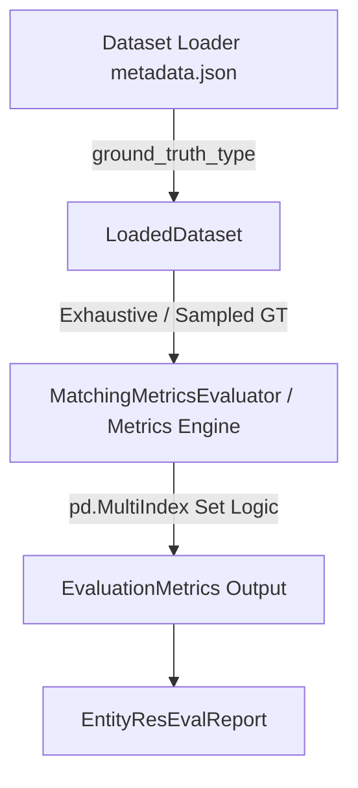
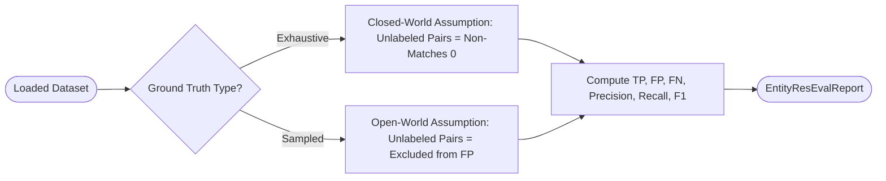

# Entity Resolution Evaluation & Benchmarking Strategy — Reference Documentation

---

## 1. Overview

This document details the mathematical, logical, and computational mechanics behind the evaluation step in the **Agentic AI for Data Integration** pipeline. It defines how evaluation metrics (Precision, Recall, F1 Score, Pairs Completeness, and Reduction Ratio) are calculated across different ground-truth dataset types (`exhaustive` vs `sampled`), explaining how the evaluation logic dynamically adapts to open-world vs. closed-world dataset assumptions.

---

## 2. Architecture

The evaluation pipeline is modularized across dataset loading, metric calculations, and stage-specific evaluators (indexing vs. matching vs. full pipeline).

* **Dataset Loader (`dataset_loader.py`)**: Parses dataset configurations and reads `ground_truth_type` (`exhaustive` or `sampled`).
* **Metrics Engine (`metrics.py`)**: Contains pure, stateless evaluation logic using standard `recordlinkage` and `pandas` set operations.
* **Evaluators (`benchmarking/index_evaluation.py` & `benchmarking/matching_evaluation.py`)**: Wraps evaluation metrics for candidate blocking (indexing) and pair classification (matching).
* **Evaluation Models (`evaluation_models.py`)**: Enforces strict Pydantic schemas for benchmark outputs.

---

## 3. Public API / Interface

### Ground Truth Dataset Classification Types (`GroundTruthType`)
- **`EXHAUSTIVE`**: The dataset's ground truth file contains the exhaustive list of all true positive matches within $A \times B$. Any candidate pair not present in ground truth is treated as a confirmed non-match (Negative).
- **`SAMPLED`**: Ground truth labels only a subset of the Cartesian product $A \times B$. Unannotated pairs have unknown status and are excluded from metric calculation.

### Metric Functions (`src/entity_resolution/metrics.py`)

#### `compute_precision_recall_f1`
- **Description**: Computes Precision, Recall, F1 Score, and Confusion Matrix arrays.
- **Inputs**:
  - `predicted`: Predicted match pairs (`pd.MultiIndex`, `DataFrame`, or `Set[Tuple[str, str]]`).
  - `ground_truth`: Target ground-truth positive pairs.
  - `total`: Optional total evaluated record pairs count (enables $TN$ calculation for exhaustive sets).
- **Outputs**: `EvaluationMetrics` object containing `precision`, `recall`, `f1`, `tp`, `fp`, `fn`, `tn`, `support`, and `confusion_matrix`.

---

## 4. Data Flow & Evaluation Mechanics

### Mathematical Definitions & Computation Rules

#### 1. Exhaustive Datasets (`ground_truth_type == "exhaustive"`)
* **Underlying Model**: Closed-World Assumption.
* **Match Definition**: $\text{GT} = \text{Set of all positive matches } (a, b) \in A \times B$.
* **Classification Breakdown**:
  * **True Positives ($TP$)**: $|\text{Predicted} \cap \text{GT}|$
  * **False Positives ($FP$)**: $|\text{Predicted} \setminus \text{GT}|$ (Any prediction not in GT is an error).
  * **False Negatives ($FN$)**: $|\text{GT} \setminus \text{Predicted}|$
  * **True Negatives ($TN$)**: $|A \times B| - (TP + FP + FN)$
* **Metrics**:
  $$\text{Precision} = \frac{TP}{TP + FP}, \quad \text{Recall} = \frac{TP}{TP + FN}, \quad F_1 = 2 \cdot \frac{\text{Precision} \cdot \text{Recall}}{\text{Precision} + \text{Recall}}$$

#### 2. Sampled Datasets (`ground_truth_type == "sampled"`)
* **Underlying Model**: Open-World Assumption.
* **Match Definition**: $\text{GT}$ contains explicit $1$ (Match) and $0$ (Non-Match) annotations for a restricted set of pairs $S \subset A \times B$.
* **Classification Breakdown**:
  * Unlabeled pairs $(a, b) \notin S$ are ignored during metric computation.
  * **True Positives ($TP_{labeled}$)**: Predictions that match labeled $1$ pairs in $S$.
  * **False Positives ($FP_{labeled}$)**: Predictions that match labeled $0$ pairs in $S$.
  * **False Negatives ($FN_{labeled}$)**: Missed pairs that were labeled $1$ in $S$.
* **Metrics**:
  $$\text{Precision}_{sampled} = \frac{TP_{labeled}}{TP_{labeled} + FP_{labeled}}, \quad \text{Recall}_{sampled} = \frac{TP_{labeled}}{\text{Total Labeled Matches in } S}$$

---

## 5. Related Modules

| Role | Module | Notes |
|---|---|---|
| Dependency | `src/entity_resolution/dataset_loader.py` | Defines `GroundTruthType` and parses `metadata.json`. |
| Dependency | `src/entity_resolution/metrics.py` | Implements core `recordlinkage` metric evaluation. |
| Consumer | `src/entity_resolution/benchmarking/matching_runner.py` | Executes matching model evaluations across datasets. |
| Consumer | `src/entity_resolution/benchmarking/runner.py` | Orchestrates full pipeline indexing + matching benchmark evaluations. |

---

## 6. Amendment Log

- **[2026-07-27]** Created initial evaluation benchmarking documentation defining exhaustive vs. sampled dataset behaviors and evaluation assumptions.
